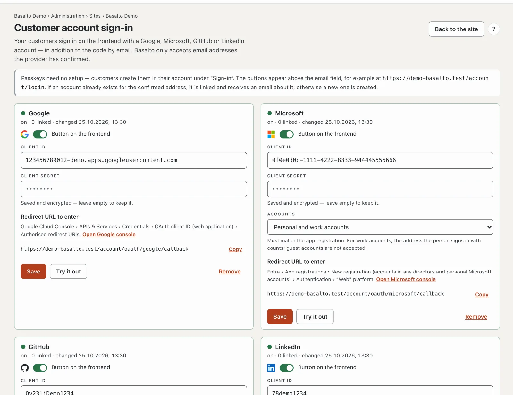
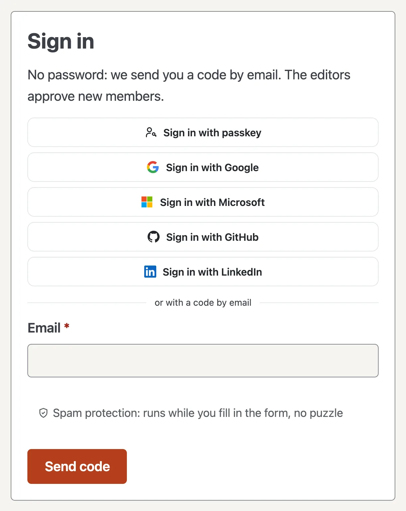

# Customer account sign-in

Your customers sign in on the frontend with a passkey or with a Google, Microsoft, GitHub or LinkedIn account — in addition to the code by email. This applies wherever the customer account is involved: forum, members, licence sales and marketplace.

## What it looks like on the frontend

“Sign in with passkey” and the buttons of the providers you have switched on appear above the email field, followed by “or with a code by email”.

- **If a customer account already exists for the address,** Basalto signs the person in to it and, the first time, links the provider account. The customer account receives an email about it (“New sign-in with Google”). From then on the ID at the provider counts — if someone changes their address there, sign-in keeps working.
- **Otherwise a new customer account is created** — but only if the site allows new accounts. If members are set to “invitation only”, only existing accounts can sign in with a provider.
- **In the account,** the **“Sign-in”** section shows the linked accounts. **Link** also works with an account that has a different address; **Disconnect** removes the link. The code by email always works.

## Code by email

Whoever enters their email address receives a six-digit code. The email shows it large in boxes and below it small as a row of digits — double-clicking it selects the whole code for copying.

- **One box per digit.** Typing moves on, backspace moves back; pasting or autofill on the phone fills in the whole code.
- **No button needed.** Once all six digits are in, sign-in continues by itself. A wrong code clears the boxes.
- **“Send code again”** counts down after each code and becomes available afterwards. How long is set under [Settings](einstellungen.md): group “Sign-in”, **“New code at the earliest after”** (default 30 seconds).
- Without JavaScript, a single field with “Sign in” remains.

## Passkeys

Passkeys need no setup. Anyone who is signed in creates one in the account under **“Sign-in” › Add passkey** — confirmed with fingerprint, face or device lock. After that, **“Sign in with passkey”** is enough, without any code.

- **The button only appears** if the browser supports passkeys; otherwise the code by email remains.
- **A passkey applies to the domain** on which it was created. If the site has several domains, your customers should create it on the main address.
- **Every new passkey** triggers an email to the account. **Remove** in the account deletes it on the site; the person deletes it on the device themselves.

## Setting it up

1. Open **Administration › Sites ›** your site **› Customer account sign-in**.
2. Create an app at the provider (instructions below) and enter the **redirect URL** from Basalto there — **Copy** takes it over exactly.
3. In Basalto, enter the **Client ID** and **Client secret**, switch on **Button on the frontend** and **Save**.
4. **Try it out:** you sign in with the provider once for real. Afterwards the result appears at the top, for example “Google confirmed the account …”. No customer account is created.

The site’s operator and the account’s owner and administrators may set this up. The buttons only appear if a module on the site uses the customer account (forum, members, licence sales or marketplace).

## Google

1. In the [Google Cloud Console](https://console.cloud.google.com), choose or create a project.
2. **APIs & Services › OAuth consent screen:** user type **External**, app name, support address and logo. Scopes: `openid`, `email`, `profile`. Then **publish** the app — in testing mode only listed test users can sign in.
3. **Credentials › Create credentials › OAuth client ID**, application type **Web application**.
4. **Authorised redirect URIs:** the redirect URLs from Basalto.
5. Enter the **Client ID** (ends in `.apps.googleusercontent.com`) and the **Client secret** in Basalto.

## Microsoft

1. In the [Microsoft Entra admin center](https://entra.microsoft.com), go to **App registrations › New registration**.
2. **Supported account types:** “Accounts in any organisational directory and personal Microsoft accounts” — then choose “Personal and work accounts” under **Accounts** in Basalto. Or “Personal Microsoft accounts only” — then “Personal accounts only” in Basalto. Both settings must match.
3. **Redirect URI:** platform **Web**, the redirect URL from Basalto. Add further addresses under **Authentication**.
4. Copy the **Application (client) ID** from the overview. Under **Certificates & secrets › New client secret**, copy the **value** (not the ID) and enter it. Note the expiry date and enter a new secret in good time.
5. **API permissions:** Microsoft Graph, delegated: `openid`, `profile`, `email`, `User.Read`.

**Which address counts:** for personal accounts the address of the Microsoft account, for work accounts the sign-in name (UPN) — not the “Email” field, which a directory’s administrators can set freely. Guest accounts (`…#EXT#@…`) are rejected.

## GitHub

1. **GitHub › Settings › Developer settings › OAuth Apps › New OAuth App** — for an organisation, under its settings.
2. **Homepage URL:** the site’s address. **Authorization callback URL:** the redirect URL of the main address — GitHub accepts only one address per app.
3. Copy the **Client ID**, click **Generate a new client secret** and enter the secret.

With GitHub, Basalto only accepts the account’s confirmed primary address.

## LinkedIn

1. At [LinkedIn Developers](https://www.linkedin.com/developers/apps), click **Create app** — this needs a LinkedIn page for your company.
2. Under **Products**, add “Sign In with LinkedIn using OpenID Connect”.
3. **Auth › Authorized redirect URLs:** the redirect URL from Basalto. Enter the **Client ID** and **Primary Client Secret**.

## Security and data protection

- **Only confirmed addresses count.** If the provider does not report that the email is confirmed, Basalto rejects the sign-in — otherwise someone could take over an existing account with somebody else’s address.
- **No provider learns anything before the click:** the buttons are ordinary links; nothing loads from Google and the like. The redirect uses `state`, with Google and Microsoft also PKCE; the return only counts with a matching session.
- **Spam protection:** if Stop Forum Spam is switched on (see [Settings](einstellungen.md)), Basalto also checks new accounts created through a provider.
- **The client secret** is stored encrypted in the database, never goes to the browser, never into the log and not into a site export. The log records “Customer account sign-in set up” and “… removed”.
- **Data access and erasure** list or remove a customer account’s links and passkeys.
- **Privacy policy:** if you switch providers on, name them in the site’s privacy policy as recipients during sign-in.

### Data protection in the customer account

The customer account has a **Data protection** section — the rights under the GDPR and the FADP for people to exercise
themselves, always only for this site:

- **Download data** (access, portability): everything about the account on this site as a JSON file — account, linked
  accounts, passkeys, community, comments, form submissions, licences and purchases. Accounts with the same address on
  other sites and the backend account are not included.
- **Correct details:** name, company and address; the team changes the email address on request.
- **Consents:** cookie settings and consent to the community terms, each with withdrawal.
- **Requests** (rectification, restriction, objection, other): arrive with a one-month deadline under
  **Administration › Data protection**; bell and email go to everyone who can see the “Data protection requests” area.
  “Complete and answer” sends the answer by email; the number in the menu shows the open ones.
- **Delete account:** confirmed with the email address — not while a contract is running (SaaS subscription, Agency
  licence). Invoices remain without the person, community posts without a name; the confirmation arrives by email.

Cancellations without signing in go through “Cancel contracts here” in the site footer.

## If something goes wrong

| Sign | Cause | Solution |
| --- | --- | --- |
| `redirect_uri_mismatch` (Google), AADSTS50011 (Microsoft), “redirect_uri is not associated” (GitHub) | The redirect URL is missing at the provider or differs | Enter the address from Basalto exactly; behind a proxy, check for `https` |
| “… has not confirmed your email address” | The address is not confirmed at the provider (GitHub: no confirmed primary address) | Confirm it there or sign in with the code by email |
| “Guest accounts in another directory are not accepted” | Microsoft guest account | Sign in with your own account |
| “… by invitation only” | The site does not create new accounts | Invite the person — then it works |
| “The sign-in has expired” | Return on a different host, cookie blocked or waited too long | Start again from the same address |
| “This site doesn’t know this passkey” | Passkey removed from the account or created on a different domain | Sign in with the code by email and create the passkey again |
| No buttons visible | Provider switched off or no module uses the customer account | Check the switch, switch the module on |

## Next

- [Sites](sites.md)
- [SSO for backend users](../betrieb/sso.md)
- [Settings](einstellungen.md)
- [Profiles and conversations](../community/profile.md)
