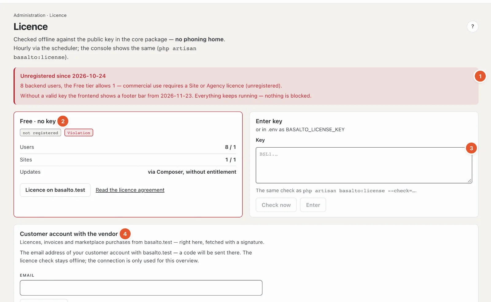

# Licence

Under **Licence** you see which tier the installation runs on and whether it keeps within the limits, and you enter the key. Basalto checks the licence **offline** — without calling home — and **never locks** a function.

## Where

“Administration” mode › **Licence**.

1. **Note at the top** — if the installation is unregistered, it says since when and why, for example “3 backend users, the Free tier allows 1”, and from when the front end shows a footer bar. “Everything keeps running — nothing is locked.”
2. **The licence card** — tier (for example “Free · without key”), labels **“registered”/“not registered”** and **“compliant”/“violation”**, then **users** and **sites** (used / allowed), **updates** (until when new versions are included). With a key also licensee, domains, issue date and key ID; for an agency sub-licence the customer. Links “Licence on …” (buy or renew) and “Read the licence agreement”.
3. **Enter key** — paste the key, **“Check now”** shows the result without entering anything; **“Enter”** applies it. An invalid key is not entered. **“Remove key”** goes back to Free. Only owners enter keys. If the key is in the installation’s `.env` file, the card says so — the entry in the backend takes precedence.
4. **Customer account with the vendor** — see below.

## Tiers

| Tier | In short |
| --- | --- |
| **Free** | without a key: one site, one backend user, all modules — for development, tests and private use |
| **Site** | one production domain, up to three sites in one installation; new versions for one year from purchase |
| **Agency** | all sites and installations for you and your customers; one sub-licence key per customer, optionally without the Basalto brand in the backend |

**Violation** means: the installation exceeds its tier — more users or sites than allowed, or a domain that is not in the key. It then counts as unregistered. After **30 days** unregistered the front end shows a slim footer bar; nothing more happens. If the update entitlement has expired, the software keeps running; new versions need a renewal.

## Customer account with the vendor

Whoever bought a licence on basaltocms.com sees keys, invoices and marketplace purchases directly here (owners only):

1. Enter the customer account’s **email address**, **“Request code”**. If there is an account, a six-digit code arrives at this address.
2. Enter the **code**, **“Connect”**.
3. Once connected, the card shows the **licences** (with “Use this key”), the **invoices** as PDF and the **purchases** in the marketplace. “Refresh” fetches the latest state, “Disconnect” ends the connection.

The licence check stays offline; the connection is only for this overview. Details for the technical side: [Licence](../betrieb/lizenz.md).

## Frequently asked questions

**Do I have to buy a licence right away?**
No. Free is enough for development, tests and private use. Commercial use with more people or sites needs a Site or Agency licence; until then the footer bar appears after 30 days.

**“Enter” is locked.**
Only owners enter keys — or the field is still empty.

## Next

- [Licence](../betrieb/lizenz.md)
- [Updates](updates.md)
