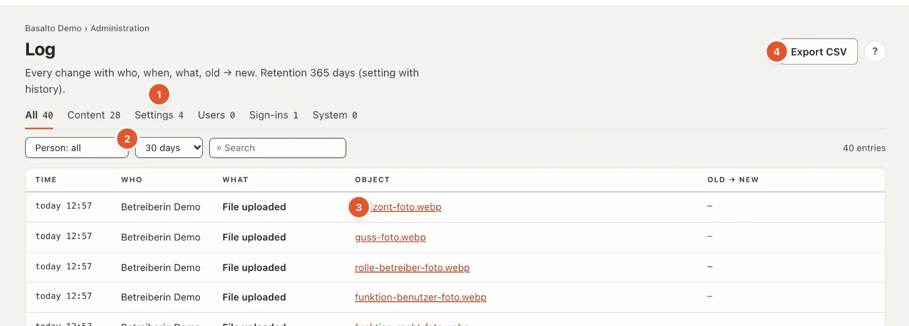

# Activity log

The **activity log** records who changed what and when — with the value before and after. That way every change can be traced, even after months.

## Where

“Administration” mode › **Activity log**. At the top it says how long entries are kept (365 days by default, setting “Keep activity log”).

1. **Kinds** — “All”, “Content”, “Settings”, “Users”, “Sign-ins”, “System”, each with the number of entries.
2. **Person** — only the entries of one person; **period** — 1, 7, 30, 90 or 365 days or “total”; **search** in the text of the entries.
3. **The entries** — time, who, what, object (with “open” where the object still exists) and **old → new**.
4. **“Export CSV”** — the entries with the filters set, as a table.

Long lists are paged with “Newer” and “Older”. “Reset filters” shows everything again.

## The history of an item

The **“History”** link on an item or a setting opens the activity log filtered to this object — at the top it then says **“only: …”**. With “Remove content filter” (×) you see all entries again.

## What is logged

- **Content** — create, change, submit, approve, publish, delete, restore.
- **Settings** — every change of a value, themes, roles, modules.
- **Users** — invitations, roles, deactivating, deleting, information.
- **Sign-ins** — successful sign-ins and sessions.
- **System** — cleanup, publications, backups, jobs.

If a person is deleted, their entries stay — **anonymised**: a placeholder appears instead of the name. Nothing is removed from the log except by the retention period.

## Frequently asked questions

**An entry is missing.**
Check the period — by default the list shows the last 30 days. “total” shows everything that is still kept.

## Next

- [Users](benutzer.md)
- [Settings](einstellungen.md)
