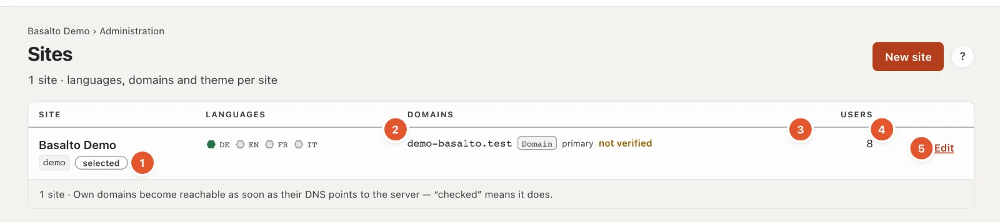

# Sites

One installation can run several websites — each with its own languages, domains, theme and content, managed in the same backend.

## Where

“Administration” mode › **Sites**.

One row per site:

1. **Site** — name and handle; “selected” marks the site you are working in.
2. **Languages** — one hexagon per language: filled green for the default language, a green ring for required languages, grey for optional ones. Hovering names the language’s role and fallback.
3. **Domains** — the site’s addresses with their kind (alias, own domain, redirect), “primary” for the main address and “checked” or “not checked”. Checked means: the domain’s DNS points to the server.
4. **Users** — how many people have a role in the site.
5. **“Edit”** opens the site; **“Switch”** (for the other sites) makes it the current site in the whole backend.

**“New site”** creates another site: name, handle, default language and theme, then “Save and close”. How many sites are allowed is set by the [licence](lizenz.md). In the subscription, the account’s owner and administration create new sites under “Account › Sites”.

## Editing a site

What the four tabs “General”, “Languages”, “Domains” and “Modules” contain is explained in the setup help: [The site](../einrichtung/site.md). Plus at the top right:

- **“Sign-in via SSO”** — set up sign-in via Microsoft Entra ID or Google Workspace (see [SSO](../betrieb/sso.md)).
- **“Customer account sign-in”** — customers sign in on the frontend with Google, Microsoft, GitHub or LinkedIn (see [Customer account sign-in](kundenanmeldung.md)).
- **“Download export”** — the whole site as a ZIP: content as JSON and all media, in the same format as the import; without form submissions and members (personal data). For a copy or a move to another installation. An export does not replace a backup of the whole installation (see [Operations](betrieb.md#backups)).

## Frequently asked questions

**I don’t see “New site”.**
Your role does not allow editing the area “Settings, modules and sites” — or the installation runs in the subscription; then the account creates new sites.

**How do I delete a site?**
Currently neither in the backend nor in the console. If you no longer want to run a site, take its domains away and download the export to be safe.

## Next

- [The site](../einrichtung/site.md)
- [Users](benutzer.md)
