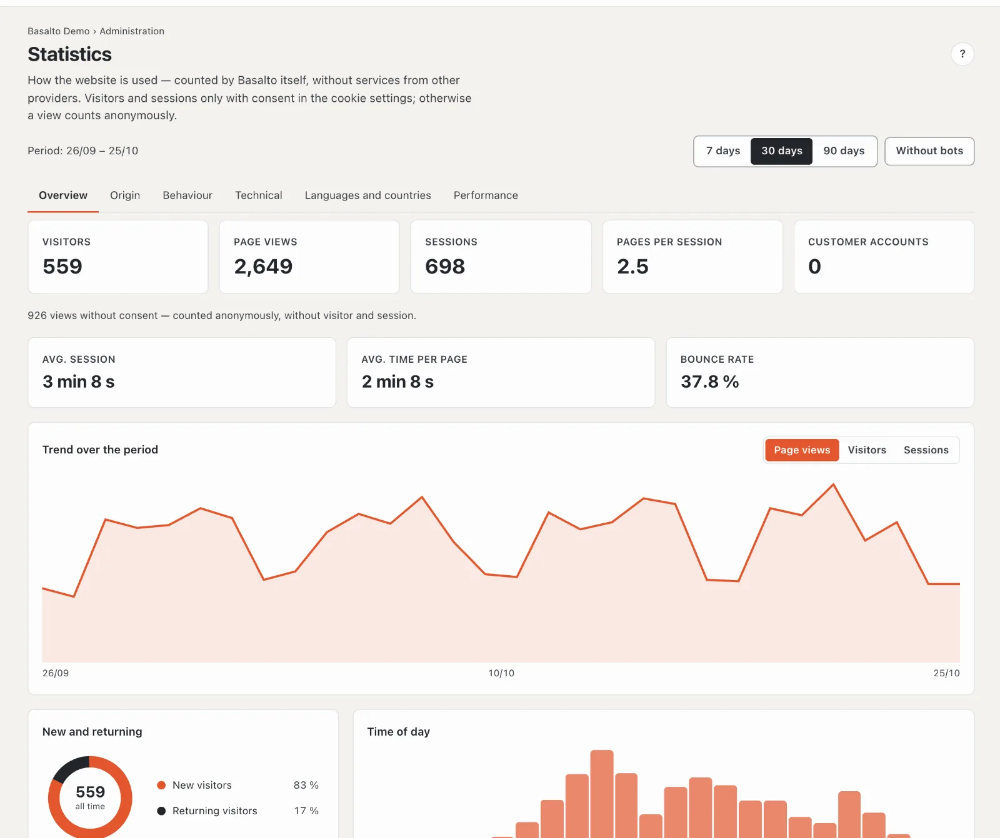
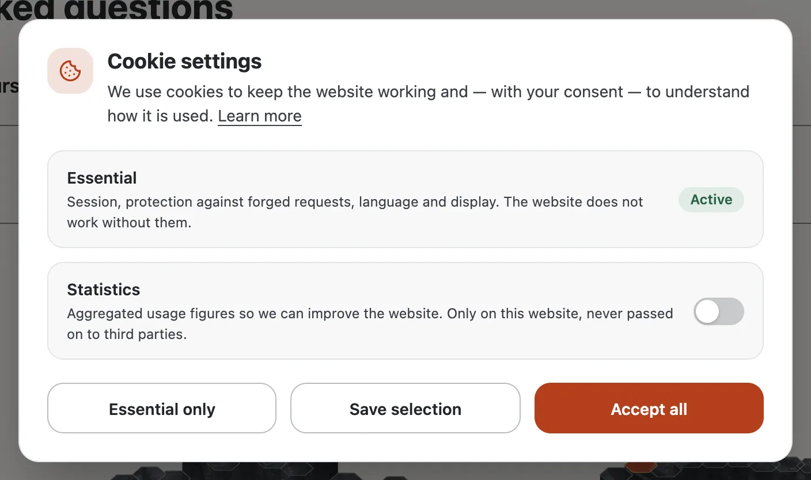

# Statistics

Basalto counts for itself how your website is used — without services from other providers, without scripts from other servers and without IP addresses. Under **Administration › Statistics** you see visitors, page views, acquisition, most visited pages, technology, languages and response times of the selected site.

## What is counted

- **Every page view** of the website counts — including pages served quickly from the page cache. Not counted: browser prefetching, error pages and people signed in to the backend (you and your team).
- **Without consent** a view counts **anonymously**: page, referrer (host only), browser, system, device and language — no cookie and no identifier. Page views are accurate, but visitors and sessions are missing.
- **With consent** in the cookie settings the browser creates two random identifiers: one for the visitor (one year) and one for the session (30 minutes without activity). Basalto then counts visitors, sessions, time on site, bounces and entry and exit pages. A browser with “Global Privacy Control” always counts anonymously.
- **No IP address** and **no query string** are stored — from `?utm_source=…` Basalto only takes source, medium and campaign.
- **The country** only appears if an upstream service such as Cloudflare passes it on.

## Reading the statistics

At the top you choose the **period** (7, 30 or 90 days) and whether **bots** count. Clicking a page, referrer, browser, device, country or language **filters the whole report**; the selection appears at the top and can be removed one by one.

| Tab | Content |
| --- | --- |
| **Overview** | Visitors, page views, sessions, pages per session, customer accounts; avg. session, avg. time per page, bounce rate; trend over the period, new and returning visitors, time of day |
| **Acquisition** | Channels (direct, search engines, social networks, campaigns, referrals), referrals and campaigns (UTM) |
| **Behaviour** | Most visited pages, entry and exit pages, recent views |
| **Technology** | Devices, browsers and operating systems |
| **Languages and countries** | Language of the pages viewed and countries |
| **Performance** | Server response time (avg., p50, p90, p99), slowest pages and bots |

Days and hours follow the site’s time zone.

## Cookie settings

If a site counts visits, the **cookie settings** ask for consent on the first visit:

- **Essential** is always active (session, protection against forged requests, language, display).
- **Statistics** is off by default — pre-ticked consent would not be valid. If the theme embeds services from other providers, **External content** is added.
- **Essential only**, **Save selection** and **Accept all** are the same size and equally easy to reach.
- The choice applies for one year. Visitors can change it at any time via **Cookie settings** in the footer; “Learn more” leads to the site’s privacy policy in the language of the page — the page the theme names under `publish { legal { datenschutz: … } }` (otherwise the page at `/datenschutz`), at the address it has in that language. If it is not published, the link is left out.

## Switching on, switching off, retention

- **Administration › Settings › Statistics › Count visits** — per site, on by default. When switched off no views are added, and the cookie settings only appear if the theme embeds services from other providers.
- **Administration › Settings › Retention › Keep statistics** — 400 days by default; the nightly cleanup deletes older views.
- **Who sees the statistics** is set by the role (area “Statistics”); by default operator and administrator.
- **Data access and erasure** for a person detach their views from the customer account; the figures remain anonymously. A site export does not include the statistics.
- **Privacy policy:** mention your own statistics and the cookie settings in the site’s privacy policy.

## For themes

A link to `#cookie-einstellungen` opens the cookie settings from anywhere. The bundled themes place it in the footer, hidden until the settings are on the page (`data-cookie-link hidden`). Scripts from other providers sit in the theme as `<script type="text/plain" data-consent …>` and `publish { cookie: consent }` declares them — they only run after consent to “External content”.

## Next

- [Settings](einstellungen.md)
- [Roles](rollen.md)
- [Customer account sign-in](kundenanmeldung.md)
- [Lava](../entwickler/lava.md)
