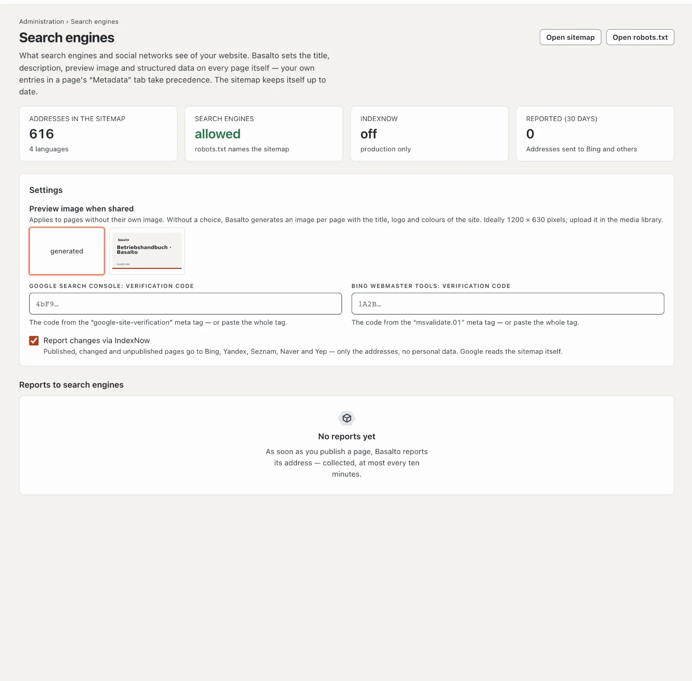

# Search engines

Basalto prepares every public page itself so that search engines and social networks understand it: title,
description, preview image, language versions, structured data and the sitemap. Under **Administration › Search
engines** you see what arrives, and you set the few details Basalto cannot know by itself.

## What Basalto sets on every page itself

You do not need to do anything for this — neither in editing nor in the theme. Whatever you enter yourself in a
page's settings on the **Metadata** tab always takes precedence.

| Detail | Where it comes from |
| --- | --- |
| **Title** | page title with the theme's suffix (such as “· Site name”) — without the suffix if the name is already in the title |
| **Description** | your own description, otherwise the introduction, otherwise the first paragraph of the content — shortened to about 160 characters at a word boundary |
| **Preview image** | page image, otherwise the first image in the content, otherwise the site's preview image, otherwise an image Basalto generates itself |
| **Canonical address** | the page's address in this language; views with their own content (an entry in the marketplace) keep their parameter |
| **Language versions** | every language with its own version, plus the default language as the default (`hreflang`) |
| **Structured data** | website and organisation with logo on the home page, page and breadcrumbs everywhere, article with date and author for posts; modules add their own (event, job, forum post, software in the marketplace) |
| **Sitemap** | `/sitemap.xml` with one sitemap per language, every address with its last change, language versions and page image — up to date by itself |
| **robots.txt** | allows search engines everything except the back office and names the sitemap |

Pages for members only, drafts, redirects and pages with “noindex” are neither in the sitemap nor in the index.

## The preview image for shared links

When someone shares a link to your website — in a message, on LinkedIn or Facebook — the preview shows an image. If a
page has no image of its own, Basalto takes the site's **Preview image when shared**. If none is chosen either,
Basalto generates one per page: 1200 × 630 pixels with the page title, the logo and the address in your theme's colours.

1. Upload an image to the **Media library** — ideally 1200 × 630 pixels, as JPEG, PNG or WebP.
2. Open **Administration › Search engines** and choose it under **Preview image when shared**. It saves itself.

## Registering with Google

Google finds the sitemap by itself via `robots.txt`. In **Google Search Console** you also see which pages are in the
index, which search terms bring visitors and whether Google reports errors.

1. Open Google Search Console and add a **property** of the type **URL prefix** — your website's address, such as
   `https://www.example.com/`.
2. Choose **HTML tag** as the verification method and copy the tag.
3. Paste it in Basalto under **Administration › Search engines › Google Search Console: verification code** — the whole
   tag or just the code from `content="…"`.
4. Click **Verify** in Search Console.
5. Under **Sitemaps**, submit the address `sitemap.xml`.

The same applies to **Bing Webmaster Tools** with the `msvalidate.01` tag; Bing can also import a verified website from
Search Console.

## Reporting changes with IndexNow

When you publish a page, change it or take it offline, Basalto reports its address via **IndexNow** to Bing, Yandex,
Seznam, Naver and Yep — collected, at most every ten minutes. Only addresses are reported, no personal data. Basalto
generates the key IndexNow requires itself and serves it at the site's address. The list **Reports to search engines**
shows what has been reported.

IndexNow only reports when the site is **live**, search engines are allowed and Basalto runs **in production** — a
test environment never reports. You can switch it off under **Report changes via IndexNow**. Google does not take
IndexNow; Google reads the sitemap.

## How search engines use your website

How many visits come from search engines, which pages they land on and how often Googlebot and other crawlers drop by
is shown on the **Search engines** tab under [Statistics](statistik.md).

## If something goes wrong

| Sign | Cause | Solution |
| --- | --- | --- |
| **Search engines: not allowed** | The theme blocks search engines (`publish { robots: disallow }`) or it is a test environment | adjust the theme; test environments stay blocked on purpose |
| **IndexNow: off — production only** | Basalto runs locally or in a test environment | intended; in production it reports by itself |
| Search Console does not find the tag | code not saved yet, or the page still comes from a cache | check the code, wait a minute, verify again |
| The preview shows an old image | networks keep previews for a while | have it fetched again in the network's tool (e.g. Facebook “Sharing Debugger”) |

## Next

- [Statistics](statistik.md)
- [Pages and page tree](../redaktion/seiten.md)
- [Going live](../einrichtung/live-gehen.md)
- [Settings](einstellungen.md)
