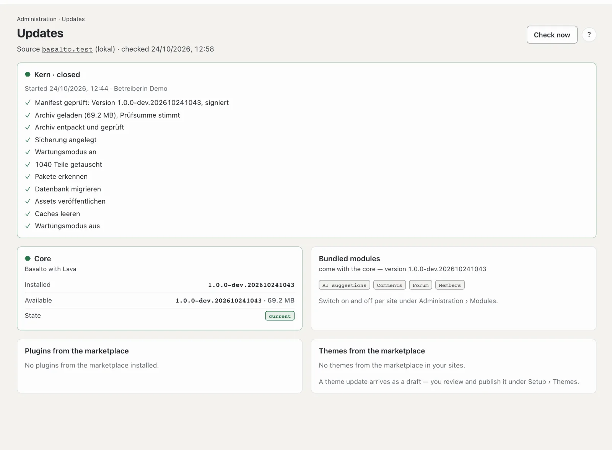

# Updates

**Updates** shows whether Basalto is up to date: the core, the bundled modules, plugins and themes from the
marketplace. If there is something new, you install it from here — with a backup and a way back.

## Where

“Administration” mode › **Updates**. The number next to the entry is the count of available updates from the last
check.

At the top you see the **source**, the vendor Basalto asks:
- `basaltocms.com` for production and the demo,
- `testing.basaltocms.com` in test environments,
- `basalto.test` in local development.

Basalto checks once a day by itself. **“Jetzt prüfen”** (check now) gets the state at once. If there is something new,
a notification appears in the bell and, if set, by mail — once for every new state.

With the check, Basalto sends **usage data** to the vendor: a random ID of this installation, the version, the PHP
version and the type of database. Addresses, content and personal data are not sent; the vendor only stores a hash of
the ID and uses it to count active installations and versions. Switch it off under **Settings** › Operations › “Usage
data for the vendor” — the update check then runs without this data.

## The cards

| Card | What it shows | What to do |
| --- | --- | --- |
| **Core** | installed and available version, size, “What’s new?” | “Update to …” |
| **Bundled modules** | forum, comments, members, AI … — they come with the core | switch on and off per site under **Modules** |
| **Plugins from the marketplace** | installed and new version per plugin | “Update” |
| **Themes from the marketplace** | per site the theme with installed and new version | “Load as draft” |

## Updating the core

After “Update to …” you confirm. Basalto then works step by step; the page shows every step:

1. Download the archive and check the signature — only releases signed by the vendor
2. Back up database and media
3. Maintenance mode — the website briefly shows a maintenance page, you keep working
4. Swap files, migrate the database, renew assets and caches
5. Maintenance mode off

**If a step fails, the old files come back.** The database stays as it is — Basalto’s migrations are built so that
the old state also runs with them.

Untouched: `.env`, storage (media, backups, logs), the database file and your own themes.

## Themes

A theme update arrives **as a draft**: you look at the changes in the preview under Setup › Themes and publish only
then. A paid theme needs the e-mail and token of your customer account with the vendor.

## Plugins

Basalto installs plugins from the marketplace just like the core: signed archive, backup, swap, migrations, way back.
This needs the e-mail and token of your customer account with the vendor (as for Composer).

## If “install” is missing

- **Git working copy or Composer:** If Basalto was set up with Git or Composer, the page only checks. It shows the
  command to run on the server.
- **Subscription (SaaS):** In a subscription the operator installs core and plugins. You only see the themes of your
  site here.
- **No write permission:** The page names the folder — technical staff set up the permissions.

## Update entitlement

If the update entitlement of your licence has expired, a notice appears on the page. Basalto keeps running and nothing
is blocked; new versions come with the renewal (see [Licence](lizenz.md)).

The technical side — command `basalto:update`, source per environment, restoring by hand — is in the
[operations docs](../betrieb/updates.md).

## Next

- [Updates](../betrieb/updates.md)
- [Backup](../betrieb/backup.md)
