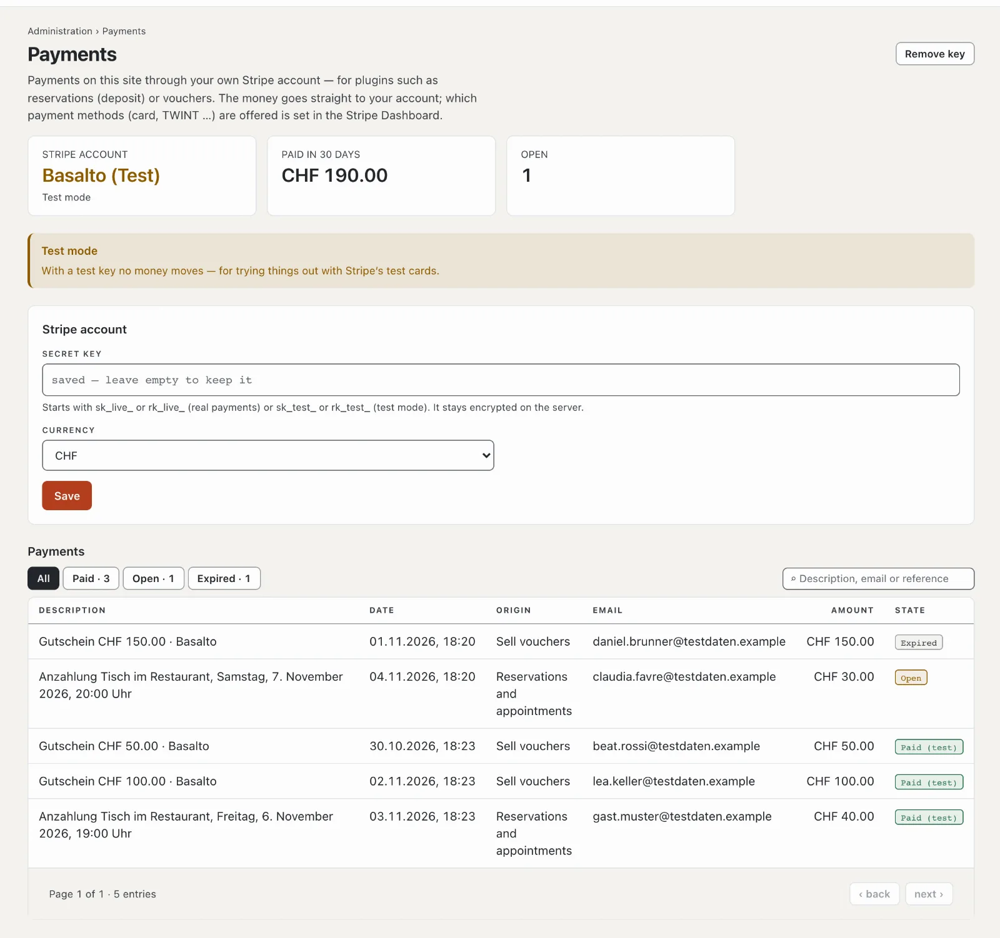

# Payments

Plugins such as “Reservations and appointments” (deposit) and “Sell vouchers” accept payments — through your own
Stripe account. Under **Administration › Payments** you connect it and see all payments of the site. The money goes
straight to your account; Basalto is not involved.

## Connect the Stripe account

1. Open an account with Stripe (or use your existing one) and copy the **secret key** in the Stripe Dashboard under
   **Developers › API keys** — it starts with `sk_live_`. A restricted key (`rk_live_`) with write access to
   “Checkout Sessions” is enough.
2. Paste it under **Administration › Payments**, choose the **currency** (CHF or EUR), **“Save”**.
3. Basalto asks Stripe straight away whether the key is valid and shows the name of the account.

The key stays encrypted on the server and never goes back to the browser; left empty, the stored one remains.
**“Remove key”** disconnects the account — new payments then no longer work, existing ones stay in the list.

## Try it out in test mode

With a test key (`sk_test_…`) no money moves; you pay with Stripe’s test cards. The page shows **“Test mode”**, and
paid payments appear as **“Paid (test)”**. For real operation you swap the key for the `sk_live_…`.

## How a payment works

1. A guest reserves or buys; Basalto creates the payment and forwards to Stripe.
2. There they pay with the payment methods you have switched on in the Stripe Dashboard — card, TWINT and others.
3. Back on your site, Basalto asks Stripe for the state. If the guest closes the window beforehand, Basalto fetches
   the state itself every five minutes — this needs the installation’s schedule ([Operations](betrieb.md)).
4. If a checkout expires without payment, the plugin releases the place or the order.

You handle refunds and payouts in the Stripe Dashboard.

## The list of payments

At the top are the account (real payments or test mode), what was paid in the last 30 days and how many payments are
open. The list shows date, description, origin (the plugin), email, amount and state — **Paid**, **Open** or
**Expired** —, with a search and a filter.

## Who sees payments

The area is called **“Payments”** ([Roles](rollen.md)); by default operator and administrator have it.

## Next

- [“Reservations and appointments” plugin](../marktplatz/plugin-reservierungen.md)
- [“Sell vouchers” plugin](../marktplatz/plugin-gutscheine.md)
- [Roles](rollen.md)
