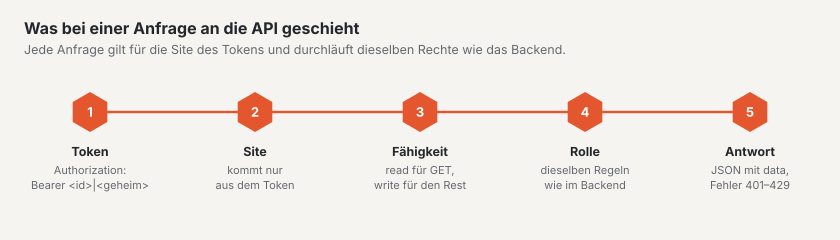

# REST-API

Basalto hat eine REST-API für Inhalte samt Freigabe, Medien und Menüs. Sie spricht JSON, gilt immer für genau eine
Site und prüft dieselben Rechte wie das Backend. Basis-Adresse: `https://<ihre-site>/api/v1`.



## Ein Token anlegen

1. Im Backend Ihr Profil öffnen (Menü unter Ihrem Namen) › Reiter **«API-Tokens»**.
2. **Name**, **Site** und **Fähigkeiten** wählen: `read` für Lesen (`GET`), `write` für Schreiben (`POST`, `PATCH`,
   `PUT`, `DELETE`). Optional ein **Ablaufdatum** — es gilt bis zum Ende des Tages in der Zeitzone Ihres Profils.
3. Das Token erscheint **genau einmal**. Kopieren Sie es und legen Sie es sicher ab; Basalto speichert nur eine
   Prüfsumme.

## Wie die API entscheidet

- **Site:** Jedes Token gehört zu genau einer Site. Die Site einer Anfrage kommt nur aus dem Token — es gibt keinen
  Parameter dafür. Inhalte anderer Sites sind für das Token nicht vorhanden (404).
- **Rechte:** Erst die Fähigkeit des Tokens (`read`, `write`), dann die **Rolle** der Person in der Site — dieselben
  Regeln wie im Backend: Die Redaktion legt an und reicht ein, die Freigabe gibt frei und veröffentlicht, das
  Vier-Augen-Prinzip gilt auch hier.
- **Ungültig** ist ein Token, wenn es widerrufen oder abgelaufen ist (401), wenn die Person nicht mehr zur Site gehört
  oder ihr Konto deaktiviert ist (403). Eine Sitzung im Backend ersetzt kein Token (401).
- **Grenze:** 120 Anfragen je Minute und Token; die Kopfzeilen `X-RateLimit-*` zeigen den Stand, darüber kommt 429 mit
  `Retry-After`. Die Grenze steht in der Konfiguration unter `basalto.api.per_minute`.

```bash
export TOKEN='<id>|<geheim>'          # aus dem Profil
export B=https://ihre-site.ch/api/v1
H=(-s -H "Authorization: Bearer $TOKEN" -H 'Accept: application/json')
```

## Antworten und Fehler

- **Erfolg:** JSON mit `data`; Listen zusätzlich mit `links` (`first`, `last`, `prev`, `next`) und `meta`
  (`current_page`, `per_page`, `total`, `last_page`). Zeiten in ISO 8601 (UTC). Löschen antwortet `204` ohne Inhalt.
- **Fehler:** `401`, `403` und `404` mit `{"message": "…"}`; `422` mit `{"message": "…", "errors": {"feld": ["…"]}}`.
  Verstösse gegen die Freigabe (Übergang, Vier-Augen-Prinzip, Pflichtsprachen, Slug, Alt-Text) stehen unter
  `errors.workflow`.

```bash
curl -s -o /dev/null -w "%{http_code}\n" -H 'Accept: application/json' $B/entries        # 401 ohne Token
```

## Inhalte

| Methode und Pfad | Fähigkeit · Recht | Zweck |
|---|---|---|
| `GET /entries` | read · gehört zur Site | Liste, neueste zuerst; Filter `type`, `status`, `locale`, `q` (Titel), `updated_since` (ISO 8601, `+` als `%2B` oder `Z`), `per_page` (1–100, Vorgabe 25), `page` |
| `GET /entries/{id}` | read · gehört zur Site | ein Inhalt mit neuester und veröffentlichter Fassung je Sprache; mit `?locale=xx` dazu `data.locale`: die Fassung, die Gäste sehen (`published`, entlang des Fallbacks der Site, mit `resolved`, `fallback`, `url`), und der neueste Stand dieser Sprache (`latest`) |
| `POST /entries` | write · Inhalte bearbeiten | neuer Inhalt eines Typs aus dem Theme (`type`, `title`, optional `slug`, `intro`, `content`, `fields`); die erste Fassung ist ein Entwurf in der Standardsprache. Seiten entstehen im Seitenbaum des Backends |
| `PATCH /entries/{id}` | write · bearbeiten oder übersetzen | ändern in `locale` (sonst Standardsprache); was fehlt, kommt aus der neuesten Fassung. Ist sie ein Entwurf, wird er weitergeschrieben — sonst entsteht ein neuer Entwurf, wie beim automatischen Speichern im Editor |
| `POST /entries/{id}/workflow/{schritt}` | write · je Schritt | `submit`, `withdraw` (bearbeiten); `approve`, `reject` mit `comment` (freigeben); `schedule` mit `at`, `unschedule`, `publish`, `unpublish` (veröffentlichen); jeweils in `locale` |
| `DELETE /entries/{id}` | write · bearbeiten | in den Papierkorb (wiederherstellen im Backend) |

```bash
curl "${H[@]}" "$B/entries?per_page=2"
# {"data":[{"id":8,"type":"post",…},{"id":7,"type":"person",…}],
#  "links":{…,"next":"https://ihre-site.ch/api/v1/entries?per_page=2&page=2"},
#  "meta":{"current_page":1,"per_page":2,"total":6,"last_page":3,…}}

curl "${H[@]}" "$B/entries/2?locale=en"
# data.locale: requested "en", resolved "de", fallback true, published.title "Über uns"

curl "${H[@]}" -X POST -H 'Content-Type: application/json' \
  -d '{"type":"post","title":"Aus der API","fields":{"category":"Neuigkeiten"}}' $B/entries      # 201

curl "${H[@]}" -X POST -H 'Content-Type: application/json' -d '{"locale":"de"}' $B/entries/309/workflow/submit

curl "${H[@]}" -X DELETE $B/entries/309                                                      # 204
```

## Medien

| Methode und Pfad | Fähigkeit · Recht | Zweck |
|---|---|---|
| `GET /media` | read · gehört zur Site | Liste; `q` (Name, Titel, Urheber), `type` (`image`, `document`), `folder_id`, `per_page` |
| `GET /media/{id}` | read · gehört zur Site | Datei, Titel, Urheber, Alt-Text je Sprache, Masse, Fokuspunkt, Stand der Bildvarianten, `file_url` |
| `GET /media/{id}/file` | read · gehört zur Site | die Originaldatei |
| `POST /media` | write · Inhalte bearbeiten oder Medien verwalten | hochladen (multipart `file`, optional `folder_id`) — dieselben Prüfungen wie im Backend: Typ und Grösse, Speicherplatz, SVG ohne Skript; die Bildvarianten entstehen danach im Hintergrund |
| `PATCH /media/{id}` | write · wie hochladen | nur Genanntes ändern: `title`, `credit`, `alt` je Sprache der Site |
| `DELETE /media/{id}` | write · Medien verwalten | in den Papierkorb |

```bash
curl "${H[@]}" -F "file=@team.jpg;type=image/jpeg" $B/media
# 201 {"data":{"id":4,"name":"team.jpg","width":1600,"height":1000,"variants_state":"pending","alt":{"de":null,"en":null},…}}

curl "${H[@]}" -X PATCH -H 'Content-Type: application/json' -d '{"alt":{"de":"Das Team vor dem Büro"}}' $B/media/4
```

## Menüs

| Methode und Pfad | Fähigkeit · Recht | Zweck |
|---|---|---|
| `GET /navigation` | read · gehört zur Site | die Menüs des Themes: `handle`, `label`, `source` (`pages`, `type`, `db`, `theme`), `editable`, `depth` |
| `GET /navigation/{menü}` | read · gehört zur Site | in `locale`: `items` wie auf der Website (`label`, `href`, `new_window`, `entry_id`, `children`), `raw` die gespeicherten freien Einträge |
| `POST /navigation/{menü}/items` | write · Inhalte bearbeiten | freier Eintrag in einem frei gepflegten Menü: `kind` (`entry` mit `entry_id` oder `url` mit `url`), `label` je Sprache, `parent_id`, `visible`, `new_window` |
| `PUT /navigation/items/{id}` | write · Inhalte bearbeiten | ändern, mit allen Feldern wie beim Anlegen |
| `DELETE /navigation/items/{id}` | write · Inhalte bearbeiten | löschen; Untereinträge rücken nach |

```bash
curl "${H[@]}" -X POST -H 'Content-Type: application/json' \
  -d '{"kind":"url","url":"https://example.com","label":{"de":"Partner"},"new_window":true}' $B/navigation/footer/items   # 201
```

## Formulare ohne Seitenwechsel

Seiten mit einem Formular (``) bekommen ein kleines eingebettetes Skript. Es sendet das Formular mit
`fetch` und `Accept: application/json`:

- **Erfolg:** `200 {"message": "<Danke-Text>", "redirect": null}` — der Danke-Text ersetzt das Formular in einer Fläche
  mit `role="status"`. Hat das Formular eine Weiterleitung (`redirect: -> /danke`), geht der Browser dorthin.
- **Fehler:** `422` mit `errors` — eine Liste oben im Formular (`role="alert"`), die Meldung am Feld mit
  `aria-invalid` und `aria-describedby`, der Fokus auf dem ersten fehlerhaften Feld.
- **Spam** (Lockfeld, Zeitprüfung, fünf Sendungen je Minute und Adresse) bekommt dieselbe Antwort wie ein Mensch und
  wird nur gezählt.
- **Ohne Skript** sendet das Formular wie gewohnt mit Weiterleitung.
- **Abschalten** im Theme: `data-basalto-ajax="false"` an einem Element, das das Formular umschliesst.

## Was die API nicht kann

- Seiten im Seitenbaum anlegen oder verschieben, Ordner der Mediathek und Wiederherstellen aus dem Papierkorb gibt es
  nur im Backend.
- Die Adressen der Bildvarianten führen ins Backend und verlangen eine Anmeldung; für die API gibt es `file_url`, die
  Originaldatei.
- Module können noch keine eigenen Endpunkte unter `api/v1` anmelden.

`php artisan route:list --path=api` zeigt alle Routen der Installation.

## Weiter

- [Module und Plugins](erweiterungen.md)
- [Rollen](../verwaltung/rollen.md)
- [Freigabe und Veröffentlichung](../redaktion/freigabe.md)
