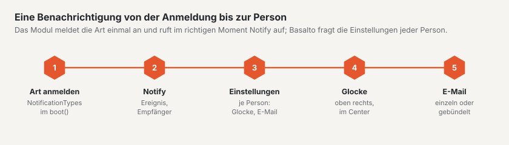

# Benachrichtigungen

Basalto hat eine **Glocke** oben rechts im Backend, ein **Center** mit allen
Benachrichtigungen und im Profil einen Reiter **«Benachrichtigungen»**, in dem jede Person je Art Glocke und E-Mail ein-
und ausschaltet. Kern und Module verschicken über dieselbe Schnittstelle — ein Plugin braucht dafür zwei Schritte:
die Art anmelden und im richtigen Moment `Notify` aufrufen.



## 1. Art anmelden

Im `boot()` des Service-Providers, über das Verzeichnis `Basalto\Core\Notifications\NotificationTypes`:

```php
use Basalto\Core\Access\Level;
use Basalto\Core\Notifications\NotificationTypes;

app(NotificationTypes::class)->type(
    'shop.order',                       // Schlüssel: Kleinbuchstaben mit Punkt, Präfix = Modul
    'Neue Bestellung im Shop',          // Beschriftung im Profil (deutscher Text = Schlüssel der Übersetzung)
    'Shop',                             // Gruppe im Profil
    'Auf Rechnung oder mit Karte.',     // Beschreibung unter der Beschriftung (freiwillig)
    area: 'shop',                       // wer sie bekommen und einstellen kann (Bereich, siehe Rollen und Rechte)
    level: Level::Edit,                 // … ab dieser Stufe (Vorgabe: ansehen)
    mail: true,                         // Vorgabe E-Mail (Vorgabe Glocke: an)
    icon: 'license',                    // Symbol im Sechseck (Namen wie im Menü)
);
```

| Parameter | Bedeutung |
| --- | --- |
| `area` | Bereich aus `Areas` — die Art erscheint nur bei Personen, die ihn auf einer ihrer Sites sehen. Ohne Bereich ist sie **persönlich** (betrifft das eigene Konto oder die eigenen Inhalte) und für alle sichtbar. |
| `scope` | `NotificationType::BACKEND` (Vorgabe) oder `NotificationType::EXTRANET` — dann gilt der Bereich im Team des Herstellers, und die Benachrichtigung steht in der Glocke des Extranets. |
| `bell`, `mail` | Vorgaben, solange die Person nichts einstellt. |
| `mailRequired` | Die Mail kommt immer (Rechnung, Kündigung); abschalten lässt sich nur die Glocke. |
| `mailAvailable: false` | Die Mail stellt man anderswo ein (Empfänger eines Formulars) — im Profil steht ein Strich statt eines Schalters. |
| `when` | `Closure(): bool` — nur sichtbar, solange es zutrifft (z. B. nur im SaaS-Betrieb). |

Texte (Beschriftung, Gruppe, Beschreibung) gehören wie alle Texte eines Moduls in `lang/{en,it,fr}.json`.

## 2. Benachrichtigen

```php
use Basalto\Core\Notifications\Notify;

Notify::make('shop.order')
    ->title('Neue Bestellung :number', ['number' => $order->number])
    ->body('Von :name über :amount.', ['name' => $order->name, 'amount' => $amount])
    ->url(route('basalto.shop.orders.show', $order), 'Bestellung öffnen')
    ->toArea($site)              // alle der Site mit dem Bereich der Art
    ->except($request->user())   // wer es ausgelöst hat, braucht keine Nachricht
    ->send();                    // Zahl der Empfänger
```

| Methode | Wirkung |
| --- | --- |
| `make($key)` | Art aus dem Verzeichnis — ein unbekannter Schlüssel wirft eine Ausnahme (Tippfehler fallen im Test auf). |
| `title($text, $params)`, `body($text, $params)` | Deutscher Text mit Platzhaltern; übersetzt wird beim Anzeigen bzw. Versenden in die Sprache der Person. |
| `url($url, $action)` | Ziel eines Klicks und Beschriftung des Knopfs in der Mail. Relativ (`/admin/…`), wenn die Anfrage auf einem anderen Host läuft. |
| `site($site)` | Zu welcher Site sie gehört — beim Öffnen wechselt das Backend dorthin. `toArea()` setzt sie selbst. |
| `to($users)`, `toArea($site, $area, $level)`, `toExtranet($area, $level)` | Empfänger: einzelne Personen, alle mit einem Bereich auf einer Site oder das Team des Herstellers. Deaktivierte nie. |
| `except($user)` | Eine Person auslassen. |
| `collapse($key)`, `titleMany($text)` | Ungelesene mit demselben Schlüssel zusammenfassen: aus zehn Bestellungen wird eine Zeile «:count neue Bestellungen». |

Welche Kanäle greifen, entscheidet `NotificationSettings` nach den Einstellungen der Person: Hauptschalter, Schalter
für Glocke und E-Mail, Wahl je Art. Die Glocke schreibt sofort, die Mail geht über die Warteschlange. Die Nachricht trägt
nur fertige Daten (keine Modelle) — die Warteschlange kennt keinen Mandanten.

## Eigene Mail, bestehende Mails

- Eine eigene Mail (Anhang, eigener Aufbau): von `Basalto\Core\Notifications\BasaltoNotification` erben und `toMail()`
  überschreiben.
- Eine bestehende Pflicht-Mail zusätzlich in der Glocke zeigen: den Trait `AlsoInBell` einbinden und `bellKind()` sowie
  `bell()` (Titel, Text, Adresse) liefern — so machen es Rechnungen, Testphase, Kündigung, Domain und Export der SaaS.

## Was der Kern selbst meldet

| Schlüssel | Wann | An |
| --- | --- | --- |
| `content.submitted` | Fassung eingereicht | Freigabe der Site |
| `content.rejected`, `content.approved`, `content.published` | zurückgewiesen (mit Kommentar), freigegeben, veröffentlicht | wer eingereicht hat |
| `forms.submitted` | neue Einsendung (je Formular gebündelt) | Bereich «Formulare» |
| `security.access` | Passkey hinzugefügt oder entfernt, API-Token angelegt | die Person selbst |
| `support.access` | Support des Herstellers öffnet die Site | Bereich «Einstellungen» |
| `operations.backup_failed` | Sicherung gescheitert (nicht im SaaS-Betrieb) | Bereich «Betrieb» |
| `account.*` | Rechnung, Testphase, Kündigung, Domain live, Export (Pflicht-Mails, nur SaaS) | Besitz und Abrechnung |
| `extranet.domains`, `extranet.cancellations` | Zusatzdomain angefragt, Konto kündigt | Team im Extranet |

Die mitgelieferten Module melden `comments.posted`, `members.pending`, `licensing.orders`, `marketplace.review` und
`marketplace.reported` an.

## Speicher und Datenschutz

Die Glocke schreibt in die Tabelle `notifications` von Laravel, ergänzt um `kind`, `scope` und `site_id`. Die
Auskunft im Profil listet die Benachrichtigungen einer Person, das Löschen einer Person entfernt sie. Beim Export einer
Site gehen sie nicht mit — sie gehören Personen, nicht der Site.

## Weiter

- [Module und Plugins](erweiterungen.md)
- [Hilfe für die Redaktion](../redaktion/index.md#benachrichtigungen)
