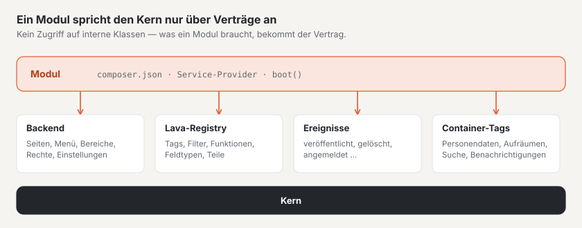
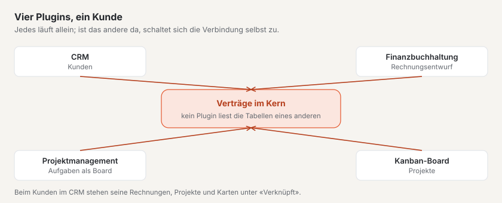

# Module und Plugins

Basalto hat **eine** Erweiterungs-Schnittstelle für beides: Module bringt Basalto mit (`modules/*`,
`basalto/module-*`), Plugins kommen von Dritten — technisch sind sie gleich gebaut. Eine
Erweiterung spricht den Kern nur über öffentliche Verträge an: die Backend-Schnittstelle, die Lava-Registry,
Domänenereignisse und Container-Tags. Was ein Modul braucht, bekommt der Vertrag — keine Zugriffe auf interne Klassen.



Zwei Beispiele unter `modules/`:

- `modules/example` — das kleinste Modul: eine Backend-Seite, ein Menüeintrag, eine
  Migration und Lava-Erweiterungen.
- `modules/comments` — ein echtes Modul: Lava-Tag, Frontend-Route, Moderation mit Zahl am
  Menü, Datenschutz und Löschlauf.

## Aufbau eines Pakets

```text
modules/example/
├── composer.json                 Paket, Service-Provider, Manifest
├── src/ExampleServiceProvider.php
├── src/Http/Controllers/…
├── database/migrations/…
├── lang/de/backend.php, lang/en/backend.php, lang/en.json …
└── resources/js/pages/Hello.vue  Inertia-Seite «example::Hello»
```

### `composer.json` mit Manifest

```json
{
    "name": "basalto/module-example",
    "type": "library",
    "require": { "php": "^8.4", "basalto/core": "*" },
    "autoload": { "psr-4": { "Basalto\\Modules\\Example\\": "src/" } },
    "extra": {
        "laravel": {
            "providers": ["Basalto\\Modules\\Example\\ExampleServiceProvider"]
        },
        "basalto": {
            "module": "example",
            "name": "Beispiel",
            "api": 1,
            "lava": "example",
            "switchable": true
        }
    }
}
```

| Schlüssel in `extra.basalto` | Bedeutung |
| --- | --- |
| `module` | Handle des Moduls — Kleinbuchstaben, Ziffern, `-` und `_`; zugleich Präfix in Lava und Namensraum der Inertia-Seiten |
| `name` | Anzeigename |
| `api` | Version der Erweiterungs-Schnittstelle, heute `1` |
| `lava` | Namensraum in Lava (gleich dem Handle) |
| `switchable` | ob das Modul je Site ein- und ausgeschaltet werden kann |
| `requires` | Handles anderer Module, die es braucht (z. B. der Marktplatz `["licensing"]`) — Angabe für Menschen und den Marktplatz; der Kern erzwingt sie heute nicht |

Laravel findet den Service-Provider über Package Discovery (`extra.laravel.providers`). Das `composer.json` im
Hauptordner der Installation bindet alle Ordner unter `modules/*` als lokale Pakete (`path`) ein.

`Backend::module()` liest das Manifest und legt es ab (`Backend::modules()`). Ob ein Modul schaltbar ist, bestimmt
der Parameter `switchable` beim Aufruf — der Eintrag im Manifest ist heute nur Angabe (für den Marktplatz).

## Service-Provider

Alles geschieht in `boot()`. Das Beispielmodul vollständig:

```php
final class ExampleServiceProvider extends ServiceProvider
{
    public function boot(): void
    {
        $root = dirname(__DIR__);
        $this->loadTranslationsFrom($root.'/lang', 'example');
        $this->loadJsonTranslationsFrom($root.'/lang');
        $this->loadMigrationsFrom($root.'/database/migrations');

        $backend = $this->app->make(Backend::class);
        $backend->pages('example', $root.'/resources/js/pages');
        $backend->module('example', 'example::backend.title', composerJson: $root.'/composer.json');
        $backend->menu('example::backend.title', 'basalto.example', 50, Backend::MODE_CONTENT, module: 'example', icon: 'module');
        $backend->routes(static function (): void {
            Route::get('example', HelloController::class)->name('example');
        });

        $this->app->extend(Registry::class, static function (Registry $registry): Registry {
            $registry->module('example')
                ->function('example.greeting', static fn (mixed $name): string => 'Grüezi '.(string) $name)
                ->tag('example.cart', static function (array $args, array $named): string { /* … */ })
                ->fieldType('example.price', ['input' => 'number', 'step' => 0.05, 'currency' => 'CHF']);

            return $registry;
        });
    }
}
```

## Backend-Schnittstelle: `Basalto\Core\Backend\Backend`

Ein Singleton im Container (`$this->app->make(Backend::class)`).

| Methode | Signatur | Zweck |
| --- | --- | --- |
| `module` | `module(string $handle, string $label, bool $switchable = true, ?string $composerJson = null, bool $enabledByDefault = true): self` | Modul anmelden; `$label` ist ein Übersetzungsschlüssel; `$composerJson` liefert das Manifest; `$enabledByDefault` falsch heisst ab Werk aus |
| `menu` | `menu(string $label, string $route, int $order = 100, string $mode = self::MODE_CONTENT, ?string $module = null, ?string $icon = null): self` | Menüeintrag; `$route` ist ein Routenname, `$mode` einer von `MODE_CONTENT` (Inhalte), `MODE_SETUP` (Einrichtung), `MODE_ADMIN` (Verwaltung). Mit `$module` verschwindet der Eintrag, wenn das Modul für die Site aus ist |
| `count` | `count(string $route, Closure $count): self` | Zahl am Menüeintrag dieser Route, je Site: `fn (Site $site): int` |
| `pages` | `pages(string $namespace, string $directory): self` | Verzeichnis mit Vue-Seiten unter einem Namensraum |
| `routes` | `routes(Closure $routes): void` | Routen unter dem Backend-Pfad (`basalto.backend.path`, Vorgabe `admin`) mit der Backend-Middleware (`web`, `auth`, aktives Konto, Site-Auswahl, Inertia) und Namenspräfix `basalto.` |
| `moduleEnabled` | `moduleEnabled(string $handle, Site $site): bool` | ist das Modul für diese Site an? |
| `modules`, `menuItems`, `menuByMode`, `counts`, `pageNamespaces`, `path`, `middleware`, `vite` | — | Lesen für den Kern |

Ein Beispiel für `count()` aus dem Kommentar-Modul — die Zahl wartender Kommentare am Menü:

```php
$backend->count('basalto.comments.index', static fn (Site $site): int => Comment::query()->withoutGlobalScopes()
    ->where('site_id', $site->id)->where('status', CommentStatus::Pending->value)->count());
```

### Routen

`routes()` hängt den Backend-Pfad und das Namenspräfix an: `Route::get('example', …)->name('example')` wird zu
`/admin/example` mit dem Namen `basalto.example` — passend zum Menüeintrag oben. Routen ausserhalb des Backends (etwa
der Versand von Kommentaren aus dem Frontend) legt das Modul selbst an:

```php
Route::post('comments/{entry}', CommentSubmissionController::class)->whereNumber('entry')
    ->middleware(['web', 'basalto.site'])->withoutMiddleware(ValidateCsrfToken::class)->name('basalto.comments.submit');
```

### Bereiche und Rechte

Jede Backend-Route gehört zu einem **Bereich** mit Gruppe (Inhalte, Einrichtung, Verwaltung). Das Modul meldet seine
Bereiche in `boot()` an und ordnet die Routen nach Präfix zu; einzelne Routen können eine höhere Stufe verlangen:

```php
app(Areas::class)->register('members', 'Mitglieder', Areas::CONTENT, 'members')
    ->map('basalto.members.', 'members')
    ->route('basalto.members.settings', 'members', Level::All);
```

Ohne eigene Angabe verlangt GET «ansehen», DELETE «löschen» und alles andere «bearbeiten». Die Middleware
`GuardAreaAccess` prüft jede Anfrage, das Menü blendet Einträge ohne Recht aus. Routen ohne Zuordnung verlangen
«Einstellungen · alles», und der Test `AreaCoverageTest` meldet sie. Im Code fragt man
`Gate::allows('area', [$site, 'members', Level::Delete])` oder `Access::allows()`; Sprachen prüft
`Access::authorizeLocale()`. Das Recht einer anderen Fähigkeit «auszuleihen» (etwa `update` der Site) ist nicht mehr
nötig. Wie Betreiber Rollen einstellen: [Rollen und Rechte](../betrieb/rollen.md).

### Inertia-Seiten mit Namensraum

Ein Controller rendert `Inertia::render('example::Hello', [...])`; der Teil vor `::` ist der Namensraum aus
`pages()`, der Teil danach der Pfad der Seite ohne `.vue`. Der Kern nutzt `core::…`.

```php
final class HelloController
{
    public function __invoke(Request $request): Response
    {
        $greeting = (new Renderer(app(Registry::class)))->render('{{ example.greeting(name) }}', ['name' => $request->user()->name ?? 'Gast']);

        return Inertia::render('example::Hello', ['greeting' => $greeting]);
    }
}
```

Der Kern baut die Seiten aller mitgelieferten Module in sein Bundle: `packages/core/resources/js/backend.ts` sucht
`modules/<namensraum>/resources/js/pages/<Seite>.vue`. Der Namensraum muss deshalb dem Ordnernamen unter `modules/`
entsprechen. Plugins Dritter bringen deshalb keine eigenen Vue-Seiten mit: Ihre Verwaltung beschreiben sie in PHP,
der Kern zeichnet sie — siehe [Verwaltungsseiten aus Beschreibung](#verwaltungsseiten-aus-beschreibung).

### Je Site schaltbar

Schaltbare Module ein- und ausschalten: Verwaltung › Sites › Site bearbeiten › Reiter «Module». Gespeichert wird in
`sites.settings.modules.<handle>`; ohne Eintrag gilt die Vorgabe des Moduls — meist eingeschaltet, mit `module(…, enabledByDefault: false)` ab Werk aus (so Lizenzverkauf und Marktplatz, die nur auf basaltocms.com laufen). Menüeinträge mit `module:`
verschwinden von selbst. **Alles andere prüft das Modul selbst** mit `moduleEnabled()` — so macht es das
Kommentar-Modul in der Ausgabe des Tags, im Versand und in der Moderation:

```php
abort_if($site === null || ! $this->backend->moduleEnabled('comments', $site), 404);
```

Ausgeschaltet bleiben die Daten gespeichert.

## Verwaltungsseiten aus Beschreibung

Ein Plugin baut seine Verwaltung, ohne JavaScript mitzubringen: Der Controller gibt eine Beschreibung der Seite zurück
(`Basalto\Core\Backend\Schema\AdminPage`), der Kern zeichnet sie mit seinen eigenen Bausteinen — Kennzahlen,
Hinweise, Text, Listen, Formulare, Knöpfe. So sieht jede Seite aus wie der Rest des Backends, funktioniert mit Tastatur
und Bildschirmleser und bleibt bei einem Update des Kerns gültig. Prüfen und Speichern bleibt gewöhnlicher
Laravel-Code.

```php
use Basalto\Core\Backend\Schema\{Action, AdminPage, Column, Form, FormField, Row, Stat, Table};

public function index(Request $request): AdminPage
{
    $q = trim((string) $request->query('q', ''));
    $notes = Note::query()->when($q !== '', fn ($query) => $query->whereLike('text', '%'.$q.'%'))
        ->orderByDesc('id')->paginate(20)->withQueryString();

    return AdminPage::make(__('Notizen'))
        ->crumb(__('Beispiel › Notizen'))
        ->stats([Stat::make(__('Notizen'), Note::query()->count())])
        ->form(Form::make(route('basalto.example.notes.store'))->title(__('Neue Notiz'))->submit(__('Anlegen'))
            ->fields([FormField::textarea('text', __('Text'))->required()->rows(3)]))
        ->table(Table::make('notizen')
            ->columns([Column::text('text', __('Text')), Column::date('created', __('Angelegt'))])
            ->rows($notes->items(), fn (Note $note): Row => Row::make($note->id)
                ->cell('text', $note->text)
                ->cell('created', $this->dates->dateTime($note->created_at))
                ->url(route('basalto.example.notes.edit', ['note' => $note->id]))
                ->action(Action::delete(__('Löschen'), route('basalto.example.notes.destroy', ['note' => $note->id]))
                    ->confirm(__('Diese Notiz löschen?'))->variant('danger')))
            ->search($q, __('Notizen durchsuchen'))
            ->paginate($notes)
            ->bulk(Action::bulk('delete', __('Löschen'), route('basalto.example.notes.bulk'))->confirm(__('Die gewählten Notizen löschen?')))
            ->empty(__('Noch keine Notizen'), __('Legen Sie oben die erste an.')));
}
```

Das vollständige Beispiel mit Bearbeiten, Löschen und Sammelaktion steht im Beispiel-Modul
(`modules/example/src/Http/Controllers/NotesController.php`, Seite `/admin/example/notizen`).

| Baustein | Aufruf | Zweck |
| --- | --- | --- |
| `AdminPage` | `make($titel)`, `crumb()`, `lead()`, `action()`, `stats()`, `notice($text, $ton, $titel)`, `text($text, $titel)`, `table()`, `form()` | Die Seite; Abschnitte erscheinen in der Reihenfolge der Aufrufe |
| `Stat` | `make($bezeichnung, $wert)`, `hint()`, `tone()` | Kennzahl oben auf der Seite; Ton `neutral`, `success`, `warning`, `danger` |
| `Table` | `make($schlüssel)`, `title()`, `columns()`, `rows($einträge, fn)`, `search($wert, $platzhalter, $parameter)`, `filter()`, `paginate($paginator)`, `bulk(...)`, `empty($titel, $text)` | Liste mit Suche, Filtern, Seiten und Sammelaktionen |
| `Column` | `text`, `mono`, `number`, `money`, `date`, `badge`, `link` | Spalte; `number` und `money` stehen rechtsbündig |
| `Row` | `make($id)`, `cell()`, `badge($schlüssel, $text, $ton)`, `link($schlüssel, $text, $url)`, `url()`, `action()` | Zeile; mit `url()` wird die erste Spalte zum Link auf den Datensatz |
| `Filter` | `make($parameter, $bezeichnung, $wert)`, `option($wert, $bezeichnung, $anzahl)` | Auswahl über der Liste, als Abfrageparameter in der Adresse |
| `Form` | `make($url, $methode)`, `title()`, `fields()`, `values()`, `autosave()`, `submit()` | Formular; mit `autosave()` speichert es nach jeder Pause selbst, sonst mit dem Knopf |
| `FormField` | `text`, `email`, `url`, `number`, `password`, `textarea`, `select($name, $bezeichnung, $auswahl)`, `checkbox`, `date`, `time`, `datetime`, `color`, `richtext`, `file($name, $bezeichnung, $accept)`; dazu `help()`, `placeholder()`, `required()`, `min()`, `max()`, `step()`, `rows()`, `mono()`, `onLeave()`, `half()` | Feld; `password` speichert beim Autosave erst beim Verlassen des Feldes |
| `Action` | `link`, `post`, `put`, `delete`, `bulk($schlüssel, $bezeichnung, $url)`; dazu `confirm($frage)`, `variant()`, `with($daten)` | Knopf; mit `confirm()` fragt der Kern vorher nach |

Worauf es ankommt:

- **Texte übersetzt übergeben.** Die Beschreibung enthält fertige Texte; `__()` mit den Schlüsseln aus `lang/` des
  Plugins (DE, EN, FR, IT).
- **Fehler am Feld:** Der Controller prüft wie gewohnt (`$request->validate()`); der Kern zeigt die Meldungen am
  passenden Feld. Bestätigungen gehen als `back()->with('status', …)` zurück.
- **Sammelaktionen** schicken `action` (der Schlüssel aus `Action::bulk`) und `ids` an die angegebene Adresse — der
  Controller prüft beides und meldet, wie viele Einträge betroffen waren.
- **Autosave** (`Form::autosave()`) ist für bestehende Datensätze gedacht: Der Kern schickt nach einer Pause die Felder
  mit der Methode des Formulars (meist `put`) und zeigt am Feld, dass gespeichert ist. Zum Anlegen dient ein Formular
  mit Knopf.
- **Rechte** gelten wie für jede Route ([Bereiche und Rechte](#bereiche-und-rechte)); Knöpfe, die ein Benutzer nicht
  nutzen darf, lässt der Controller weg.

### Boards

Mit `AdminPage::board()` zeigt eine Seite ein Board nach der Kanban-Methode: Spalten mit Karten, auf Wunsch mit
WIP-Limit. Der Kern verschiebt Karten mit Ziehen und Ablegen oder mit den Pfeilknöpfen jeder Karte (Tastatur) und
schickt `card`, `column` und `position` (ab 0) als POST an die Adresse aus `Board::make()`. Der Controller prüft das
WIP-Limit mit `Board::allows($limit, $anzahl, $von, $nach)` — in eine volle Spalte geht keine Karte, Umordnen in der
Spalte immer — und speichert. Fehler ohne Feld (`back()->withErrors(['card' => …])`) stehen oben auf der Seite.

```php
use Basalto\Core\Backend\Schema\{Board, Card};

$page->board(Board::make(route('basalto.shop.board.move'))->add(route('basalto.shop.board.store'), __('Karte hinzufügen'))
    ->column('neu', __('Neu'), [Card::make(7, 'B-0042')->meta('Muster AG')->due('14.11.2026', overdue: true)->label(__('Express'), 'lava')])
    ->column('packen', __('Packen'), limit: 3)
    ->column('versandt', __('Versandt'), done: true));
```

## Verbindungen zwischen Plugins

Plugins greifen nie in die Tabellen eines anderen. Wo sie zusammenarbeiten — Kunden aus dem CRM, Rechnungen in der
Finanzbuchhaltung, Aufgaben als Kanban-Board —, gehen sie über Verträge des Kerns in `Basalto\Core\Business`: Ein
Plugin stellt einen Vertrag bereit, andere fragen über `Connections` danach. Fehlt das Plugin oder ist es für die
Site aus, ist die Antwort `null` — jedes Plugin muss ohne das andere laufen und schaltet die Verbindung von selbst zu.



| Vertrag | Stellt bereit | Gefragt mit | Ereignisse |
| --- | --- | --- | --- |
| `PartnerDirectory` (`PartnerData`) | CRM | `partners($site)` | `PartnerCreated`, `PartnerUpdated`, `PartnerArchived` |
| `ProjectDirectory` (`ProjectData`) | Projektmanagement | `projects($site)` | `ProjectUpdated` |
| `Invoicing` (`InvoiceDraft`, `InvoiceLine`, `InvoiceData`) | Finanzbuchhaltung | `invoicing($site)` | `InvoiceCancelled` |
| `CardSource` (`CardColumn`, `CardData`) | ein Plugin mit Karten, z. B. Projektmanagement | `cardSource($site, $schlüssel)` | — |
| `BoardViewer` | Kanban-Board | `boardUrl($site, $quelle, $schlüssel)` | — |
| `LinkedRecord` | jedes Plugin | `linked($site, Connections::PARTNER, $id)` | — |

Angemeldet wird in `boot()` mit `providePartners()`, `provideProjects()`, `provideInvoicing()`,
`provideCardSource()`, `provideBoardViewer()` und `links()`. Gefragt wird erst in der Anfrage — die Reihenfolge, in der
Plugins starten, spielt keine Rolle.

```php
use Basalto\Core\Business\{Connections, LinkedRecord};
use Basalto\Core\Business\Events\PartnerUpdated;

// boot(): Kunden aus dem CRM verwenden, wenn es da ist
$partners = app(Connections::class)->partners($site);      // null ohne CRM oder auf einer Site ohne CRM
$choices = $partners?->search($site, $term) ?? [];          // list<PartnerData>
$invoiceAddress = $partners?->find($site, $id)?->debtor(); // Anschrift in der Form der QR-Rechnung

// Kopien abgleichen, wenn sich der Kunde im CRM ändert
Event::listen(PartnerUpdated::class, fn (PartnerUpdated $e) => Order::query()
    ->where('site_id', $e->siteId)->where('partner_id', $e->partner->id)->update(['partner_name' => $e->partner->name]));

// Beim Kunden im CRM zeigen, was dieses Plugin zu ihm weiss
app(Connections::class)->links(Connections::PARTNER, 'shop', fn (Site $site, int $partnerId): array => [
    new LinkedRecord(__('Bestellungen'), 'B-0042', 'CHF 120.00', route('basalto.shop.orders.show', 42), __('offen'), 'warning'),
]);
```

Worauf es ankommt:

- **Kopie und Verweis:** Speichern Sie neben `partner_id` eine Kopie des Namens (bei Rechnungen der Anschrift), ohne
  Fremdschlüssel — das CRM kann fehlen oder später entfernt werden. Die Ereignisse halten die Kopie aktuell.
- **Ohne das andere Plugin** zeigt Ihr Plugin eine eigene einfache Eingabe oder einen Hinweis, nie einen Fehler.
- **`suggest` in der `composer.json`** nennt die Plugins, mit denen Ihres zusammenarbeitet; Verwaltung › Module zeigt
  sie als «arbeitet zusammen mit …». Ein `require` auf ein anderes Plugin weist die Installation ab.

## Einhängeseiten: eine Seite gehört dem Modul

Ein Modul kann eine Seite des Seitenbaums samt allen Adressen darunter übernehmen — so arbeiten das Forum und das
Plugin «Veranstaltungen». Die Redaktion legt die Seite an und wählt im Reiter «Experten» unter «Modul einhängen» das
Modul; Titel, Brotkrumen, Metadaten und Layout kommen weiter von der Seite und dem Theme.

```php
use Basalto\Core\Community\{MountHandler, MountRequest, MountResult, Mounts};

// im boot() des Providers: Kennung, Name in der Auswahl, Handler, Modul
app(Mounts::class)->register('events', 'Veranstaltungen', EventsMount::class, 'events');

final class EventsMount implements MountHandler
{
    public function handle(MountRequest $request): MountResult
    {
        return match ($request->segments) {
            [] => MountResult::page('<section>…</section>', head: '<link rel="alternate" …>'),
            ['kalender.ics'] => MountResult::raw($ics, 'text/calendar; charset=utf-8'),
            default => MountResult::notFound(),
        };
    }
}
```

`MountRequest` nennt Site, Sprache, die Seite, ihre Adresse (`base`) und die Pfadteile darunter (`segments`);
`url('archiv')` baut eine Adresse unter der Seite. `MountResult::page()` setzt Markup an die Stelle der Einleitung
(mit Titel, weiteren Brotkrumen, Beschreibung, `head` für strukturierte Daten), `raw()` antwortet ohne Layout (Feeds,
Kalender), dazu `redirect()` und `notFound()`. Ist das Modul für die Site aus, ist die Seite eine gewöhnliche Seite und
die Adressen darunter antworten 404. Die Ausgabe zentriert sich selbst (`width: min(100% - 2rem, …)`, `margin: auto`),
weil Themes den Bereich der Einleitung nicht einfassen.

Mit `community: true` (nur das Forum) leben unter der Seite auch Profile und Konversationen — ein Modul ohne Community
lässt das weg. Antworten für Gäste kommen aus dem Seiten-Cache: Nach einer Änderung an den Daten des Moduls
`app(PageCache::class)->invalidate($site->id)`.

## Suchmaschinen und Statistik

Den Kopf jeder Seite setzt Basalto selbst zusammen, wenn die Seite fertig ist — Titel, Beschreibung, Vorschaubild,
kanonische Adresse, Sprachfassungen und strukturierte Daten. Ein Modul trägt bei, was nur es weiss:

```php
use Basalto\Core\Seo\PageSeo;

// in einem Lava-Tag oder -Teil, während er rendert
app(PageSeo::class)->title($package->title)
    ->description($package->summary)
    ->image('/marketplace/media/'.$package->id.'/screen-1', 1280, 800, 'Bildschirmfoto')
    ->query(['paket' => $package->handle()])           // gehört zur kanonischen Adresse
    ->data(['@type' => 'SoftwareApplication', 'name' => $package->title]);
```

`query()` nennt die Parameter, ohne die die Ansicht eine andere wäre — sie kommen in die kanonische Adresse und die
Sprachfassungen. `noindex()` hält eine Ansicht aus dem Index (ein unbekannter Eintrag), `dates()` gibt Veröffentlichung
und Änderung an. Einhängeseiten nennen Titel, Beschreibung und Bild über `MountResult::page()`.

**Sitemap:** Adressen eines Moduls kommen über eine Closure mit dem Tag `Sitemap::TAG` in die Sitemap — sie bekommt
Site, Sprache und Basisadresse und liefert eine Liste aus `loc`, `lastmod`, `alternates` (Sprache → Adresse) und auf
Wunsch `images`. **IndexNow:** `app(IndexNow::class)->queue($site, [$url])` meldet eine neue oder geänderte Adresse.

**Statistik:** Ein Abschnitt unter Verwaltung › Statistik wird mit `Backend::statistics()` angemeldet — mit Bereich
(Recht), Reihenfolge, dem Modul (nur wenn es auf der Site an ist) und einer Closure, die einen `MetricSection` baut.
Kennzahlen mit `headline` stehen zusätzlich im Überblick.

```php
use Basalto\Core\Analytics\Period;
use Basalto\Core\Extranet\Statistics\MetricSection;

$backend->statistics('reservierungen', 'Reservierungen', 'reservations', 100,
    static fn (Period $period, Site $site): MetricSection => (new MetricSection('reservierungen', 'Reservierungen'))
        ->kpi('Neue Reservierungen', $neu($period), $neu($period->previous()), headline: true)
        ->series('Neue Reservierungen je Tag', $period->daily($abfrage))
        ->list('Reservierungen je Angebot', $zeilen),
    module: 'reservations');
```

## Lava erweitern: die Registry

Lava ruft nur auf, was registriert ist (`Basalto\Lava\Runtime\Registry`, eine Instanz je Anwendung). Ein Modul
erweitert die Instanz im Container und registriert **nur unter seinem Präfix** — über `module('handle')`, das eine
`Basalto\Lava\Runtime\ModuleRegistry` liefert. Ein Name ohne Präfix, mit fremdem Präfix oder einer, der schon belegt
ist, wirft eine `LogicException`. Themes registrieren nie etwas.

```php
$this->app->extend(Registry::class, static function (Registry $registry): Registry {
    $registry->module('comments')
        ->tag('comments.list', static fn (array $args, array $named, Context $ctx): string => app(CommentsRenderer::class)->render($named, $ctx));

    return $registry;
});
```

| Methode der `ModuleRegistry` | Signatur | In Lava |
| --- | --- | --- |
| `function` | `function(string $name, Closure $fn): self` — beliebige Parameter, erster ist beim Filter der Wert | `{{ example.greeting(name) }}`, `{{ preis \| example.money }}` |
| `tag` | `tag(string $name, Closure $fn): self` — `fn (array $args, array $named, Context $ctx): string` | `` |
| `fieldType` | `fieldType(string $name, array $options = []): self` | `field preis: example.price` |
| `property` | `property(string $keyword, string $name): self` | zusätzliche Eigenschaft, z. B. `property('type', 'example.sku')` → `example.sku:` in einem `type` |
| `part` | `part(string $name, string $label, array $settings, Closure $render): self` — `fn (array $settings, array $vars, string $lang): string` | Lava-Teil `part warenkorb: shop.cart { … }` — Einstellungen als Liste oder mit Beschriftung im Layout-Editor: `['per' => 'Anzahl', 'heading' => 'Überschrift']` |

Hinweise:

- **Tags geben HTML zurück** und maskieren selbst (`htmlspecialchars`). `$args` sind die Positions-, `$named` die
  benannten Argumente; `$ctx->get('page')` und `$ctx->get('site')` liefern die Variablen der Seite.
- **Fehler in einer Funktion oder einem Tag** (falscher Typ, fehlendes Argument) werden zum Lava-Fehler mit Zeile;
  das Theme sieht keinen PHP-Stack. Es gelten die Grenzen des Renderers (Zeit, Schleifen, Tiefe).
- **Feldtypen** aus Modulen kennt der Prüfer (`basalto:check`) und schlägt sie vor («`price` — meinten Sie
  `example.price`?»). Die Optionen (`['input' => 'number', …]`) legt die Registry ab (`fieldTypeOptions()`);
  ausgewertet werden sie vom Backend-Formular noch nicht.
- **Sprachdienst:** Registrierte Namen erscheinen in Vervollständigung und Hover, die Signatur liest der Sprachdienst
  aus der Closure.

## Domänenereignisse

Der Kern feuert Laravel-Events mit stabiler Nutzlast (Namensraum `Basalto\Core\Events`). Ein Modul hört mit
`Event::listen(…)` zu.

| Ereignis | Nutzlast | Wann |
| --- | --- | --- |
| `EntrySaved` | `Entry $entry, EntryVersion $version` | eine Sprachfassung wurde gespeichert (Entwurf) |
| `VersionTransitioned` | `EntryVersion $version, EntryStatus $from, EntryStatus $to, ?string $comment` | eine Fassung wechselte ihren Zustand im Workflow |
| `VersionPublished` | `EntryVersion $version` | eine Fassung ist live |
| `MediaUploaded` | `Media $media` | ein Medium wurde hochgeladen |
| `MediaTrashed` | `Media $media, int $usages` | ein Medium kam in den Papierkorb (mit Zahl der Inhalte, die es noch einbinden) |
| `MediaRestored` | `Media $media` | ein Medium kam aus dem Papierkorb zurück |
| `SiteCreated` | `Site $site` | eine Site wurde angelegt |
| `SiteUpdated` | `Site $site, array $before, array $after` | Stammdaten einer Site geändert |
| `UserLoggedIn` | `Authenticatable $user, string $method` | Anmeldung im Backend (Code, Link oder Passkey) |

Alle Eigenschaften sind `public readonly`.

Wer bei einem Ereignis Personen benachrichtigen will — in der Glocke und per E-Mail, nach ihren Einstellungen —, meldet
eine Art an und ruft `Notify` auf: siehe [Benachrichtigungen](benachrichtigungen.md).

## Datenschutz: Container-Tags

Personendaten in Modultabellen hängen sich an Auskunft, Löschung und Löschlauf des Kerns über zwei Container-Tags.
Beide erwarten eine **Closure** im Container.

| Tag | Aufgerufen von | Signatur der Closure | Rückgabe |
| --- | --- | --- | --- |
| `basalto.person-data` | `Basalto\Core\Privacy\PersonData` (`basalto:privacy`, Profil und Benutzerverwaltung im Backend) | `fn (string $email, bool $delete): array` | bei Auskunft je Art eine Liste (wird an die Auskunft angehängt), bei Löschung je Art eine Zahl |
| `basalto.cleanup` | `basalto:cleanup` (täglich 03:00) | `fn (Settings $settings): array` | je Art die Zahl gelöschter Datensätze; erscheint in Ausgabe und Protokoll |

So bindet das Kommentar-Modul beide an:

```php
$this->app->instance('basalto.person-data.comments', (new CommentPersonData)(...));
$this->app->tag(['basalto.person-data.comments'], 'basalto.person-data');
$this->app->instance('basalto.cleanup.comments', CommentPersonData::cleanup(...));
$this->app->tag(['basalto.cleanup.comments'], 'basalto.cleanup');
```

`CommentPersonData::__invoke(string $email, bool $delete): array` liefert `['kommentare' => [...]]` bzw.
`['kommentare' => $anzahl]`; `CommentPersonData::cleanup(Settings $settings): array` löscht je Site Spam und
Gelöschtes nach der Frist `comments.retention_days` (Vorgabe 365) und liefert `['Kommentare' => $anzahl]`. Die
E-Mail-Adresse kommt kleingeschrieben und ohne Leerraum an; die Suche gilt über alle Sites.

## Frontend-Konto und geschützte Seiten

Das **Frontend-Konto** gehört dem Kern (`Basalto\Core\FrontendAccounts`). Lizenzverkauf, Marktplatz und Mitglieder teilen es, ohne voneinander abzuhängen. Ältere Namen aus dem Lizenzverkauf
(`Basalto\Modules\Licensing\Accounts\Customer`, `CustomerAuth`, `CustomerLogin`, `CustomerLoginCode`,
`Frontend\LoginForm`, `Http\CustomerLoginController`, `Http\Middleware\…`, `Notifications\CustomerLoginCodeNotification`)
bleiben als `class_alias` und gelten als veraltet; neuer Code nimmt die Namen im Kern. Ein Alias ist dieselbe Klasse
(`instanceof` gilt für beide Namen) — nur Vergleiche über den Klassennamen als Zeichenkette (etwa
`Notification::assertSentTo(…, AlterName::class)`) sehen den Namen im Kern.

| Schnittstelle | Zweck |
| --- | --- |
| `CustomerAuth::useFor('modul', ?Policy::class)` | Das Modul nutzt das Konto (im `boot()`). Die Routen `POST /account/login`, `/account/code`, `/account/logout` und die Anmeldeseite `GET /account/login` antworten auf einer Site nur, wenn eines der nutzenden Module an ist. |
| `RegistrationPolicy::opensRegistration(Site)` | Darf die Anmeldung auf der Site neue Konten anlegen? Ohne Regel ja. Lässt keines der eingeschalteten Module sie zu, gehen Codes nur an Adressen mit Konto (die Antwort an den Browser bleibt gleich). |
| `CustomerAuth::current()` · `::available(Site)` · `::MIDDLEWARE` (`basalto.customer`) | Wer angemeldet ist (nur Konten der Site der Anfrage), ob es das Konto auf der Site gibt, Middleware für Routen nur mit Konto |
| `LoginForm::render($request, $lang, $pfad, $intro, $zweck)` | Das Anmeldeformular für eigene Tags; `$zweck` (z. B. `members`) kommt nach dem Code als `CustomerSignedIn::$purpose` zurück |
| Ereignis `Events\CustomerSignedIn` (`customer`, `site`, `purpose`) | Nach dem richtigen Code — die Mitglieder legen damit beim ersten Mal die Mitgliedschaft an |

**Bereiche im Kundenkonto:** Der Tag `` (Lava-Teil «Kundenkonto», Einstellungen `buy`, `entry`, `catalog`, `start`) zeigt das ganze Konto: einen kompakten Kopf mit Begrüssung, links die Bereiche als Navigation (Zahl, Hinweispunkt), rechts immer einen — zuerst die Übersicht mit «Als Nächstes», einer Kachel je Bereich und «Zuletzt». Jeder Bereich hat den Anker `#konto-<key>`; ein Anker irgendwo in einem Bereich (`#lizenz-12`) öffnet diesen Bereich. Ein Modul steuert einen Bereich bei, indem es im `boot()` eine Klasse anmeldet — `app(AccountAreas::class)->add(MeinBereich::class)` — die `Basalto\Core\FrontendAccounts\Hub\AccountArea` erfüllt:

| Methode | Zweck |
| --- | --- |
| `key()` · `position()` | Anker `#konto-<key>` und Reihenfolge (Sites 10, Lizenzen 20, Installationen 30, Marktplatz 40, Autorenkonto 45, Community 50, Rechnungen 60, Profil 90) |
| `pitch($page)` | Für Gäste: Symbol, Titel und ein Satz (`AreaPitch`) — oder `null` |
| `summary($page)` | Angemeldet: `AreaSummary` mit Bezeichnung, Symbol, Zahl, Ton (`lava`, `warn`), Aufgaben (`AreaTodo`), Ereignissen (`AreaEvent`), Knöpfen (`AreaAction`) und Meldungen — `null` blendet den Bereich aus |
| `render($page, $summary)` | Der Inhalt des Abschnitts; Rahmen, Überschrift und Anker setzt das Konto |

Der Bereich entsteht je Ausgabe neu und darf zwischen `summary()` und `render()` Daten halten. `AccountPage` liefert Site, Sprache, Pfad, Anfrage, angemeldetes Konto und `t()` für Texte, `Icons::svg()` die Symbole des Kontos. Bausteine im Markup: `konto-zeilen` mit `konto-zeile`, `konto-sechseck`, `konto-chip`, `konto-knopf`, `konto-leer`, `konto-klappe`.

**Geschützte Seiten:** Der Kern kennt den Schutz (Reiter «Zugriff», `access.protected`, vererbt über
`access.children`; `Pages::isProtected()`), lässt geschützte Seiten in Navigation und Listen nur für Berechtigte und in
Sitemap, Suchindex und Feeds nie zu und antwortet Gästen mit 401 (Angemeldeten ohne Recht mit 403). Wer sie sehen darf,
entscheidet ein Modul über `PageAccess::useGate(Gate::class)` mit dem Vertrag `Basalto\Core\Content\ProtectedPageGate`
(`enabled`, `adminUrl`, `allows`, `denied`, `login`); ohne Modul sieht sie nur die Backend-Redaktion der Site. Eigene
Listen eines Moduls fragen `app(PageAccess::class)->mayView($entry)`.

**Datenschutz:** `PersonData` ruft zuerst die Module (`basalto.person-data`) und **danach** die Frontend-Konten des
Kerns — ein Modul findet seine Daten also beim Löschen noch über die E-Mail des Kontos; anonymisieren muss es das Konto
nicht.

## Ohne Composer installiert

Installationen aus dem Web-Installer haben keinen Composer: Basalto installiert Plugins dort selbst aus dem Marktplatz
([Plugin installieren](../marktplatz/installieren.md#plugin-installieren)). Damit das geht, gilt für ein Plugin:

- **`composer.json`** an der Wurzel mit `type: basalto-plugin`, `extra.basalto.module` (Handle) und
  `extra.laravel.providers`. Klassen nur über `autoload.psr-4` (dazu `autoload.files`, falls nötig) — `classmap` kennt
  der Lader nicht.
- **Keine eigenen Bibliotheken.** Was `require` nennt, muss die Installation schon haben, in passender Version — etwa
  `laravel/framework`, `dompdf/dompdf`, `sprain/swiss-qr-bill`, `league/flysystem-aws-s3-v3`, die mitgelieferten Module.
  `require.basalto/core` (z. B. `^1.3`) prüft Basalto gegen die laufende Version; passt etwas nicht, installiert es
  nicht und nennt den Grund. Dieselben Regeln prüft der Marktplatz schon beim Einreichen.
- **Migrationen unter `database/migrations`** und mit `loadMigrationsFrom()` angemeldet: Beim Entfernen mit «Auch die
  Daten löschen» setzt Basalto genau diesen Ordner zurück. Migrationen brauchen deshalb ein `down()`.
- **Keine eigenen Vue-Seiten:** Das Bundle des Kerns kennt nur die mitgelieferten Module. Die Verwaltung eines Plugins
  entsteht aus [Verwaltungsseiten aus Beschreibung](#verwaltungsseiten-aus-beschreibung).
- **Beim Start nichts Riskantes:** Basalto meldet das Plugin in der laufenden Anfrage an, migriert und prüft danach, ob
  die Site in einem frischen Prozess noch startet (`/up/live`). Wirft ein Provider beim Start, bleibt das Plugin aus;
  wirft er später in einer Anfrage, fehlt nur das Plugin, die Verwaltung zeigt den Grund.

- **PHPStan ohne Larastan:** Die Prüfung im Marktplatz analysiert den Code mit PHPStan Stufe 5, aber ohne die
  Erweiterung für Laravel. Schreiben Sie Eloquent-Abfragen als Anweisungen (`$query->where(…);` und dann
  `$query->get()`) statt als lange Ketten, und rufen Sie statt Scopes (`scopeVisible()`) eine eigene Methode auf — sonst
  meldet die Prüfung weitergereichte Methoden als unbekannt.

Basalto legt das Plugin unter `storage/app/plugins/<hersteller>/<paket>` ab und führt die Liste
`storage/app/plugins/plugins.php` selbst; daraus meldet der Kern beim Start die PSR-4-Pfade beim Autoloader an und
registriert die Provider.

**Beim Entwickeln** legen Sie das Plugin in einem Git-Arbeitsstand von Basalto unter `plugins/<name>/` ab: Dort lädt
Basalto es beim Start mit denselben Regeln wie ein installiertes — in der Entwicklung und in den Tests (abschaltbar mit
`BASALTO_PLUGINS_WORKSHOP=false`). Ein Release enthält den Ordner `plugins/` nie.

**Selbst erproben** — in einer Installation aus dem Web-Installer, mit dem ZIP, das Sie einreichen wollen:

```sh
php artisan basalto:plugin install --archiv=pfad/zum/plugin.zip
php artisan basalto:plugin check hersteller/paket
php artisan basalto:plugin remove hersteller/paket --daten-loeschen
```

`--archiv` installiert ohne Katalog und ohne Signatur des Marktplatzes, sonst wie im Backend (Form, Verträglichkeit,
Sicherung, Migrationen, Startprobe). `check` ruft jede GET-Seite des Plugins ohne Pflicht-Parameter auf — angemeldet
als Inhaberin oder Inhaber der Standard-Site, mit `--benutzer=<E-Mail>` als jemand anderes — und scheitert, sobald eine
Seite mit einem Serverfehler antwortet (`--json` für eine maschinenlesbare Ausgabe). Nach dem Entfernen mit
`--daten-loeschen` darf keine Tabelle des Plugins übrig sein. Genau diese Schritte macht der Marktplatz im
**Prüfstand-Lauf** in seiner Sandbox, bevor er ein Plugin freigibt.

## Pflichten einer Erweiterung

Was jede Erweiterung einhalten muss:

1. **Site-Scope** auf jeder Tabelle mit Inhalten einer Site: Spalte `site_id` und im Modell der Trait
   `Basalto\Core\Sites\BelongsToSite` (globaler Scope auf die aktuelle Site, `site_id` beim Anlegen) — dazu ein Test,
   dass eine zweite Site nichts sieht.
2. **Übersetzungen** für die Oberfläche (DE, EN, IT, FR) unter `lang/`; Menü-Labels sind Übersetzungsschlüssel. Die
   JSON-Übersetzungen aller Module gelten gemeinsam: Nehmen Sie nur eigene Schlüssel auf — einen Schlüssel, den der
   Kern schon übersetzt (etwa «Ort» oder «Stand»), würden Sie für das ganze Backend überschreiben.
3. **Migrationen** im Paket (`loadMigrationsFrom`), nie im Kern.
4. **Personendaten** an `basalto.person-data` und, wenn es Fristen gibt, an `basalto.cleanup` anschliessen.
5. **Export:** Jede Tabelle mit `site_id` geht mit dem Site-Export mit oder bleibt begründet zurück — ein Test im Kern
   wird sonst rot. Im `boot()` des Providers: `app(ModuleTables::class)->export('events')` für eine einfache Tabelle
   (ihre Zeilen verweisen nur über `site_id` auf anderes; der Import legt sie für die neue Site an, wenn das Modul dort
   installiert ist) oder `app(ModuleTables::class)->exclude('tabelle', 'Grund')` (`Basalto\Core\Transfer\ModuleTables`).

## Weiter

- [Lava — die Theme-Sprache](lava.md)
- [Benachrichtigungen](benachrichtigungen.md)
- [REST-API](api.md)
