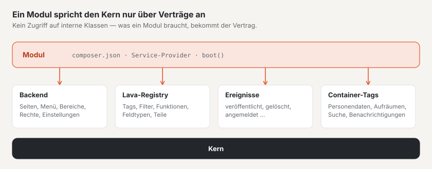

# Module und Plugins

Basalto hat **eine** Erweiterungs-Schnittstelle für beides: Module bringt Basalto mit (`modules/*`,
`basalto/module-*`), Plugins kommen von Dritten — technisch sind sie gleich gebaut. Eine
Erweiterung spricht den Kern nur über öffentliche Verträge an: die Backend-Schnittstelle, die Lava-Registry,
Domänenereignisse und Container-Tags. Was ein Modul braucht, bekommt der Vertrag — keine Zugriffe auf interne Klassen.



Zwei Beispiele unter `modules/`:

- `modules/example` — das kleinste Modul: eine Backend-Seite, ein Menüeintrag, eine
  Migration und Lava-Erweiterungen.
- `modules/comments` — ein echtes Modul: Lava-Tag, Frontend-Route, Moderation mit Zahl am
  Menü, Datenschutz und Löschlauf.

## Aufbau eines Pakets

```text
modules/example/
├── composer.json                 Paket, Service-Provider, Manifest
├── src/ExampleServiceProvider.php
├── src/Http/Controllers/…
├── database/migrations/…
├── lang/de/backend.php, lang/en/backend.php, lang/en.json …
└── resources/js/pages/Hello.vue  Inertia-Seite «example::Hello»
```

### `composer.json` mit Manifest

```json
{
    "name": "basalto/module-example",
    "type": "library",
    "require": { "php": "^8.4", "basalto/core": "*" },
    "autoload": { "psr-4": { "Basalto\\Modules\\Example\\": "src/" } },
    "extra": {
        "laravel": {
            "providers": ["Basalto\\Modules\\Example\\ExampleServiceProvider"]
        },
        "basalto": {
            "module": "example",
            "name": "Beispiel",
            "api": 1,
            "lava": "example",
            "switchable": true
        }
    }
}
```

| Schlüssel in `extra.basalto` | Bedeutung |
| --- | --- |
| `module` | Handle des Moduls — Kleinbuchstaben, Ziffern, `-` und `_`; zugleich Präfix in Lava und Namensraum der Inertia-Seiten |
| `name` | Anzeigename |
| `api` | Version der Erweiterungs-Schnittstelle, heute `1` |
| `lava` | Namensraum in Lava (gleich dem Handle) |
| `switchable` | ob das Modul je Site ein- und ausgeschaltet werden kann |
| `requires` | Handles anderer Module, die es braucht (z. B. der Marktplatz `["licensing"]`) — Angabe für Menschen und den Marktplatz; der Kern erzwingt sie heute nicht |

Laravel findet den Service-Provider über Package Discovery (`extra.laravel.providers`). Das `composer.json` im
Hauptordner der Installation bindet alle Ordner unter `modules/*` als lokale Pakete (`path`) ein.

`Backend::module()` liest das Manifest und legt es ab (`Backend::modules()`). Ob ein Modul schaltbar ist, bestimmt
der Parameter `switchable` beim Aufruf — der Eintrag im Manifest ist heute nur Angabe (für den Marktplatz).

## Service-Provider

Alles geschieht in `boot()`. Das Beispielmodul vollständig:

```php
final class ExampleServiceProvider extends ServiceProvider
{
    public function boot(): void
    {
        $root = dirname(__DIR__);
        $this->loadTranslationsFrom($root.'/lang', 'example');
        $this->loadJsonTranslationsFrom($root.'/lang');
        $this->loadMigrationsFrom($root.'/database/migrations');

        $backend = $this->app->make(Backend::class);
        $backend->pages('example', $root.'/resources/js/pages');
        $backend->module('example', 'example::backend.title', composerJson: $root.'/composer.json');
        $backend->menu('example::backend.title', 'basalto.example', 50, Backend::MODE_CONTENT, module: 'example', icon: 'module');
        $backend->routes(static function (): void {
            Route::get('example', HelloController::class)->name('example');
        });

        $this->app->extend(Registry::class, static function (Registry $registry): Registry {
            $registry->module('example')
                ->function('example.greeting', static fn (mixed $name): string => 'Grüezi '.(string) $name)
                ->tag('example.cart', static function (array $args, array $named): string { /* … */ })
                ->fieldType('example.price', ['input' => 'number', 'step' => 0.05, 'currency' => 'CHF']);

            return $registry;
        });
    }
}
```

## Backend-Schnittstelle: `Basalto\Core\Backend\Backend`

Ein Singleton im Container (`$this->app->make(Backend::class)`).

| Methode | Signatur | Zweck |
| --- | --- | --- |
| `module` | `module(string $handle, string $label, bool $switchable = true, ?string $composerJson = null, bool $enabledByDefault = true): self` | Modul anmelden; `$label` ist ein Übersetzungsschlüssel; `$composerJson` liefert das Manifest; `$enabledByDefault` falsch heisst ab Werk aus |
| `menu` | `menu(string $label, string $route, int $order = 100, string $mode = self::MODE_CONTENT, ?string $module = null, ?string $icon = null): self` | Menüeintrag; `$route` ist ein Routenname, `$mode` einer von `MODE_CONTENT` (Inhalte), `MODE_SETUP` (Einrichtung), `MODE_ADMIN` (Verwaltung). Mit `$module` verschwindet der Eintrag, wenn das Modul für die Site aus ist |
| `count` | `count(string $route, Closure $count): self` | Zahl am Menüeintrag dieser Route, je Site: `fn (Site $site): int` |
| `pages` | `pages(string $namespace, string $directory): self` | Verzeichnis mit Vue-Seiten unter einem Namensraum |
| `routes` | `routes(Closure $routes): void` | Routen unter dem Backend-Pfad (`basalto.backend.path`, Vorgabe `admin`) mit der Backend-Middleware (`web`, `auth`, aktives Konto, Site-Auswahl, Inertia) und Namenspräfix `basalto.` |
| `moduleEnabled` | `moduleEnabled(string $handle, Site $site): bool` | ist das Modul für diese Site an? |
| `modules`, `menuItems`, `menuByMode`, `counts`, `pageNamespaces`, `path`, `middleware`, `vite` | — | Lesen für den Kern |

Ein Beispiel für `count()` aus dem Kommentar-Modul — die Zahl wartender Kommentare am Menü:

```php
$backend->count('basalto.comments.index', static fn (Site $site): int => Comment::query()->withoutGlobalScopes()
    ->where('site_id', $site->id)->where('status', CommentStatus::Pending->value)->count());
```

### Routen

`routes()` hängt den Backend-Pfad und das Namenspräfix an: `Route::get('example', …)->name('example')` wird zu
`/admin/example` mit dem Namen `basalto.example` — passend zum Menüeintrag oben. Routen ausserhalb des Backends (etwa
der Versand von Kommentaren aus dem Frontend) legt das Modul selbst an:

```php
Route::post('comments/{entry}', CommentSubmissionController::class)->whereNumber('entry')
    ->middleware(['web', 'basalto.site'])->withoutMiddleware(ValidateCsrfToken::class)->name('basalto.comments.submit');
```

### Bereiche und Rechte

Jede Backend-Route gehört zu einem **Bereich** mit Gruppe (Inhalte, Einrichtung, Verwaltung). Das Modul meldet seine
Bereiche in `boot()` an und ordnet die Routen nach Präfix zu; einzelne Routen können eine höhere Stufe verlangen:

```php
app(Areas::class)->register('members', 'Mitglieder', Areas::CONTENT, 'members')
    ->map('basalto.members.', 'members')
    ->route('basalto.members.settings', 'members', Level::All);
```

Ohne eigene Angabe verlangt GET «ansehen», DELETE «löschen» und alles andere «bearbeiten». Die Middleware
`GuardAreaAccess` prüft jede Anfrage, das Menü blendet Einträge ohne Recht aus. Routen ohne Zuordnung verlangen
«Einstellungen · alles», und der Test `AreaCoverageTest` meldet sie. Im Code fragt man
`Gate::allows('area', [$site, 'members', Level::Delete])` oder `Access::allows()`; Sprachen prüft
`Access::authorizeLocale()`. Das Recht einer anderen Fähigkeit «auszuleihen» (etwa `update` der Site) ist nicht mehr
nötig. Wie Betreiber Rollen einstellen: [Rollen und Rechte](../betrieb/rollen.md).

### Inertia-Seiten mit Namensraum

Ein Controller rendert `Inertia::render('example::Hello', [...])`; der Teil vor `::` ist der Namensraum aus
`pages()`, der Teil danach der Pfad der Seite ohne `.vue`. Der Kern nutzt `core::…`.

```php
final class HelloController
{
    public function __invoke(Request $request): Response
    {
        $greeting = (new Renderer(app(Registry::class)))->render('{{ example.greeting(name) }}', ['name' => $request->user()->name ?? 'Gast']);

        return Inertia::render('example::Hello', ['greeting' => $greeting]);
    }
}
```

Der Kern baut die Seiten aller mitgelieferten Module in sein Bundle: `packages/core/resources/js/backend.ts` sucht
`modules/<namensraum>/resources/js/pages/<Seite>.vue`. Der Namensraum muss deshalb dem Ordnernamen unter `modules/`
entsprechen. Ein eigenes Build für Plugins Dritter (`resources/dist` mit Manifest über `vite()`) ist noch
offen.

### Je Site schaltbar

Schaltbare Module ein- und ausschalten: Verwaltung › Sites › Site bearbeiten › Reiter «Module». Gespeichert wird in
`sites.settings.modules.<handle>`; ohne Eintrag gilt die Vorgabe des Moduls — meist eingeschaltet, mit `module(…, enabledByDefault: false)` ab Werk aus (so Lizenzverkauf und Marktplatz, die nur auf basaltocms.com laufen). Menüeinträge mit `module:`
verschwinden von selbst. **Alles andere prüft das Modul selbst** mit `moduleEnabled()` — so macht es das
Kommentar-Modul in der Ausgabe des Tags, im Versand und in der Moderation:

```php
abort_if($site === null || ! $this->backend->moduleEnabled('comments', $site), 404);
```

Ausgeschaltet bleiben die Daten gespeichert.

## Lava erweitern: die Registry

Lava ruft nur auf, was registriert ist (`Basalto\Lava\Runtime\Registry`, eine Instanz je Anwendung). Ein Modul
erweitert die Instanz im Container und registriert **nur unter seinem Präfix** — über `module('handle')`, das eine
`Basalto\Lava\Runtime\ModuleRegistry` liefert. Ein Name ohne Präfix, mit fremdem Präfix oder einer, der schon belegt
ist, wirft eine `LogicException`. Themes registrieren nie etwas.

```php
$this->app->extend(Registry::class, static function (Registry $registry): Registry {
    $registry->module('comments')
        ->tag('comments.list', static fn (array $args, array $named, Context $ctx): string => app(CommentsRenderer::class)->render($named, $ctx));

    return $registry;
});
```

| Methode der `ModuleRegistry` | Signatur | In Lava |
| --- | --- | --- |
| `function` | `function(string $name, Closure $fn): self` — beliebige Parameter, erster ist beim Filter der Wert | `{{ example.greeting(name) }}`, `{{ preis \| example.money }}` |
| `tag` | `tag(string $name, Closure $fn): self` — `fn (array $args, array $named, Context $ctx): string` | `` |
| `fieldType` | `fieldType(string $name, array $options = []): self` | `field preis: example.price` |
| `property` | `property(string $keyword, string $name): self` | zusätzliche Eigenschaft, z. B. `property('type', 'example.sku')` → `example.sku:` in einem `type` |
| `part` | `part(string $name, string $label, array $settings, Closure $render): self` — `fn (array $settings, array $vars, string $lang): string` | Lava-Teil `part warenkorb: shop.cart { … }` |

Hinweise:

- **Tags geben HTML zurück** und maskieren selbst (`htmlspecialchars`). `$args` sind die Positions-, `$named` die
  benannten Argumente; `$ctx->get('page')` und `$ctx->get('site')` liefern die Variablen der Seite.
- **Fehler in einer Funktion oder einem Tag** (falscher Typ, fehlendes Argument) werden zum Lava-Fehler mit Zeile;
  das Theme sieht keinen PHP-Stack. Es gelten die Grenzen des Renderers (Zeit, Schleifen, Tiefe).
- **Feldtypen** aus Modulen kennt der Prüfer (`basalto:check`) und schlägt sie vor («`price` — meinten Sie
  `example.price`?»). Die Optionen (`['input' => 'number', …]`) legt die Registry ab (`fieldTypeOptions()`);
  ausgewertet werden sie vom Backend-Formular noch nicht.
- **Sprachdienst:** Registrierte Namen erscheinen in Vervollständigung und Hover, die Signatur liest der Sprachdienst
  aus der Closure.

## Domänenereignisse

Der Kern feuert Laravel-Events mit stabiler Nutzlast (Namensraum `Basalto\Core\Events`). Ein Modul hört mit
`Event::listen(…)` zu.

| Ereignis | Nutzlast | Wann |
| --- | --- | --- |
| `EntrySaved` | `Entry $entry, EntryVersion $version` | eine Sprachfassung wurde gespeichert (Entwurf) |
| `VersionTransitioned` | `EntryVersion $version, EntryStatus $from, EntryStatus $to, ?string $comment` | eine Fassung wechselte ihren Zustand im Workflow |
| `VersionPublished` | `EntryVersion $version` | eine Fassung ist live |
| `MediaUploaded` | `Media $media` | ein Medium wurde hochgeladen |
| `MediaTrashed` | `Media $media, int $usages` | ein Medium kam in den Papierkorb (mit Zahl der Inhalte, die es noch einbinden) |
| `MediaRestored` | `Media $media` | ein Medium kam aus dem Papierkorb zurück |
| `SiteCreated` | `Site $site` | eine Site wurde angelegt |
| `SiteUpdated` | `Site $site, array $before, array $after` | Stammdaten einer Site geändert |
| `UserLoggedIn` | `Authenticatable $user, string $method` | Anmeldung im Backend (Code, Link oder Passkey) |

Alle Eigenschaften sind `public readonly`.

Wer bei einem Ereignis Personen benachrichtigen will — in der Glocke und per E-Mail, nach ihren Einstellungen —, meldet
eine Art an und ruft `Notify` auf: siehe [Benachrichtigungen](benachrichtigungen.md).

## Datenschutz: Container-Tags

Personendaten in Modultabellen hängen sich an Auskunft, Löschung und Löschlauf des Kerns über zwei Container-Tags.
Beide erwarten eine **Closure** im Container.

| Tag | Aufgerufen von | Signatur der Closure | Rückgabe |
| --- | --- | --- | --- |
| `basalto.person-data` | `Basalto\Core\Privacy\PersonData` (`basalto:privacy`, Profil und Benutzerverwaltung im Backend) | `fn (string $email, bool $delete): array` | bei Auskunft je Art eine Liste (wird an die Auskunft angehängt), bei Löschung je Art eine Zahl |
| `basalto.cleanup` | `basalto:cleanup` (täglich 03:00) | `fn (Settings $settings): array` | je Art die Zahl gelöschter Datensätze; erscheint in Ausgabe und Protokoll |

So bindet das Kommentar-Modul beide an:

```php
$this->app->instance('basalto.person-data.comments', (new CommentPersonData)(...));
$this->app->tag(['basalto.person-data.comments'], 'basalto.person-data');
$this->app->instance('basalto.cleanup.comments', CommentPersonData::cleanup(...));
$this->app->tag(['basalto.cleanup.comments'], 'basalto.cleanup');
```

`CommentPersonData::__invoke(string $email, bool $delete): array` liefert `['kommentare' => [...]]` bzw.
`['kommentare' => $anzahl]`; `CommentPersonData::cleanup(Settings $settings): array` löscht je Site Spam und
Gelöschtes nach der Frist `comments.retention_days` (Vorgabe 365) und liefert `['Kommentare' => $anzahl]`. Die
E-Mail-Adresse kommt kleingeschrieben und ohne Leerraum an; die Suche gilt über alle Sites.

## Frontend-Konto und geschützte Seiten

Das **Frontend-Konto** gehört dem Kern (`Basalto\Core\FrontendAccounts`). Lizenzverkauf, Marktplatz und Mitglieder teilen es, ohne voneinander abzuhängen. Ältere Namen aus dem Lizenzverkauf
(`Basalto\Modules\Licensing\Accounts\Customer`, `CustomerAuth`, `CustomerLogin`, `CustomerLoginCode`,
`Frontend\LoginForm`, `Http\CustomerLoginController`, `Http\Middleware\…`, `Notifications\CustomerLoginCodeNotification`)
bleiben als `class_alias` und gelten als veraltet; neuer Code nimmt die Namen im Kern. Ein Alias ist dieselbe Klasse
(`instanceof` gilt für beide Namen) — nur Vergleiche über den Klassennamen als Zeichenkette (etwa
`Notification::assertSentTo(…, AlterName::class)`) sehen den Namen im Kern.

| Schnittstelle | Zweck |
| --- | --- |
| `CustomerAuth::useFor('modul', ?Policy::class)` | Das Modul nutzt das Konto (im `boot()`). Die Routen `POST /account/login`, `/account/code`, `/account/logout` und die Anmeldeseite `GET /account/login` antworten auf einer Site nur, wenn eines der nutzenden Module an ist. |
| `RegistrationPolicy::opensRegistration(Site)` | Darf die Anmeldung auf der Site neue Konten anlegen? Ohne Regel ja. Lässt keines der eingeschalteten Module sie zu, gehen Codes nur an Adressen mit Konto (die Antwort an den Browser bleibt gleich). |
| `CustomerAuth::current()` · `::available(Site)` · `::MIDDLEWARE` (`basalto.customer`) | Wer angemeldet ist (nur Konten der Site der Anfrage), ob es das Konto auf der Site gibt, Middleware für Routen nur mit Konto |
| `LoginForm::render($request, $lang, $pfad, $intro, $zweck)` | Das Anmeldeformular für eigene Tags; `$zweck` (z. B. `members`) kommt nach dem Code als `CustomerSignedIn::$purpose` zurück |
| Ereignis `Events\CustomerSignedIn` (`customer`, `site`, `purpose`) | Nach dem richtigen Code — die Mitglieder legen damit beim ersten Mal die Mitgliedschaft an |

**Bereiche im Kundenkonto:** Der Tag `` (Lava-Teil «Kundenkonto», Einstellungen `buy`, `entry`, `catalog`, `start`) zeigt das ganze Konto: einen kompakten Kopf mit Begrüssung, links die Bereiche als Navigation (Zahl, Hinweispunkt), rechts immer einen — zuerst die Übersicht mit «Als Nächstes», einer Kachel je Bereich und «Zuletzt». Jeder Bereich hat den Anker `#konto-<key>`; ein Anker irgendwo in einem Bereich (`#lizenz-12`) öffnet diesen Bereich. Ein Modul steuert einen Bereich bei, indem es im `boot()` eine Klasse anmeldet — `app(AccountAreas::class)->add(MeinBereich::class)` — die `Basalto\Core\FrontendAccounts\Hub\AccountArea` erfüllt:

| Methode | Zweck |
| --- | --- |
| `key()` · `position()` | Anker `#konto-<key>` und Reihenfolge (Sites 10, Lizenzen 20, Installationen 30, Marktplatz 40, Community 50, Rechnungen 60, Profil 90) |
| `pitch($page)` | Für Gäste: Symbol, Titel und ein Satz (`AreaPitch`) — oder `null` |
| `summary($page)` | Angemeldet: `AreaSummary` mit Bezeichnung, Symbol, Zahl, Ton (`lava`, `warn`), Aufgaben (`AreaTodo`), Ereignissen (`AreaEvent`), Knöpfen (`AreaAction`) und Meldungen — `null` blendet den Bereich aus |
| `render($page, $summary)` | Der Inhalt des Abschnitts; Rahmen, Überschrift und Anker setzt das Konto |

Der Bereich entsteht je Ausgabe neu und darf zwischen `summary()` und `render()` Daten halten. `AccountPage` liefert Site, Sprache, Pfad, Anfrage, angemeldetes Konto und `t()` für Texte, `Icons::svg()` die Symbole des Kontos. Bausteine im Markup: `konto-zeilen` mit `konto-zeile`, `konto-sechseck`, `konto-chip`, `konto-knopf`, `konto-leer`, `konto-klappe`.

**Geschützte Seiten:** Der Kern kennt den Schutz (Reiter «Zugriff», `access.protected`, vererbt über
`access.children`; `Pages::isProtected()`), lässt geschützte Seiten in Navigation und Listen nur für Berechtigte und in
Sitemap, Suchindex und Feeds nie zu und antwortet Gästen mit 401 (Angemeldeten ohne Recht mit 403). Wer sie sehen darf,
entscheidet ein Modul über `PageAccess::useGate(Gate::class)` mit dem Vertrag `Basalto\Core\Content\ProtectedPageGate`
(`enabled`, `adminUrl`, `allows`, `denied`, `login`); ohne Modul sieht sie nur die Backend-Redaktion der Site. Eigene
Listen eines Moduls fragen `app(PageAccess::class)->mayView($entry)`.

**Datenschutz:** `PersonData` ruft zuerst die Module (`basalto.person-data`) und **danach** die Frontend-Konten des
Kerns — ein Modul findet seine Daten also beim Löschen noch über die E-Mail des Kontos; anonymisieren muss es das Konto
nicht.

## Pflichten einer Erweiterung

Was jede Erweiterung einhalten muss:

1. **Site-Scope** auf jeder Tabelle mit Inhalten einer Site: Spalte `site_id` und im Modell der Trait
   `Basalto\Core\Sites\BelongsToSite` (globaler Scope auf die aktuelle Site, `site_id` beim Anlegen) — dazu ein Test,
   dass eine zweite Site nichts sieht.
2. **Übersetzungen** für die Oberfläche (DE, EN, IT, FR) unter `lang/`; Menü-Labels sind Übersetzungsschlüssel.
3. **Migrationen** im Paket (`loadMigrationsFrom`), nie im Kern.
4. **Personendaten** an `basalto.person-data` und, wenn es Fristen gibt, an `basalto.cleanup` anschliessen.
5. **Export:** Jede Tabelle mit `site_id` muss im Site-Export enthalten oder begründet ausgenommen sein — ein Test im
   Kern wird sonst rot. Eine Schnittstelle, über die Module ihre Tabellen selbst exportieren, ist noch offen; bis
   dahin steht die Begründung in `Basalto\Core\Transfer\SiteExporter::EXCLUDED` (so beim Kommentar-Modul).

## Weiter

- [Lava — die Theme-Sprache](lava.md)
- [Benachrichtigungen](benachrichtigungen.md)
- [REST-API](api.md)
