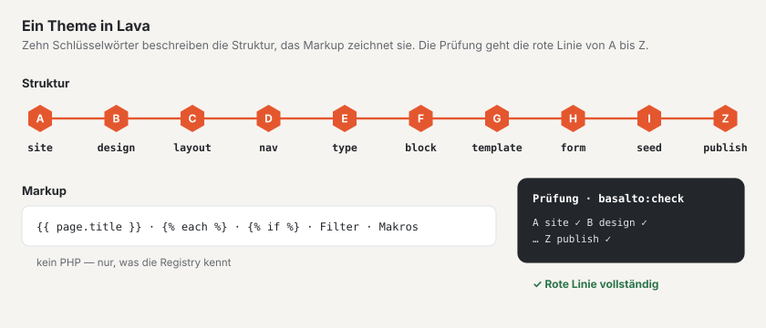

# Lava — die Theme-Sprache

Lava beschreibt ein ganzes Theme in einer Sprache: Struktur (Site, Design, Layouts, Menüs, Inhaltstypen, Blöcke,
Templates, Formulare, Startinhalte, Veröffentlichung) und Markup. Das Markup kennt Ausgaben, Schleifen, Bedingungen,
Makros, Filter und Funktionen — aber kein PHP. Ein Theme kann deshalb keinen Code ausführen und nichts registrieren;
erweitern lässt sich Lava nur über die Registry des Kerns und der Module ([Module und Plugins](erweiterungen.md)).

Massgeblich für die Syntax ist die Grammatik in `packages/lava/grammar/lava-1.ebnf` (siehe [Grammatik](#grammatik)).



## Aufbau eines Themes

Ein Theme ist ein Ordner unter `themes/` (oder unter `BASALTO_THEMES_PATH`). Als Vorlage dient
`themes/starter`, siehe [Themes](themes.md).

| Datei oder Ordner | Pflicht | Zweck |
| --- | --- | --- |
| `theme.lava` | ja | Einstieg. Beginnt mit der Versionszeile `lava 1` (fehlt sie, warnt der Prüfer). Kann weitere `.lava`-Dateien mit `include "datei.lava"` einbinden — nur auf oberster Ebene, nur innerhalb des Ordners, ohne Zirkel. |
| `<ordner>/<name>.lava.html` | nein | Markup eines Elements als eigene Datei statt im Zaun: `layouts/`, `blocks/`, `templates/`, `navs/`, `parts/`. Die Datei gewinnt über den Zaun in der Definition. |
| `assets/` | nein | Stylesheets, Skripte, Schriften, Bilder — ohne Build ausgeliefert. Erlaubte Endungen: `css`, `js`, `svg`, `woff2`, `woff`, `png`, `jpg`, `jpeg`, `webp`, `avif`, `ico`. Die Adresse trägt eine Prüfsumme (`/_theme/{site}/{hash}/{pfad}`), jede Änderung bekommt eine neue. |
| `assets/preview.(webp\|png\|jpg\|svg)` | nein | Vorschaubild in Einrichtung › Themes (in dieser Reihenfolge gesucht). |
| `theme.json` | nein | Angaben für die Theme-Verwaltung und das Paket: `label`, `author`, `version`, `license`, `description`. Ohne `label` gilt der Name aus `site`; ohne `version` packt `basalto:theme-pack` als `0.0.0`. |

```json
{
    "label": "Starter",
    "author": "Basalto",
    "version": "1.0.0",
    "license": "MIT",
    "description": "Das Beispiel-Theme von Basalto …"
}
```

## Struktur-Teil in Kürze

```lava
lava 1

# Kommentar bis Zeilenende (ausser «#» beginnt eine Farbe wie #b53f1d)
site starter {
  name: "Starter"
  languages: de, en            # Liste, Kommas freiwillig
  default: de
  domain: example.ch
}

type page {
  label: "Seite"  label.en: "Page"        # Sprachsuffix aus zwei Kleinbuchstaben
  field title: text required translatable # Element mit Typ und Flags hinter «:»
  field content: blocks { allow: hero, text }
  route: /{slug}                           # Pfad mit Platzhalter
  template: default                        # Verweis auf eine Definition
}

layout landing extends standard {          # Modifikator hinter dem Namen
  region hero before main
}
```

- **Elemente** haben die Form `wort name: typ flags { … }`; **Eigenschaften** die Form `schluessel: werte`.
- **Werte:** Zeichenketten in `"…"` oder `'…'`, Zahlen, `true`/`false`, Farben `#rgb` bis `#rrggbbaa`, Pfade `/…`,
  Verweise (blosse Wörter) und Pfeile `->` (Ziel eines Menüeintrags oder Links im Seed).
- **Zeilenumbrüche zählen:** Sie beenden eine Eigenschaft. Ein Element je Zeile, wenn nur Werte folgen.
- **Markup** steht in einem Zaun hinter dem Wort `markup` (drei Backticks davor und danach, wie in Markdown) oder in
  einer `.lava.html`-Datei (siehe oben). Der Zaun wird roh übernommen; gemeinsame Einrückung fällt weg.
- **Sprachvarianten:** `label.en`, `label.it`, `label.fr` … gelten in der jeweiligen Sprache; der Wert ohne Suffix ist
  Deutsch. Fehlt eine Sprache, nimmt Basalto Englisch und erst dann den Wert ohne Suffix — eine französische
  Oberfläche zeigt also «Hero» statt «Bühne», solange `label.fr` fehlt.
- **Logik gehört ins Markup:** Ein Wert mit `{{` oder `{%` in einem Struktur-Teil ist eine Warnung.

## Die zehn Schlüsselwörter und die rote Linie A–Z

Ein Theme beantwortet zehn Fragen, je Frage eine Station. `php artisan basalto:check` und die Einrichtung im Backend
zeigen dieselbe Linie (Quelle: `Basalto\Lava\Diagnostics\Step`, `Basalto\Lava\Theme\Line`).

| Station | Schlüsselwort | Frage | Eigenschaften · Unterelemente |
| --- | --- | --- | --- |
| A | `site` | Wer bin ich? | `name languages default domain redirects timezone` |
| B | `design` | Wie sehe ich aus? | `space radius images css logo` · `color font images` |
| C | `layout` | Wo steht was? | `region`, Markup; dazu Lava-Teile `part` |
| D | `nav` | Wie findet man sich zurecht? | `from items depth start exclude only label` · `item`, Markup |
| E | `type` | Welche Inhalte gibt es? | `label route template` · `field`; dazu `global` (`label` · `field`) |
| F | `block` | Woraus bestehen Seiten? | `label group hint` · `field`, Markup |
| G | `template` | Wie wird ein Inhalt gezeigt? | `for layout noindex` · `region`, Markup |
| H | `form` | Wie erreicht man mich? | `label to subject thanks spam submit store redirect webhook retain consent` · `field` |
| I | `seed` | Womit fange ich an? | `page global` und jeder Typname (`post …`, `person …`) |
| Z | `publish` | Darf es raus? | `seo sitemap robots cookie legal redirects check` · `seo legal redirects` |

**Dunkle Darstellung:** Eine Farbe in `design` kann einen zweiten Wert für dunkel tragen, `color text: #23262b dark #ebe8e3`.
Er gilt, wenn das Betriebssystem der Besucher dunkel eingestellt ist oder sie mit `` «dunkel» wählen;
«hell» gewählt bleibt hell. Farben ohne dunklen Wert gelten in beiden Darstellungen. `basalto:check` rechnet die
Kontraste auch für die dunkle Palette.

**Blöcke in der Palette:** `group` ordnet einen Block einer Gruppe der Palette im Editor zu, `hint` ist ein
Satz darunter — beides mit Sprachvarianten wie `label`:

```lava
block hero {
  label: "Bühne"  label.en: "Hero"
  group: "Einstieg"  group.en: "Intro"
  hint: "Grosser Titel mit Einleitung, Bild und Knöpfen — oben auf der Seite."
  field title: text required translatable
}
```

Ohne `group` ordnet der Editor nach den Feldern (Bild und Überschrift mit Knopf → «Einstieg», Wiederholungen →
«Listen und Raster», Knopf ohne Bild → «Aktionen», keine Inhaltsfelder → «Aus Daten», sonst «Text» oder «Bilder»);
ohne `hint` stehen die Feldnamen da. Das **Schema** jeder Karte zeichnet der Editor selbst aus den Feldern: eine
Überschrift (`title`, `heading`) als dicker Balken, Fliesstext als Zeilen, ein Bild (`image` oder ein Text-Feld `art`,
`cover`, `logo`) als Bildfläche, Links als Knöpfe, Repeater als Karten, Zahlen, Schritte oder aufklappbare Fragen
(nach ihren Feldern `question`, `value`). Begleitfelder wie `art_overlay` oder `cta_label` zeichnen nichts eigenes.

**Felder im Formular:** Was die Redaktion im Block-Formular sieht, kommt aus dem Feld — alles mit
Sprachvarianten wie `label`:

```lava
block hero {
  field title: text required translatable { label: "Titel"  label.en: "Title"  placeholder: "z. B. Willkommen" }
  field cta: link { label: "Knopf" }
  field cta_label: text translatable { label: "Beschriftung des Knopfs"  help: "Leer = Titel der Zielseite"  from: "cta.label" }
  field art_credit: text advanced { label: "Bildnachweis" }
}
```

- `label` — die Beschriftung. Ohne sie macht der Editor aus dem Namen einen lesbaren Text (`cta_label` → «Knopf ·
  Beschriftung», `art_overlay` → «Bild · Grafik darüber»); Feldnamen in Grossbuchstaben erscheinen nicht mehr.
- `help` — ein Satz unter dem Feld; `placeholder` — ein Beispiel im leeren Feld.
- `from` — das Feld, dessen Wert gilt, solange dieses leer ist; das leere Feld zeigt ihn als «leer = «…»». Ein
  Feld `x_label` neben einem Link `x` gilt auch ohne `from` so. Das Markup entscheidet weiter selbst
  (`{{ cta_label | default(cta.label) }}`) — `from` erklärt es nur der Redaktion.
- `pick: image` an einem Text-Feld (eine Bildadresse wie `art`) — das Formular zeigt die Mediathek als Dialog mit
  Hochladen und Hineinziehen; gespeichert wird `media:<id>`, und das Markup bekommt die Adresse des Bildes. Eine Datei
  unter `assets/` des Themes lässt sich weiter eintippen; `asset()` lässt volle Adressen (`https://…`) unverändert.
- Flag `advanced` — das Feld steht unter «Weitere Möglichkeiten». Ohne `advanced` im Block stehen Pflichtfelder,
  ausgefüllte Felder und je Art das erste Feld oben (Text, Fliesstext, Bild, Link, verschachtelte Blöcke, Repeater),
  aufgefüllt auf drei; Blöcke mit bis zu vier Feldern zeigen alles.

Ausserdem gibt es auf oberster Ebene `global` (zählt zu E), `part` (zählt zu C) und `include` (keine Station). Module
können weitere Eigenschaften je Schlüsselwort registrieren (immer mit Präfix, z. B. `example.sku`).

### Status je Station

- `✓` — die Station ist vorhanden und fehlerfrei; dahinter eine Zusammenfassung (z. B. «2 Sprachen», «11 Blöcke»).
- `✗` — ein Fehler dieser Station (der erste mit Zeile und Vorschlag) oder das Schlüsselwort fehlt («`nav` fehlt»).
- `–` — nur bei Z: «wartet auf die Schritte davor», solange eine frühere Station `✗` hat und `publish` fehlt.

«Rote Linie vollständig — bereit für publish» erscheint, wenn alle zehn Stationen `✓` haben und kein Fehler vorliegt.
Warnungen (`!`) halten die Linie nicht auf.

### Was jede Station prüft

Für alle Stationen gilt: Ein unbekanntes Schlüsselwort ist ein **Fehler** mit Vorschlag («`desing` — meinten Sie
`design`?»). Unbekannte Eigenschaften und Unterelemente sind **Warnungen** mit Vorschlag — sie brechen das Theme nicht.

| Station | Fehler (`✗`) | Warnungen (`!`) |
| --- | --- | --- |
| A `site` | — | unbekannte Eigenschaft |
| B `design` | Farbwert kein `#rgb`, `#rrggbb` oder `#rrggbbaa`; `css` nicht `.css`, `logo` nicht `.svg/.png/.webp/.jpg/.jpeg`, Schrift-`src` nicht `.woff2/.woff`; Datei fehlt im Theme-Ordner | Kontrast unter WCAG 2.2 AA (4,5:1 für Text) für die Paare `text`, `muted`, `link` auf `background` sowie `X-text` oder `on-X` auf `X` |
| C `layout`, `part` | `extends` auf unbekanntes Layout; Markup-Syntax; Region mit `part`, `nav` oder `global`, das es nicht gibt; Teil mit unbekannter Art; Teil ohne `source:` (bei `nav`, `global`, `form`, `sitemap`, `list`) oder mit unbekannter Quelle | Einstellung, die die Art des Teils nicht kennt; Markup mehr als 6 Ebenen `each`/`if` tief |
| D `nav` | Menüeintrag ohne Ziel `-> …`; Ziel ist keine Seite aus `seed`; `only:`/`exclude:` nennt unbekanntes Template; `from:` ist weder `pages` noch ein Typ; `items:` ausser `db`; Markup-Syntax | Verschachtelung |
| E `type`, `global` | Feld ohne Typ; unbekannter Feldtyp (Kern und Module, mit Vorschlag); `blocks { allow: … }` mit unbekanntem Block; `relation <typ>` mit unbekanntem Typ (erlaubt: `form`, `page`, `global` oder ein Typ des Themes); `template:` unbekannt | — |
| F `block` | wie E für Felder; Markup-Syntax | Verschachtelung |
| G `template` | ohne `for:` oder für unbekannten Typ; ohne `layout:` oder unbekanntes Layout; Region, die das Layout (samt `extends`) nicht hat; `nav`, `global` oder `part` in einer Region, die es nicht gibt; Markup-Syntax | Verschachtelung |
| H `form` | Formularfeld ohne Typ oder mit unbekanntem Typ; `select`/`radio` ohne `options:`; Felder in `group` ebenso | — |
| I `seed` | Seite mit unbekanntem `template:`; Block in `content { … }`, den es nicht gibt | `{{`/`{%` in Werten (Logik in Struktur) |
| Z `publish` | `legal { … }` verlangt eine Seite, die in `seed` fehlt | — |

Feldtypen des Kerns: `text textarea richtext blocks markdown number checkbox bool date datetime select tags image
gallery file link relation repeater slug email url color code seo json` — dazu die der Module (`example.price`).

Formular-Feldtypen: `text email number tel url date textarea select radio checkbox file range hidden explanation group`.

Was `basalto:publish` zusätzlich gegen die Datenbank prüft (`check: links, images, alt-texts, translations, forms`
sowie immer Rote Linie, Rechtsseiten und Umleitungen), steht in `Basalto\Core\Publish\PublishChecks`.

## Markup

Markup steht im Zaun eines `layout`, `nav`, `block`, `template` oder `part` (Art `html`) oder in der passenden
`.lava.html`-Datei.

### Ausgaben, Kommentare, Variablen

```lava
{{ page.title }}                 {# immer HTML-maskiert #}
{{ raw body }}                   {# unmaskiert — nur für Fliesstext aus dem Editor (richtext), der Kern bereinigt ihn #}
{{ title | upper }}              {# Filter #}
{{ count(items) }}               {# Funktion #}
{# Kommentar, erscheint nicht in der Ausgabe #}

```

Zugriff mit `.` und `[…]` geht nur auf Arrays und öffentliche Eigenschaften, nie auf Methoden. Ein unbekannter Name
ergibt `null`; eine Funktion ohne Klammern ist ein Fehler.

| Variable | Wo | Inhalt |
| --- | --- | --- |
| `site.name`, `site.language`, `site.domain`, `site.logo` | überall | Site aus `site`, aktuelle Sprache, Logo-Adresse |
| `site.cancellation` | überall | Adresse von «Verträge hier kündigen» — leer, wo sich nichts kündigen lässt |
| `page.*` | Seiten | `title`, `intro`, Felder des Typs, `url`, `path`, `locale`, `is_home`, `canonical`, `image`, `alternates` (je `locale`, `url`), `breadcrumbs` |
| `content` | Template-Markup | die gerenderten Blöcke der Seite (mit `{{ raw content }}` ausgeben) |
| `regions.<name>` | Layout-Markup | `true`, wenn die Region Inhalt hat (z. B. ``) |
| Feldnamen, `block.name`, `block.index` | Block-Markup | Werte der Blockfelder, Name und Position des Blocks |
| `nav.name`, `nav.label`, `nav.items` | Nav-Markup | je Eintrag `href`, `label`, `current`, `active`, `new_window` |
| `loop.index`, `loop.index0`, `loop.first`, `loop.last`, `loop.length` | in `each` | Zähler der Schleife |

### Schleifen und Bedingungen

```lava

  <li>{{ loop.index }}. {{ item.title }}</li>

  <li>Noch nichts da.</li>


{{ key }}={{ value }}

………
```

### Ausdrücke

| Art | Schreibweise |
| --- | --- |
| Logik | `and` `&&` · `or` `\|\|` · `not` `!` |
| Vergleich | `==` `!=` `<` `>` `<=` `>=` · `in`, `not in` (Liste oder Teilzeichenkette) |
| Rechnen | `+` `-` `*` `/` `%` (Division durch null ist ein Fehler) |
| Verketten | `~` (`"Seite " ~ loop.index`) |
| Bedingt | `a if bedingung else b` |
| Literale | Zahlen, `"…"`/`'…'`, `true`, `false`, `null`, Listen `[1, 2]`, Maps `{ key: wert }` |

Reservierte Wörter: `and or not in if else true false null as with`.

### Makros und Einbindungen

```lava
<a class="card" href="{{ href }}">{{ title }}</a>

   {# drei gleichwertige Aufrufe #}

{{ card("Kontakt", "/kontakt") }}

       {# liest parts/card.lava.html; «with» gibt Variablen mit #}
```

`include` liest `<pfad>.lava.html` aus dem Theme — nie ausserhalb des Ordners. Ist der Wert hinter `with` eine Map,
werden ihre Schlüssel zu Variablen; sonst heisst er `item`.

### Tags

Ein Tag ist ``; Argumente trennen Leerzeichen oder Kommas.

| Tag | Wirkung |
| --- | --- |
| `` | Zeichensatz, Viewport, Design-Variablen der Site und Stylesheets des Themes — zuerst im `<head>` |
| `` | Umschalter hell/dunkel für Besucher (Sonne/Mond, Wahl im Browser gespeichert) — nur, wenn `design` dunkle Farben hat |
| `` | Titel, Beschreibung, Canonical, `robots` und Open-Graph-Angaben der Seite (aus `publish.seo` und den Seitendaten) |
| `` | Inhalt einer Region (im Layout-Markup) |
| `` · `` · `` | Navigation, Lava-Teil oder Formular an dieser Stelle |
| `` | Bild mit Variante aus `design.images` (WebP mit `srcset`, AVIF-Quelle, Breite und Höhe, `loading`) |
| `` | Link aus einem `link`-Feld |
| `` | Text maskiert ausgeben |
| `` · `` | Brotkrumen und Sprachwechsel mit dem Standard-Markup (eigenes Markup über `page.breadcrumbs` und `page.alternates`) |
| `` · `` | Teilen: E-Mail und Netzwerke als gewöhnliche Links (nichts geht vor dem Klick hinaus), «Link kopieren» und das Teilen des Geräts; Adresse und Titel der Seite, wenn nicht angegeben |
| `` · `` · `` | Seitenblättern, Kategorien und Archiv zu `entries()` |
| `` | Suchformular und Treffer der Site |
| `` | verschachtelte Blöcke eines `blocks`-Felds (schon gerendert) |
| `` · `` | siehe oben |
| `` | Kommentare (Modul `comments`); Module bringen eigene Tags mit Präfix |
| `` · `` · `` | Anmelden/Abmelden, Anmeldung und Mitgliedschaft (Modul `members`, siehe unten) |

Ein unbekanntes Tag scheitert beim Rendern, nicht beim Prüfen.

### Tags der Mitglieder

Das Modul «Mitglieder» (`members`) bringt drei Tags mit — auch als Lava-Teile gleichen Namens, also in einer
Region (`region header: part konto`) oder als Block einer Seite. Alle drei geben **nichts** aus, wenn das Modul für
die Site aus ist. Fehlt das Modul in der Installation ganz, scheitert ein Tag beim Rendern (wie jedes unbekannte Tag) —
darum steht er in einem Theme, das auch ohne das Modul laufen soll, in einer Bedingung:

```lava
<div class="header-account"></div>
```

`site.modules` nennt die Module, die für die Site an sind (`site.modules.comments`, `site.modules.members` …).

| Tag | Gäste | Angemeldet | Einstellungen |
| --- | --- | --- | --- |
| `` | Link «Anmelden» (`a.members-link`) zur Anmeldeseite | Knopf «Abmelden» (`form.members-link.is-signed-in`) | `login: "/pfad"` — Ziel von «Anmelden»; sonst die Anmeldeseite aus den Einstellungen der Mitglieder bzw. `/account/login` |
| `` | Anmeldung per Mail-Code (`section.account-login#konto-anmeldung`) — wer sich darüber anmeldet, tritt nach der Regel der Site bei | «Angemeldet als … · Abmelden» (`form.account-signed-in`) | — |
| `` | wie `members.login` | Stand der Mitgliedschaft (`section.members-panel#konto`): aktiv seit …, wartet auf Freigabe, gesperrt, keine Einladung — oder «Mitglied werden» (`form.members-join`) — dazu «Abmelden» | — |

Geschützte Seiten zeigen Gästen die Anmeldung von selbst (die Fehlerseite 401 der Site oder eine Seite «Anmeldung
erforderlich» im Layout des Themes, an der Stelle von `page.intro`, sonst am Anfang von `<main>`); dafür braucht das
Theme keinen Tag. Für Gäste ist die Ausgabe für alle gleich und darf aus dem Seiten-Cache kommen (der erste Schritt der
Anmeldung hat kein CSRF-Token); wer angemeldet ist, bekommt nie eine Seite aus dem Cache. Gestalten lassen sich die
Klassen `account-login`, `account-form`, `account-intro`, `account-status`, `account-signed-in`, `members-panel`,
`members-state` (mit `is-active`, `is-pending`, `is-blocked`, `is-none`), `members-join`, `members-link` sowie die
Formular-Klassen des Kerns (`form`, `form-field`, `form-error`, `form-help`). Das Starter-Theme zeigt ein Beispiel.

### Grenzen

Beim Rendern gelten höchstens 10 000 Schleifendurchläufe, 2 Sekunden und eine Verschachtelung (Einbindung, Makro,
Schleife, Bedingung) bis Tiefe 8 (`Basalto\Lava\Runtime\Limits`); darüber bricht das Rendern mit einem Lava-Fehler
samt Zeile ab. Der Prüfer warnt schon ab 7 Ebenen `each`/`if`. Ein PHP-Fehler in einer registrierten Funktion wird
zum Lava-Fehler mit Zeile — das Theme sieht nie einen PHP-Stack.

## Lava-Teile

Ein **Teil** ist ein fertiger Baustein mit Einstellungen, einmal definiert und in Regionen oder im Markup platziert:

```lava
part main_nav: nav {
  source: main
  label: "Hauptnavigation"  label.en: "Main navigation"
}
part lang_switch: languages

layout standard {
  region header: part main_nav, part lang_switch    # Vorgabe-Füllung der Region
  region main
  …
}
```

Im Markup steht derselbe Teil als ``. Teile zählen zu Station C.

| Art | Beschriftung | Einstellungen | Ausgabe |
| --- | --- | --- | --- |
| `nav` | Navigation | `source depth start only exclude label` | die Navigation `source`; die Einstellungen der Instanz überschreiben die der `nav` |
| `breadcrumbs` | Brotkrumen | — | Brotkrumen der Seite |
| `languages` | Sprachwechsel | — | Links auf die Sprachfassungen |
| `global` | Globaler Inhalt | `source` | Felder des globalen Inhalts |
| `form` | Formular | `source` | das Formular |
| `sitemap` | HTML-Sitemap | `source depth start only exclude label` | alle Ebenen der Navigation `source` |
| `search` | Suche | — | wie `` |
| `list` | Liste | `source per label` | neueste Inhalte des Typs `source` |
| `html` | HTML | — | eigenes Markup im Zaun des Teils |

Module registrieren eigene Arten mit Präfix (`shop.cart`), siehe [Module und Plugins](erweiterungen.md).

Was eine Region sonst noch füllen kann (im Layout als Vorgabe, im Template je Typ): `content`, `content.first`,
`content.rest` (die Blöcke der Seite, ganz oder geteilt), `nav <name>`, `global <name>`, `part <name>`,
`breadcrumbs`, `languages`.

Nicht zu verwechseln mit zwei anderen Arten der Wiederverwendung:

- `include "datei.lava"` auf oberster Ebene fügt weitere **Struktur** in `theme.lava` ein. Eine benannte Definition, die
  es mit Art und Name schon gibt (etwa `nav main`), ersetzt die frühere. So ersetzt die Lava einer Site — sie wird am
  Ende eingebunden — ein Menü oder einen Block des Themes; die Demo nutzt das für ihr eigenes Hauptmenü.
- `` im Markup bindet eine **Markup-Datei** `parts/karte.lava.html` ein.

## Filter und Funktionen

Filter und Funktionen sind dieselbe Liste: `{{ wert | name(a, b) }}` ruft `name(wert, a, b)` auf. Registriert sind
sie in `Basalto\Lava\Runtime\Registry::standard()`; `entries` setzt die Anwendung beim Rendern einer Seite.

| Name | Aufruf | Ergebnis |
| --- | --- | --- |
| `count` | `count(liste)` | Anzahl Elemente, sonst `0` |
| `length` | `text \| length` | Zeichen eines Textes (Unicode) oder Anzahl Elemente |
| `upper`, `lower` | `text \| upper` | Gross- bzw. Kleinschreibung (Unicode) |
| `truncate` | `text \| truncate(100, "…")` | gekürzt auf n Zeichen, Ende angehängt (Vorgabe 100 und `…`) |
| `date` | `datum \| date("d.m.Y")` | Datum im PHP-Format, Vorgabe `d.m.Y`; nimmt Zeitstempel oder Datumstext |
| `join` | `liste \| join(", ")` | Elemente verbunden, Vorgabe `, ` |
| `first`, `last` | `liste \| first` | erstes bzw. letztes Element |
| `keys` | `map \| keys` | Schlüssel einer Map |
| `default` | `wert \| default("–")` | Ersatz, wenn der Wert `null`, leer oder eine leere Liste ist |
| `json` | `wert \| json` | JSON (Unicode und `/` unmaskiert) |
| `range` | `range(1, 5)` | Liste von a bis b, höchstens 10 000 Elemente |
| `url` | `"blog/a" \| url` | Adresse mit führendem `/`; `http…` bleibt unverändert |
| `t` | `text \| t` | den Text unverändert — Platzhalter, eine Übersetzung findet noch nicht statt |
| `nl2br` | `{{ raw text \| nl2br }}` | maskiert und fügt `<br />` ein — darum mit `raw` ausgeben |
| `replace` | `text \| replace("a", "b")` | ersetzt jede Fundstelle |
| `slug` | `text \| slug` | Kleinbuchstaben, alles ausser `a–z` und `0–9` wird zu `-` (Umlaute fallen weg: «Zürich» → `z-rich`) |
| `entries` | `entries("post", 10)` | veröffentlichte Inhalte eines Typs mit Seitenblättern (je Eintrag u. a. `url`, `title`, `date`, `intro`, `category`, `category_url`, `author`) |
| `asset` | `asset("demo/editor.svg")` | Adresse einer Datei unter `assets/` des Themes (Bilder, Grafiken), mit Prüfsumme — leer, wenn die Datei fehlt |

Funktionen aus Modulen tragen das Präfix des Moduls, z. B. `{{ example.greeting(name) }}` oder
`{{ preis | example.money }}`. Welche Namen eine Installation kennt, zeigt die Vervollständigung des Sprachdiensts.

## Prüfen: `php artisan basalto:check`

```text
basalto:check [--theme=THEME] [--site=SITE] [--json]
```

| Option | Bedeutung |
| --- | --- |
| `--theme=` | Theme-Verzeichnis relativ zur Installation, zum Beispiel `themes/starter` — immer angeben |
| `--site=` | Handle einer Site: prüft das Theme, das die Site wirklich nutzt — aus der Datenbank (`lava_sources`), wenn sie eines hat, sonst den Ordner |
| `--json` | Linie und Befunde als JSON (`line`, `diagnostics`) |

Der Befehl endet mit Code 0 ohne Fehler, sonst 1. Warnungen ändern den Code nicht.

Gegen das Starter-Theme:

```text
$ php artisan basalto:check --theme=themes/starter
Theme «starter» (Dateien)
A site       ✓ starter · 2 Sprachen · example.ch
B design     ✓ 14 Farben · 3 Schriften
C layout     ✓ standard (4 Regionen) · landing (1 Regionen)
D nav        ✓ main · legal
E type       ✓ page · post · person · footer
F block      ✓ 11 Blöcke
G template   ✓ default · landing · post · legal
H form       ✓ contact → ohne Empfänger
I seed       ✓ 8 Seiten · 1 globale Inhalte
Z publish    ✓ Sitemap true · Prüfungen: links, images, alt-texts, translations, forms
Rote Linie vollständig — bereit für publish.
```

Mit einem Fehler (ein Template verweist auf ein falsch geschriebenes Layout, gekürzt):

```text
G template   ✗ Template «default» verweist auf unbekanntes Layout «standart» — meinten Sie «standard»? (Zeile 78)
  ✗ [G] Template «default» verweist auf unbekanntes Layout «standart» (theme.lava:78:1) — meinten Sie «standard»?
```

Jeder Befund nennt Station, Meldung, Datei, Zeile und Spalte und — wenn es einen gibt — einen Vorschlag. Fehler beim
Einlesen (fehlende oder zirkuläre `include`-Datei) tragen keine Station; dann zeigt die Linie alle Stationen als
fehlend.

## Grammatik

Die vollständige Syntax steht als EBNF in
`packages/lava/grammar/lava-1.ebnf`: Struktur-Teil, Lexik, Markup,
Ausdrücke und — als Kommentar — die Eigenschaften je Schlüsselwort. Änderungen innerhalb von `lava 1` sind nur
additiv; bestehende Formen bleiben gültig, ein Bruch wäre `lava 2`.

## Weiter

- [Themes](themes.md)
- [Sprachdienst für Lava](sprachdienst.md)
- [Module und Plugins](erweiterungen.md)
