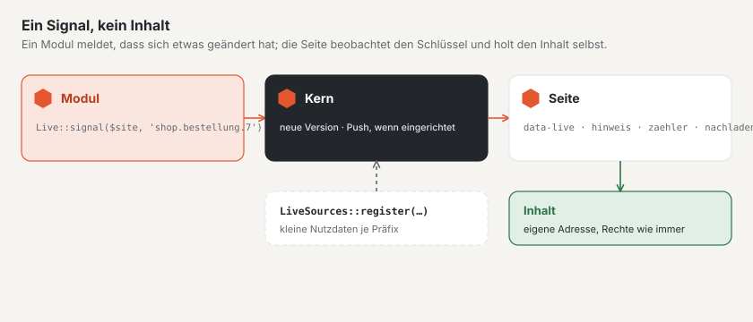

# Live-Aktualisierung in Modulen

Module melden über denselben Kanal wie das Forum, dass sich etwas geändert hat — und Seiten aktualisieren sich, ohne
dass ein Modul eigenes JavaScript braucht. Das Signal trägt keinen Inhalt: Die Seite beobachtet einen **Schlüssel**
und holt das Neue über ihre gewöhnliche Adresse, mit den Rechten, die dort ohnehin gelten.



## 1. Signal senden

```php
use Basalto\Core\Live\Live;

app(Live::class)->signal($site->id, 'shop.bestellung.'.$order->id);
```

- Schlüssel bestehen aus Kleinbuchstaben, Ziffern, `-` und `_`, getrennt durch Punkte (höchstens fünf Teile); der
  erste Teil ist das Präfix des Moduls.
- `signal()` wartet auf den Abschluss einer laufenden Transaktion — die Seite holt den Inhalt nie, bevor er sichtbar ist.
- Ist Push eingerichtet, geht das Signal nach der Antwort an den WebSocket-Server; ein Fehler dort bricht nichts ab.
- Persönliche Schlüssel der Konten heissen `konto.{id}` (Kundenkonten) und `benutzer.{id}` (Backend, ohne Site).

## 2. Stelle im Markup

`Live::attributes()` liefert die Attribute für eine Stelle, die sich selbst aktualisiert — ausgestellt beim Ausliefern
der Seite, also nach Ihrer Rechteprüfung:

```php
$attributes = app(Live::class)->attributes($site->id, 'shop.bestellungen', 'hinweis');
$html = '<p class="hinweis" hidden'.$attributes.'>Neue Bestellungen — <a href="">Aktualisieren</a></p>';
```

| Aktion | Was die Insel tut | Weitere Angaben |
| --- | --- | --- |
| `hinweis` | blendet das (verborgene) Element ein, sobald sich etwas ändert | — |
| `zaehler` | zeigt eine Zahl aus den Nutzdaten, verborgen bei 0 | `feld` |
| `nachladen` | holt ein Fragment und fügt es auf Klick ein | `quelle`, `nach`, `ziel`, `eins`, `mehr` |
| `schreibt` | zeigt, wer gerade tippt (Nutzdaten `schreibt`), ohne die eigene Person; jede Meldung verfällt nach ihren Sekunden | `ich`, `eins`, `zwei`, `mehr` |

Weitere Angaben übergeben Sie als viertes Argument (`['feld' => 'offen']` wird zu `data-live-feld="offen"`).
`nachladen` ruft `quelle?nach=<nach>` auf und erwartet JSON `{anzahl, html, url, nach}`: `html` landet in `ziel`
(CSS-Selektor), ohne `html` führt der Klick zu `url`; `eins` und `mehr` sind die Texte für die Anzahl (`:count`).

Steht im Markup einer Einhängeseite eine solche Stelle, hängt Basalto das kleine Skript der Live-Aktualisierung
selbst an. Auf anderen Seiten binden Sie es mit `Islands::attach($html)` ein.

## 3. Nutzdaten je Präfix

Wer zu einem geänderten Schlüssel kleine Daten mitliefern will — etwa einen Zähler —, meldet im `boot()` eine Quelle an:

```php
use Basalto\Core\Live\LiveSources;

app(LiveSources::class)->register('shop', static fn (int $siteId, string $key): ?array => [
    'offen' => Order::query()->where('site_id', $siteId)->where('status', 'offen')->count(),
]);
```

Die Abfrage ruft die Quelle nur für Schlüssel auf, die sich geändert haben. Nutzdaten sehen alle, die den Schlüssel
beobachten — persönliche Daten gehören an persönliche Schlüssel.

## 4. Eigene Inseln

Für eigenes JavaScript gibt es zwei Ereignisse am `document`:

| Ereignis | Wann | `detail` |
| --- | --- | --- |
| `basalto:live` | eine Version hat sich geändert | `{ key, version, data }` |
| `basalto:inhalt` | Markup wurde nachgeladen und eingefügt | `{ root }` — Inseln darin übernehmen |

## 5. Anwesenheit: wer schreibt, wer bearbeitet

`Presence` hält eine kurze Liste, wer gerade an einem Ort ist. Der Kern nutzt sie für «Wer schreibt gerade» in der
Community (Schlüssel `schreibt.…`, Klasse `Typing`) und für «wer bearbeitet gerade» im Backend (`bearbeitet.…`).
`update($siteId, $key, $id, $name, $aktiv, $ttl)` meldet an oder ab und setzt ein Signal; `current()` liefert die
Liste mit den verbleibenden Sekunden.

Ein eigenes Antwortfeld bekommt «Wer schreibt gerade» mit zwei Zeilen:

```php
$editor = Islands::editor('antwort', 'body', '', $lang, 6, true, ['typing' => Typing::key('shop.'.$id), 'preview' => route('basalto.community.preview', absolute: false)]);
$anzeige = Islands::typingIndicator($site->id, 'shop.'.$id, $lang, $profilId);
```

Der Ort braucht keine eigene Quelle: Die Nutzdaten zu `schreibt.…` liefert der Kern.

## Gut zu wissen

- Die Abfrage `/_live` läuft ohne Sitzung und liest nur Versionen aus dem Cache; teure Arbeit gehört in die Quelle
  des Inhalts, nicht ins Signal.
- Melden Sie nur, was alle sehen dürfen, die den Schlüssel beobachten (wartende Inhalte erst bei der Freigabe).
- Einrichtung, Takt und Push beschreibt [Live-Aktualisierung einrichten](../betrieb/live.md).

## Weiter

- [Erweiterungen](erweiterungen.md)
- [Benachrichtigungen](benachrichtigungen.md)
- [Live-Aktualisierung einrichten](../betrieb/live.md)
