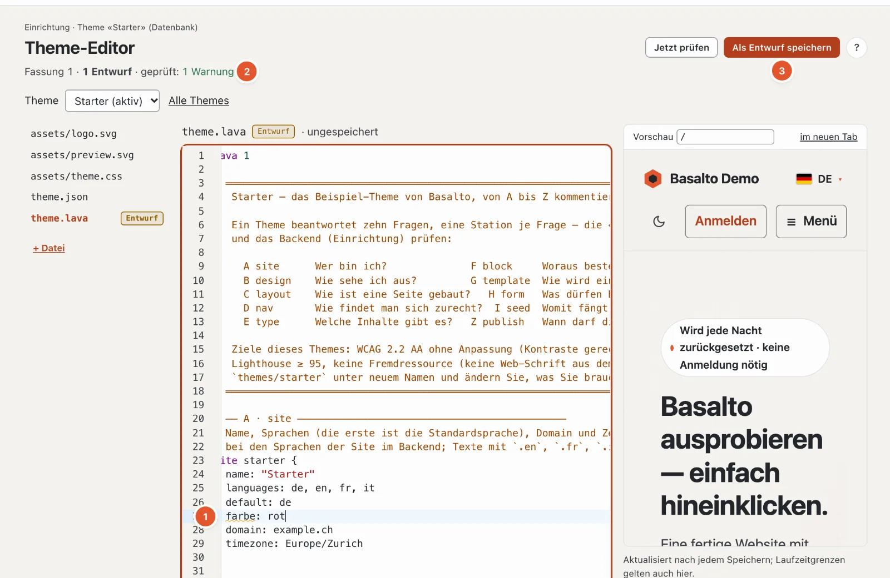

# Sprachdienst für Lava

Der Sprachdienst bringt die Befunde von `basalto:check` in den Editor — beim Tippen, auch für ungespeicherte Dateien —
dazu Vervollständigung, Sprung zur Definition und Erklärungen. Es gibt ihn zweimal mit demselben Kern
(`Basalto\Lava\Lsp\LanguageService`): als LSP-Server für VS Code und PhpStorm und im Lava-Editor des Backends.



## `php artisan basalto:lsp`

```text
basalto:lsp [--stdio]
```

Startet einen Language Server (LSP) über Standardein- und -ausgabe. `--stdio` ist die Vorgabe; VS Code hängt die
Option selbst an. Die Standardausgabe gehört dem Protokoll, PHP-Meldungen gehen auf stderr. Der Server schreibt nie
eine Datei.

| LSP-Methode | Leistung |
| --- | --- |
| `textDocument/publishDiagnostics` | Befunde beim Öffnen und bei jeder Änderung; das ganze Theme (nächster Ordner mit `theme.lava`) wird kompiliert, jeder Befund landet in seiner Datei |
| `textDocument/completion` | Schlüsselwörter, Eigenschaften, Feldtypen (samt Modulen), Arten von Teilen, im Markup Tags, Filter und Funktionen, Namen aus dem Theme |
| `textDocument/definition` | Sprung zu Blöcken, Teilen, Layouts, Templates, Typen, Navigationen, Formularen, Globalen und Seiten aus `seed` |
| `textDocument/hover` | Erklärung zu Schlüsselwörtern, Feldtypen, Signatur von Filtern und Funktionen, Form der Tags |

Nicht dabei: Umbenennen, Formatieren, Gliederung, Signaturhilfe beim Tippen. Ein Theme aus der Datenbank prüft der
LSP-Server nicht — dafür gibt es den Lava-Editor im Backend (unten) und `basalto:check --site=<handle>`.

## VS Code und PhpStorm einbinden

Bauen, installieren und einrichten — VS-Code-Erweiterung, Einstellungen `lava.phpPath` und `lava.artisanPath`,
TextMate-Bundle und LSP4IJ für PhpStorm — beschreibt
`tools/vscode-lava/README.md`. Kurz:

```sh
cd tools/vscode-lava
npm install && npm run compile && npx @vscode/vsce package
code --install-extension basalto-lava-0.1.0.vsix
```

In PhpStorm startet LSP4IJ den Server mit `php $PROJECT_DIR$/artisan basalto:lsp`; die Dateien `*.lava` und
`*.lava.html` werden den Language-IDs `lava` und `lava-html` zugeordnet.

## Derselbe Dienst im Lava-Editor

Der Theme-Editor im Backend (Einrichtung › Theme-Editor, siehe [Themes](themes.md)) nutzt denselben
`LanguageService` über HTTP:

```text
POST /admin/einrichtung/lava/sprachdienst      Route basalto.setup.lava.language
```

`admin` ist der Backend-Pfad (`basalto.backend.path`). Die Anfrage läuft in der Backend-Sitzung (angemeldet,
CSRF-Token, Recht `update` auf der Site). Gearbeitet wird auf dem Theme der Site mit allen offenen Entwürfen
und dem ungespeicherten Inhalt des Editors.

| Feld | Pflicht | Bedeutung |
| --- | --- | --- |
| `action` | ja | `diagnostics`, `completions`, `hover` oder `definition` |
| `path` | ja | bearbeitbarer Pfad im Theme, z. B. `theme.lava` oder `assets/theme.css` (wie im Theme-Editor, siehe [Themes](themes.md)) |
| `lava_source` | ja (darf leer sein) | aktueller Inhalt des Editors, höchstens 512 KB |
| `line` | nein | Zeile ab 1 |
| `character` | nein | Zeichen ab 0, gezählt in UTF-16 wie im Browser |

| `action` | Antwort |
| --- | --- |
| `diagnostics` | `{"findings": [{file, line, column, character, severity, message}, …]}` |
| `completions` | `{"items": [...]}` |
| `hover` | `{"markdown": "..."}`, ohne Treffer `{"markdown": null}` |
| `definition` | `{"location": {...}}`, ohne Treffer `{"location": null}` |

Der Editor (CodeMirror 6) fragt die Befunde nach jeder Tipp-Pause ab, die Vorschläge mit Ctrl+Leertaste, die
Erklärung beim Darüberfahren und die Definition mit F12.

## Weiter

- [Lava — die Theme-Sprache](lava.md)
- [Themes](themes.md)
