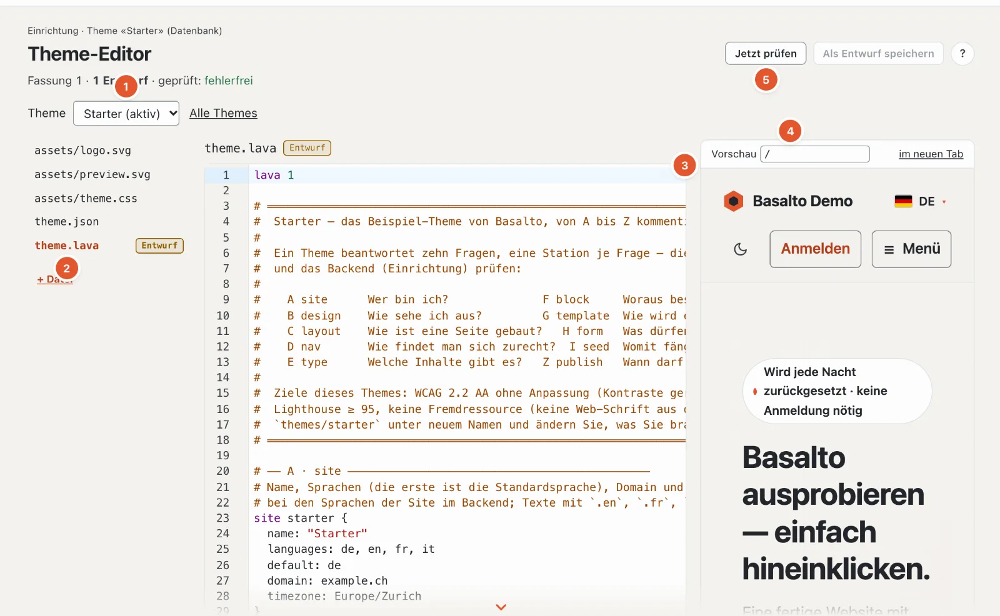

# Themes

Ein Theme ist ein Ordner mit `theme.lava`, `assets/` und optional `theme.json` — die Sprache dazu beschreibt
[Lava — die Theme-Sprache](lava.md). Diese Seite zeigt, wo Themes liegen, wie Sie mit dem Starter-Theme beginnen, Design-Tokens und
Startinhalte nutzt, ein Theme als Paket weitergibst und wie eine Site ihr Theme in der Datenbank pflegt.



## Theme-Ordner

| Einstellung | Bedeutung |
| --- | --- |
| `BASALTO_THEMES_PATH` (`basalto.themes_path`) | Ordner mit den Themes; leer heisst `themes/` im Projekt |
| `BASALTO_DEFAULT_THEME` (`basalto.default_theme`) | Theme einer Site ohne eigene Wahl, zum Beispiel `starter` |
| `BASALTO_DEFAULT_SITE` (`basalto.default_site`) | Site für Befehle ohne Handle, z. B. `basalto:tokens` |

Als Theme gilt jeder Unterordner mit einer `theme.lava`. Welches Theme eine Site nutzt, wählen Sie im Backend unter
Einrichtung › Themes; dort stehen auch Angaben aus `theme.json`, Vorschaubild, Umfang und Prüfstand jedes Themes und —
vor einem Wechsel — was die Site danach nicht mehr zeigen würde. Gelöscht wird beim Wechsel nichts.

## Starter-Theme als Vorlage

`themes/starter` ist ein vollständig kommentiertes Beispiel aller zehn Stationen: zwei
Sprachen (DE, EN), Systemschriften, ein Stylesheet ohne Build, kein Skript (ausser dem kleinen Umschalter hell/dunkel,
inline) und keine Fremdressource, eine dunkle Darstellung (`color … dark #…`), Kontraste nach
WCAG 2.2 AA gerechnet. Es bringt achtzehn Blöcke mit (darunter Formular, Beitragsliste, Suche und Kommentare sowie für
Startseiten «Bühne mit Karte», «Kennzahlen», «Schritte», «Auswahl», «Funktionen» mit Zeichen und «Hinweise»), einen Blog
mit Atom-Feed, Rechtsseiten und Startinhalte. «Bild mit Grafik» (`visual`) legt über ein Bild eine durchsichtige Grafik
— Foto mit Schema, wie die Demo es zeigt; «Bühne mit Karte» und «Auswahl» können dasselbe mit `art` und `art_overlay`.

```sh
cp -R themes/starter themes/mein-theme
php artisan basalto:check --theme=themes/mein-theme
```

Danach in `theme.json` Name, Autor und Version anpassen und in `site` Name, Sprachen und Domain.

## Design-Tokens

Jede Farbe, Schrift, jeder Abstand und der Radius aus `design` wird eine CSS-Variable (`--color-text`,
`--font-body`, `--space-3`, `--radius`). `` schreibt sie in den Kopf jeder Seite — mit der Farbvariante, die
die Site gewählt hat (`palette`, siehe [Lava](lava.md)), und darüber den Überschreibungen der Site aus Einrichtung ›
Design.

Kundenkonto, Forum und Cookie-Hinweis lesen diese Variablen: den Akzent über `accent` und `accent-text`, Markierungen
(etwa «neu») über `marker` und `marker-text`. Wer einen hellen `marker` wählt, gibt `marker-text` dunkel an.

```text
basalto:tokens [--tailwind] [<site>]
```

| Argument / Option | Bedeutung |
| --- | --- |
| `<site>` | Handle der Site, sonst `BASALTO_DEFAULT_SITE`, sonst die erste Site |
| `--tailwind` | als `@theme { … }` für Tailwind 4 statt als `:root { … }` |

```text
$ php artisan basalto:tokens --tailwind
@theme {
 --color-text: #23262b;
 --color-background: #f6f4f0;
 …
```

Für ein Theme, das sein CSS mit Tailwind baut: `php artisan basalto:tokens --tailwind > themes/x/assets/tokens.css`.

## Startinhalte: `seed`

Die Station I (`seed`) legt Seiten mit Titel, Slug, Template und Blöcken je Sprache an, dazu globale Inhalte und
Inhalte eigener Typen (`post willkommen { … }`, `person redaktion { … }`) — veröffentlicht, damit die Site nach dem
ersten Livegang ohne Handarbeit steht.

```text
basalto:seed <site>
```

Das Einspielen ist **idempotent**: Jeder Eintrag trägt eine feste UUID aus Site und Seed-Name. Was schon da ist, bleibt
unangetastet (auch Geändertes oder Gelöschtes), fehlende Sprachen kommen dazu. Die Ausgabe nennt jeden angelegten
Eintrag und am Ende «Seed: n angelegt, m schon vorhanden».

Hat sich der Seed eines Themes geändert (neue Texte, neue Blöcke), bringt `basalto:seed <site> --auffrischen` die Änderung
auf eine bestehende Site: Einträge, die noch genau so sind, wie der Seed sie angelegt hat (alle Fassungen ohne Autor),
kommen neu; was jemand im Backend bearbeitet oder gelöscht hat, bleibt.

`php artisan basalto:publish <site>` spielt den Seed mit ein, prüft die Site und schaltet sie live; `--ohne-seed`
lässt den Seed weg, `--dry-run` prüft nur.

Hat die Site eigene Lava (Lava-Editor, Ebene «Site»), darf sie einen eigenen `seed` mitbringen. Gleichnamiges ersetzt
dabei das des Themes an seiner Stelle — `page home { … }` in der Lava der Site ist die neue Startseite, `global footer
{ … }` der neue Fuss. So macht es die Demo mit dem Starter-Theme.

## Theme-Pakete

Ein Paket ist ein ZIP für Weitergabe und Marktplatz: alle Dateien des Theme-Ordners unter `<name>/`, dazu
`manifest.json` und — mit Schlüssel — `signature`.

```text
basalto:theme-pack <name> [--output=ORDNER] [--key=SCHLUESSEL]
basalto:theme-verify <zip> [--public-key=SCHLUESSEL]
```

| Befehl · Option | Bedeutung |
| --- | --- |
| `theme-pack <name>` | Ordner unter `themes/`; schreibt `<name>-<version>.zip` (Version aus `theme.json`, sonst `0.0.0`) |
| `--output=` | Zielordner, Vorgabe `storage/app/themes` |
| `--key=` | geheimer Ed25519-Schlüssel, Base64 oder Pfad zu einer Datei mit Base64 |
| `theme-verify <zip>` | prüft jede Datei gegen das Manifest |
| `--public-key=` | öffentlicher Ed25519-Schlüssel, Base64 oder Datei — erst damit wird die Signatur geprüft |

Das Manifest (Format 1):

```json
{
    "format": 1,
    "name": "starter",
    "version": "1.0.0",
    "files": {
        "assets/theme.css": "7430…1dd5",
        "theme.lava": "c858…1a8e"
    }
}
```

`files` enthält je Datei die SHA-256-Prüfsumme; Dateien, deren Name mit `.` beginnt, fehlen im Paket. Die Signatur ist
Ed25519 über `manifest.json`, Base64-kodiert. `theme-verify` meldet einen Fehler, wenn eine Datei verändert ist, im
Paket fehlt oder nicht im Manifest steht, wenn `theme.lava` fehlt und — mit `--public-key` — wenn die Signatur fehlt
oder nicht passt. Ohne `--public-key` zeigt «signiert» nur, dass eine Signatur beiliegt.

```text
$ php artisan basalto:theme-pack starter --output=/tmp/pakete --key=/tmp/secret.key
/tmp/pakete/starter-1.0.0.zip · 5 Dateien · signiert
$ php artisan basalto:theme-verify /tmp/pakete/starter-1.0.0.zip --public-key=/tmp/public.key
Paket in Ordnung: starter 1.0.0 · 5 Dateien · signiert
```

Ein Schlüsselpaar erzeugt libsodium, zum Beispiel:

```sh
php -r '$k = sodium_crypto_sign_keypair();
  file_put_contents("secret.key", base64_encode(sodium_crypto_sign_secretkey($k)));
  file_put_contents("public.key", base64_encode(sodium_crypto_sign_publickey($k)));'
```

`theme-pack` prüft das Lava nicht — vorher `basalto:check` laufen lassen.

## Theme-Bibliothek der Site und der Lava-Editor

Neben den mitgelieferten Themes im Ordner `themes/` (gelten für alle Sites der Installation, im Backend nur lesbar)
hat jede Site eine eigene **Theme-Bibliothek** in der Datenbank: beliebig viele eigene Themes, jedes mit
Textdateien, Bildern und Schriften, Entwürfen und Fassungen. So lassen sich Themes auch dort hinzufügen, bearbeiten
und entfernen, wo die Platte flüchtig ist (Laravel Cloud) oder der Ordner allen Kunden gehört (SaaS).

| Teil | Ablage |
| --- | --- |
| Eintrag | `site_themes` (Name, Bezeichnung, Herkunft `ordner` · `kopie` · `paket` · `marktplatz`, Signatur) |
| Textdateien | `lava_sources` mit `scope = theme:<id>` |
| Bilder und Schriften | Standard-Disk unter `theme-assets/<site>/<theme>/…`; Pfade mit Prüfsumme in `site_themes.assets`, damit Seiten Adressen bilden, ohne die Dateien zu lesen |
| Entwürfe, Fassungen | `theme_drafts`, `theme_versions` mit `site_theme_id` |

Welches Theme eine Site zeigt, steht weiter in `sites.theme`. Heisst ein eigenes Theme wie ein Ordner, geht es dem
Ordner vor — so wirkt «In die Datenbank übernehmen»; Bilder und Schriften, die ihm fehlen, kommen dann aus dem Ordner.

### Station «Themes»

**Einrichtung › Themes** (`/admin/einrichtung/themes`) zeigt «Eigene Themes» und «Mitgelieferte Themes». Wechseln,
hinzufügen und entfernen darf, wer die Site bearbeiten darf.

| Aktion | Was passiert |
| --- | --- |
| **Theme hinzufügen › Paket hochladen** | ZIP mit `manifest.json` (höchstens 20 MB, 800 Dateien, 50 MB entpackt). Geprüft werden Prüfsummen und — falls vorhanden — die Signatur mit dem Produkt- oder Marktplatz-Schlüssel. Name aus dem Manifest; ist er vergeben (auch von einem Ordner), mit Zähler (`starter-2`) |
| **Kopie anlegen** | von jedem Theme (eigenes oder Ordner) mit allen Dateien, Bildern und Schriften, unter neuem Namen |
| **Aus dem Marktplatz** | Modul «Marktplatz»: ein Theme kommt signiert als neues eigenes Theme; eine spätere Installation desselben Themes kommt als Entwürfe (Update) |
| **Zu diesem Theme wechseln** | wie bisher mit Bericht, was die Site dann nicht mehr zeigt |
| **Vorschau** | die ganze Site mit diesem Theme in der eigenen Sitzung |
| **Als Paket laden** | eigenes Theme mit Bildern, Ordner-Theme wie es ist (unsigniert) |
| **Entfernen** | eigenes Theme samt Dateien, Bildern, Entwürfen und Fassungen — nicht das aktive, ausser ein Ordner gleichen Namens springt ein |
| **Ausblenden** | mitgeliefertes Theme für diese Site aus der Liste nehmen (`sites.settings.themes.hidden`); nicht das aktive |

Im Protokoll: `theme.add`, `theme.copy`, `theme.remove`, `theme.hide`, `theme.show`, `theme.asset`, `site.theme`.

### Theme-Editor

**Einrichtung › Theme-Editor** (`/admin/einrichtung/theme-editor`) bearbeitet jedes eigene Theme — das aktive oder mit
`?theme=<name>` eines, das die Site noch nicht zeigt (Auswahl oben). Dateien links, Code in der Mitte, Vorschau
rechts.

| Schritt | Was passiert |
| --- | --- |
| **In die Datenbank übernehmen** | zeigt die Site ein Ordner-Theme: legt ein eigenes Theme gleichen Namens mit den Textdateien an; Fassung 1 hält den Ausgangsstand fest |
| **Bearbeiten** | jede Änderung ist ein Entwurf je Datei (Löschen einer Datei ist ein Entwurf ohne Inhalt). Bearbeitbar sind Pfade auf `.lava`, `.html`, `.json`, `.css`, `.js`, `.svg`, `.txt`, `.md`, höchstens 512 KB, UTF-8; `theme.lava` lässt sich nicht löschen |
| **Prüfung vor dem Speichern** | ein Entwurf wird nur gespeichert, wenn das ganze Theme mit ihm fehlerfrei kompiliert — sonst Antwort 422 mit den Befunden am Text. Warnungen kommen mit, halten aber nicht auf |
| **Konflikt** | wer mit einem veralteten Stand speichert (Prüfsumme `base` passt nicht), bekommt 409 statt still zu überschreiben |
| **Vorschau** | jede Seite der Site mit den Entwürfen (auch eines nicht aktiven Themes), im Backend gerendert (`vorschau-seite?pfad=/…`); oder die ganze Site mit Entwürfen in der eigenen Sitzung — die Site selbst bleibt unverändert |
| **Einreichen**, **Veröffentlichen** | wie bisher, mit Vier-Augen-Prinzip (`four_eyes`); jede Veröffentlichung ist eine Fassung des Themes. Neu geschnitten werden Bilder nur, wenn sich Bildvarianten des aktiven Themes ändern |
| **Fassungen**, **Verwerfen** | die letzten 50 Fassungen je Theme; eine frühere kommt als Entwürfe zurück |
| **Bilder und Schriften** | hochladen (`woff2`, `woff`, `png`, `jpg`, `jpeg`, `webp`, `avif`, `ico`, je Datei höchstens 5 MB, zusammen 40 MB) in einen Ordner unter `assets/`, löschen — gilt sofort, ohne Entwurf |
| **Exportieren**, **Importieren** | Paket des Themes mit Bildern; ein Import kommt als Entwürfe (Text) und sofort (Bilder) |
| **Zurück zum Ordner** | nur bei einem eigenen Theme mit dem Namen eines Ordners: die Site zeigt wieder den Ordner, das eigene Theme bleibt unter `<name>-eigen` mit Entwürfen und Fassungen in der Bibliothek |

Der Code-Editor ist CodeMirror 6 mit Lava-Hervorhebung und demselben Sprachdienst wie in VS Code — Befunde nach jeder
Pause, Vorschläge mit Ctrl+Leertaste, Erklärung beim Darüberfahren, F12 zur Definition (siehe
[Sprachdienst für Lava](sprachdienst.md)).

> Noch offen: CSS-Entwürfe erscheinen in der Vorschau erst nach dem Veröffentlichen, weil die Theme-Assets die
> Live-Fassung lesen.

### Prüfen eines Datenbank-Themes

```sh
php artisan basalto:check --site=<handle>
```

prüft das Theme, das die Site wirklich nutzt (Kopfzeile «(Datenbank)» oder «(Dateien)»).

## `basalto:lava-import`

```text
basalto:lava-import <site> [--theme=THEME] [--scope=theme|site]
```

Kopiert ein Datei-Theme ohne Backend als Datensätze in `lava_sources` — etwa beim Einrichten einer Site auf einem
Server ohne beschreibbare Platte. Mit `--scope=theme` landen die Dateien in der Theme-Bibliothek der Site, im eigenen
Theme mit dem Namen ihres Themes (fehlt es, wird es angelegt).

| Argument / Option | Bedeutung |
| --- | --- |
| `<site>` | Handle der Site |
| `--theme=` | Theme-Verzeichnis relativ zur Installation, zum Beispiel `themes/starter` — immer angeben |
| `--scope=` | `theme` (Vorgabe): das Theme der Site · `site`: eigene Ergänzungen der Site, die unter `site/…` am Ende von `theme.lava` eingebunden werden (z. B. eigene Inhaltstypen aus dem Backend) |

Bestehende Datensätze mit gleichem Pfad werden überschrieben; nicht-UTF-8-Dateien werden übersprungen. Anders als
«In die Datenbank übernehmen» im Editor legt der Befehl **keine Fassung** an.

## Weiter

- [Lava — die Theme-Sprache](lava.md)
- [Aussehen: Themes, Design und Bildvarianten](../einrichtung/aussehen.md)
- [Marktplatz für Autorinnen und Autoren](../marktplatz/autoren.md)
