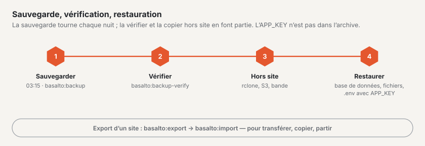

# Sauvegarde

Basalto sauvegarde toute l’installation chaque nuit, vérifie la sauvegarde sur demande et la restaure en cas d’urgence.
Pour un site isolé, il existe en outre l’export — pour un transfert, une copie ou un départ.



Deux outils aux finalités différentes :

| | Sauvegarde | Export |
| --- | --- | --- |
| Commande | `basalto:backup` | `basalto:export` |
| Étendue | toute l’installation : dump de la base de données et fichiers de tous les sites | un site : contenus, médias, paramètres en JSON et fichiers |
| Finalité | urgence : serveur, base de données ou stockage perdu | transfert, copie, départ |
| Retour | restaurer la base de données, recopier les fichiers | `basalto:import` |

## Sauvegarde

```sh
php artisan basalto:backup                          # vers storage/app/backups
php artisan basalto:backup --path=/srv/sicherung    # autre dossier
```

L’archive `basalto-backup-JJJJMMTT-HHMMSS.zip` (heure en UTC) contient le dump de la base de données, la médiathèque de
chaque disque, les fichiers issus des formulaires et un `manifest.json` avec le SHA-256 et la taille de chaque fichier.

- **SQLite** est copié via `VACUUM INTO`, **MariaDB/MySQL** avec `mariadb-dump` ou `mysqldump`, **PostgreSQL** avec
  `pg_dump`. L’outil doit correspondre au serveur. S’il ne se trouve pas dans le chemin de recherche, définissez dans
  le `.env` `BASALTO_BACKUP_MYSQL_DUMP` ou `BASALTO_BACKUP_PG_DUMP` sur son chemin.
- **Absent de l’archive :** le `.env` et donc l’`APP_KEY`. Conservez cette clé à part et en lieu sûr (gestionnaire de mots de
  passe), jamais à côté de l’archive — sans cette même clé, les colonnes chiffrées ne peuvent pas être lues.
- Une sauvegarde sur le même disque ne protège que contre les erreurs de manipulation. Copiez en plus l’archive **hors
  site**, par exemple après 03:15 avec `rclone copy storage/app/backups remote:basalto`.

### Planning et conservation

| Quoi | Quand ou où |
| --- | --- |
| `basalto:backup` | chaque jour à **03:15 UTC** via le scheduler, sur un seul serveur (après `basalto:cleanup` à 03:00, avant `basalto:media-purge` à 03:30) |
| « Sauvegarder maintenant » | à la main sous **Administration › Exploitation** ; déclenche la même commande dans la file d’attente |
| Conservation | après chaque exécution, les sauvegardes les plus récentes restent dans le dossier, **7** par défaut ; réglable sous **Administration › Paramètres › Conservation › « Conserver les sauvegardes »** (`backup.keep`, 1 à 365) |

Le planning nécessite l’entrée cron décrite sous [Hébergement](hosting.md). Administration › Exploitation affiche
l’état de la dernière sauvegarde et de la dernière vérification.

## Vérification

```sh
php artisan basalto:backup-verify                                   # sauvegarde la plus récente dans le dossier standard
php artisan basalto:backup-verify --path=/srv/sicherung             # sauvegarde la plus récente dans ce dossier
php artisan basalto:backup-verify /srv/sicherung/basalto-backup-20261016-031500.zip
```

Sont vérifiés les noms, le manifeste, la taille et le SHA-256 de chaque fichier. Avec SQLite, la commande restaure la
base de données dans un fichier temporaire (`PRAGMA integrity_check`, comptage par échantillon) ; avec MariaDB/MySQL et
PostgreSQL, elle lit le dump pour en contrôler l’intégralité. Le vrai test de restauration dans une base de données vide
y est une opération manuelle — au minimum avant chaque mise à jour et chaque trimestre.

## Restaurer

Au préalable : mode maintenance (`php artisan down`), arrêter le scheduler et le worker, sauvegarder en plus la base
de données et le stockage **actuels** — au cas où la restauration elle-même échouerait.

1. **Vérifier l’archive :** `php artisan basalto:backup-verify <archiv>` — ne continuer qu’avec « Wiederherstellung
   geprüft » (restauration vérifiée).
2. **Décompresser** dans un dossier de travail vide : `mkdir /tmp/wieder && cd /tmp/wieder && unzip <archiv>`.
3. **Restaurer la base de données :**
   - SQLite : arrêter l’application, `cp database/database.sqlite <pfad aus DB_DATABASE>`.
   - MariaDB/MySQL : créer une base de données vide et l’importer —
     `mariadb -h <host> -u <benutzer> -p -e "CREATE DATABASE basalto_neu CHARACTER SET utf8mb4 COLLATE utf8mb4_unicode_ci"`,
     puis `mariadb -h <host> -u <benutzer> -p basalto_neu < database/database.sql` ; régler `DB_DATABASE` sur
     `basalto_neu` (ou vider l’ancienne base de données et y importer).
   - PostgreSQL : `createdb basalto_neu`, puis `psql -h <host> -U <benutzer> -d basalto_neu -f database/database.sql`.
4. **Recopier les fichiers :** `files/<disk>/…` sur le disque du même nom — en local par exemple
   `rsync -a files/local/ storage/app/private/` ; avec S3 ou R2, `aws s3 sync files/s3/ s3://<bucket>/` ou `rclone copy`.
5. **Remettre en place le `.env` et l’`APP_KEY`** de l’installation sauvegardée — la même clé que lors de la sauvegarde.
6. **Travaux de finition :**

```sh
php artisan migrate --force                 # si Basalto est plus récent que la sauvegarde
php artisan optimize:clear
php artisan basalto:search-index
php artisan basalto:page-cache clear        # si le cache des pages est activé
php artisan basalto:page-cache warm
php artisan up
```

7. **Contrôle :** `/up` indique « bereit » (prêt), la connexion au backend fonctionne, une page avec des images et la
   médiathèque s’ouvrent. Relancer ensuite le scheduler et le worker.

## Export et import d’un site

```sh
php artisan basalto:export <handle>                         # vers storage/app/exports
php artisan basalto:export <handle> --path=/tmp/site.zip    # fichier ou dossier
php artisan basalto:export <handle> --with-submissions      # avec les soumissions de formulaires (données personnelles)
php artisan basalto:import /tmp/site.zip                    # sous le handle de l’export
php artisan basalto:import /tmp/site.zip --handle=kopie     # sous un autre handle
```

Dans le backend : **Administration › Sites** › ouvrir le site › **« Télécharger l’export »** — pour les exploitants du
site ainsi que pour le propriétaire ou l’administration de son compte, sans les soumissions de formulaires.

### Contenu de l’export

Le ZIP contient `site.json` (version de format 1), `manifest.json` avec le SHA-256 de chaque fichier, les fichiers
médias sous `media/` et — avec `--with-submissions` — les fichiers des soumissions sous `submissions/`. `site.json`
contient le site (handle, nom, langues, fuseau horaire, thème, paramètres), les domaines, les membres avec leur rôle
(invitations ouvertes comme « en attente »), les paramètres, le thème issu de la base de données avec ses brouillons et
ses versions, les dossiers et les indications des médias, tous les contenus avec leurs versions par langue, les
redirections, les menus et les formulaires. Les références entre contenus, médias et personnes sont réécrites vers les
nouveaux identifiants lors de l’import.

**Volontairement absents :** le journal, les occurrences 404, l’index de recherche (il est reconstruit), les tokens
d’API, les commentaires, le secret des webhooks des formulaires (à régénérer dans le backend après l’import et à
communiquer au destinataire) et les empreintes des adresses IP des soumissions.

### Ce que fait l’import

Basalto vérifie l’archive dans son intégralité (chemins, manifeste, sommes de contrôle, version de format), puis crée le
site en **une seule** étape ; en cas d’échec, les fichiers déjà écrits disparaissent eux aussi. Les personnes disposant
d’un compte dans l’installation (même e-mail) deviennent membres ; pour toutes les autres, une invitation est créée
**sans e-mail** — à envoyer sous « Utilisateurs » avec « Renvoyer ». Les domaines déjà occupés sont ignorés et signalés.

## Laravel Cloud

Sur Laravel Cloud, c’est la sauvegarde de la plateforme qui s’applique : sauvegardes automatiques de la base de données
et — si vous l’activez — versionnage du bucket. `basalto:backup` y écrit sur le disque éphémère de l’instance ;
n’utilisez la commande qu’avec `--path` vers un stockage persistant. Un site isolé ne se récupère pas depuis la
sauvegarde de la plateforme, mais via l’export.

## Pour continuer

- [Mises à jour](updates.md)
- [Surveillance](monitoring.md)
- [Sites](../verwaltung/sites.md)
