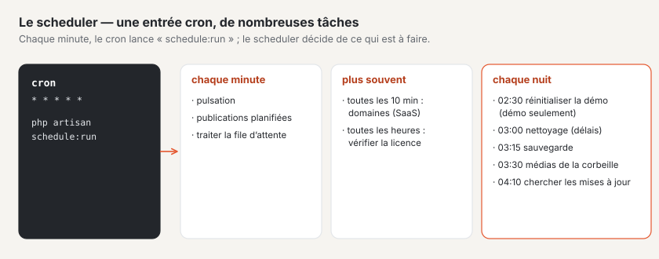

# Hébergement

Basalto fonctionne chez un **hébergeur simple** avec PHP, une base de données et une entrée cron — ou sur **Laravel
Cloud** avec des services gérés. Dans les deux cas, sans Redis et sans worker permanent.

## Hébergement simple



1. Copier Basalto sur le serveur et le configurer comme décrit sous [Installation](installation.md).
2. Régler les pilotes du `.env` sur la base de données — c’est déjà la valeur par défaut de `.env.example` :

   ```dotenv
   DB_CONNECTION=mariadb
   CACHE_STORE=database
   SESSION_DRIVER=database
   QUEUE_CONNECTION=database
   ```

3. Créer **une seule** entrée cron (adapter le chemin) :

   ```cron
   * * * * * cd /pfad/zu/basalto && php artisan schedule:run >> /dev/null 2>&1
   ```

4. Vérifier dans le backend sous **Administration › Exploitation** : `/up` indique « bereit » (prêt), la pulsation est
   plus récent que le seuil (5 minutes par défaut, Administration › Paramètres › Exploitation › « Seuil de
   pulsation »), la file d’attente passe par le cron.

### File d’attente sans worker

Les e-mails, les webhooks, les variantes d’images et le préchauffage du cache des pages passent par la file d’attente.
Sans worker, c’est le scheduler qui la traite : chaque minute, il lance

```sh
php artisan queue:work --stop-when-empty --max-time=50 --tries=3
```

sans chevauchement et sur un seul serveur. Cela se produit tant que les deux conditions sont remplies :

- `QUEUE_CONNECTION=database` et
- `BASALTO_QUEUE_VIA_SCHEDULER` n’est pas défini ou vaut `true`.

Si un worker propre tourne (Supervisor, file d’attente gérée), définissez `BASALTO_QUEUE_VIA_SCHEDULER=false`. Avec une
autre file d’attente que `database`, Basalto ne planifie de toute façon pas `queue:work`. Les autres tâches exécutées
par le scheduler sont indiquées sous [Commandes](befehle.md#planning-du-scheduler).

### Points à vérifier chez l’hébergeur

- `schedule:run` lance chaque tâche dans un processus PHP distinct ; l’hébergeur doit autoriser `proc_open` et
  permettre un cron à la minute.
- Pour la sauvegarde quotidienne, le serveur a besoin de l’outil de dump de la base de données, voir
  [Sauvegarde](backup.md).
- Node.js n’est pas nécessaire sur le serveur : l’archive de version contient le frontend compilé.

### Hébergement web avec LiteSpeed (p. ex. cyon)

- **Cron avec le chemin PHP complet :** sans chemin, le cron lance la version par défaut du serveur, pas celle de votre
  site :

  ```cron
  * * * * * cd /home/<login>/basalto && /opt/alt/php85/usr/bin/php artisan schedule:run >> /dev/null 2>&1
  ```

- **Version PHP par dossier :** LiteSpeed n’hérite du `.htaccess` que sur un niveau. Si `public/` se trouve plus bas
  (`public_html/basalto/public`), `public/.htaccess` a besoin de la version PHP lui-même. L’installateur web la reprend du
  `.htaccess` au-dessus ; les mises à jour laissent `public/.htaccess` en place.
- **`.htaccess` existant :** l’installateur web ajoute la redirection vers `public/` au lieu de l’omettre.
- **Mises à jour sans `proc_open` :** si `proc_open` est désactivé dans le navigateur, Administration › Mises à jour
  indique la commande pour SSH : `/opt/alt/php85/usr/bin/php artisan basalto:update --kern`. Si PHP tourne en `lsphp`
  dans le navigateur, définissez `BASALTO_PHP_BINARY=/opt/alt/php85/usr/bin/php`.
- **SQLite :** Basalto règle SQLite en WAL avec 5 secondes d’attente (`DB_JOURNAL_MODE`, `DB_BUSY_TIMEOUT`) ; le fichier
  se trouve dans `database/`, hors de `public/`, et est sauvegardé avec `VACUUM INTO`.
- **E-mails :** l’expéditeur est une adresse d’un domaine du même hébergement (SMTP via le port 465 ou 587) ; un nouvel
  hébergement envoie au plus 30 e-mails par heure pendant ses 30 premiers jours.

## Santé : `/up` et `/up/live`

| Adresse | Vérifie | Réponse |
| --- | --- | --- |
| `/up` | la base de données et la pulsation du scheduler (readiness) | 200 « bereit » (prêt) ou 503 « gestört » (perturbé), JSON sans secrets |
| `/up/live` | uniquement le processus PHP (liveness) | 200 |

Une installation toute neuve sans première pulsation n’est considérée comme perturbée qu’une fois le seuil dépassé.
Pour en savoir plus sur la surveillance, voir [Surveillance](monitoring.md).

## Laravel Cloud

Les réglages suivants s’appliquent à Laravel Cloud :

| Sujet | Sur Laravel Cloud |
| --- | --- |
| Fichiers | médias dans le bucket privé (`FILESYSTEM_DISK=s3`) ; rien sur le disque éphémère |
| Cache, sessions | Valkey (`CACHE_STORE=redis`, `SESSION_DRIVER=redis`), cache propre à chaque environnement |
| File d’attente | file d’attente gérée ou `database` ; avec un worker propre, `BASALTO_QUEUE_VIA_SCHEDULER=false` |
| Build | `composer install --no-dev --no-interaction --prefer-dist --optimize-autoloader` · `php artisan vendor:publish --tag=basalto-assets --force` · `npm ci --audit false` · `npm run build` |
| Commande de déploiement | `php artisan migrate --force` |
| Scheduler | l’activer dans le cluster d’application ; toutes les tâches s’exécutent `onOneServer` |
| Domaines propres des clients (SaaS uniquement) | `basalto:domains-verify` toutes les dix minutes via la CLI Cloud (`BASALTO_CLOUD_ENVIRONMENT`, `LARAVEL_CLOUD_TOKEN` comme secret) |

Laravel Cloud construit la nouvelle version et exécute les migrations avant de basculer — pendant un moment, l’ancien
code sert le nouveau schéma. Vos propres migrations (par exemple dans des modules) suivent donc la règle « d’abord
étendre, nettoyer plus tard » : ajouter et remplir d’abord une nouvelle colonne, ne supprimer l’ancienne que dans une
version ultérieure.

Vous activez les sauvegardes de plateforme de la base de données et le versionnage du bucket dans Laravel Cloud ; la
sauvegarde de Basalto s’y ajoute, voir [Sauvegarde](backup.md).

## Démo publique

Une installation peut fonctionner comme démo publique : avec `BASALTO_DEMO=true` — jamais avec des données qui doivent
être conservées.

- **Configurer :** avec l’installateur web, sous « Avancé », « Installer comme démo publique » — l’installateur écrit
  `BASALTO_DEMO=true` et mène directement à la visite des fonctions.
- **Accès rapide :** la page de connexion affiche trois boutons « Voir en tant qu’exploitant », « Voir en tant que
  rédacteur » et « Voir en tant que traducteur », qui connectent sans mot de passe ni code. Sans ce commutateur, il n’y
  a ni les boutons ni l’adresse qui se trouve derrière.
- **E-mails interceptés :** chaque e-mail est retenu avant l’envoi et uniquement journalisé (mailer `log`, modifiable
  avec `BASALTO_DEMO_MAILER`) ; le backend affiche le bandeau « Démo — les données sont réinitialisées chaque nuit, les
  e-mails ne sont pas envoyés ».
- **Remise à neuf chaque nuit :** à 02:30, le scheduler appelle `basalto:demo-reset --force` — vider la base de données
  et relancer les migrations, vider les médias, importer le site `BASALTO_DEMO_SITE` (`demo` par défaut) avec les
  contenus de départ de `BASALTO_DEMO_THEME` (`starter` par défaut) et le mettre en ligne, créer trois comptes.
- **Visite des fonctions :** la démo comprend la page `/funktionen` avec une sous-page par domaine — ce qu’il sait
  faire, ce que l’on peut essayer, et un chemin vers le backend qui, via l’accès rapide, mène directement au bon
  endroit.
- Le domaine du site de démo est l’hôte de `APP_URL` ; `BASALTO_DEFAULT_SITE=demo` y dirige aussi les autres hôtes.

## Pour continuer

- [Installation](installation.md)
- [Surveillance](monitoring.md)
- [Commandes](befehle.md)
