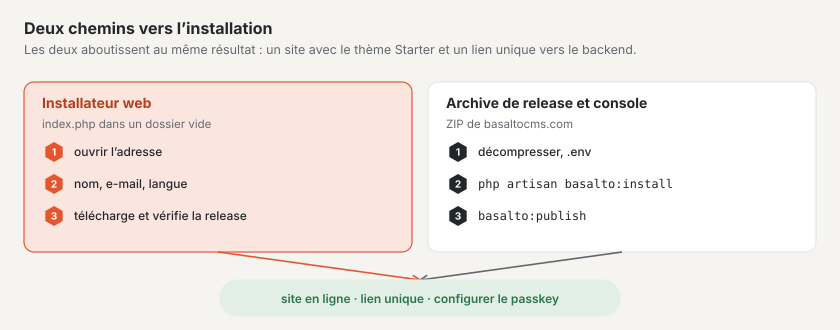

# Installation

Basalto fonctionne sur tout hébergement web doté de PHP 8.4 — sans Redis, sans worker et même, avec SQLite, sans base de
données dédiée. Cette page décrit les prérequis, les deux voies d’installation et les clés du fichier `.env`.



## Prérequis

| Quoi | Valeur |
| --- | --- |
| PHP | 8.4 ou plus récent |
| Extensions PHP | `pdo_sqlite`, `pdo_mysql` ou `pdo_pgsql` selon la base de données, `mbstring`, `intl`, `gd` (variantes d’images), `zip` (export, sauvegarde, paquets de thèmes), `sodium` (licence et signatures) |
| Base de données | SQLite, MariaDB 11.4, MySQL 8.4 ou PostgreSQL 18 |
| Serveur web | Racine des documents sur `public/`, HTTPS |
| Cron | une entrée pour le scheduler, voir [Hébergement](hosting.md) |
| Pas nécessaire | Redis/Valkey, worker de file d’attente, Node.js, serveur de messagerie pour la première connexion |

Pour la sauvegarde, il vous faut en outre l’outil de dump de la base de données (`mariadb-dump`, `mysqldump` ou
`pg_dump`), voir [Sauvegarde](backup.md).

## Voie 1 : l’installateur web

Pour tous ceux qui veulent un site web sans avoir besoin d’un terminal. La procédure pas à pas, avec des images, se
trouve sous [Installer Basalto](../einstieg/installieren.md) ; voici l’essentiel pour l’exploitation :

1. Récupérer l’installateur sur basaltocms.com sous **Téléchargement** — un seul fichier `index.php`.
2. Le déposer dans un dossier **vide** et ouvrir l’adresse dans le navigateur.
3. Indiquer **Nom du site**, **Votre e-mail** et **Langue du site**, puis « Installer ».

L’installateur vérifie PHP et les extensions, télécharge la version actuelle, vérifie sa **signature Ed25519** et sa
somme de contrôle, décompresse, écrit le fichier `.env` (nouvelle clé d’application, SQLite, adresse reprise du
navigateur), exécute les migrations, crée le site avec le thème Starter et le domaine issu de l’adresse, publie les
contenus de départ et vous connecte au backend au moyen d’un lien à usage unique. Ensuite, il se supprime lui-même.

- **Avancé :** MariaDB/MySQL ou PostgreSQL au lieu de SQLite, clé de licence fournie d’emblée.
- **Uniquement dans un dossier vide** (sont autorisés les fichiers que les hébergeurs créent eux-mêmes : `.htaccess`,
  `.user.ini`, `.well-known`, `cgi-bin`, `error_log`).
- **Premier arrivé, premier servi :** le premier navigateur obtient l’installation ; un second voit « L’installation
  est déjà en cours dans un autre navigateur ». Pour recommencer : supprimer le fichier `.basalto-install.json` du
  dossier.
- **Le serveur web démarre dans le dossier principal au lieu de `public/` :** l’installateur crée un `.htaccess` qui
  fait tout passer par `public/` (Apache). Avec nginx, placer la racine sur `public/`.

## Voie 2 : archive de version et console

Pour les serveurs avec console, pour les scripts et pour Laravel Cloud. L’archive contient tout ce dont Basalto a
besoin — y compris `vendor/` et le frontend compilé ; Composer et Node ne sont pas nécessaires sur le serveur.

1. Récupérer l’archive actuelle. Le fichier actuel est indiqué dans `https://basaltocms.com/_download/latest.json`
   (champ `file`, avec `sha256` et la signature) ; le fichier se trouve sous `https://basaltocms.com/_download/<file>`.
2. Comparer la somme de contrôle et décompresser :

```sh
curl -fsSO https://basaltocms.com/_download/basalto-1.2.0.zip
sha256sum basalto-1.2.0.zip          # comparer avec « sha256 » de latest.json
unzip basalto-1.2.0.zip -d meine-site && cd meine-site
cp .env.example .env
php artisan key:generate
# modifier .env : APP_ENV, APP_DEBUG, APP_URL, base de données, mail (voir ci-dessous)
```

3. Installer :

```sh
php artisan basalto:install
```

L’installateur exécute les migrations de la base de données, demande l’identifiant (handle) et le nom du site ainsi
que l’e-mail et le nom du premier compte, puis affiche un **lien à usage unique** pour la première connexion (valable
60 minutes, utilisable une seule fois) — sans mot de passe et sans serveur de messagerie. Le premier compte devient
exploitant du site. L’installateur peut être relancé plusieurs fois sans risque ; ce qui existe est conservé.

Sans questions, par exemple dans un script :

```sh
php artisan basalto:install --no-interaction --site=meine-site --name="Meine Site" \
  --email=redaktion@example.ch --locale=de --timezone=Europe/Zurich
```

Autres options : `--user` (nom du compte), `--minutes` (validité du lien, 60 par défaut).

Après la connexion, configurez une passkey dans le backend (Aperçu général › « Configurer une passkey »). Un nouveau
lien à usage unique s’obtient à tout moment avec :

```sh
php artisan basalto:login-link redaktion@example.ch              # valable 15 minutes
php artisan basalto:login-link redaktion@example.ch --minutes=60
```

### Installateur dans le navigateur sur un serveur préparé

Sans console, l’installateur guide dans le navigateur à travers les mêmes étapes (Base de données › Site › Compte ›
Terminé). Il se trouve sous `/<BASALTO_BACKEND_PATH>/installieren`, donc par défaut `/admin/installieren`, et affiche à
la fin le lien à usage unique.

- L’installateur n’existe que tant que rien n’est configuré ; ensuite, l’adresse répond par 404.
- Si le serveur est déjà accessible publiquement avant que quelqu’un n’installe, définissez
  **`BASALTO_INSTALL_TOKEN`** dans le `.env` sur une longue valeur aléatoire et appelez l’installateur avec
  `/admin/installieren?token=<wert>`. Sans token correspondant, il répond par 404.

## Mettre en ligne le premier site

Dans le `.env` :

```dotenv
BASALTO_DEFAULT_THEME=starter
BASALTO_DEFAULT_SITE=meine-site
```

Puis :

```sh
php artisan basalto:publish meine-site --dry-run   # vérifier seulement, ne rien écrire
php artisan basalto:publish meine-site             # importer les contenus de départ, vérifier, préchauffer, mettre en ligne
```

`basalto:publish` importe les contenus de départ du thème (`--ohne-seed` les omet), vérifie les liens, les images, les
textes alternatifs, les langues obligatoires, les pages légales, les formulaires et les redirections, préchauffe le
cache des pages et met le site en ligne — ou refuse en indiquant le motif. Vous créez les mentions légales et la
déclaration de protection des données à partir d’un modèle, sous forme de brouillon :

```sh
php artisan basalto:legal meine-site impressum
php artisan basalto:legal meine-site datenschutz
```

`BASALTO_DEFAULT_SITE` s’applique à tout hôte sans entrée propre. Vous saisissez les domaines d’un site dans le
backend sous **Administration › Sites**.

## Clés `.env` importantes

### Laravel

| Clé | Valeur par défaut dans `.env.example` | Pour l’exploitation |
| --- | --- | --- |
| `APP_ENV` | `local` | `production` |
| `APP_DEBUG` | `true` | `false` |
| `APP_KEY` | vide | `php artisan key:generate` ; conserver à part (voir [Sauvegarde](backup.md)) |
| `APP_URL` | `http://localhost:8000` | adresse publique avec HTTPS |
| `APP_LOCALE`, `APP_FALLBACK_LOCALE` | `de`, `en` | langue de l’interface |
| `DB_CONNECTION`, `DB_HOST`, `DB_PORT`, `DB_DATABASE`, `DB_USERNAME`, `DB_PASSWORD` | `sqlite` | `mariadb`, `mysql`, `pgsql` ou `sqlite` |
| `CACHE_STORE`, `SESSION_DRIVER`, `QUEUE_CONNECTION` | `database` | `database` suffit ; sur Laravel Cloud, Valkey (`redis`) |
| `FILESYSTEM_DISK` | `local` | `local` ou `s3` (bucket, avec `AWS_*`) |
| `DB_TIMEZONE` | non défini, `+00:00` s’applique | fuseau horaire de la session de base de données avec MariaDB et MySQL ; laissez `+00:00`, voir [Fuseau horaire de la base de données](#fuseau-horaire-de-la-base-de-données) |
| `MAIL_MAILER`, `MAIL_HOST`, `MAIL_PORT`, `MAIL_USERNAME`, `MAIL_PASSWORD`, `MAIL_FROM_ADDRESS` | `log` | envoi réel pour les codes de connexion, les invitations, les formulaires et l’alerte d’erreurs |

Les e-mails portent l’en-tête et le pied de page du site auquel appartient la destinataire (sans site : le site de
l’éditeur) : en haut le nom du site, en bas les lignes du fournisseur tirées du contenu global « Pied de page » du thème
(champs `brand`, `owner`, `street`, `city`, `country`, `vat`) et des liens vers les pages juridiques de `publish.legal`.
Couleurs et police figurent dans le thème de mail `basalto` (`packages/core/resources/views/mail/html/themes/basalto.css`).

### Basalto

Les clés sont lues par `config/basalto.php` du noyau (`packages/core/config/basalto.php`). Elles ne figurent pas toutes
dans `.env.example` ; vous ne définissez les autres qu’en cas de besoin.

| Clé | Valeur par défaut | À quoi elle sert |
| --- | --- | --- |
| `BASALTO_BACKEND_PATH` | `admin` | chemin du backend |
| `BASALTO_DEFAULT_SITE` | vide | site pour les hôtes sans entrée dans les domaines |
| `BASALTO_DEFAULT_THEME` | voir le texte | dossier de thème sous `themes/` lorsqu’un site n’en indique aucun ; définissez `starter` (absent de `.env.example`) |
| `BASALTO_THEMES_PATH` | `themes/` de l’installation | autre dossier pour les thèmes sous forme de fichiers (absent de `.env.example`) |
| `BASALTO_INSTALL_TOKEN` | vide | protège l’installateur dans le navigateur (absent de `.env.example`) |
| `BASALTO_PAGE_CACHE` | activé, sauf avec `APP_ENV=local` | activer ou désactiver le cache des pages (absent de `.env.example`) |
| `BASALTO_PAGE_CACHE_STORE` | store par défaut | store de cache propre pour le cache des pages (absent de `.env.example`) |
| `BASALTO_MEDIA_QUOTA_MB` | illimité | quota de stockage par site en Mo (absent de `.env.example`) |
| `BASALTO_PASSWORD_LOGIN` | `false` | connexion par mot de passe pour les installations sans e-mail (absent de `.env.example`) |
| `BASALTO_PHP_BINARY` | PHP de ce processus | PHP pour les étapes d’une mise à jour, p. ex. `/opt/alt/php85/usr/bin/php` sous LiteSpeed, voir [Hébergement](hosting.md) (pas dans `.env.example`) |
| `BASALTO_QUEUE_VIA_SCHEDULER` | `true` | le scheduler traite la file d’attente en base de données, voir [Hébergement](hosting.md) (absent de `.env.example`) |
| `BASALTO_BACKUP_MYSQL_DUMP`, `BASALTO_BACKUP_PG_DUMP` | chemin de recherche | chemin vers l’outil de dump, voir [Sauvegarde](backup.md) (absent de `.env.example`) |
| `BASALTO_LICENSE_KEY` | vide | clé de licence, voir [Licence](lizenz.md) |
| `BASALTO_LICENSE_BANNER_DAYS` | `30` | jours en état « non enregistrée » avant l’affichage du bandeau de pied de page dans le frontend |
| `BASALTO_LICENSE_PUBLIC_KEY` | clé de produit dans le noyau | uniquement pour les tests et vos propres émissions ; supprimer la ligne vide de `.env.example`, voir [Licence](lizenz.md) |
| `BASALTO_DEPLOYED_AT` | vide | date et heure de la dernière livraison, affichée sous Administration › Exploitation |
| `BASALTO_ALIAS_DOMAIN` | `basaltocms.com` | zone d’alias du SaaS (Laravel Cloud uniquement) |
| `BASALTO_CLOUD_ENVIRONMENT`, `BASALTO_CLOUD_BINARY`, `LARAVEL_CLOUD_TOKEN` | vide, `vendor/bin/cloud`, vide | domaines clients via la CLI Cloud (Laravel Cloud uniquement) ; le token uniquement comme secret, jamais dans un fichier |

Pour Pulse et Nightwatch, voir [Surveillance](monitoring.md).

### Fuseau horaire de la base de données

Basalto enregistre tous les horodatages en UTC. MariaDB et MySQL interprètent les horodatages dans le fuseau horaire de
la connexion — si le serveur de base de données tourne par exemple en Europe/Zurich, il n’existe aucune heure entre
02:00 et 02:59 le dernier dimanche de mars, et l’enregistrement échoue avec « Incorrect datetime value ». C’est
pourquoi Basalto règle la connexion sur UTC (`DB_TIMEZONE`, par défaut `+00:00`). Les nouvelles installations n’ont
rien à faire ; SQLite et PostgreSQL ne sont pas concernés.

Si vous exploitiez déjà Basalto sur un serveur qui n’est pas en UTC, les horodatages enregistrés jusqu’ici apparaissent
décalés du décalage du serveur après la mise à jour (à Zurich une heure en hiver, deux en été). Voici comment les
convertir une fois :

1. Consultez le constat — la commande indique le fuseau horaire du serveur et les colonnes concernées, mais ne change
   rien :

   ```sh
   php artisan basalto:db-zeitzone
   ```

2. Créez une sauvegarde : `php artisan basalto:backup` ([Sauvegarde](backup.md)).
3. Convertissez :

   ```sh
   php artisan basalto:db-zeitzone --umrechnen
   ```

La commande mémorise la conversion ; une deuxième exécution ne change rien. Si vous connaissez le fuseau horaire dans
lequel les données ont été écrites, indiquez-le avec `--von=+01:00` ; sinon elle prend celui du serveur.

Bon à savoir :

- Jusqu’à la conversion, `DB_TIMEZONE=SYSTEM` dans `.env` conserve le comportement précédent. Retirez à nouveau
  l’entrée pour la conversion — la commande la refuse tant que la connexion n’est pas en UTC.
- Les sauvegardes conservent leurs horodatages indépendamment du fuseau horaire. Si vous restaurez une sauvegarde
  antérieure à la conversion, exécutez ensuite à nouveau `basalto:db-zeitzone`.
- Les horodatages de l’heure répétée lors du passage à l’heure d’hiver (à Zurich 02:00–02:59) étaient déjà enregistrés
  de manière ambiguë et peuvent différer d’une heure après la conversion.

## Pour continuer

- [Hébergement](hosting.md)
- [Sauvegarde](backup.md)
- [Commandes](befehle.md)
