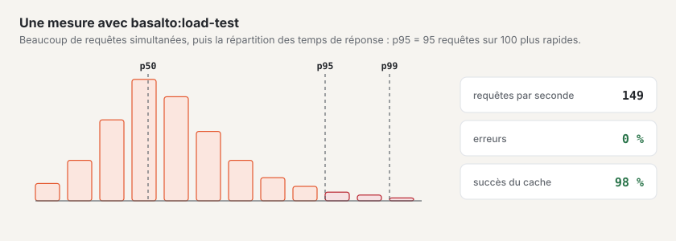

# Test de charge

`php artisan basalto:load-test` interroge des adresses simultanément et indique les requêtes par seconde, p50/p95/p99,
les erreurs, les codes de statut et les succès du cache des pages (en-tête `X-Basalto-Cache: HIT`). Il ne nécessite
aucun paquet supplémentaire et convient à votre propre instance — il refuse les hôtes étrangers sans `--remote`.

| Option | Signification |
| --- | --- |
| `url…` | une ou plusieurs adresses, interrogées à tour de rôle |
| `--concurrency` | requêtes simultanées (10 par défaut) |
| `--duration` | durée en secondes (30 par défaut) lorsque `--requests` vaut 0 |
| `--requests` | nombre fixe de requêtes au lieu d’une durée |
| `--max-p95` | objectif pour p95 en ms — un dépassement donne le code de sortie 1 |
| `--max-errors` | taux d’erreurs maximal en pour cent (1 par défaut) — un dépassement donne le code de sortie 1 |
| `--remote` | hôtes en dehors de `localhost`, `*.test`, `*.localhost` — uniquement vos propres instances |
| `--json` | résultat en JSON (pour les procès-verbaux) |

## Mesurer une instance

Voici comment vérifier si une installation supporte les pics attendus — de préférence sur une copie, jamais sur une
instance contenant des données de clients :

1. Remplir avec des données de test : `php artisan basalto:benchmark --sites=100 --entries=1000` crée des sites
   `bench-n` ; `--clean` les supprime ensuite.
2. **À froid** (après une pause, par exemple lorsque l’instance se met en veille entre les requêtes), mesurer une fois
   avec `--requests=1` et noter le temps.
3. **À chaud, avec cache des pages :**
   `php artisan basalto:load-test https://bench-1.ihre-domain.ch/ https://bench-2.ihre-domain.ch/ --remote --concurrency=30 --duration=300 --max-p95=300 --json`
4. **Sans cache :** la même mesure avec des pages que le cache ne conserve pas — avec formulaire ou recherche, par
   exemple `/kontakt` et `/suche?q=…`.
5. Consigner le résultat avec la date, la taille de l’instance et la version ; pour finir, `--clean`.

**Valeurs indicatives :** p95 inférieur à 300 ms pour 30 requêtes simultanées avec cache des pages, inférieur à 800 ms
sans ; taux d’erreurs inférieur à 1 %.

## Pour continuer

- [Hébergement](hosting.md)
- [Surveillance](monitoring.md)
- [Commandes](befehle.md)
