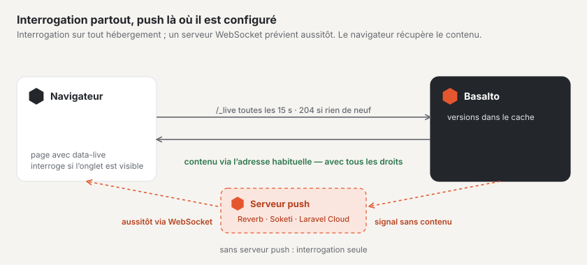

# Configurer la mise à jour en direct

Basalto signale les nouveautés sans rechargement — dans le forum (messages, listes de sujets, conversations, compteurs)
et à la cloche du backend. La base est une **interrogation** économe, qui fonctionne sur tout hébergement et ne demande
rien. Là où tourne un **serveur WebSocket** selon le protocole Pusher, le même signal arrive aussitôt par **push** ;
s’il tombe en panne, l’interrogation prend le relais.

## Interrogation

Les pages qui attendent des nouveautés demandent toutes les 15 secondes sous `/_live` si quelque chose a changé —
uniquement tant que leur onglet est visible, immédiatement au retour dans l’onglet, et avec des pauses plus longues
après des erreurs.

- Sans changement, Basalto répond par `204` et sans contenu ; seules des versions du cache sont lues. L’interrogation ne
  démarre aucune session et ne pose aucun cookie.
- Pour les invités, les pages du forum continuent de provenir du cache des pages ; l’interrogation a sa propre adresse.
- Ce qu’une page a le droit d’observer figure, signé, dans la page elle-même ; les compteurs personnels n’existent que
  dans les pages personnelles.

| Réglage | Signification | Par défaut |
| --- | --- | --- |
| `BASALTO_LIVE_INTERVAL` | Cadence de l’interrogation en secondes (au moins 5) | `15` |
| `BASALTO_LIVE_RATE` | Requêtes par minute et par adresse — y compris pour de nombreux onglets derrière une adresse commune | `600` |

Le cache devrait être un stockage partagé (Redis, Valkey ou base de données) si plusieurs serveurs servent le site —
sinon chaque serveur ne voit que ses propres versions.

## Push

Le push nécessite un serveur WebSocket qui parle le protocole Pusher : **Laravel Reverb** (sur Laravel Cloud comme
service géré, ou comme petite application distincte sur votre serveur) ou **Soketi**. Basalto envoie au serveur un
signal sans contenu ; le navigateur s’inscrit au canal via `/_live/auth`, sans session — les invités aussi.

| Variable | Signification |
| --- | --- |
| `REVERB_APP_ID`, `REVERB_APP_KEY`, `REVERB_APP_SECRET` | Application, clé publique et secret auprès du serveur |
| `REVERB_HOST`, `REVERB_PORT`, `REVERB_SCHEME` | où le navigateur joint le serveur (par exemple `ws.example.ch`, `443`, `https`) |
| `BASALTO_LIVE_PUSH_SERVER_HOST`, `…_PORT`, `…_SCHEME` | où Basalto joint le serveur, si c’est différent (par exemple en interne sans TLS) — vide signifie identique |
| `BASALTO_LIVE_PUSH` | `false` désactive le push, même si tout est renseigné |

Dès que l’application, la clé, le secret et l’hôte sont renseignés, le push est activé. Ce n’est qu’alors que le
navigateur charge Echo et `pusher-js` ; le secret ne quitte jamais le serveur.

### Laravel Cloud

Rattachez un **cluster WebSocket** à l’environnement. Laravel Cloud définit lui-même les variables `REVERB_…` ; après le
prochain déploiement, le push est activé.

### Serveur propre

Exploitez Reverb ou Soketi comme service distinct à côté de Basalto (sous un gestionnaire de processus comme
Supervisor), redirigez `wss://` vers lui par votre serveur web et saisissez les mêmes identifiants des deux côtés.
Basalto n’a besoin pour cela d’aucun paquet supplémentaire — il parle lui-même le protocole.

### Hébergement simple

Sans processus propre, pas de serveur WebSocket. L’interrogation s’occupe alors de tout ; les nouveautés apparaissent au
plus tard après une cadence.

## Vérifier

Sous **Administration › Exploitation**, la carte **« Mise à jour en direct »** indique la cadence, la limite par adresse
et si le push est configuré et joignable. Si le serveur est injoignable, c’est indiqué en rouge — le forum continue de
fonctionner par l’interrogation.

## Pour continuer

- [Mise à jour en direct](../community/live.md)
- [Surveillance](monitoring.md)
- [Hébergement](hosting.md)
