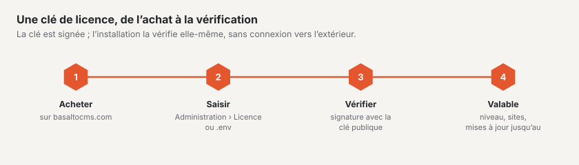

# Licence

Basalto est **source-available** : le code est public, l’utilisation est régie par le contrat de licence Basalto. Vous
le lisez dans le backend sous `/admin/recht/lizenzvertrag` et publiquement sous `/_recht/de/lizenzvertrag`. Cette page
présente les niveaux et explique comment saisir et vérifier une clé.



## Niveaux

| Niveau | En bref |
| --- | --- |
| **Free** | sans clé : un site, un utilisateur du backend, tous les modules ; pour le développement, les tests et l’usage privé |
| **Site** | un domaine de production, jusqu’à trois sites dans une installation ; nouvelles versions pendant un an à compter de l’achat |
| **Agence** | tous les sites et toutes les installations pour vous et vos clients ; clé de sous-licence par client, sur demande sans la marque Basalto dans le backend |

Les §§ 3 à 5 du contrat de licence font foi.

## Comment Basalto vérifie la licence

- **Hors ligne.** La clé est signée avec Ed25519 et vérifiée par rapport à la clé de produit publique contenue dans le
  noyau — sans appel vers l’éditeur.
- **Jamais bloquée.** Si une installation dépasse son niveau (plus d’utilisateurs, plus de sites, domaine absent de la
  clé), elle est considérée comme « non enregistrée ». Basalto affiche alors des avis, mais ne bloque aucune fonction.
- **Bandeau de pied de page après 30 jours.** Si une installation reste non enregistrée plus de
  `BASALTO_LICENSE_BANNER_DAYS` jours (30 par défaut), le frontend affiche un bandeau de pied de page. La date à partir
  de laquelle il apparaît est indiquée sous Administration › Licence.
- **Droit aux mises à jour.** S’il a expiré, le logiciel continue de fonctionner ; les nouvelles versions nécessitent
  une prolongation.
- Le scheduler met l’état à jour toutes les heures avec `basalto:license`.

## Saisir la clé

Deux voies — la saisie dans le backend prime sur le `.env` :

1. **Administration › Licence :** coller la clé, la vérifier, la saisir. Une clé invalide n’est pas enregistrée. La
   page affiche le niveau, l’état, les limites et les avis.
2. **`.env` :**

   ```dotenv
   BASALTO_LICENSE_KEY=<schlüssel>
   ```

> **Attention :** `.env.example` contient la ligne vide `BASALTO_LICENSE_PUBLIC_KEY=`. Une valeur vide écrase la clé
> de produit du noyau, et Basalto ne peut alors plus vérifier aucune clé (« Kein öffentlicher Lizenzschlüssel
> konfiguriert », aucune clé de licence publique configurée). Supprimez la ligne ou mettez-la en commentaire ; vous
> n’avez à la définir que pour les tests et vos propres émissions de clés.

## Connecter le compte client

Si vous avez acheté une licence sur basaltocms.com, vous voyez les clés, les factures et les achats sur le Marketplace
directement dans votre propre backend — seul l’achat reste sur basaltocms.com. Sous **Administration › Licence ›
Compte client chez l’éditeur** (exploitants uniquement) :

1. Saisir l’**adresse e-mail** du compte client → **Demander un code**. basaltocms.com envoie un code à six chiffres à
   cette adresse — uniquement s’il y existe un compte client ; la réponse dans le backend est la même dans les deux
   cas. L’e-mail indique l’hôte de cette installation.
2. Saisir le **Code** → **Connecter**. L’installation reçoit un token et l’enregistre chiffré (avec l’`APP_KEY`) ; il
   n’apparaît jamais dans l’interface ni dans le journal. Le journal ne consigne que « connecté » et « déconnecté »,
   avec l’hôte de l’éditeur.
3. Une fois connectée, la page affiche :
   - **Licences** avec le niveau, les domaines, le droit aux mises à jour et l’état (actif, bloquée, en cours).
     **Utiliser cette clé** saisit une clé comme le formulaire voisin — même vérification, même emplacement
     d’enregistrement.
   - **Factures** avec le numéro, la date, le montant, l’état et le **PDF**. Le lien PDF est une adresse signée sur
     basaltocms.com, valable une heure et seulement tant que l’installation est connectée.
   - **Achats sur le Marketplace** avec la quittance, s’il y en a.

Les données restent dix minutes dans le cache ; **Actualiser** les recharge immédiatement. La page n’attend jamais
l’éditeur : les données se chargent en différé et, si basaltocms.com n’est pas joignable (délai de quelques secondes),
un message s’affiche au lieu d’une page bloquée.

**Signature.** basaltocms.com signe chaque réponse avec la clé du Marketplace ; l’installation la vérifie avec la clé
publique contenue dans le noyau (`basalto.marketplace.public_key`). Si la signature est incorrecte ou si la réponse
appartient à une autre installation, la page affiche une erreur et aucune donnée. Si la signature manque, les données
apparaissent avec la mention « non signé ». Les liens de la réponse n’apparaissent que s’ils pointent vers l’éditeur.

**Déconnecter** révoque le token auprès de basaltocms.com et le supprime ici. Si basaltocms.com n’est pas joignable à ce
moment-là, il est tout de même supprimé ici et devient ainsi inutilisable.

Le **compte client** sur basaltocms.com liste aussi les installations connectées avec l’hôte et la dernière consultation ; **Déconnecter** y révoque également le token.

La vérification de la licence elle-même reste **hors ligne** — la connexion ne sert qu’à cette vue d’ensemble.
L’adresse de l’éditeur provient de `BASALTO_VENDOR_URL` (par défaut `https://basaltocms.com`, en local
`https://basalto.test`) ; si elle change, l’installation est considérée comme non connectée.

## `basalto:license`

```sh
php artisan basalto:license                     # afficher et consigner l’état de la licence
php artisan basalto:license --check=<schlüssel> # vérifier une clé sans la saisir
php artisan basalto:license --help              # toutes les options
```

Les autres options (`--keypair`, `--issue` avec `--plan`, `--licensee`, `--domains`, `--seats`, `--sites`,
`--updates-until`, `--agency`, `--customer`, `--white-label`, `--secret-file`, ainsi que `--revoke`) servent à émettre
et à bloquer des clés. Elles nécessitent la clé de produit privée, qui se trouve uniquement chez basaltocms.com, et ne
sont pas nécessaires pour exploiter une installation.


Questions sur la licence : email@basaltocms.com.

## Pour continuer

- [Licence](../verwaltung/lizenz.md)
- [Installation](installation.md)
