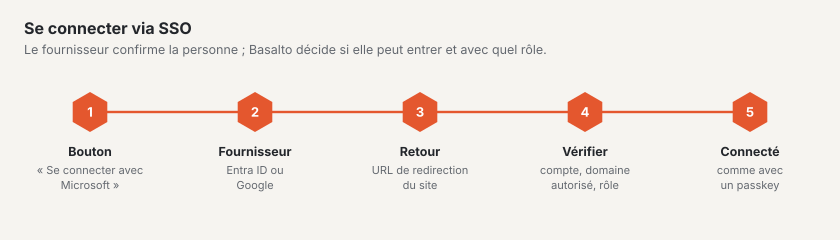

# SSO pour les utilisateurs du backend

Les utilisateurs du backend d’un site se connectent avec le compte de leur entreprise : « Se connecter avec Microsoft »
(Microsoft Entra ID) ou « Se connecter avec Google » (Google Workspace ou compte Google). La passkey et le code par
e-mail restent disponibles en parallèle — si le fournisseur est en panne, on peut toujours entrer.

Cela vaut de la même manière pour les installations propres et pour le SaaS.

## Principes

- **Configuré par site**, et non par compte : les rôles sont liés au site, et une agence gère dans un même compte des
  sites de différentes entreprises avec différents tenants. Deux sites de la même entreprise nécessitent deux entrées
  (la même inscription d’application peut être utilisée les deux fois, avec les deux URL de redirection).
- **Uniquement des utilisateurs existants.** Est connectée la personne qui a dans Basalto un utilisateur avec l’e-mail
  confirmé **et** un rôle sur le site. La première fois, Basalto associe l’utilisateur à son identifiant chez le
  fournisseur ; ensuite, c’est l’identifiant qui compte (une adresse modifiée chez le fournisseur n’interrompt pas la
  connexion).
- **La création automatique est désactivée d’usine.** Qui l’active choisit un rôle (Rédacteur, Approbateur ou
  Traducteur — jamais Exploitant ou Administrateur). Avec Google, ce n’est possible qu’avec un **Domaine autorisé**,
  sinon n’importe quel compte Google au monde obtiendrait l’accès. Les nouveaux utilisateurs figurent dans le journal
  (« Utilisateur créé via SSO »).
- **Les comptes désactivés** restent exclus, y compris via SSO.
- **Le secret client** est stocké chiffré avec l’`APP_KEY` dans la base de données ; il n’est jamais transmis au
  navigateur, n’apparaît jamais dans le journal et ne figure pas dans l’export d’un site. Après un transfert, vous
  reconfigurez le SSO.
- **Peuvent le configurer** l’exploitant du site ainsi que le propriétaire et l’administration du compte — pas
  l’administrateur du site : qui fixe le fournisseur détermine quels comptes peuvent se connecter.

## Où dans le backend

**Administration › Sites › (site) › Connexion via SSO** (`/admin/sites/<id>/anmeldung`). On y trouve

- l’**adresse de connexion** du site (`/admin/login?site=<handle>`) — sous un domaine du site, les boutons apparaissent
  aussi sans ce complément ; sur une installation avec un seul site, toujours. La page de connexion n’affiche jamais
  la liste de tous les sites.
- pour chaque fournisseur, les champs, un commutateur (désactivé = pas de bouton), les **URL de redirection à copier**
  (une par adresse sous laquelle le backend est accessible) et **« Tester la connexion »**.

« Tester la connexion » est une indication, pas une garantie : avec Entra, Basalto obtient un token pour l’application
elle-même et traduit les codes d’erreur (tenant inconnu, ID client absent du tenant, secret erroné ou expiré) ; avec
Google, il vérifie si l’ID client et le secret sont connus. Seule une vraie connexion montre si l’URL de redirection est
correcte et si les utilisateurs peuvent donner leur consentement — idéalement une fois dans une fenêtre privée.

## Microsoft Entra ID : inscrire l’application

1. [Centre d’administration Microsoft Entra](https://entra.microsoft.com) › **Identité › Applications › Inscriptions
   d’applications › Nouvelle inscription**.
2. Nom, par ex. « Basalto – Muster AG ». **Types de comptes pris en charge : « Comptes dans cet annuaire
   organisationnel uniquement »** (un seul locataire). Basalto n’accepte de toute façon que le tenant saisi.
3. **URI de redirection :** plateforme **Web**, l’URL de redirection fournie par Basalto, par ex.
   `https://muster.ch/admin/login/sso/entra/callback`. D’autres adresses (alias, `APP_URL`) sous
   **Authentification › Ajouter un URI**.
4. La **Vue d’ensemble** indique l’**ID d’application (client)** et l’**ID de l’annuaire (locataire), Tenant-ID** —
   reprendre les deux GUID dans Basalto. `common`, `organizations` ou un nom de domaine ne fonctionnent pas.
5. **Certificats & secrets › Nouveau secret client**, choisir l’expiration (24 mois au plus), copier immédiatement la
   **Valeur** (et non l’« ID de secret ») et la saisir dans Basalto. Avant l’expiration, en générer un nouveau et le
   saisir.
6. **Autorisations de l’API :** Microsoft Graph, déléguées : `openid`, `profile`, `email`, `User.Read` (généralement
   déjà présent). Selon le réglage du tenant, **« Accorder un consentement d’administrateur »** — sinon les
   utilisateurs voient à la première connexion une demande de consentement ou un refus.
7. Facultatif : sous **Applications d’entreprise › (application) › Propriétés**, activer « Affectation obligatoire » et
   n’affecter que certains groupes.

**Quelle adresse compte :** le nom d’utilisateur principal (UPN) — son domaine est toujours un domaine vérifié du
tenant. Le champ `mail` ne compte que s’il a le même domaine. **Les comptes invités** (`…#EXT#@…`) sont refusés : leur
adresse appartient à un autre annuaire. Le tenant du compte est vérifié au retour par rapport au tenant saisi.

## Google : créer le client OAuth

1. [Google Cloud Console](https://console.cloud.google.com) › choisir ou créer un projet.
2. **API et services › Écran de consentement OAuth** (ou « Google Auth Platform ») : type d’utilisateur **Interne** si
   seuls les comptes de votre organisation Workspace sont admis, sinon **Externe**. Nom de l’application, adresse
   d’assistance, logo selon vos souhaits. Champs d’application : `openid`, `email`, `profile` — aucun champ
   d’application sensible, aucune validation par Google nécessaire.
3. **Identifiants › Créer des identifiants › ID client OAuth**, type d’application **Application Web**.
4. **URI de redirection autorisés :** la ou les URL de redirection fournies par Basalto, par ex.
   `https://muster.ch/admin/login/sso/google/callback`.
5. Reprendre dans Basalto l’**ID client** (se termine par `.apps.googleusercontent.com`) et le **Code secret du
   client**.
6. Définir le **Domaine autorisé** dans Basalto (par ex. `muster.ch`) si seuls les comptes Workspace de ce domaine
   doivent entrer. Basalto vérifie alors `hd` et le domaine de l’e-mail au retour ; sans domaine, tout compte Google
   avec un e-mail confirmé est admis, pour autant qu’il existe dans Basalto un utilisateur avec un rôle pour cet e-mail.

## Déroulement et sécurité

- **Redirection** avec `state` et PKCE (tous deux dans la session), avec Entra toujours vers le tenant saisi, avec
  `prompt=select_account`. **Retour** uniquement avec une session correspondante ; retour expiré ou étranger →
  « La connexion a expiré ».
- **Entra :** Socialite vérifie l’ID token (signature, émetteur, audience, expiration) ; Basalto compare le tenant.
  **Google :** `email_verified` doit être vrai ; avec un domaine autorisé, en plus `hd` et le domaine de l’e-mail.
- **Les erreurs** sont renvoyées à la page de connexion de manière aimable et sans détails. Le journal en consigne le
  motif (« SSO refusé » : tenant étranger, compte invité, non confirmé, mauvais domaine, inconnu, sans rôle,
  désactivé) — pour les personnes étrangères, uniquement le domaine de l’e-mail, jamais l’adresse complète.
- **Limites :** la redirection et le retour partagent la limite de la vérification des codes (20 requêtes par minute et
  par IP), « Tester la connexion » dix par minute.
- **Journal :** « Connexion » avec la méthode `sso-entra` ou `sso-google` et le site, « SSO associé » la première fois,
  « SSO configuré »/« SSO supprimé » lors des modifications (avec « secret modifié : oui/non », jamais la valeur).
- **Le droit d’accès et la suppression** (protection des données) indiquent ou suppriment les associations d’un
  utilisateur.

## Derrière un proxy

Basalto construit l’URL de redirection à partir du schéma et de l’hôte de la requête. Derrière un proxy ou un load
balancer, `TrustProxies` et `X-Forwarded-Proto` doivent être corrects, sinon on obtient `http://…` au lieu de
`https://…` et le fournisseur refuse le retour (Entra : AADSTS50011, Google : `redirect_uri_mismatch`). Vérifiez donc
les URL de redirection affichées sur l’environnement cible lui-même, et non en local.

## Symptômes d’erreur

| Message / code | Cause | Remède |
| --- | --- | --- |
| AADSTS50011 / `redirect_uri_mismatch` | l’URL de redirection manque chez le fournisseur ou diffère (schéma, hôte, barre oblique) | saisir l’URL fournie par Basalto exactement telle quelle |
| AADSTS700016 | ID client absent du tenant saisi | prendre le Tenant-ID et l’ID client de la même inscription |
| AADSTS7000215 / 7000222 | secret erroné ou expiré | générer une nouvelle valeur et la saisir |
| AADSTS65001 | consentement manquant | accorder le consentement d’administrateur |
| « Ce compte ne permet pas de se connecter à ce site … » | compte sans utilisateur/rôle, invité, tenant étranger, mauvais domaine | lire le motif dans le journal sous « SSO refusé » ; inviter l’utilisateur ou lui attribuer un rôle |
| « La connexion a expiré » | retour sans session correspondante (autre hôte, cookie bloqué, attente trop longue) | recommencer via l’adresse de connexion du site ; hôte de l’URL de redirection = hôte de la connexion |

## Pour continuer

- [Sites](../verwaltung/sites.md)
- [Rôles et droits](rollen.md)
