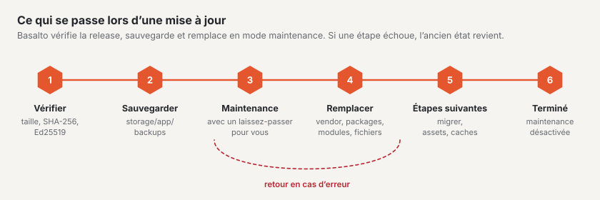

# Mises à jour

Vous installez les nouvelles versions de Basalto, des modules fournis, des plugins et des thèmes dans le backend sous
**Administration › Mises à jour** ou sur la console. Basalto télécharge la version signée, effectue une sauvegarde au
préalable, remplace les fichiers et, en cas d’erreur, rétablit l’état précédent.



## Dans le backend ou sur la console

Dans le navigateur : [Mises à jour](../verwaltung/updates.md). Sur la console :

```sh
php artisan basalto:update                   # vérifier : noyau, plugins, thèmes — avec la source
php artisan basalto:update --kern            # installer le noyau à partir de la version signée
php artisan basalto:update --plugin=anbieter/paket
```

- **Ce qui se passe :** télécharger l’archive (`/_download/latest.json` de la source), vérifier la taille, le SHA-256
  et Ed25519, sauvegarder vers `storage/app/backups`, mode maintenance. Puis remplacer : `vendor`, `packages` et
  `modules` en bloc, tout le reste fichier par fichier. Ensuite `package:discover`, `migrate --force`, les assets et
  `optimize:clear`, chacun dans un nouveau processus PHP. Si une étape échoue, les anciens fichiers reviennent.
- **Ce qui reste :** `.env`, `storage`, `auth.json`, `public/storage`, `public/hot`, chaque `*.sqlite` et tout ce qui
  ne figure pas dans l’archive.
- **Revenir en arrière à la main :** après l’exécution, les fichiers remplacés se trouvent dans
  `storage/app/updates/lauf-<zeit>/vorher/` (seule la dernière exécution est conservée). Les recopier, puis
  `php artisan optimize:clear`.
- **État et journal :** `storage/app/updates/status.json` (la page du backend le lit) et `storage/logs/update.log`.
- **Source :** `BASALTO_UPDATES_URL`, sinon basaltocms.com.
- **Vérification quotidienne :** le scheduler appelle `basalto:update --benachrichtigen` à 04:10 (désactivation avec
  `BASALTO_UPDATES_CHECK=false`).
- **Plugins :** il faut pour cela l’e-mail et le token du compte client (`auth.json` ou `BASALTO_MARKETPLACE_EMAIL` et
  `BASALTO_MARKETPLACE_TOKEN`).

Avant un grand saut de version, une sauvegarde propre avec test de restauration reste néanmoins utile
([Sauvegarde](backup.md)).

## Installations avec Composer

Si votre installation gère Basalto sous forme de paquets Composer, la page « Mises à jour » affiche l’état et les
commandes ; l’installation se fait alors avec Composer :

1. Sauvegarder et vérifier, activer le mode maintenance :

   ```sh
   php artisan basalto:backup
   php artisan basalto:backup-verify
   php artisan down
   ```

2. Récupérer les nouvelles versions — dans l’environnement de développement, pas sur le serveur :

   ```sh
   composer update "basalto/*"     # uniquement le noyau, Lava et les modules
   composer update                 # tout
   ```

3. Transférer le nouvel état (`composer.json`, `composer.lock`) sur le serveur et l’y installer :

   ```sh
   composer install --no-dev --optimize-autoloader
   php artisan migrate --force
   php artisan vendor:publish --tag=basalto-assets --force
   php artisan optimize
   ```

## Caches après la mise à jour

| Quoi | Commande | Quand |
| --- | --- | --- |
| Caches Laravel | `php artisan optimize` | après chaque mise à jour ; en cas de problème, d’abord `php artisan optimize:clear` |
| Cache des pages | `php artisan basalto:page-cache clear`, puis `php artisan basalto:page-cache warm` | si le cache des pages est activé ; `--site=<handle>` pour un seul site |
| Index de recherche | `php artisan basalto:search-index` | si la mise à jour concerne la recherche ou après un changement de pilote ; `--site=<handle>` pour un seul site |
| File d’attente | `php artisan queue:restart` | uniquement avec un worker propre ; via le scheduler, `queue:work` redémarre chaque minute |

Le cache des pages dépend de l’empreinte de la source du thème et de la génération du site, pas de la version. Si une
mise à jour modifie la sortie du noyau, videz-le donc à la main.

## Vérifier après la mise à jour

```sh
php artisan up
```

1. **`/up`** indique « bereit » (prêt : base de données et pulsation).
2. **Administration › Exploitation :** pulsation à jour, file d’attente vide ou en cours de traitement, aucune nouvelle
   tâche en échec, dernière exécution des tâches sans erreur.
3. **Vérifier le thème** si Lava a changé :

   ```sh
   php artisan basalto:check --site=<handle>          # thème issu de la base de données
   php artisan basalto:check --theme=themes/<name>    # thème issu de fichiers
   php artisan basalto:publish <handle> --dry-run     # vérification avant la mise en ligne, sans écrire
   ```

4. Ouvrir dans le frontend une page avec des images et un formulaire, modifier une page dans le backend.
5. **Administration › Licence :** si le droit aux mises à jour a expiré, une indication y apparaît
   ([Licence](lizenz.md)).
6. **MariaDB ou MySQL :** `php artisan basalto:db-zeitzone` indique si des horodatages plus anciens doivent être
   convertis ([Fuseau horaire de la base de données](installation.md#fuseau-horaire-de-la-base-de-données)).

En cas de problème : le mode maintenance reste activé, rétablir l’état à partir de la sauvegarde
([Sauvegarde](backup.md#restaurer)).

## Pour continuer

- [Mises à jour](../verwaltung/updates.md)
- [Sauvegarde](backup.md)
- [Commandes](befehle.md)
