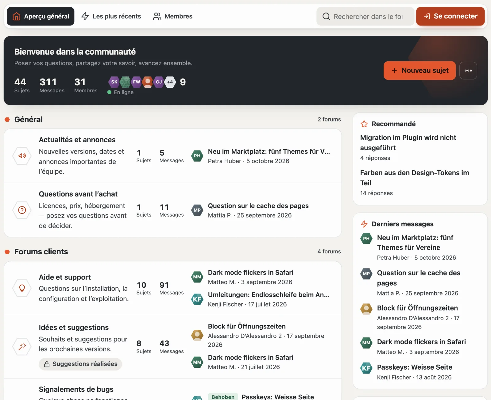
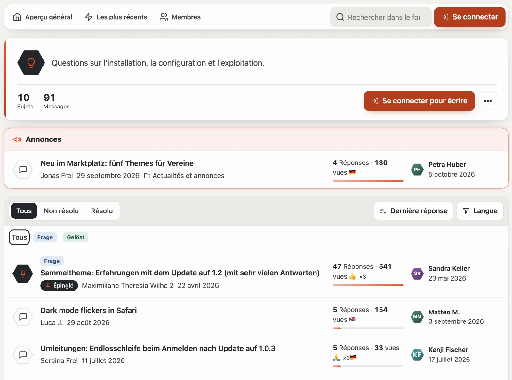
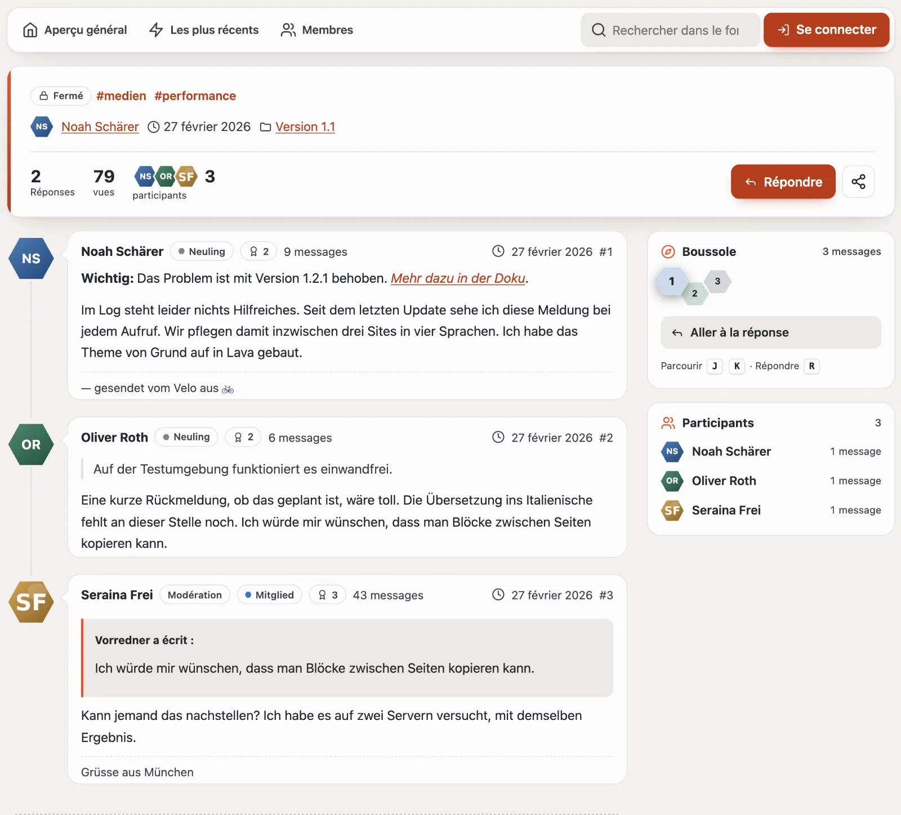
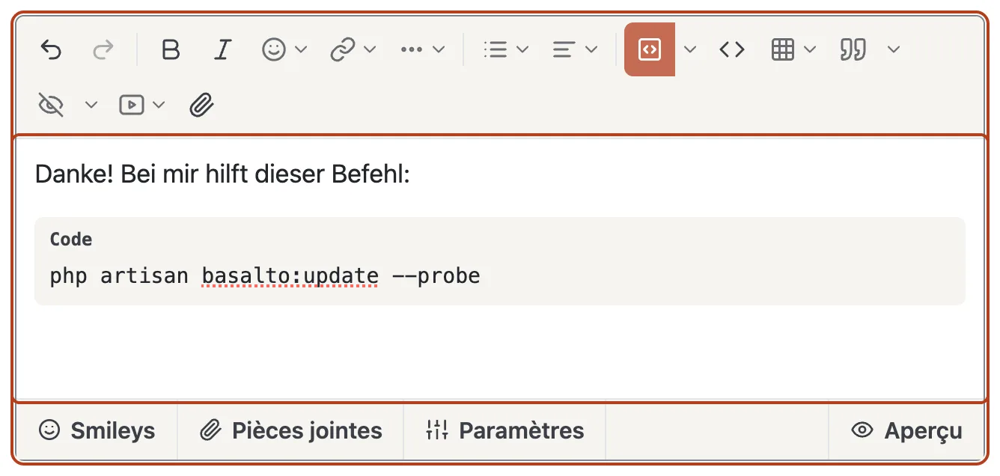
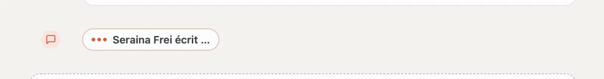
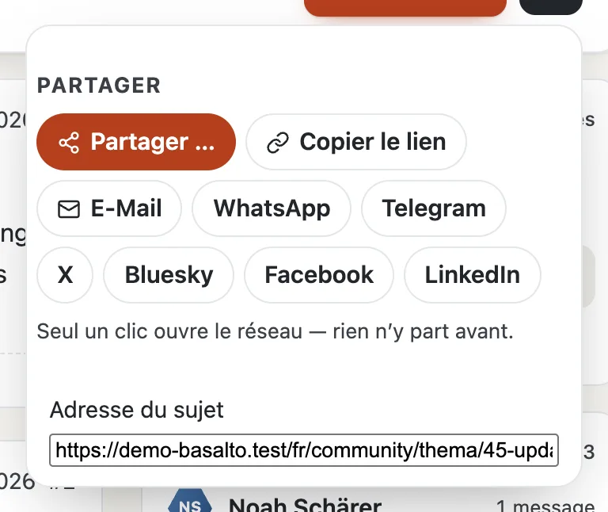

# Forum

L’aperçu général sous `/community` commence par le **pouls** : un mot d’accueil, ce qui est nouveau depuis votre dernière visite, les sujets, les messages, les membres et qui est en ligne, avec **« + Nouveau sujet »** et le menu **« … »** (tout marquer comme lu, RSS, recherche, membres). En dessous figurent les catégories avec leurs forums. Pour chaque forum, l’hexagone montre un symbole — en lave s’il y a du nouveau —, à côté le nombre de sujets et de messages, les sous-forums et les deux derniers sujets avec image, préfixe, nom et heure. À droite se trouvent des encadrés : Recommandé, derniers messages, du blog, sujets populaires et mots-clés. Tout en bas suit un bandeau avec les statistiques (messages par jour, membre le plus récent) et « Membres en ligne » avec le record.

Chaque page du forum commence par le **navigateur** : **Aperçu général**, **Les plus récents**, **Non lues** (avec le nombre), **Abonné**, **Suivis**, **Membres**, la recherche, les messages, la cloche, pour la modération le bouclier avec les cas ouverts, et votre profil. Sur un téléphone, les chemins deviennent une barre de symboles.

Les encadrés existent aussi sous forme de parties Lava pour chaque région d’une mise en page (`forum.latest`, `forum.hot`, `forum.featured`, `forum.online`, `forum.stats`, `forum.members`, `forum.team`).

## Lire

- **Liste des sujets :** l’en-tête montre le symbole, la description et les chiffres du forum, **« + Nouveau sujet »**, **S’abonner** (cloche) et le menu « … ». Les annonces figurent au-dessus, les sujets épinglés en haut. L’hexagone devant chaque sujet indique son état : lave = nouveau, vert = résolu, rayé = en attente de modération, sombre = épinglé. La barre sous les chiffres montre l’animation d’un sujet. **Tous**, **Non résolu** et **Résolu** filtrent ; **trier** par dernière réponse, date de création, réponses ou titre ; les préfixes comme pastilles, la langue dans le menu. Ce qui n’est pas lu apparaît en gras et mène au premier nouveau message.
- **Sujet :** l’en-tête montre préfixe, état et mots-clés, qui l’a ouvert quand et dans quel forum, réponses, vues, les participants et — si vous êtes déjà venu — **« nouveaux pour vous »**. Des raccourcis mènent à la réponse la plus utile et aux messages officiels de l’équipe. Les messages sont suspendus à une ligne avec les images de profil ; les nouveaux la colorent en lave et portent **« Nouveau »**. L’en-tête de chaque message montre nom, groupe, rang, trophées, nombre de messages, heure et numéro. La réponse la plus utile porte un bandeau vert.
- **Boussole :** à droite, elle montre les messages de la page sous forme d’alvéoles à la couleur de la personne qui les a écrits — vous voyez ainsi qui porte la conversation. Nouveau, solution, en attente et équipe sont mis en évidence ; le message que vous lisez est plus grand. Un clic y mène ; au clavier, **J** et **K** passent d’un message à l’autre, **R** mène à la réponse.

- **Listes :** Les plus récents, Non lues, Abonné, Suivis (nouveautés des personnes que vous suivez).

## Écrire

- **Ouvrir un sujet :** dès la saisie du titre, le forum affiche des **sujets similaires** — la question a peut-être déjà reçu une réponse. S’y ajoutent le titre, le préfixe, les champs du sujet du forum, les mots-clés (cinq au maximum, séparés par des virgules), le texte, les pièces jointes et, si vous le souhaitez, un sondage.
- **Éditeur :** la barre du haut a tout ce qu’il faut pour un bon message :
  - **Annuler** et **Rétablir**, **Gras**, **Italique**, **Émoji** et **Lien** (adresse et texte dans un petit formulaire) ;
  - **« … »** pour le format de paragraphe (paragraphe, titre 1 à 3), souligné, barré, indice et exposant, effacer la mise en forme et le **surligneur** en cinq couleurs ;
  - **Listes** (à puces, numérotée, diminuer et augmenter le retrait) et **Alignement** (gauche, centré, droite, justifié) ;
  - **Bloc de code :** un clic l’insère ; la flèche à côté choisit le langage (ou la détection automatique), le numéro de la première ligne et un nom de fichier. À la lecture, le code est coloré, avec les numéros de ligne et le bouton **« Copier »** ; si des lignes sont coupées, **« Plus »** les renvoie à la ligne jusqu’à ce que tout le code soit visible ;
  - **Code en ligne**, **Tableau** (choisir la taille dans la grille ; si le curseur se trouve dans un tableau, le menu insère ou supprime des lignes et des colonnes), **Citation** (avec les citations retenues), **Spoiler** (avec un titre si vous le souhaitez), **Vidéo** et **Fichier**.

  Vous mentionnez quelqu’un avec `@` et les premières lettres. L’équipe et la modération (ou les personnes à qui l’administration donne le droit « Mentionner des groupes ») mentionnent aussi des groupes entiers, par exemple `@Moderation` — tous leurs membres reçoivent une notification. La barre fonctionne aussi au clavier : Tab y entre, les flèches s’y déplacent, Échap ferme un menu. Sans script, il reste un simple champ de texte.
- **Onglets sous le texte :** **Smileys**, **Pièces jointes** (téléverser, types autorisés, taille par fichier, espace libre), **Réglages** (par exemple « message officiel de l’équipe »), à l’ouverture d’un sujet **Sondage** et, à droite, l’**Aperçu** — il montre le message exactement tel qu’il apparaîtra après l’envoi.
- **Qui écrit en ce moment :** si quelqu’un d’autre rédige une réponse dans le même sujet, **« Anna écrit … »** apparaît à la fin des messages et dans le coin de votre champ de réponse — ainsi, deux personnes ne répondent pas la même chose en même temps. Plus d’informations sous [Mise à jour en direct](live.md).
- **Modifier :** dans le délai fixé par le site, avec un motif ; l’historique reste visible.
- Certains forums n’approuvent les nouveaux messages qu’après contrôle — votre message apparaît alors dès que la modération l’approuve. Un court intervalle minimal sépare deux messages.

## Participer

- **Réactions :** sous chaque message, elles apparaissent comme décompte, la vôtre mise en évidence. Le bouton avec le smiley ouvre le choix 👍 ❤️ 😂 😮 😢 🙏 ; choisir à nouveau la retire.
- **Répondre, Citer, Mémoriser** figurent sous chaque message. **Modifier**, **Historique**, **Réponse la plus utile** et **Signaler** se trouvent dans le menu « … » du message.
- **S’abonner** est la cloche dans l’en-tête d’un sujet ou d’un forum, **Ignorer** se trouve dans le menu « … ». La cloche du navigateur affiche les nouveautés, les e-mails arrivent immédiatement, chaque jour ou jamais (dans le profil).
- La **réponse la plus utile** est choisie par la personne qui a ouvert le sujet.
- **Signaler :** dans le menu « … » du message d’une autre personne — l’auteur du message n’apprend pas qui l’a signalé.
- **Partager :** dans l’en-tête d’un sujet, **« Partager »** ouvre l’e-mail, WhatsApp, Telegram, X, Bluesky, Facebook et LinkedIn — sous forme de simples liens : seul votre clic ouvre le réseau ; avant, il n’apprend rien. S’y ajoutent **« Copier le lien »** et, sur téléphone, le partage de l’appareil. Comme image d’aperçu, les réseaux affichent la première image du message d’ouverture.

## Trouver

- **Recherche dans le forum** sous `/community/suche` ; les sujets figurent aussi dans la recherche du site entier, avec le filtre « Forum ».
  La recherche suit la saisie : sur la page de recherche, les résultats se mettent à jour, et dans le champ de recherche de la
  barre du forum, jusqu’à cinq sujets apparaissent en suggestion avec « Afficher les … résultats » (flèches, Entrée, Échap).
  La recherche porte sur les mots : chacun doit figurer, dans n’importe quel ordre, sans distinction de majuscules, de
  minuscules ni d’accents (« ubersetzung » trouve « Übersetzung »). Un résultat montre le message correspondant avec le nom,
  le numéro et la date et y mène directement.
- **Mots-clés :** `#Theme` mène à tous les sujets portant ce mot-clé.
- **RSS :** `/community/feed` pour le forum entier, `/community/<forum>/feed` par forum.

## Pour continuer

- [Profils et conversations](profile.md)
- [Modération](moderation.md)
- [Communauté](README.md)
