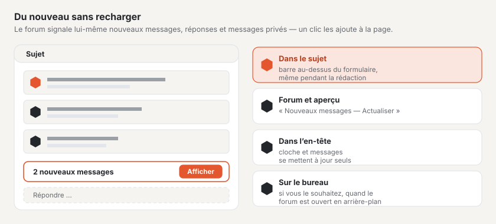

# Mise à jour en direct

Le forum signale lui-même les nouveautés : nouveaux messages dans le sujet ouvert, nouveaux sujets et réponses dans la
liste des sujets, nouveaux messages dans une conversation et notifications non lues dans l’en-tête. Personne n’a besoin
de recharger la page — un clic insère les nouveautés dans la page. Cela fonctionne sur tout hébergement ; là où un
serveur WebSocket est configuré, elles apparaissent aussitôt, sinon au plus tard après environ 15 secondes.

## Dans un sujet

Si une réponse arrive pendant que vous lisez un sujet, la barre **« 1 nouveau message »** avec le bouton
**« Afficher »** apparaît en bas de la fenêtre. Un clic insère le message à la fin de la page — avec son numéro, ses
réactions et tous les boutons, comme si la page avait été rechargée. La barre se trouve juste au-dessus du formulaire de
réponse et reste collée au bord inférieur de la fenêtre : vous la voyez même pendant que vous écrivez, et vous pouvez
lire avant l’envoi ce qui a été répondu entre-temps.

- Sur une page antérieure du sujet, la barre propose **« Aller à la dernière page »**.
- S’il y a plus de nouveaux messages que n’en contient une page, le bouton mène lui aussi à la dernière page.
- N’apparaît que ce que vous pourriez voir de toute façon : les messages en attente d’approbation seulement après leur
  approbation ; les messages des personnes que vous avez bloquées repliés, comme sur la page.
- Les messages chargés ainsi comptent comme lus.

## Dans le forum et l’aperçu général

Lorsqu’un sujet ou une réponse s’ajoute dans un forum, **« Nouveaux messages dans ce forum »** apparaît au-dessus de la
liste des sujets, avec **« Actualiser »**. Cela vaut aussi pour les forums situés au-dessus (une réponse dans un
sous-forum modifie l’aperçu de la catégorie) et pour l’aperçu général du forum.

## Conversations

Dans une conversation ouverte, **« Nouveau message dans cette conversation »** apparaît dès qu’une autre personne écrit.
**« Afficher »** charge la conversation et saute au formulaire de réponse.

## Qui écrit en ce moment

Dès que quelqu’un commence à rédiger une réponse dans un sujet, **« Anna écrit … »** apparaît à la fin des messages
avec trois points qui pulsent — pour toutes les personnes qui lisent le sujet, y compris les visiteurs. Qui écrit
soi-même le voit aussi dans le coin de son propre champ de réponse. Pour deux personnes, on lit « Anna et Ben
écrivent … », au-delà le nombre.

- L’indication disparaît quelques secondes après la dernière touche, à l’envoi ou lorsque la personne quitte la page.
- Dans les conversations, seuls les participants la voient.
- Vous ne vous voyez pas vous-même ; les personnes interdites d’écriture n’apparaissent pas.

## Cloche et messages

Si vous êtes connecté, l’en-tête du forum affiche le nombre de notifications (cloche) et de messages non lus. Les deux
nombres se mettent à jour d’eux-mêmes, sans recharger la page.

## Notifications de bureau

Sur la page **Notifications**, vous pouvez activer les notifications de bureau. Le navigateur demande une fois
l’autorisation ; ensuite, il affiche la notification la plus récente sous forme d’avis du système lorsque le forum est
ouvert dans un onglet en arrière-plan. Un clic dessus l’ouvre. Lorsque le forum est au premier plan, la cloche et les
compteurs suffisent. Ce choix vaut pour ce navigateur et peut y être désactivé à nouveau.

## Bon à savoir

- La page ne demande les nouveautés que tant que son onglet est visible — en arrière-plan uniquement si les
  notifications de bureau sont activées, et alors moins souvent.
- Sans JavaScript, le forum fonctionne comme avant ; les nouveautés apparaissent alors au prochain chargement.
- Ce que le forum transmet n’est qu’un signal « il y a du nouveau ». Le navigateur charge le contenu par l’adresse
  habituelle, avec les mêmes droits que la page.

## Pour continuer

- [Forum](forum.md)
- [Profils et conversations](profile.md)
- [Configurer la mise à jour en direct](../betrieb/live.md)
