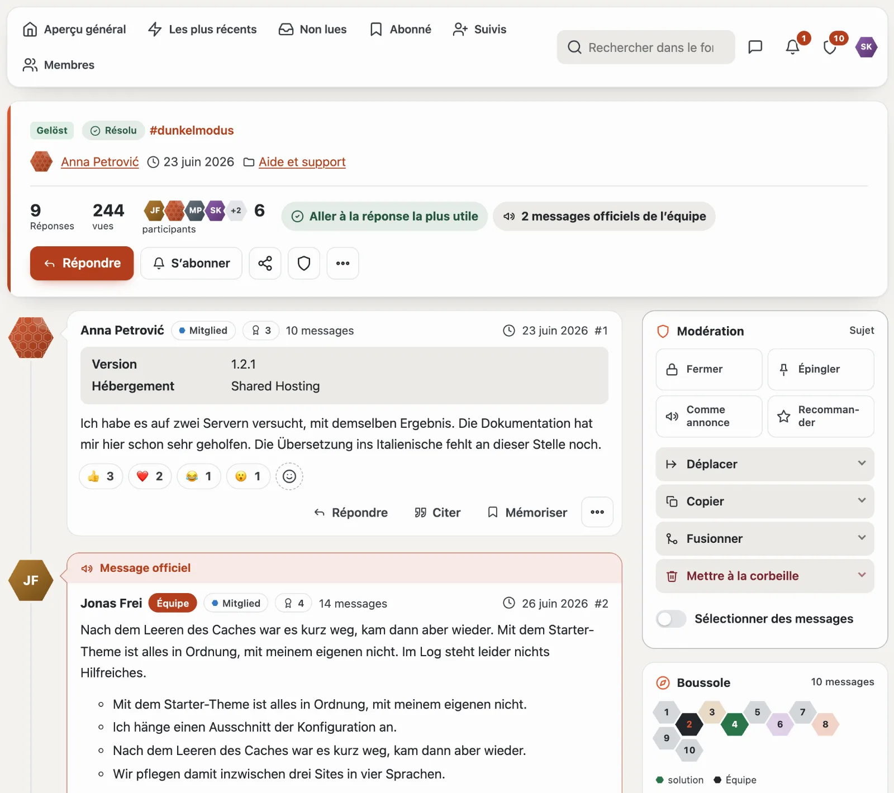
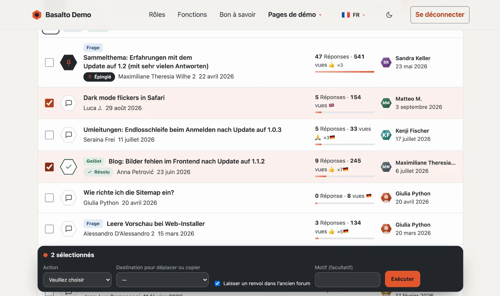
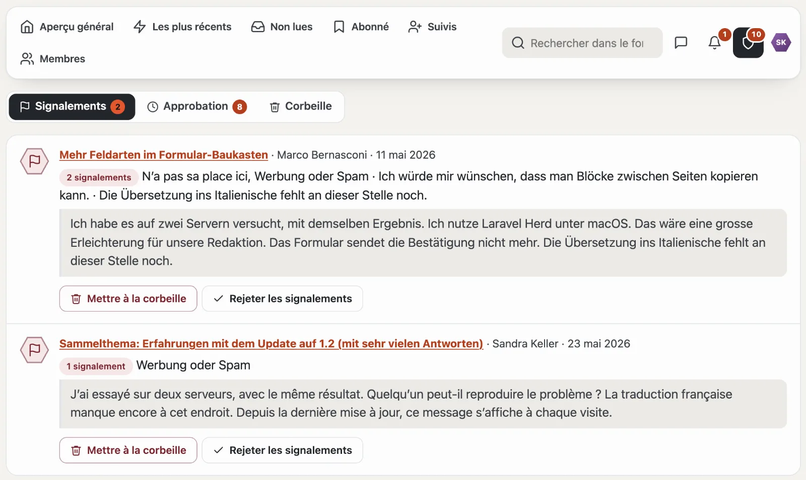
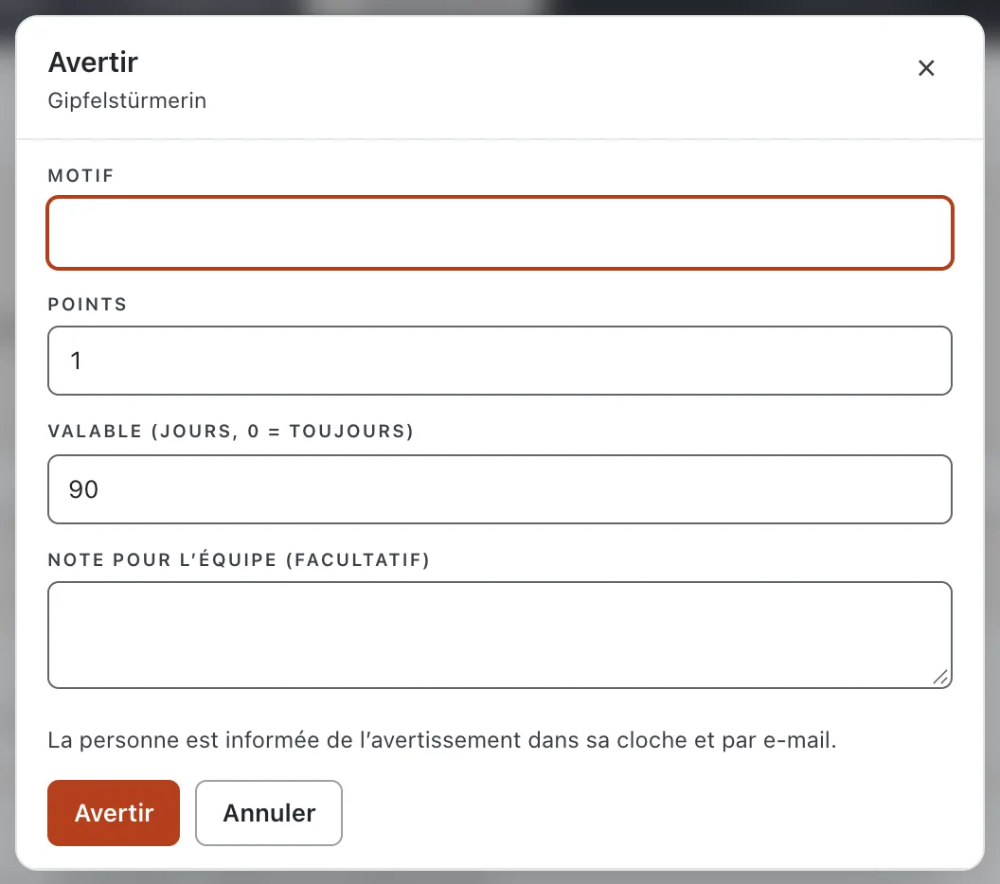
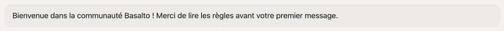

# Modération

Peut modérer qui dispose, dans un forum, du droit **« Modérer »** (d’usine, les groupes Modération et Équipe). Chaque action existe à deux endroits — sur place dans le forum et dans l’administration (extranet ou backend) — avec les mêmes conséquences et la même ligne dans le **journal de modération**.

## Sur place

- **Carte Modération sur le sujet :** à côté des messages figurent des tuiles pour **Fermer**, **Épingler**, **Comme annonce** et **Recommander**. Quand quelque chose est actif, la tuile est sombre et indique le chemin du retour (par exemple « Épinglé · détacher »). En dessous se déplient **Déplacer** (si souhaité avec un renvoi dans l’ancien forum, qui disparaît après quelques jours), **Copier** (avec tous les messages visibles, les mots-clés et le sondage sans les votes), **Fusionner** et **Mettre à la corbeille**. Sur un téléphone, la carte se trouve à la fin du sujet ; le bouclier de l’en-tête y mène.
- **Sélectionner :** l’interrupteur **« Sélectionner »** au-dessus de la liste des sujets et **« Sélectionner des messages »** dans la carte affichent des cases à cocher. La barre sombre « n sélectionné(s) » exécute l’action pour tous.

- **Sur le message :** si un message est en attente ou signalé, un bandeau en haut propose la décision (**Approuver**, **Mettre à la corbeille**, **Rejeter les signalements**) ainsi que **Avertir** et **Supprimer comme spammeur**. Pour tous les autres messages, Avertir et Supprimer comme spammeur se trouvent dans le menu « … ».
- **Messages :** approuver, masquer, mettre à la corbeille, diviser vers un nouveau sujet.
- **Bloquer la modification :** dans le menu « … » d’un message, la modération bloque la modification pour son auteur (par exemple lors d’un différend sur le contenu) ; l’auteur voit « Modification bloquée (modération) ». « Autoriser la modification » le lève ; la modération elle-même peut toujours modifier.
- La liste `/community/moderation` rassemble les signalements, ce qui est en attente et la corbeille ; les onglets montrent le nombre de cas ouverts, le bouclier du navigateur leur total.

## Signalements

Les membres signalent des messages en indiquant un motif. À partir du nombre réglé de signalements ouverts (par défaut trois), un message est masqué provisoirement jusqu’à ce que la modération décide. Les signalements concernant des avis du Marketplace et des messages privés se trouvent dans la même liste de l’administration.

## Avertissements et blocages

- Un **avertissement** comporte un motif, des points et une durée de validité. La personne avertie en est informée dans la cloche et par e-mail.
- À partir du nombre de points réglé suit automatiquement une **interdiction d’écrire** (lire oui ; écrire, réagir, voter et envoyer des messages non) ou un **blocage** (la personne compte comme un visiteur).
- **Supprimer comme spammeur :** bloque sans limite de durée, met tous les sujets et messages à la corbeille et règle les signalements ouverts — les compteurs sont ensuite justes.
- Sous **Membres**, vous posez et levez les blocages à la main et retirez des avertissements.

## Protection contre les abus

- **Approbation :** si « Écrire sans approbation » est réglé sur « Non » pour un groupe (globalement ou par forum), chaque nouveau message attend la modération.
- **Intervalle minimal** entre deux messages (flood control) ; la modération et l’équipe n’attendent jamais.
- **Censure :** une liste de mots (`*` pour un nombre quelconque de lettres) bloque l’envoi avec un message — rien n’est modifié en silence.

## Annonces

Sous **Annonces**, vous créez des bannières — pour toute la communauté, l’aperçu général ou un forum, pour tous, uniquement les visiteurs, uniquement les personnes connectées ou certains groupes, avec une période. Les personnes connectées masquent pour elles-mêmes les avis masquables ; les visiteurs aussi — leur navigateur s’en souvient.

## Pour continuer

- [Administration de la communauté](verwaltung.md)
- [Forum](forum.md)
