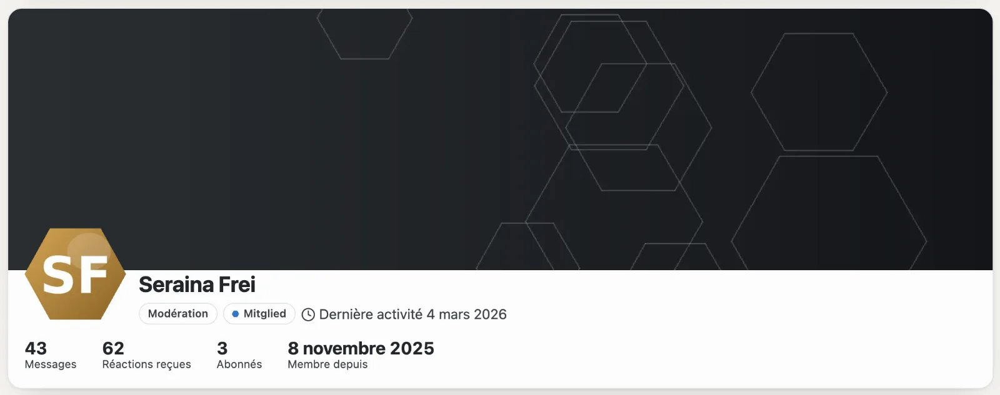
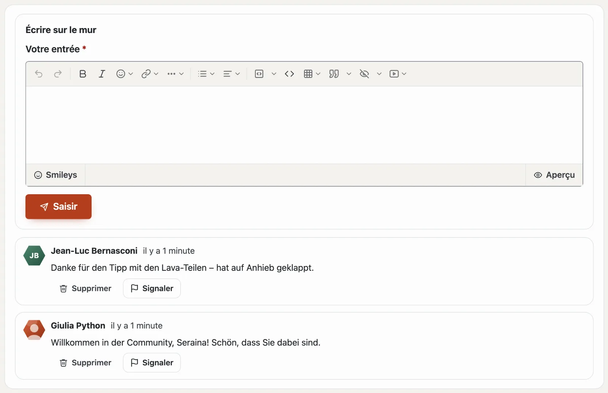
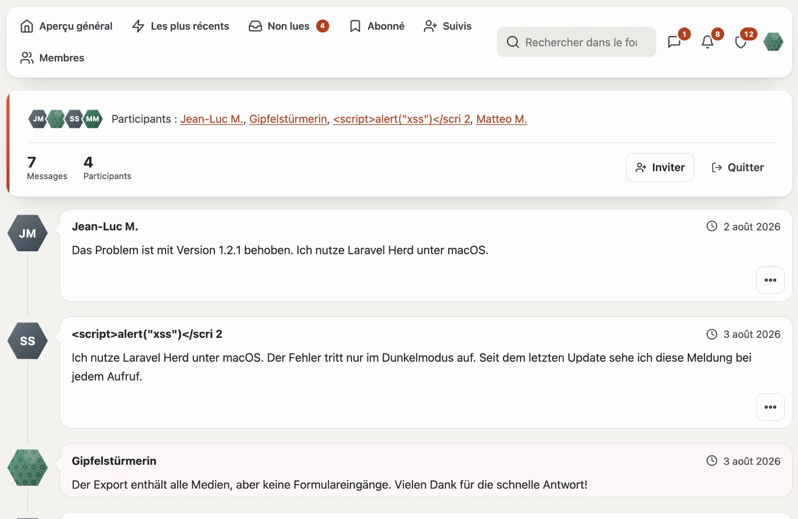

# Profils et conversations

## Votre profil

Sous « Votre profil » (`/community/konto`), vous définissez :

- le **nom affiché** (unique dans la communauté), la **photo de profil** et la **signature**,
- **À propos de moi**, une **photo de couverture** et les **champs propres** du site (par exemple site web ou lieu) — chaque champ indique qui le voit : tout le monde, les membres connectés ou seulement l’équipe,
- les e-mails concernant les réponses et les mentions (immédiatement, chaque jour, jamais) et si vous vous abonnez automatiquement aux sujets dans lesquels vous écrivez.

Le profil public sous `/community/mitglied/<nummer>-<name>` affiche le rang, les trophées, les messages, les réactions reçues, les abonnés et des onglets issus de tous les modules : messages et sujets du forum, fiches et avis du Marketplace.

## Mur

Le profil comporte l’onglet **Mur** : les membres s’y laissent un bonjour, un merci ou une question — public comme le
profil. Sous « Votre profil », vous décidez **qui peut écrire sur votre mur** : tous les membres, seulement les
personnes que vous suivez, ou personne.

- La cloche (et l’e-mail) vous informe lorsque quelqu’un écrit sur votre mur.
- L’auteur, vous-même et l’équipe peuvent supprimer une entrée ; toute entrée d’une autre personne peut être
  **signalée**.
- Les personnes bloquées n’écrivent pas sur votre mur — et vous pas sur le leur.

## Suivre et bloquer

- **Suivre :** vous êtes informé dans la cloche lorsque la personne ouvre un sujet ; « Suivis » liste ses nouveaux messages.
- **Bloquer :** les messages de la personne sont repliés pour vous, ses réponses, mentions, citations et réactions ne déclenchent aucune notification, et elle ne peut pas vous écrire. Le blocage est privé ; l’équipe ne peut pas être bloquée.

## Conversations

- « Envoyer un message » dans le profil ou « Nouvelle conversation » sous **Messages** — à une ou plusieurs personnes (noms affichés séparés par des virgules).
- Seuls les participants lisent. Vous pouvez inviter d’autres personnes ou quitter la conversation.
- Les nouveaux messages sont comptés dans la barre et arrivent dans la cloche et par e-mail.
- **Signaler** un message ne montre à l’équipe que ce seul message, jamais la conversation entière.

## Rangs et trophées

- Les **rangs** dépendent du nombre de vos messages (certains uniquement pour un groupe) et figurent à côté de votre nom — avec un symbole comme ⭐ si la communauté en a choisi un.
- Les **trophées** sont attribués par la communauté selon des règles — premier message, nombreuses réactions, réponses les plus utiles, licence achetée — ou à la main par l’équipe. Une fois attribués, ils restent.

## Pour continuer

- [Forum](forum.md)
- [Communauté](README.md)
