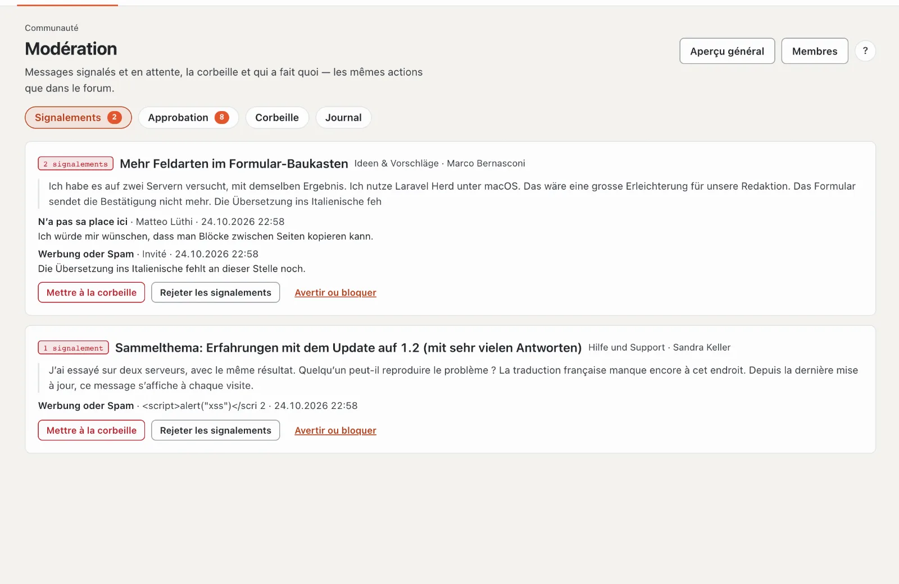
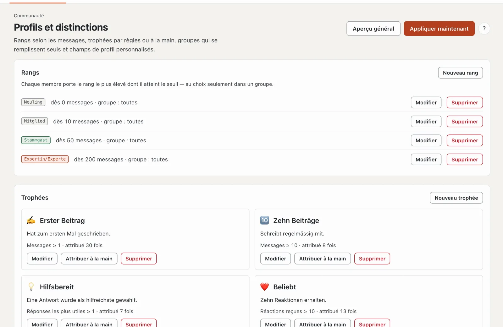

# Administration de la communauté

Sur basaltocms.com, l’administration se trouve dans l’**Extranet** sous « Communauté », sur tout autre site dans le backend sous **Administration › Communauté** — les mêmes pages avec les mêmes actions.

| Page | Pour quoi |
| --- | --- |
| **Aperçu général** | chiffres, modération en attente, page dans le frontend, votre compte dans l’équipe, paramètres |
| **Forums** | arbre avec catégories, forums, sous-forums et renvois ; préfixes et champs du sujet par forum |
| **Groupes et droits** | groupes de visiteurs et matrice des droits, globalement et par forum (Oui, Non, Jamais) |
| **Modération** | signalements, approbation, corbeille, journal avec filtre |
| **Membres** | recherche et filtre (bloqués, interdiction d’écrire, avertis) ; avertir, bloquer, supprimer des spammeurs |
| **Annonces** | bannières avec zone, public cible et période, avec aperçu |
| **Profils et distinctions** | rangs, trophées, groupes automatiques, champs de profil propres |

## Profils et distinctions

- **Rangs :** titre, couleur et, si souhaité, un symbole (par exemple ⭐, affiché à la place du point coloré) à partir d’un nombre de messages, au choix uniquement pour un groupe.
- **Trophées :** selon une règle ou à la main. Les règles sont fournies par les modules : messages, réactions reçues, membre depuis, abonnés (noyau), sujets ouverts et réponses les plus utiles (forum), « Possède une licence » (vente de licences), « Auteur sur le Marketplace » (Marketplace). L’aperçu montre combien de membres une règle concerne aujourd’hui.
- **Champs de profil propres :** texte, plusieurs lignes, adresse ou **choix** avec des possibilités fixes (une par ligne), chacun avec sa visibilité (tous, membres connectés, équipe seulement) et, si souhaité, obligatoire.
- **Groupes automatiques :** une règle remplit un groupe propre et ne retire que les adhésions qu’elle a elle-même attribuées.
- L’exécution a lieu chaque jour à 03:30 (`basalto:community-rules`) ou immédiatement avec « Appliquer maintenant ».

## Paramètres

Dans l’aperçu général : délai de modification, pièces jointes (types, taille, espace par compte, **pièces jointes par message**), les **réactions** proposées, renvoi après déplacement, intervalle minimal, seuil des signalements, validité des avertissements et points pour l’interdiction d’écrire et le blocage avec leur durée, censure et ce qu’il advient des messages lors de la suppression d’un compte.

### Conditions de la communauté

Par défaut, quiconque ouvre le forum donne d'abord son accord : une fenêtre présente les conditions d'utilisation et
les règles de la communauté (pages du thème, sinon mentions légales et protection des données) et exige la case cochée.
Sans accord, un compte compte comme un invité — lire oui, écrire, réagir, envoyer des messages et modérer non ; le forum
derrière est bloqué. Les invités donnent leur accord dans le navigateur (cookie `basalto_community_terms`). Le compte
client indique la date, l'heure et la version de l'accord, avec « Retirer l'accord » — ensuite la fenêtre réapparaît.

Dans les paramètres : **Exiger l'accord** (activé/désactivé) et **Version** — une nouvelle version (p. ex. la date de
la modification) redemande l'accord à tous.

## Protection des données

Le droit d’accès et la suppression (`basalto:privacy`) englobent le profil, les images, les messages, les pièces jointes, les réactions, les abonnements, le suivi, les blocages, les messages privés, les trophées, les avertissements et les signalements. D’usine, les messages restent en place **anonymisés** (la discussion reste lisible) ; dans les paramètres, on peut choisir « supprimer » — les sujets sans messages d’autres personnes disparaissent alors entièrement. Les messages dans les conversations restent visibles de manière anonyme pour les autres participants.

## Recherche, plan du site et flux

Les sujets des forums que les visiteurs peuvent lire figurent dans la recherche du site (filtre « Forum »), dans le plan du site et dans les flux RSS ; chaque sujet porte des données structurées (`DiscussionForumPosting`). Si les droits changent, l’index se reconstruit ; à la main : `php artisan basalto:search-index`.

## Commandes

| Commande | Pour quoi |
| --- | --- |
| `php artisan basalto:forum-seed <site>` | structure de départ de la communauté Basalto comme chez WoltLab : Général (Nouveautés et annonces, Questions avant l’achat), Forums clients (Aide et support, Idées et suggestions, Rapports de bogues — chacun avec un sous-forum pour ce qui est réglé), Personnalisation (Thèmes et Lava, Modules et plugins, renvoi vers la documentation pour les développeurs), Divers (hors sujet) ; avec symboles, préfixes et champs du sujet — ne crée rien en double |
| `php artisan basalto:testdaten <site>` | remplit le forum (et tout le reste) de nombreuses données de test pour essayer ; `--entfernen` les supprime à nouveau |
| `php artisan basalto:forum-recount [site]` | recalculer les compteurs des forums, sujets et profils |
| `php artisan basalto:community-rules [site]` | attribuer des trophées et affecter des groupes selon les règles |
| `php artisan basalto:community-digest` | résumé quotidien par e-mail |
| `php artisan basalto:forum-benchmark` | test de charge avec 100 000 messages sur un site jetable : liste des sujets et sujet en moins de 300 ms |

## Pour continuer

- [Modération](moderation.md)
- [Paramètres](../verwaltung/einstellungen.md)
