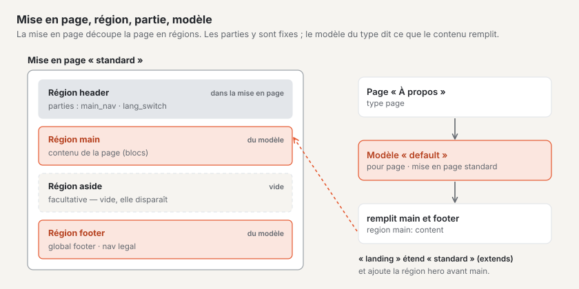
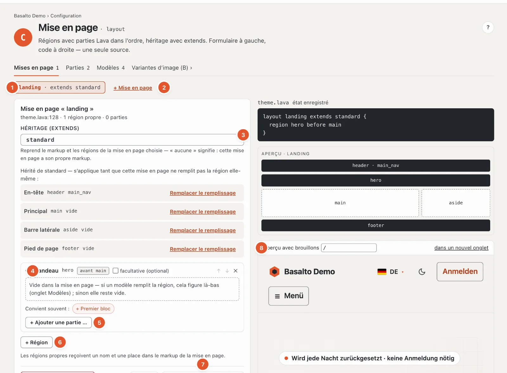
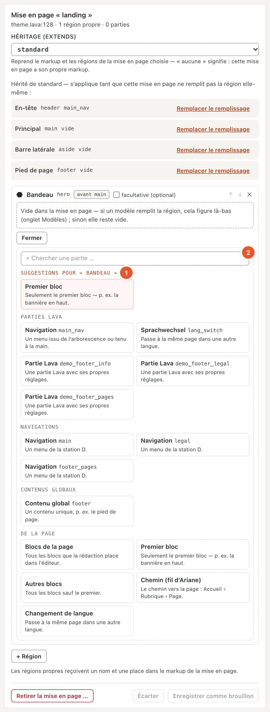
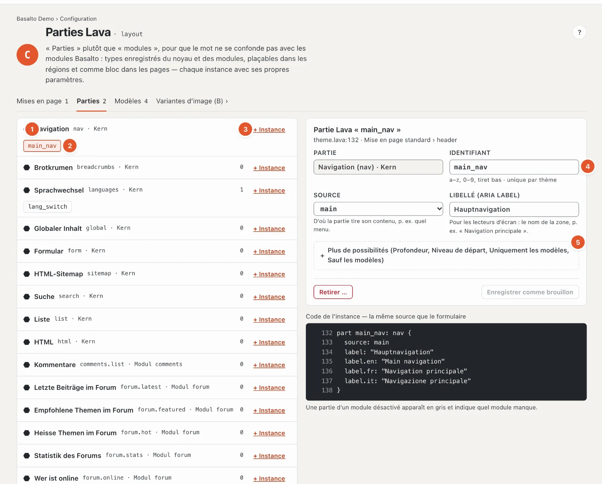
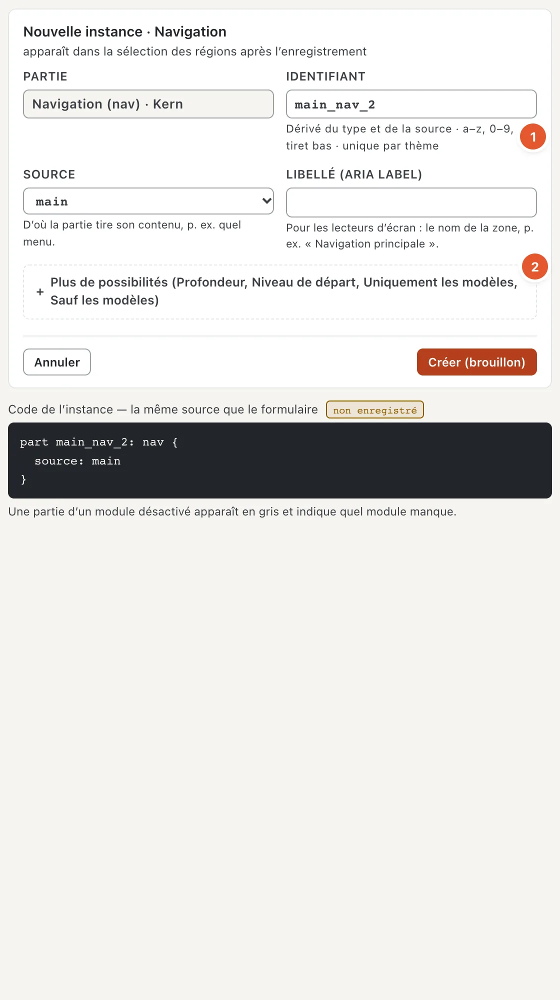
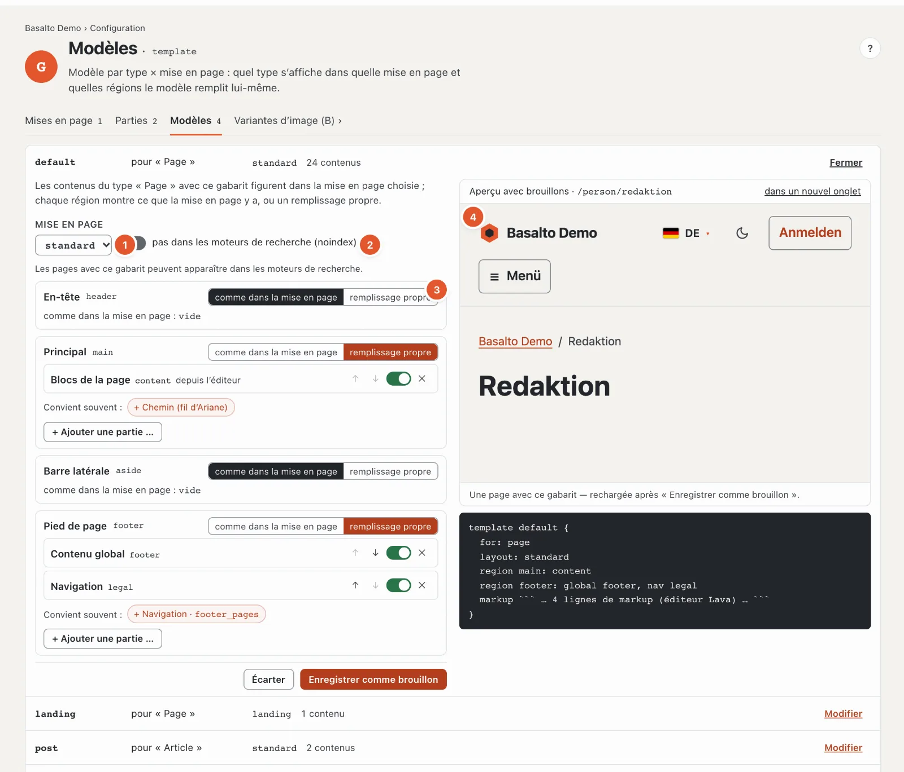

# Structure : mises en page, parties et modèles

La station **« Comment est-il construit ? »** définit les zones qui composent une page et ce qui figure dans chaque zone. Elle regroupe deux vérifications : mise en page (C) et modèle (G).

- Une **mise en page** est la charpente d’une page : en-tête, partie principale, pied de page. Elle divise la page en **régions**.
- Une **partie** (partie Lava) est un élément prêt à l’emploi placé dans une région — par exemple la navigation principale ou le changement de langue. Les parties proviennent du noyau et des modules ; vous les installez avec vos propres réglages.
- Un **modèle** indique comment un type de contenu apparaît dans une mise en page et quelles régions le contenu remplit lui-même.
- Une mise en page peut en **étendre** une autre (« extends ») : elle reprend tout et ajoute des régions — dans Starter, « landing » insère un bandeau avant la partie principale.

## Où

Mode « Configuration » › « Comment est-il construit ? » › **« Ouvrir les mises en page »**. La page comporte les onglets **Mises en page**, **Parties** et **Modèles**, ainsi qu’un raccourci vers les [Variantes d’image](aussehen.md#variantes-dimage).

Si le thème se trouve encore dans le dossier de l’installation, la page affiche en haut « Ce thème se trouve dans le dossier » et ne peut qu’être consultée ; elle devient modifiable après **« Reprendre dans la base de données »**. Toutes les modifications sont ensuite créées comme **brouillon** et passent en ligne via la validation — voir [Brouillons et validation](entwuerfe.md).

## Onglet Mises en page

1. **Choisir la mise en page** — un bouton par mise en page, avec « extends … » si elle en étend une autre.
2. **« + Mise en page »** — une nouvelle mise en page : nom (des suggestions comme « schmal » ou « landing » d’un clic) et **« Hérite de »** — en dessous figure la liste des régions qu’elle reprend. Le markup (HTML) d’une mise en page reste du code ; une mise en page entièrement sans modèle de départ se crée dans l’éditeur de thème.
3. **Héritage (extends)** — la mise en page dont celle-ci reprend le markup et les régions ; « — aucun : markup propre » pour les mises en page avec leur propre HTML.
4. **Les régions** — une carte par région avec nom, identifiant et emplacement (« avant main »). **« facultative (optional) »** signifie : si la région reste vide, elle disparaît entièrement. Avec ↑ et ↓, vous modifiez l’ordre, ✕ retire la région. Les régions héritées portent « Hérité de … » ; **« Remplacer le remplissage »** donne à cette mise en page son propre remplissage. Une région vide est remplie par le modèle — s’il ne la remplit pas, elle reste vide.
5. **Ajouter une partie** — voir ci-dessous. Les parties d’une région sont dans l’ordre et peuvent être déplacées, désactivées et activées, et retirées.
6. **« + Région »** — une région propre : nom et emplacement dans le markup de la mise en page (avant ou après, par rapport à une région existante). Les régions fréquentes — bandeau, barre latérale, bandeau d’information, appel à l’action — définissent nom et emplacement d’un clic. Si le markup insère déjà la région, aucun emplacement n’est nécessaire.
7. **« Enregistrer comme brouillon »** et **« Écarter »** ; **« Retirer la mise en page … »** supprime une mise en page après confirmation. Si quelque chose ne va pas, le message est « Rien n’a été enregistré — un thème avec des erreurs ne passe jamais en ligne », et le code montre l’endroit.
8. **Aperçu avec brouillons** — le site web avec vos brouillons enregistrés, pour un chemin de votre choix (« / » est la page d’accueil) ; « dans un nouvel onglet » l’ouvre en grand.

### Ce qui va dans une région

Sous chaque région, Basalto suggère ce qui y va souvent — sous forme de boutons « Convient souvent : + Navigation · main … » : dans
l’**en-tête**, la navigation principale et le changement de langue ; dans le **pied de page**, le pied de page et les menus juridiques ; dans le
**bandeau**, le premier bloc ; dans la **zone principale**, les blocs de la page ; dans la **barre latérale**, la recherche et les listes.
**« + Ajouter une partie … »** ouvre toute la sélection :

1. **Suggestions pour la région** — en haut, sans ce qui s’y trouve déjà.
2. **Recherche** et les groupes **Parties Lava**, **Navigations**, **Contenus globaux** et **De la page** (tous les blocs,
   seulement le premier, les autres, chemin, changement de langue) — une phrase par entrée indique à quoi elle sert. Entrée reprend le premier
   résultat.

À droite figurent en outre le **code** de la mise en page (état enregistré), **« Afficher le markup »** pour le HTML, les **constats** avec E (erreur) et W (avertissement) et un **aperçu schématique** des régions. En bas, « Modèle par type × mise en page » indique quels modèles utilisent cette mise en page et combien de contenus en dépendent.

## Onglet Parties

1. **Les sortes de parties** — du noyau (navigation, fil d’Ariane, changement de langue, contenu global, formulaire, plan du site HTML, recherche, liste, HTML) et des modules (par exemple commentaires, connexion pour les membres). À droite, le nombre d’instances.
2. **Une instance** — une partie installée avec son propre nom, par exemple « main_nav ». Un clic ouvre ses réglages.
3. **« + Instance »** — créer une nouvelle partie de cette sorte.
4. **Identifiant** — minuscules, chiffres et tiret bas, unique dans le thème. En dessous, les **réglages de la sorte**, avec une phrase par réglage — pour une navigation, par exemple, la source (quel menu) et le libellé pour les lecteurs d’écran.
5. **Plus de possibilités** — profondeur, niveau de départ, **Uniquement les modèles / Sauf les modèles** (la partie n’apparaît que dans certains modèles, ou dans tous sauf ceux-ci) et le libellé pour chaque langue supplémentaire.

Pour une **nouvelle instance**, la première source est déjà choisie, et l’**identifiant** se forme à partir de la source et de la sorte
(1) — « main » et « nav » donnent « main_nav » —, jusqu’à ce que vous le modifiiez vous-même. Ce qui sert rarement se trouve sous **« Plus de
possibilités »** (2).

Les instances figurent dans les régions d’une mise en page — et comme bloc sur certaines pages (« + Partie Lava » dans l’éditeur). Une instance ne peut être retirée que lorsqu’elle ne figure plus dans aucune région ; sinon, le message est « Elle figure dans : … — la retirer d’abord de là ». Si une partie appartient à un module désactivé pour le site, elle apparaît en gris : l’instance reste, mais rien n’est affiché.

## Onglet Modèles

Une ligne par modèle : nom, pour quel type (« pour « Page » »), dans quelle mise en page et combien de contenus l’utilisent.
« Modifier » l’ouvre ; en haut, une phrase résume ce que fait un modèle :

1. **Mise en page** — la mise en page dans laquelle figurent les contenus avec ce modèle.
2. **Pas dans les moteurs de recherche (noindex)** — les pages avec ce modèle n’apparaissent pas sur Google & cie et manquent dans
   le plan du site. Si le modèle porte le nom d’une page juridique, de remerciement ou d’erreur (« legal », « danke », « 404 »),
   Basalto propose d’activer noindex.
3. **Par région : « comme dans la mise en page » ou « remplissage propre »** — toutes les régions de la mise en page sont présentes, y compris celles que seul
   le markup insère. « Remplissage propre » reprend d’abord ce que la mise en page y contient ; ensuite, vous le modifiez avec les mêmes
   suggestions et la même sélection que dans la mise en page (« Convient souvent », « + Ajouter une partie … »).
4. **Aperçu avec brouillons** — une page qui utilise ce modèle, avec vos brouillons enregistrés ; après
   « Enregistrer comme brouillon », elle se recharge.

En dessous figure le **code** — le modèle en Lava. Son markup (le HTML du contenu) reste du code et se modifie dans
l’éditeur de thème. Un type peut avoir plusieurs modèles ; celui qu’utilise une page se choisit dans les paramètres
de la page, onglet « Mise en page » (voir [Pages](../redaktion/seiten.md)).

## Questions fréquentes

**Pourquoi ne puis-je rien modifier ?**
Le thème se trouve dans le dossier de l’installation — reprenez-le dans la base de données. Ou votre rôle n’autorise la zone « Design, thèmes et mises en page » qu’en consultation.

**J’ai enregistré, mais le site web ne l’affiche pas.**
L’enregistrement se fait comme brouillon. L’« Aperçu avec brouillons » l’affiche ; il ne passe en ligne qu’après la validation (voir [Brouillons et validation](entwuerfe.md)).

## Pour continuer

- [Menus](menues.md)
- [Blocs réutilisables](bausteine.md)
- [Brouillons et validation dans la configuration](entwuerfe.md)
