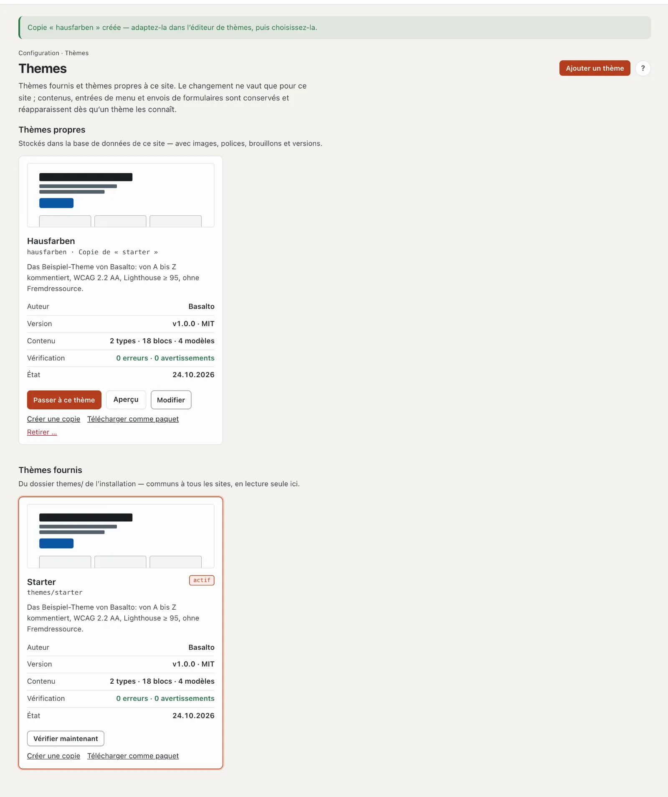
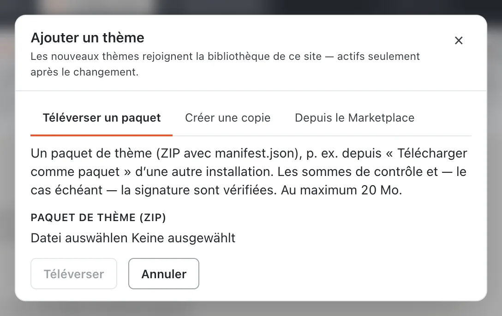
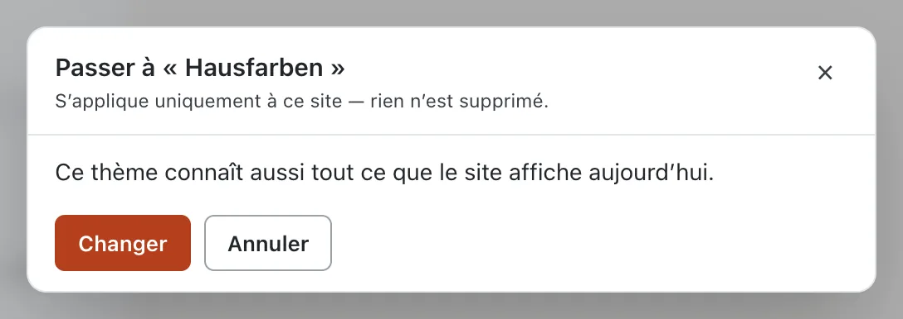
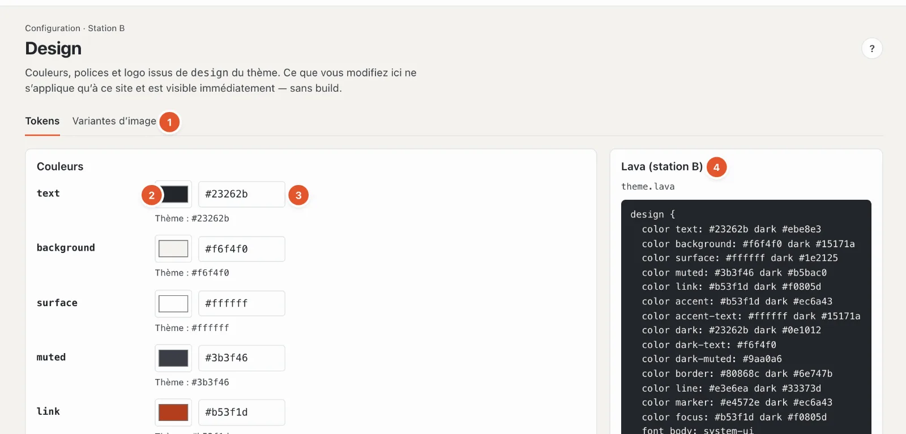
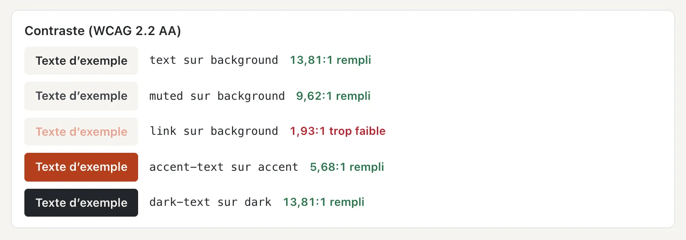
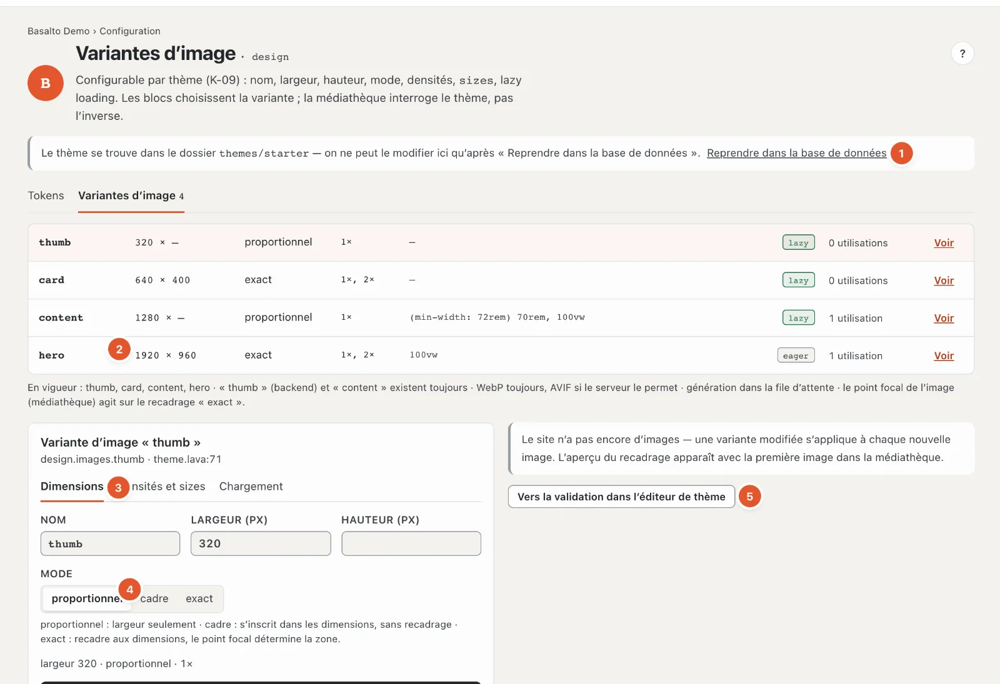
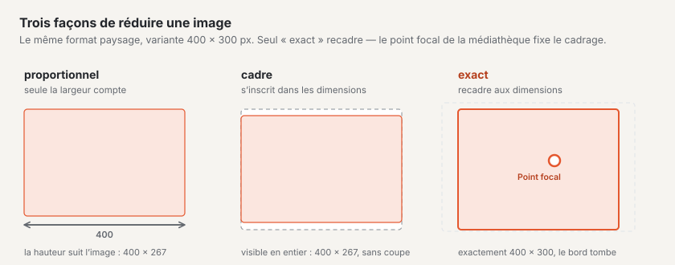

# Apparence : thèmes, design et variantes d’image

La station **« À quoi ressemble-t-il ? »** détermine la forme du site. Le **thème** la fixe ; dans le **design**, vous adaptez couleurs, polices et logo, dans les **variantes d’image**, les tailles dans lesquelles les images sont livrées — le tout sans code.

## Thèmes

Mode « Configuration » › « À quoi ressemble-t-il ? » › **Thèmes** (dans le parcours, la case portant le nom du thème actif).

La page affiche deux groupes :

- **Thèmes propres** — se trouvent dans la base de données de ce site, avec images, polices, brouillons et versions. Ils sont modifiables.
- **Thèmes fournis** — proviennent du dossier `themes/` de l’installation, valent pour tous les sites et sont ici en lecture seule.

Chaque carte affiche une image d’aperçu, le nom et la provenance (par exemple « Copie de « starter » », « depuis le Marketplace », « depuis un paquet (signé) »), la description, **Auteur**, **Version**, **Contenu** (types, blocs, modèles), le résultat de la **Vérification** et l’**État**. Le thème actif porte la marque « actif ».

Les boutons d’une carte :

- **« Passer à ce thème »** — voir ci-dessous.
- **« Aperçu »** — affiche le site web avec ce thème, uniquement dans votre session. En haut figure alors « L’aperçu avec le thème … est actif dans votre session — le site lui-même est inchangé » ; **« Terminer l’aperçu »** permet de revenir. L’aperçu est ouvert à toutes les personnes qui voient la page.
- **« Modifier »** — ouvre le thème propre dans l’éditeur de thème (code).
- **« Vérifier maintenant »** — vérifie à nouveau le thème ; en cas d’erreurs, **« Voir les constats »** mène aux messages. Un thème comportant des erreurs ne peut pas être choisi.
- **« Créer une copie »** — une copie avec tous les fichiers, images et polices, le meilleur départ pour un thème propre. L’original reste inchangé.
- **« Télécharger comme paquet »** — télécharge le thème sous forme de ZIP, par exemple pour une autre installation.
- **« Retirer … »** (thèmes propres uniquement) — supprime fichiers, images, polices, brouillons et toutes les versions du thème ; les contenus du site restent. Si le thème est actif, le site affiche ensuite immédiatement à nouveau le thème fourni du même nom. Si vous en aurez encore besoin plus tard, choisissez d’abord **« D’abord télécharger le paquet »**.
- **« Masquer »** (thèmes fournis non actifs uniquement) — retire un thème de la liste ; en bas, **« Afficher à nouveau »** le fait revenir.

### Ajouter un thème

**« Ajouter un thème »** propose trois voies. Les nouveaux thèmes entrent dans la bibliothèque de ce site — actifs seulement après le changement.

- **Téléverser un paquet** — un paquet de thème (ZIP avec `manifest.json`), par exemple issu de « Télécharger comme paquet » d’une autre installation, jusqu’à 20 Mo. Les sommes de contrôle sont vérifiées, ainsi que la signature si elle existe.
- **Créer une copie** — choisir le **Modèle**, la **Désignation** (le nom du thème dans le backend) et le **Nom** (minuscules, chiffres et traits d’union — c’est le nom du thème en Lava et dans le paquet).
- **Depuis le Marketplace** — les thèmes du Marketplace sont signés par l’éditeur. Une fois installés, ils entrent dans la bibliothèque comme thème propre ; une mise à jour ultérieure apparaît comme brouillon dans l’éditeur de thème.

### Passer à un autre thème

**« Passer à ce thème »** vérifie d’abord ce que le site ne pourrait plus afficher avec le nouveau thème, et le liste dans un rapport :

- Types de contenu que le thème ne connaît pas,
- Blocs qui ne seront plus affichés,
- Modèles auxquels des pages renvoient,
- Menus avec leurs propres entrées,
- Formulaires avec envois.

Un changement ne vaut que pour ce site, et **rien n’est supprimé** : ce que le nouveau thème ne connaît pas reste dans la base de données et réapparaît dès qu’un thème le connaît. Si le rapport est vide (« Ce thème connaît aussi tout ce que le site affiche aujourd’hui. »), le bouton s’appelle « Changer » ; sinon **« Changer quand même »**.

Changer, ajouter et retirer sont réservés aux personnes dont le rôle peut modifier la zone « Design, thèmes et mises en page » ; sinon figure en haut « Votre rôle ne permet pas de changer, d’ajouter ou de supprimer des thèmes ».

## Design

Mode « Configuration » › « À quoi ressemble-t-il ? » › **« Ajuster le design »**, onglet **Tokens**. Ce que vous modifiez ici ne vaut que pour ce site et est visible immédiatement — sans build. Le thème lui-même reste inchangé.

1. **Tokens · Variantes d’image** — les deux onglets de la station.
2. **Sélecteur de couleur** — un clic ouvre le choix de couleur du système.
3. **Couleur en code** — `#rgb` ou `#rrggbb`. En dessous figure la valeur du thème (« Thème : #23262b ») ; si votre couleur s’en écarte, **« réinitialiser »** la rétablit.
4. **Lava (station B)** — la partie `design` du thème, en lecture seule. En dessous, les **Feuilles de style** du thème et les mêmes valeurs **Pour Tailwind 4**, au cas où quelqu’un poursuit la construction du site avec Tailwind.

Le thème détermine les couleurs disponibles — dans Starter, par exemple, `text`, `background`, `surface`, `muted`, `link`, `accent`, `accent-text`, `dark`, `dark-text`, `dark-muted`, `border`, `line`, `marker` et `focus`.

### Contraste

Sous les couleurs, Basalto vérifie chaque paire de couleur de texte et de couleur de fond selon la règle d’accessibilité (WCAG 2.2 AA) : **au moins 4,5:1**. Les paires découlent des noms — `text` sur `background`, `link` sur `background`, `accent-text` sur `accent` et ainsi de suite. Pour chaque paire, vous voyez un texte d’exemple, le rapport et « conforme » ou **« trop faible »**.

Si une paire est trop faible, la couleur **n’est pas enregistrée** ; le champ affiche par exemple « Le contraste « link » sur « background » est de 1,93:1 — au moins 4,5:1. ». Choisissez une couleur plus foncée ou plus claire.

### Polices

Pour chaque rôle de police (par exemple **body**, **heading**, **code**), un champ avec le nom de la police ; en dessous, la valeur du thème et la graisse. La police doit se trouver dans le thème ou être disponible sur l’appareil — sinon, la police de substitution s’applique. « réinitialiser » rétablit la valeur du thème.

### Logo

Le thème affiche le logo là où il place `{{ site.logo }}`. Vous choisissez :

- **du thème** — le logo fourni par le thème (par défaut),
- **Image de la médiathèque** — une image propre,
- **pas de logo**.

Dès que quelque chose s’écarte du thème, **« Tout comme dans le thème »** apparaît en haut à droite : il réinitialise toutes les couleurs, polices et le logo selon le thème.

## Variantes d’image

Onglet **Variantes d’image** à côté de « Tokens ». Une **variante d’image** est une taille dans laquelle Basalto tient prête chaque image de la médiathèque — par exemple « thumb » pour les vignettes, « card » pour les cartes, « hero » pour le bandeau. Les blocs choisissent la variante ; les rédactrices et rédacteurs ne téléversent que l’original.

1. **Thème dans le dossier** — si le thème se trouve encore dans le dossier de l’installation, les variantes ne sont modifiables qu’après **« Reprendre dans la base de données »** (voir [Brouillons et validation](entwuerfe.md)).
2. **Les variantes** — par ligne : nom, dimensions (largeur × hauteur, « — » signifie libre), mode, densités, `sizes`, « lazy » ou « eager », le nombre d’utilisations de la variante, et « Voir » ou « Modifier ». **« + Variante »** en crée une nouvelle.
3. **La variante choisie** en trois onglets : **Dimensions** (nom, largeur, hauteur, mode), **Densités et sizes**, **Chargement**. En dessous, le code de la variante.
4. **Mode** — comment l’image est ramenée aux dimensions (voir le schéma).
5. **Enregistrer** — comme brouillon ; **« Vers la validation dans l’éditeur de thème »** soumet la modification.

Les réglages en détail :

- **Mode** : **proportionnel** — seule la largeur compte, la hauteur suit l’image ; **cadre** — tient entièrement dans les dimensions, sans recadrage ; **exact** — recadre aux dimensions, le **Point focal** de l’image (défini dans la médiathèque) détermine le cadrage.
- **Densités** — 1× pour les écrans normaux, 2× pour les écrans haute résolution. Les densités supérieures ne sont créées que si l’original est assez grand ; sinon figure « 2× nécessiterait … px de largeur — reste 1× ».
- **sizes** — indique au navigateur quelle largeur l’image occupe sur la page, par exemple « 100vw » pour toute la largeur.
- **Lazy loading** — les images ne se chargent que lorsqu’elles entrent dans le champ de vision en défilant. Désactivé pour les images en haut de la page (bandeau), activé sinon.

Important :

- « thumb » (pour le backend) et « content » existent toujours.
- Basalto livre toujours du WebP, ainsi que de l’AVIF là où le serveur le permet. Les variantes sont créées en arrière-plan (file d’attente).
- Si une variante change, toutes les images du site sont recadrées **après la publication** ; jusque-là, le cache livre les anciennes. Si le site a déjà des images, un aperçu montre le nouveau cadrage sur la première image.

## Questions fréquentes

**La couleur ne s’enregistre pas.**
Le contraste est trop faible. Le message au champ indique la paire et le rapport — au moins 4,5:1.

**J’ai changé de thème, et une partie des pages paraît vide.**
Le nouveau thème ne connaît pas leurs blocs ou leurs modèles. Rien n’est perdu : revenez à l’ancien thème, ou complétez le nouveau.

**Quelle est la différence entre le design et l’éditeur de thème ?**
Dans le design, vous modifiez les valeurs que le thème rend modifiables (couleurs, polices, logo). Dans l’éditeur de thème, vous modifiez le thème lui-même, en Lava.

## Pour continuer

- [Structure : mises en page, parties et modèles](aufbau.md)
- [Thèmes](../entwickler/themes.md)
- [Marketplace pour les installations](../marktplatz/installieren.md)
