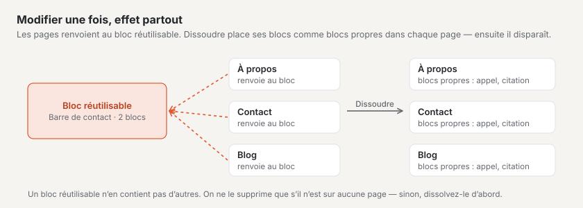
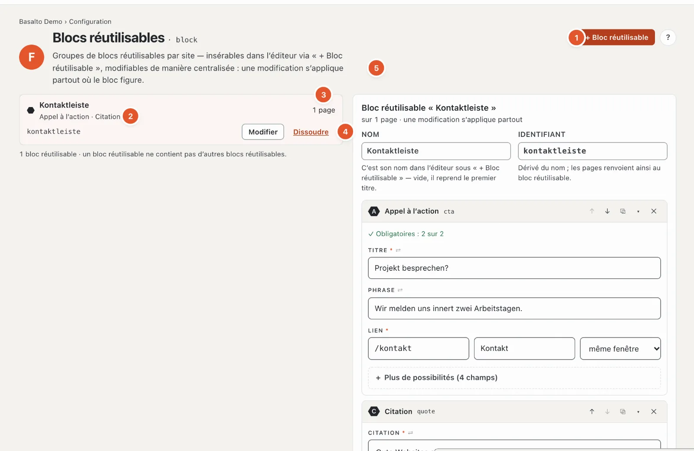

# Blocs réutilisables

La station **« De quoi se composent les pages ? »** a deux faces : les **blocs** — texte, image, appel à l’action, cartes, etc. — sont fournis par le thème ; vous voyez ceux qui existent dans la palette de blocs de l’éditeur (voir [Modifier le contenu avec des blocs](../redaktion/bloecke.md)). Les **blocs réutilisables**, en revanche, c’est vous qui les créez : un groupe de blocs identique sur plusieurs pages — une barre de contact, un appel à l’action, une information sur les horaires d’ouverture.

La différence :

| | Bloc | Bloc réutilisable | Partie Lava |
| --- | --- | --- | --- |
| Quoi | un élément de contenu d’une page | un groupe de blocs au contenu fixe | un élément du thème avec réglages (menu, recherche, formulaire) |
| D’où | Thème | Vous, ici | Noyau et modules, installés sous [Structure](aufbau.md#onglet-parties) |
| Modifier | sur chaque page séparément | une fois — s’applique partout | dans ses réglages |

## Où

Mode « Configuration » › « De quoi se composent les pages ? » › **« Gérer les éléments »**. « Voir les blocs dans le code » affiche le code des blocs dans l’éditeur de thème.

1. **« + Bloc réutilisable »** en crée un nouveau.
2. **La liste** — par bloc réutilisable : nom, les blocs qu’il contient (ici « Appel à l’action · Citation »), identifiant et « Modifier ».
3. **Où il figure** — sur combien de pages le bloc réutilisable est inséré ; dans le bloc réutilisable ouvert, sous « Présent sur », avec des liens vers les pages.
4. **« Dissoudre »** — voir ci-dessous.
5. **Le bloc réutilisable ouvert** — « sur 1 page · une modification s’applique partout ».

## Créer et modifier un bloc réutilisable

1. **« + Bloc réutilisable »**, puis **Nom** (par exemple « Barre de contact »). L’**identifiant** en découle ; il peut être adapté (minuscules, chiffres, trait d’union). Si vous laissez le nom vide, il reprend le premier titre que vous écrivez dans le premier bloc.
2. Ajouter des blocs — avec la palette de blocs comme dans l’éditeur d’une page, avec les mêmes champs, ↑ ↓, Dupliquer et Retirer. Le formulaire affiche l’essentiel en premier, une aide à chaque champ et, sous « Plus de possibilités », les réglages fins ([Les champs d’un bloc](../redaktion/bloecke.md#les-champs-dun-bloc)).
3. En bas à droite, la fenêtre **« Aperçu en direct »** affiche le bloc réutilisable avec le thème de votre site, actualisé à chaque saisie — le champ dans lequel vous écrivez s’y illumine, et un clic dans l’aperçu saute au champ ([Aperçu en direct](../redaktion/bloecke.md#aperçu-en-direct-dans-la-fenêtre)).
4. **« Enregistrer »**. Le bloc réutilisable apparaît dans l’éditeur de chaque page sous **« + Bloc réutilisable »**.

**Attention :** un bloc réutilisable n’a pas de versions. Une modification s’applique, dès l’enregistrement, **immédiatement sur toutes les pages** qui le contiennent — sans soumission ni validation. La modification figure dans le journal.

Un bloc réutilisable ne contient pas de blocs réutilisables — dans sa palette, le groupe « Réutilisables » pour les blocs réutilisables est absent.

## Insérer un bloc réutilisable

Dans l’éditeur d’une page : **« + Insérer un bloc »** › groupe « Réutilisables » › **« + Bloc réutilisable »**, puis choisir le bloc réutilisable (« Insérer un bloc réutilisable »). La page contient alors une **référence** avec la mention « Référence — les modifications du bloc réutilisable s’appliquent à toutes les pages qui le contiennent » ; le contenu ne peut pas y être modifié.

Si une page doit afficher un contenu différent, dissolvez la référence **sur cette page** : ses blocs deviennent des copies que vous modifiez librement ici. Le bloc réutilisable lui-même et les autres pages restent tels quels.

## Dissoudre ou supprimer

- **« Dissoudre »** — sur toutes les pages qui contiennent le bloc réutilisable, ses blocs deviennent des **blocs propres** de la page ; rien n’est perdu. Ensuite, le bloc réutilisable disparaît. Basalto demande d’abord : « Dissoudre … ? » et nomme les pages.
- **« Supprimer »** — possible uniquement si le bloc réutilisable ne figure sur aucune page. Sinon, dissolvez-le d’abord ou retirez-le des pages.

Les rôles disposant de la zone « Types et blocs réutilisables » peuvent les modifier ; sinon figure en haut « Votre rôle permet de voir les blocs réutilisables, pas de les modifier ». L’insertion est possible pour toutes les personnes autorisées à modifier des pages.

## Questions fréquentes

**J’ai modifié un bloc réutilisable — pourquoi est-ce déjà en ligne ?**
Les blocs réutilisables n’ont pas de versions ; une modification s’applique immédiatement partout.

**Un bloc réutilisable peut-il avoir un autre aspect sur une page ?**
Pas en tant que bloc réutilisable — il est identique partout. Dissolvez-le dans l’éditeur de cette page (ce sont alors des blocs propres), ou créez un deuxième bloc réutilisable.

## Pour continuer

- [Types de contenu](inhaltstypen.md)
- [Modifier le contenu avec des blocs](../redaktion/bloecke.md)
