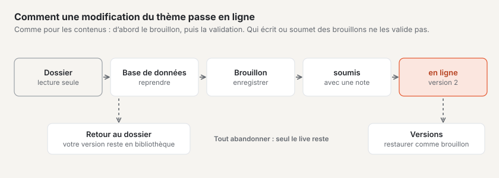
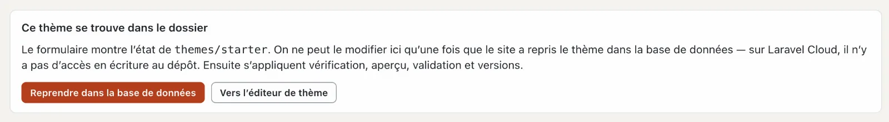
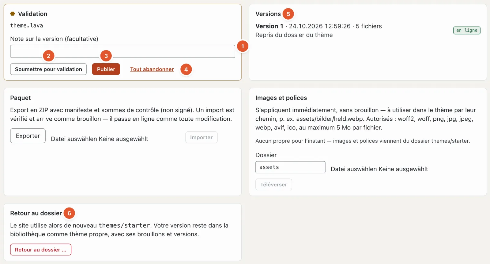

# Brouillons et validation dans la configuration

Les modifications des mises en page, des parties, des modèles, des variantes d’image et du code du thème ne passent pas en ligne immédiatement. Elles naissent sous forme de **brouillon**, sont vérifiées et ne deviennent la nouvelle **version** du thème qu’avec **« Publier »** — comme les contenus en mode « Contenus ».

Exceptions qui s’appliquent immédiatement : les valeurs du [Design](aussehen.md#design) (couleurs, polices, logo), les paramètres du [site](site.md), les [menus](menues.md), les [blocs réutilisables](bausteine.md) ainsi que les images et polices du thème.

## Thème dans le dossier ou dans la base de données

Un thème fourni se trouve dans le dossier `themes/` de l’installation. Basalto ne modifie jamais ce dossier — sur les installations hébergées, il n’y a d’ailleurs aucun accès en écriture. C’est pourquoi les mises en page, les variantes d’image et l’éditeur de thème affichent d’abord « Ce thème se trouve dans le dossier » et ne peuvent qu’être consultés.

**« Reprendre dans la base de données »** crée pour ce site une version propre du thème dans la base de données (version 1, « Repris du dossier du thème »). Dès lors, la vérification, l’aperçu, les brouillons, la validation et les versions s’appliquent. Le rapport de vérification indique ensuite « Base de données » au lieu de « Fichiers ».

## Brouillons

Chaque **« Enregistrer comme brouillon »** — dans les mises en page, pour les variantes d’image ou dans l’éditeur de thème — crée un brouillon. Basalto vérifie alors tout le thème : s’il contient une erreur, **rien n’est enregistré** (« un thème avec des erreurs ne passe jamais en ligne »), et le code montre l’endroit.

L’effet des brouillons se voit dans l’**aperçu avec brouillons** — dans les mises en page et dans l’éditeur de thème, pour le chemin de votre choix. **« Parcourir tout le site avec les brouillons »** étend l’aperçu à tout le site web pour votre session ; les visiteurs continuent de voir la version en ligne.

## La validation

En bas de l’éditeur de thème (mode « Configuration » › « Code ») se trouve la carte **Validation** :

En haut, elle indique les fichiers qui ont des brouillons (ici `theme.lava`).

1. **Note sur la version** — facultative, par exemple « Variante d’image thumb plus large ». Elle apparaît plus tard dans la liste des versions.
2. **« Soumettre pour validation »** — les brouillons partent en vérification.
3. **« Publier »** — les brouillons deviennent la nouvelle version et passent en ligne. Si des variantes d’image changent, Basalto recadre en arrière-plan toutes les images du site.
4. **« Tout abandonner »** — tous les brouillons sont supprimés ; la version en ligne reste.
5. **Versions** — chaque version publiée avec la date, le nombre de fichiers et la note ; « en ligne » marque la version actuelle. **« Restaurer comme brouillon »** refait d’une ancienne version un brouillon — c’est ainsi que vous annulez une modification.
6. **« Retour au dossier … »** — le site utilise à nouveau le thème fourni dans le dossier. Votre version reste, avec ses brouillons et ses versions, comme thème propre dans la [bibliothèque](aussehen.md#thèmes).

Si le site exige le **principe des quatre yeux** (« Administration › Paramètres », groupe « Validation », « Principe des quatre yeux » — désactivé par défaut), les brouillons doivent d’abord être soumis, et la personne qui les a écrits ou soumis ne peut pas les valider elle-même. Sans ce paramètre, vous pouvez publier directement.

À côté se trouvent les cartes **Paquet** (exporter le thème en ZIP ou importer un paquet — un import arrive comme brouillon) et **Images et polices** (téléverser des fichiers du thème ; ils s’appliquent immédiatement, sans brouillon).

## Questions fréquentes

**J’ai enregistré, mais le site web n’affiche pas la modification.**
Vous avez enregistré un brouillon. Publiez-le dans la carte « Validation » de l’éditeur de thème — ou faites-le valider si le principe des quatre yeux s’applique.

**« Rien n’a été enregistré » — que faire ?**
Avec votre modification, le thème aurait contenu une erreur. Le résultat indique l’endroit ; corrigez-le et enregistrez à nouveau.

## Pour continuer

- [Mise en ligne](live-gehen.md)
- [Configuration : concevoir et construire le site](README.md)
