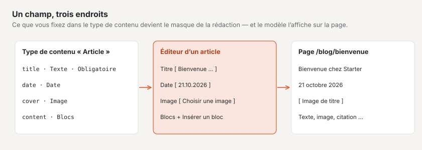
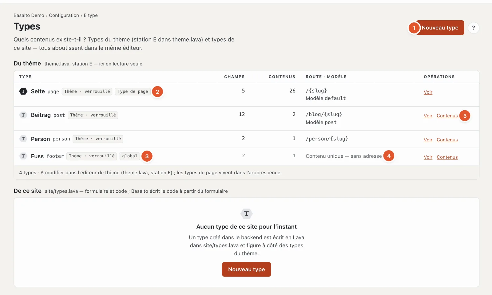
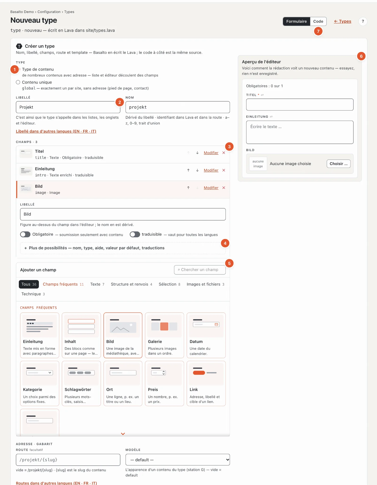
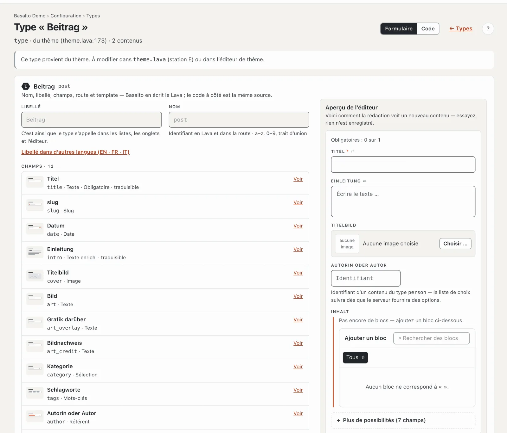

# Types de contenu

L’étape **« Que peut-on gérer ? »** définit les sortes de contenus que le site connaît — pages, articles, personnes, événements — et les **champs** de chaque sorte. Les champs donnent le masque que la rédaction remplit dans l’éditeur.

## Où

Mode « Configuration » › « Que peut-on gérer ? » › **« Ouvrir les types de contenu »**.

La page comporte deux listes :

- **Du thème** — les types fournis par le thème. Ici, en consultation seulement ; ils se modifient dans l’éditeur de thème (station E).
- **De ce site** — les types que vous créez dans le backend. Basalto les écrit en Lava dans `site/types.lava` ; ils ont le même rang que les types du thème.

Pour chaque type : nom et identifiant, marques comme « Thème · verrouillé », nombre de champs et de contenus, adresse (route) et modèle, ainsi que les opérations.

1. **« Nouveau type »** crée un type de ce site.
2. **Type de page** — le type « Page » vit dans l’[arborescence](../redaktion/seiten.md) ; ses contenus y ont leur place.
3. **global** — un **contenu unique** : exactement un par site, sans adresse, par exemple le pied de page.
4. Au lieu de la route, les contenus uniques indiquent « Contenu unique — sans adresse ».
5. **« Contenus »** ouvre la liste de tous les contenus de ce type (pour les contenus uniques, le seul contenu) ; **« Voir »** ou **« Modifier »** ouvre le type.

Si le thème ne connaît plus un type dont il reste des contenus, celui-ci figure avec « plus défini — les contenus restent ». Si le thème ne compile pas, la page affiche les constats en haut.

## Créer un type

1. **Type** :
   - **Type de contenu** — de nombreux contenus avec adresse ; la liste et l’éditeur découlent des champs (par exemple articles, projets).
   - **Contenu unique** — exactement un par site, sans adresse et sans modèle ; le thème le lit par un bloc « global » (par exemple pied de page, coordonnées).
2. **Libellé** — c’est ainsi que le type s’appelle dans les listes, les onglets et l’éditeur, par exemple « Projet ». Le **nom** en découle (« projet ») : l’identifiant en Lava et dans l’adresse, composé de minuscules, de chiffres et de traits d’union ; si vous le modifiez, il reste tel que vous l’écrivez. Les libellés dans d’autres langues se trouvent sous « Libellé dans d’autres langues ».
3. **Champs** — une ligne par champ avec dessin, libellé, nom et type. Un type de contenu a besoin du champ **title** ; il porte le titre dans les listes et dans l’éditeur et existe déjà. Avec ↑ et ↓, vous changez l’ordre, ✕ retire un champ, **« Modifier »** ouvre ses réglages — d’abord l’essentiel : **Libellé** (le nom du champ le suit tant que vous ne le modifiez pas vous-même), **Obligatoire**, **traduisible** et ce dont le type de champ a besoin (options d’une sélection, blocs autorisés, type cible d’un référent).
4. **Plus de possibilités** d’un champ — nom, type de champ, **texte d’aide** (affiché dans l’éditeur sous le champ), **valeur par défaut** et le libellé dans d’autres langues. Si une erreur s’y trouve, la zone est déjà ouverte.
5. **Ajouter un champ** — une palette comme pour les blocs : dessin et phrase par type de champ, par groupes, avec recherche. Les **champs fréquents** apportent directement le libellé dans chaque langue et le nom : Introduction, Contenu (blocs — tous les blocs du thème autorisés), Image, Galerie, Date, Catégorie, Mots-clés, Localité, Prix, Lien, Client.
6. **Aperçu de l’éditeur** — à droite, vous voyez ce que la rédaction remplit pour un nouveau contenu de ce type, actualisé à chaque modification ; vous pouvez l’essayer, rien n’est enregistré.
7. **Formulaire · Code** — en haut à droite, vous passez à la vue du code. Le formulaire et le code sont deux vues de la même source ; le code apparaît après l’enregistrement.

En dessous, **Adresse et modèle** : la **route** des contenus, par exemple `/projekte/{slug}` — `{slug}` est le slug du contenu, vide vaut `/‹name›/{slug}` — et le **modèle** de la station G (vide vaut « default »). Les routes dans d’autres langues se trouvent sous « Routes dans d’autres langues » ; si un libellé y est saisi, Basalto en propose la route (« D’après le libellé : reprendre /projects/{slug} »).

**« Enregistrer »** crée le type ; ensuite, les modifications s’enregistrent d’elles-mêmes, les noms en quittant le champ. **« Enregistrer et fermer »** ramène à la liste.

### Les types de champ

| Type de champ | Pour quoi |
| --- | --- |
| Texte · Texte multiligne | textes courts ou longs sans mise en forme |
| Texte enrichi · Markdown | texte mis en forme |
| Blocs | l’éditeur de blocs ; **Blocs autorisés** détermine les blocs que l’on peut insérer — sans sélection, l’éditeur n’a pas de zone de contenu |
| Nombre · Oui/Non · Date · Date et heure | valeurs |
| Sélection | un choix parmi des **options** (séparées par des virgules) |
| Mots-clés | mots-clés librement attribués, par exemple pour le blog |
| Image · Galerie · Fichier | depuis la médiathèque |
| Lien · URL · E-mail | adresses |
| Référent | vers un autre contenu ; **Type cible** indique vers quel type (par exemple d’un article vers son autrice de type « Personne ») |
| Répétition | un groupe de champs que l’on peut créer plusieurs fois |
| Slug · SEO · Couleur · Code · JSON | cas particuliers |

**Traduisible** signifie : le champ a sa propre valeur dans chaque langue et apparaît lors de la traduction. Sinon, il vaut pour toutes les langues (« partagé », voir [Traduire](../redaktion/uebersetzen.md)).

## Consulter un type du thème

Les types du thème affichent le même masque, verrouillé, avec la remarque « Ce type provient du thème ». Vous voyez ainsi les champs que remplit la rédaction — ici par exemple titre, date, introduction, image de titre, catégorie (sélection), mots-clés, auteur (référent vers « Personne ») et blocs avec les blocs autorisés.

## Supprimer un type

En bas du type : **« Supprimer »**, puis « Oui, supprimer ». Les contenus de ce type restent dans la base de données ; sans type, ils n’apparaissent plus, jusqu’à ce qu’un type du même nom les reconnaisse à nouveau.

## Questions fréquentes

**Où gérer un contenu unique, par exemple le pied de page ?**
En mode « Contenus » › **Contenus** : il y a son propre onglet avec son libellé (« Pied de page »). Comme il n’existe qu’une fois, « Nouveau contenu » n’y figure pas.

**Je ne vois pas mon nouveau type dans « Contenus ».**
Enregistrez le type et rechargez la liste « Contenus ». Les types de page se trouvent dans l’arborescence, pas là.

**Puis-je modifier un type du thème ?**
Pas ici. Modifiez-le dans l’éditeur de thème — ou créez un type propre à ce site.

## Pour continuer

- [Blocs réutilisables](bausteine.md)
- [Pages et arborescence](../redaktion/seiten.md)
