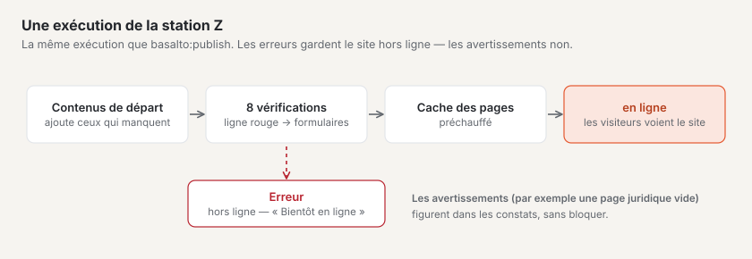
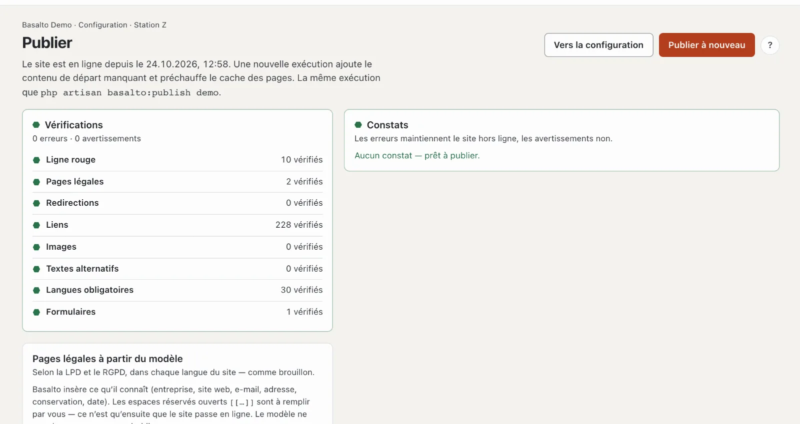

# Mise en ligne

La dernière étape, **« Prêt pour la mise en ligne ? »** (station Z), vérifie tout le site et l’ouvre aux visiteurs. Jusque-là, les visiteuses et visiteurs voient une page « Bientôt en ligne » ; vous-même voyez le site tant que vous êtes connecté au backend.

## Où

Mode « Configuration » › « Prêt pour la mise en ligne ? » › **« Publier »** — ou, sur la page d’accueil de la configuration, **« Publier (Z) »**. En console, c’est la même exécution que `php artisan basalto:publish <site>`.

En haut figure l’état : « Le site n’est pas encore en ligne — les visiteurs voient « Bientôt en ligne » » ou « Le site est en ligne depuis le … ».

1. **« Mettre en ligne »** ou, si le site est déjà en ligne, **« Publier à nouveau »** — lance l’exécution. S’il y a des erreurs, le bouton est verrouillé : « Corrigez d’abord les erreurs — la liste indique où ». « Vers la configuration » ramène au rapport de vérification.
2. **Vérifications** — huit vérifications, chacune avec un symbole et « … vérifié ».
3. **Constats** — chaque message avec « Ouvrir → » vers l’endroit où il peut être corrigé. **Les erreurs maintiennent le site hors ligne, les avertissements non.** Sans constat : « Aucun constat — prêt à publier ».
4. **Pages légales à partir du modèle** — voir plus bas.

## Ce que fait une exécution

1. **Importer les contenus de départ** — les pages et contenus fournis par le thème (dans Starter, par exemple la page d’accueil, À propos, le blog, Contact et le pied de page). Basalto n’importe que ce qui manque encore ; ce qui a été modifié reste tel quel.
2. **Vérifier** — les huit vérifications ci-dessous.
3. **Préchauffer le cache des pages** — les pages sont ensuite déjà prêtes, les premiers visiteurs n’attendent pas.
4. **Mettre en ligne** — s’il ne reste aucune erreur.

En haut apparaît ensuite par exemple « Mis en ligne — 8 contenus de départ importés, 23 pages préchauffées ».

### Contenus de départ

L’étape « Avec quoi démarre-t-il ? » n’a pas de page propre : c’est cette exécution qui importe les contenus de départ. Pour les voir, le parcours mène à « Voir les pages ». Les contenus de départ que vous avez modifiés ou supprimés restent ainsi : une nouvelle exécution n’écrase rien et ne récupère rien non plus de la corbeille.

## Les huit vérifications

| Vérification | Ce qui est vérifié | Constat typique |
| --- | --- | --- |
| **Ligne rouge** | les dix vérifications A à Z du thème | une erreur dans le thème |
| **Pages légales** | les mentions légales et la déclaration de protection des données existent et sont publiées dans chaque langue, sans espace réservé ouvert | « Mentions légales « … » manque » · « contient un espace réservé ouvert » (erreur) · « est vide » (avertissement) |
| **Redirections** | chaque redirection mène à une page publiée et ne tourne pas en boucle | « La redirection /ancien tourne en boucle » |
| **Liens** | les liens dans les contenus et les entrées de menu mènent à une page | « Le lien vers /tarifs ne mène nulle part » |
| **Images** | les images intégrées existent et ne sont pas dans la corbeille | « L’image #12 manque ou est dans la corbeille » |
| **Textes alternatifs** | les images intégrées ont un texte alternatif dans chaque langue — si le site a activé « Texte alternatif obligatoire » ou si le thème exige la vérification (le thème Starter le fait) | « Image … sans texte alternatif en EN » |
| **Langues obligatoires** | chaque contenu publié est publié dans toutes les langues obligatoires | « … n’est pas publié dans la langue obligatoire EN » |
| **Formulaires** | chaque formulaire a une action (e-mail, enregistrement ou webhook) et des destinataires valides | « Le formulaire … n’a aucune action » · avertissement si le mailer n’envoie pas d’e-mails |

## Pages légales à partir du modèle

Sans mentions légales ni déclaration de protection des données, le site ne passe pas en ligne. La carte **« Pages légales à partir du modèle »** crée les deux selon la LPD suisse et le RGPD européen — dans chaque langue du site, comme **brouillon** :

1. **« Insérer Mentions légales »** ou **« Insérer déclaration de protection des données »**. Basalto demande d’abord confirmation ; un brouillon existant est remplacé, la version publiée reste.
2. Basalto insère ce qu’il connaît : entreprise, site web, e-mail, adresse, délais de conservation, date.
3. Vous remplissez les **espaces réservés** ouverts `[[…]]` dans l’éditeur — tant qu’il en reste un, la vérification signale une erreur.
4. Publiez les pages comme n’importe quel contenu (voir [Validation et publication](../redaktion/freigabe.md)).

Le modèle ne remplace pas un examen juridique au cas par cas.

## Questions fréquentes

**Le bouton « Mettre en ligne » est verrouillé.**
Il y a au moins une erreur. Les constats l’indiquent ; « Ouvrir → » y mène.

**Dois-je cliquer sur « Publier à nouveau » après chaque modification ?**
Non. Les contenus passent en ligne par la validation, le thème par sa propre validation. Une nouvelle exécution est utile si le thème apporte de nouveaux contenus de départ ou si vous voulez vérifier tout le site.

## Pour continuer

- [Hosting](../betrieb/hosting.md)
- [Sites](../verwaltung/sites.md)
- [Configuration : concevoir et construire le site](README.md)
