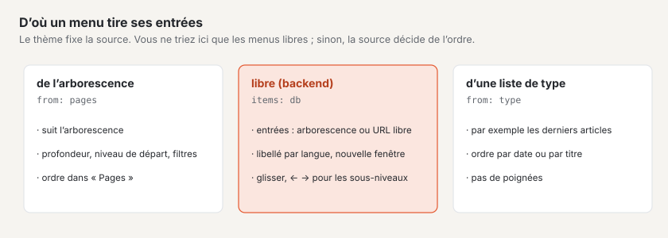
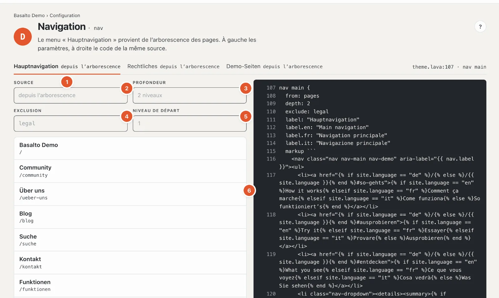
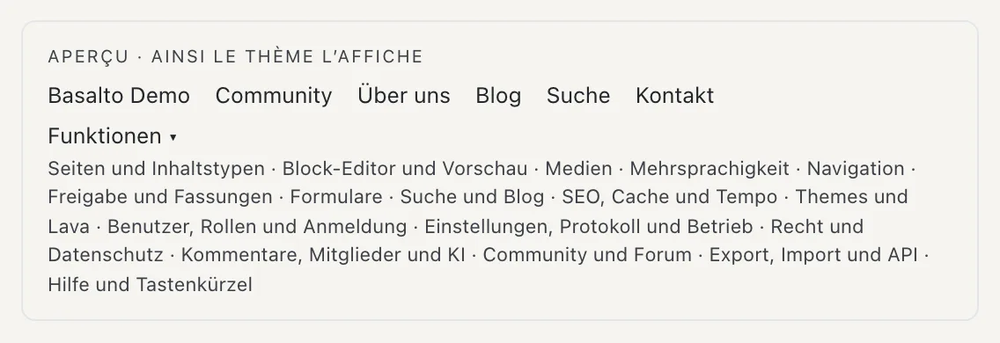

# Menus

L’étape **« Comment s’y retrouver ? »** montre les menus du site : menu principal, pied de page, informations juridiques et autres. Le thème définit quels menus existent et où ils figurent sur la page ; ici, vous voyez leurs entrées, vous les réglez et — pour les menus gérés librement — vous les ordonnez.

## Où

Mode « Configuration » › « Comment s’y retrouver ? » › **« Modifier les menus »**. En haut, chaque menu a un onglet avec sa source, par exemple « Navigation principale depuis l’arborescence », et à droite l’emplacement dans le thème (« theme.lava:107 · nav main »).

## D’où un menu tire ses entrées

- **Depuis l’arborescence** — le menu suit l’[arborescence](../redaktion/seiten.md). Une nouvelle page apparaît d’elle-même ; vous modifiez l’ordre dans « Pages » (le lien « Modifier l’ordre dans « Pages » » y mène). Il n’y a donc ici « pas de poignées ».
- **Géré librement** — les entrées sont créées ici dans le backend : des pages de l’arborescence ou des adresses libres, dans l’ordre et la profondeur de votre choix.
- **Depuis une liste de type** — par exemple les articles les plus récents ; l’ordre suit la liste (date ou titre).
- **Depuis le thème** — des entrées fixes inscrites dans le thème ; elles ne se modifient que là.

## Un menu depuis l’arborescence

1. **Choisir le menu** — un onglet par menu.
2. **Source** — d’où viennent les entrées.
3. **Profondeur** — combien de niveaux de l’arborescence le menu affiche, par exemple « 2 niveaux » (pages principales et leurs sous-pages).
4. **Exclusion** — les pages que le menu omet, par exemple les pages légales.
5. **Niveau de départ** — le niveau à partir duquel le menu commence ; 1 est le niveau supérieur. Avec **Uniquement**, un menu n’affiche que certaines pages (dans Starter, le menu « Juridique »).
6. **Les entrées**, telles qu’elles apparaissent dans le menu, indentées par niveau, avec leur adresse.

Ces réglages figurent dans le thème et sont visibles ici pour contrôle. Seules les pages publiées et visibles apparaissent dans le menu — les pages avec « Masquer dans le menu (reste accessible) » (paramètres de la page, onglet « Experts ») et les pages protégées sont absentes pour les visiteurs. Si la liste est vide, la page indique « Vide — le menu n’affiche que des pages publiées et visibles ».

## Un menu géré librement

Si le thème connaît un menu géré librement, le champ **« Ajouter une entrée »** figure sous la liste :

- **Chercher une page** — tapez une partie du titre (« pro »), et les pages correspondantes apparaissent avec leur adresse ; un clic
  ou Entrée insère la page. Son **libellé** suit le titre de la page, jusqu’à ce que vous le remplaciez.
- **Saisir une adresse** — « /blog », « https://… », « www.… » (devient « https://www.… »), « mailto: » ou « tel: ». Si
  l’adresse est une page du site, Basalto insère la page (elle suit alors les renommages) ; sinon, une entrée libre
  s’ouvre avec cette adresse — pour les sites externes, directement « Dans une nouvelle fenêtre ».
- **« Manque encore : »** — les pages publiées qui manquent encore dans le menu, le niveau supérieur d’abord ; un clic les insère.

Pour chaque entrée, vous réglez :

- **Libellé** — pour une page, laissez-le vide : l’entrée porte alors le nom de la page. Les libellés des autres langues
  se trouvent sous « Libellé dans d’autres langues » ; s’il manque dans une langue, l’entrée reprend le libellé
  de la langue par défaut (« — reprend … »).
- **Cible** — pour une entrée libre, l’adresse. Si elle contient le chemin d’une page du site, Basalto propose **« Lier
  comme page »**.
- **Visible** — une entrée masquée reste dans la liste (« masqué »), mais n’apparaît pas dans le menu.
- **Dans une nouvelle fenêtre** — le lien ouvre un nouvel onglet (« ↗ nouvelle fenêtre ») ; c’est l’usage pour les sites externes.

« Modifier » ouvre une entrée, « Supprimer » la retire après la question « Vraiment supprimer ? ». Les modifications s’enregistrent d’elles-mêmes ; « ✓ enregistré » le confirme.

### Ordonner

- **Glisser** trie les entrées. Si vous déposez une entrée **plus à droite**, elle devient une sous-entrée de l’entrée au-dessus.
- Au clavier : **↑ ↓** déplace, **→** crée une sous-entrée (plus profond), **←** la remonte d’un niveau (plus haut).
- Le nouvel ordre s’enregistre immédiatement ; si quelque chose échoue, la raison s’affiche en bas à droite.

Une entrée vers une page non publiée porte la mention « non publié » et n’apparaît que lorsque la page est en ligne.

## L’aperçu

Sous le code figure **« Aperçu · ainsi le thème l’affiche »** : le menu tel que les visiteuses et visiteurs le voient, avec ses sous-menus. Avec plusieurs langues, vous choisissez la **langue du libellé**.

À droite figure le code du menu dans le thème — la même source que les réglages à gauche. Il se modifie dans l’éditeur de thème (station D).

## Questions fréquentes

**Une nouvelle page manque dans le menu.**
Est-elle publiée ? Se trouve-t-elle dans l’arborescence sous une page que le menu affiche, et pas plus profond que la profondeur réglée ? « Masquer dans le menu (reste accessible) » n’est-il pas coché ?

**Je ne peux pas modifier l’ordre.**
Le menu vient de l’arborescence, d’une liste de type ou du thème — l’ordre appartient à la source. Si « Vous n’êtes pas autorisé à modifier ce menu » s’affiche, votre rôle ne permet que de consulter le domaine « Navigation ».

## Pour continuer

- [Types de contenu](inhaltstypen.md)
- [Pages et arborescence](../redaktion/seiten.md)
