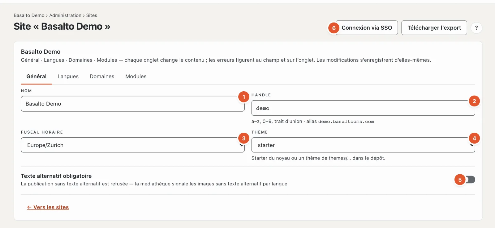
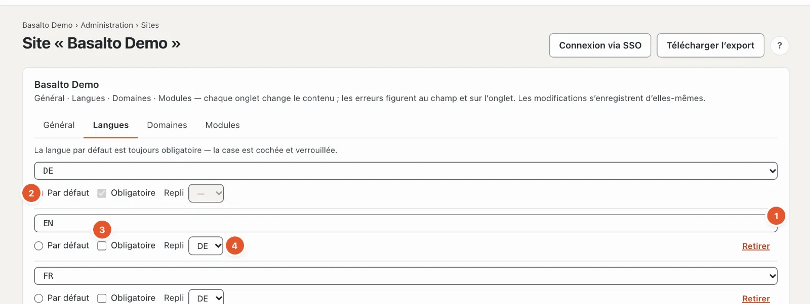
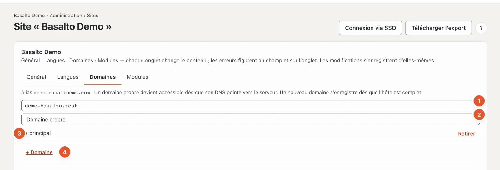
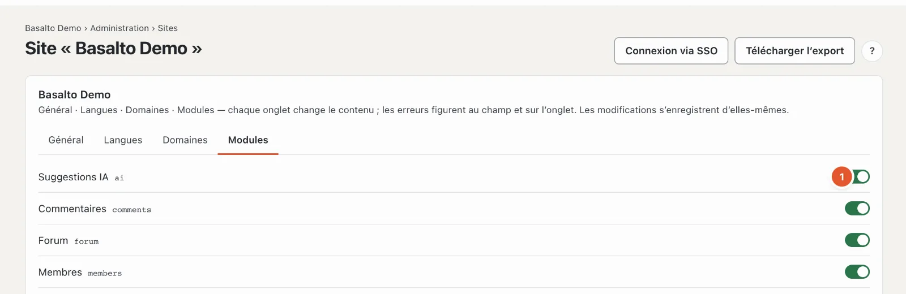

# Le site

La première étape du parcours, **« Qu’est-ce que le site ? »**, pose la base de tout le reste : nom, langues, domaines, fuseau horaire, thème et modules. Elle se trouve en mode « Administration » sous **Sites** — le parcours mène directement au site dans lequel vous travaillez.

## Où

Mode « Administration » › **Sites** › ouvrir le site, ou dans le parcours « Qu’est-ce que le site ? » › « Modifier le site ». La liste « Sites » montre tous les sites de l’installation avec leurs langues, leurs domaines et leur état ; **« Nouveau site »** en crée un autre (nom, handle, langue par défaut, thème — « Enregistrer et fermer »).

La page a quatre onglets. Les modifications s’enregistrent d’elles-mêmes ; « enregistré » à côté du champ le confirme. Si une donnée est incorrecte, l’erreur s’affiche au champ et sous forme de nombre sur l’onglet.

## Onglet Général

1. **Nom** — c’est ainsi que le site s’appelle dans le backend, dans les e-mails et dans le titre du site web.
2. **Handle** — le nom court technique : minuscules, chiffres et trait d’union. Il figure dans l’**alias**, l’adresse sous laquelle le site est accessible sans domaine propre (par exemple « demo.basaltocms.com »), et dans des commandes comme `basalto:publish demo`. Ne le modifiez que si personne ne connaît encore l’ancienne adresse.
3. **Fuseau horaire** — pour la date et l’heure du site, par exemple pour les publications planifiées.
4. **Thème** — le thème fourni qu’utilise le site. Il est plus pratique d’en changer sous [Thèmes](aussehen.md#thèmes) : vous y voyez à l’avance ce qui change.
5. **Texte alternatif obligatoire** — si l’interrupteur est activé, toute publication contenant une image sans texte alternatif dans une langue est refusée ; la médiathèque signale ces images. Désactivé par défaut — mais certains thèmes exigent d’eux-mêmes des textes alternatifs (le thème Starter le fait).
6. En haut à droite : **« Connexion via SSO »** configure la connexion par un login d’entreprise (voir [SSO pour les utilisateurs du backend](../betrieb/sso.md)) ; **« Connexion des comptes clients »** les boutons « Se connecter avec Google », etc. sur le frontend (voir [Connexion des comptes clients](../verwaltung/kundenanmeldung.md)) ; **« Télécharger l’export »** télécharge tout le site en ZIP — les contenus en JSON et tous les médias, dans le même format que l’import, sans les envois de formulaires ni les membres. Seuls les exploitants et l’administration du compte voient ces deux boutons.

## Onglet Langues

Une ligne par langue :

1. **Langue** — à choisir dans la liste.
2. **Par défaut** — la langue principale du site. Toutes les traductions en découlent. Il y en a exactement une.
3. **Obligatoire** — sans cette langue, un contenu n’est pas validé. La langue par défaut est toujours obligatoire ; sa case est cochée et verrouillée.
4. **Repli** — s’il manque la version publiée dans cette langue, les visiteurs voient la version de la langue de repli (et ainsi de suite jusqu’à la langue par défaut).
5. **« + Langue »** ajoute une ligne, **« Retirer »** supprime une langue. Les contenus de cette langue restent dans la base de données, mais n’apparaissent plus.

L’effet de la traduction, des langues obligatoires et du repli au quotidien est décrit sous [Traduire](../redaktion/uebersetzen.md).

## Onglet Domaines

En haut figure l’**alias** du site. En dessous, une ligne par domaine :

1. **Hôte** — l’adresse sans « https:// », par exemple « www.votre-entreprise.ch ». Un nouveau domaine s’enregistre dès que l’hôte est complet.
2. **Type** :
   - **Domaine propre** — l’adresse sous laquelle le site doit apparaître,
   - **Alias** — une autre adresse du même site,
   - **Redirection** — une ancienne adresse qui redirige vers l’adresse principale.
3. **principal** — l’adresse principale ; elle figure dans le sitemap, dans les liens et dans les e-mails.
4. **« + Domaine »** et **« Retirer »**.

Pour qu’un domaine fonctionne, il doit pointer vers le serveur dans le DNS. Avec l’abonnement (SaaS), le compte gère l’alias et les domaines propres : l’onglet renvoie alors à **Compte › Domaines** (voir [Domaines](../redaktion/domains.md)).

## Onglet Modules

Chaque module installé a un interrupteur : **activé** signifie que le site l’utilise — les entrées de menu, les blocs et les boutons du module apparaissent. **« toujours actif »** figure pour les modules qui ne peuvent pas être désactivés. Les modules installés se règlent sous « Administration › Modules » ; sans module, la page indique « Aucun module installé ».

| Module | Ce qu’il apporte |
| --- | --- |
| Suggestions IA | Faire proposer des améliorations de texte, des traductions, du SEO et des textes alternatifs — voir [Suggestions IA](../redaktion/ki.md) |
| Commentaires | Commentaires sous les articles et les pages — voir [Commentaires](../redaktion/kommentare.md) |
| Membres | Pages réservées aux membres connectés — voir [Membres](../redaktion/mitglieder.md) |

## Questions fréquentes

**Je ne vois ni « Connexion via SSO », ni « Connexion des comptes clients », ni « Télécharger l’export ».**
Ces deux fonctions sont réservées à l’exploitant et à l’administration du compte.

**J’ai retiré une langue — les traductions ont-elles disparu ?**
Non. Elles restent enregistrées et réapparaissent dès que vous ajoutez à nouveau la langue.

## Pour continuer

- [Apparence : thèmes, design et variantes d’image](aussehen.md)
- [Sites](../verwaltung/sites.md)
