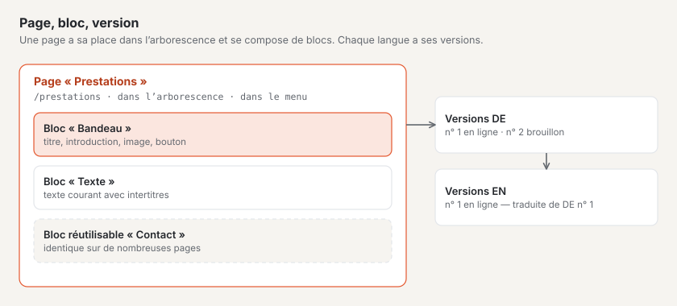

# Les termes essentiels

Basalto utilise peu de termes, mais toujours de la même manière. Cette page les explique en une phrase et montre
comment ils sont liés. Le backend emploie les mêmes mots.

## Installation et site

| Terme | Signification |
| --- | --- |
| **Installation** | Basalto sur un serveur, avec une base de données. Les utilisateurs, les rôles, la licence et les mises à jour valent pour toute l’installation. |
| **Site** | Un site web dans l’installation, avec un nom, une adresse (domaine), des langues et un thème. Une installation peut avoir plusieurs sites. |
| **Domaine** | L’adresse sous laquelle un site est accessible, par exemple `praxis-muster.ch`. |
| **Langue par défaut** | La langue principale du site. Toutes les traductions en découlent. |

## Contenus

| Terme | Signification |
| --- | --- |
| **Page** | Une entrée de l’arborescence avec sa propre adresse, par exemple « Services » sous `/services`. |
| **Arborescence** | L’ordre de toutes les pages : les pages principales et, en dessous, leurs sous-pages. Elle donne naissance aux menus, aux adresses et au fil d’Ariane. |
| **Contenu** | Une entrée sans place fixe dans l’arborescence, par exemple un article de blog ou une personne. |
| **Type de contenu** | La nature d’un contenu avec ses champs, par exemple « Article » avec un titre, une date et un texte. |
| **Bloc** | Un élément d’une page : bandeau, texte, image, cartes, questions et réponses, formulaire … |
| **Bloc réutilisable** | Un groupe de blocs qui figure à l’identique sur plusieurs pages et se modifie à un seul endroit. |
| **Médias** | Les images et les fichiers du site dans la médiathèque. Chaque image reçoit un texte alternatif pour les personnes qui ne la voient pas. |

## Versions et validation

| Terme | Signification |
| --- | --- |
| **Version** | Un état d’un contenu dans une langue. Chaque modification commence comme une nouvelle version ; les anciennes sont conservées. |
| **Brouillon** | Une version à laquelle on écrit encore. Basalto l’enregistre automatiquement. |
| **Soumettre pour validation** | Remettre la version pour vérification. |
| **Valider** | Valider la version vérifiée pour la publication. |
| **Publier** | Mettre en ligne la version validée — immédiatement ou à un moment planifié. |
| **En ligne** | La version que les visiteurs voient sur le site web. |

## Présentation et extension

| Terme | Signification |
| --- | --- |
| **Thème** | L’apparence et le plan de construction d’un site : couleurs, polices, mises en page, menus, blocs, types de contenu et contenus de départ. |
| **Lava** | Le langage dans lequel les thèmes sont écrits. Invisible pour la rédaction. |
| **Mise en page** | Le cadre d’une page avec ses régions, par exemple l’en-tête, le contenu et le pied de page. |
| **Module** | Une extension comme les formulaires, les commentaires, les membres ou le forum, activable et désactivable par site. |
| **Plugin** | Un module provenant du Marketplace ou d’un tiers. |

## Personnes

| Terme | Signification |
| --- | --- |
| **Utilisateur** | Une personne qui a accès au backend. |
| **Rôle** | Ce qu’un utilisateur peut faire dans un site : Rédacteur, Approbateur, Traducteur, Administrateur ou Exploitant. |
| **Membre** | Une visiteuse avec un compte sur le site web, par exemple pour des pages protégées ou le forum — sans accès au backend. |
| **Passkey** | Se connecter avec l’empreinte digitale, le visage ou le verrouillage de l’appareil au lieu d’un code par e-mail. |

## Pour continuer

- [Installer Basalto](installieren.md)
- [Visite du backend](rundgang.md)
