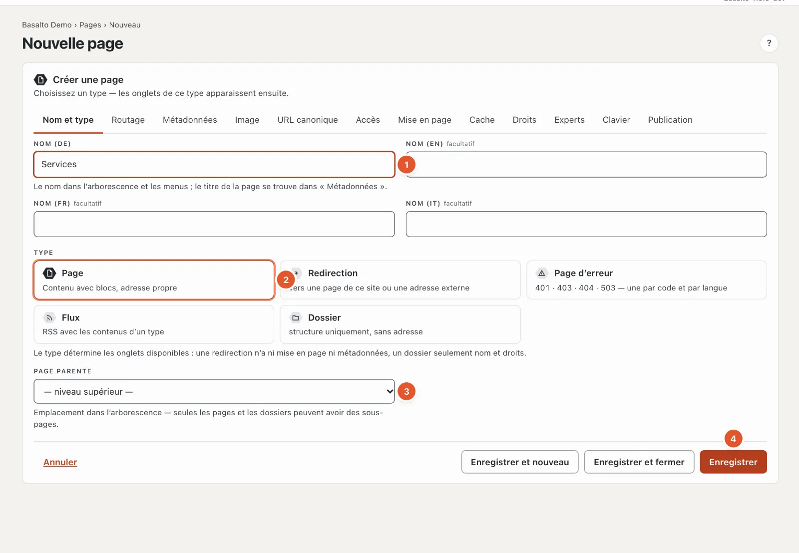
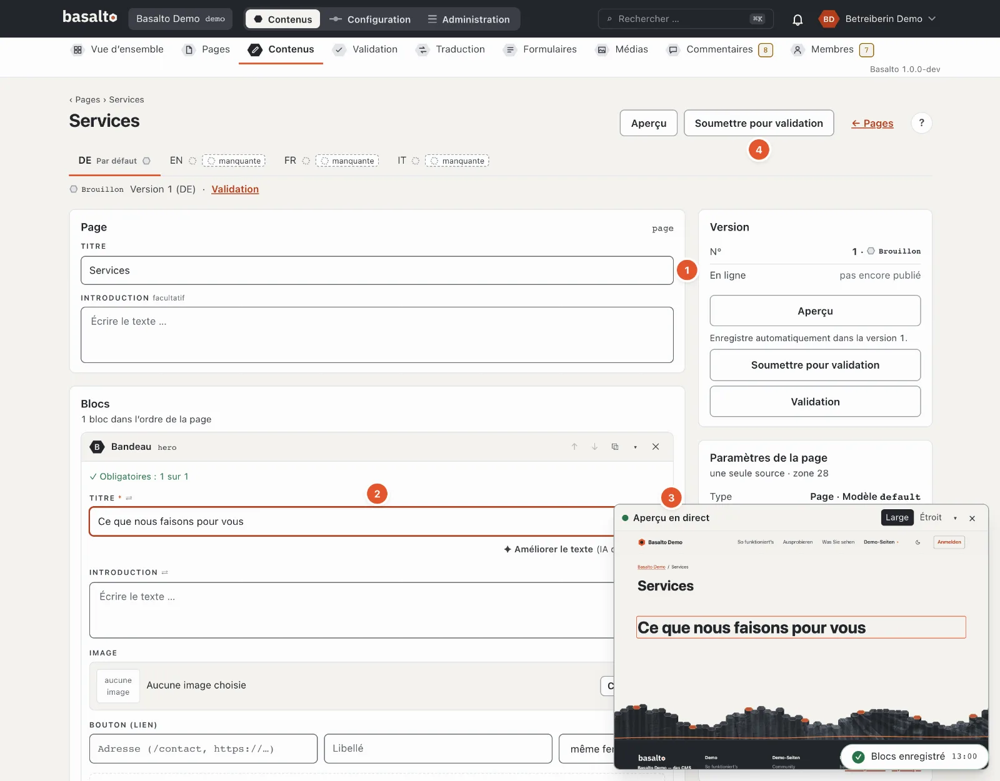
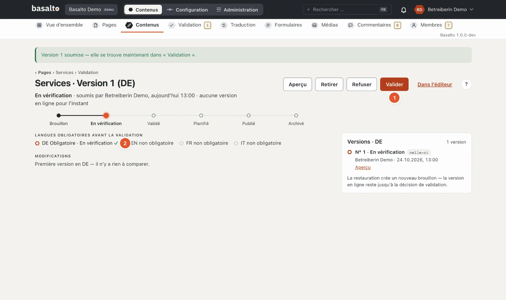
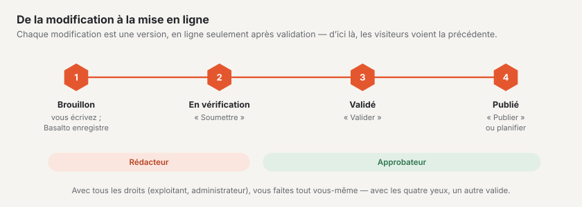
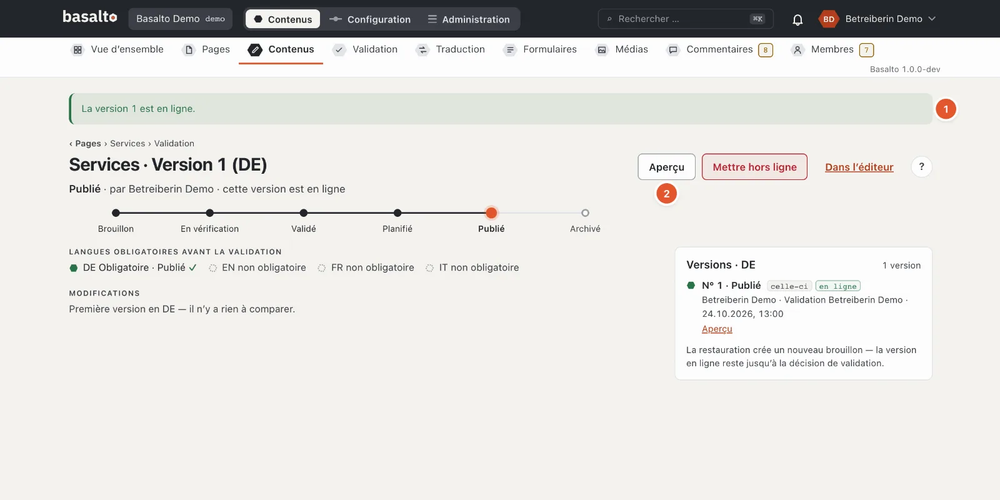

# La première page

Vous créez une nouvelle page « Services », la remplissez de blocs, insérez une image et la publiez. Ensuite, la page
figure sur le site web et dans le menu. L’exemple prend environ un quart d’heure.

## 1. Créer la page

1. Mode « Contenus » › **Pages** › **« Nouveau »**.
2. Dans l’onglet « Nom et type » (numéros comme sur l’image ci-dessus) :
   1. **Nom** — « Services ». Le nom figure dans l’arborescence et dans le menu ; il donne l’adresse `/services`.
   2. **Type** — « Page » est présélectionné : un contenu avec des blocs et sa propre adresse.
   3. **Page parente** — « niveau supérieur » pour une page principale. Si vous choisissez une autre page,
      « Services » devient sa sous-page, par exemple `/a-propos/services`.
   4. **« Enregistrer »**.
3. Basalto ouvre les paramètres de la nouvelle page. En haut à droite, **« Modifier le contenu »** mène à l’éditeur.

Les autres onglets — métadonnées, image, accès, mise en page et autres — ne vous servent pas pour l’instant. Leurs
valeurs par défaut conviennent à une page ordinaire.

## 2. Insérer des blocs et écrire

1. **Titre** — il est déjà là : « Services ». En dessous, vous pouvez écrire une introduction.
2. Sous **« Blocs »**, choisissez un bloc dans « Ajouter un bloc », ici **« Bandeau »** — un grand titre avec une
   introduction, une image et un bouton. Écrivez dans le champ **« Titre »** du bloc : « Ce que nous faisons pour
   vous ».
3. L’**aperçu en direct** montre la page telle que les visiteurs la verront et suit chaque saisie. « Large » et
   « Étroit » basculent entre écran et téléphone.
4. Avec **« + Insérer un bloc »**, vous ajoutez d’autres blocs, par exemple « Texte » pour du texte courant ou
   « Cartes » pour plusieurs services côte à côte. Les flèches sur le bloc le déplacent, ✕ le retire.

Vous n’avez pas besoin d’enregistrer : Basalto enregistre un peu plus d’une seconde après chaque saisie et l’indique
en bas à droite, par exemple « Blocs enregistrés ». Ce que vous écrivez reste un **brouillon** — rien ne change
encore sur le site web.

## 3. Insérer une image

1. Dans le bloc « Bandeau », sous **« Image »**, cliquer sur **« Choisir … »**. La médiathèque s’ouvre dans une
   fenêtre.
2. Choisir une image — ou en ajouter une nouvelle avec **« Téléverser »**.
3. Vérifier le **texte alternatif**. Basalto le préremplit à partir du nom du fichier ; mieux vaut une phrase qui dit
   ce que l’on voit sur l’image — pour les personnes qui ne la voient pas. Vous le modifiez dans **Médias**, dans le
   détail de l’image. Le thème Starter ne publie aucune page contenant une image sans texte alternatif.

Basalto produit lui-même, à partir de chaque image, les tailles adaptées à l’écran et au téléphone. Plus
d’informations sous [Médias](../redaktion/medien.md).

## 4. Vérifier et publier

Une version passe en ligne en trois étapes :

1. **« Soumettre pour validation »** — en haut à droite dans l’éditeur. La version est maintenant « En
   vérification » et apparaît sous « Validation ».
2. **« Valider »** — sur la page de validation (lien « Validation » sous le titre). En dessous, il est indiqué si
   toutes les **langues obligatoires** sont prêtes ; sans elles, Basalto ne valide pas.
3. **« Publier »** — la version passe immédiatement en ligne. Avec **« Planifier la publication »**, vous choisissez
   à la place une date et une heure.

Si vous avez tous les droits (Exploitant ou Administrateur), vous faites vous-même les trois étapes. Sinon, une
personne ayant le rôle « Approbateur » valide votre version ; la cloche lui signale que quelque chose attend.

1. **« La version 1 est en ligne »** — la page figure sur le site web.
2. **« Aperçu »** l’affiche ; sur le site web, vous la trouvez sous `/services`.

Si vous modifiez la page plus tard, la **version 2** naît comme brouillon. Les visiteurs continuent de voir la
version 1 jusqu’à ce que vous publiiez la version 2.

## En cas de problème

| Vous voyez | Cause | Solution |
| --- | --- | --- |
| À l’enregistrement, « 1 indication est incorrecte » avec un nombre sur l’onglet « Routage » | L’adresse est déjà prise. | Dans l’onglet « Routage », choisir un autre slug, par exemple `services-2025`. |
| « Valider » est bloqué : « Validation seulement avec toutes les langues obligatoires » | Une langue obligatoire n’a pas encore de version. | Traduire la page (voir [Menu et langues](menue-und-sprachen.md)) ou ne plus traiter la langue comme obligatoire. |
| « Publier » est bloqué à cause d’une image | Une image n’a pas de texte alternatif. | Compléter le texte alternatif dans la médiathèque. |
| « Soumettre pour validation » manque, seulement « Aperçu » | Votre rôle ne peut pas modifier cette page. | Demander à la personne qui administre votre site. |

## Pour continuer

- [Menu et langues](menue-und-sprachen.md)
- [Modifier le contenu avec des blocs](../redaktion/bloecke.md)
- [Validation et publication](../redaktion/freigabe.md)
