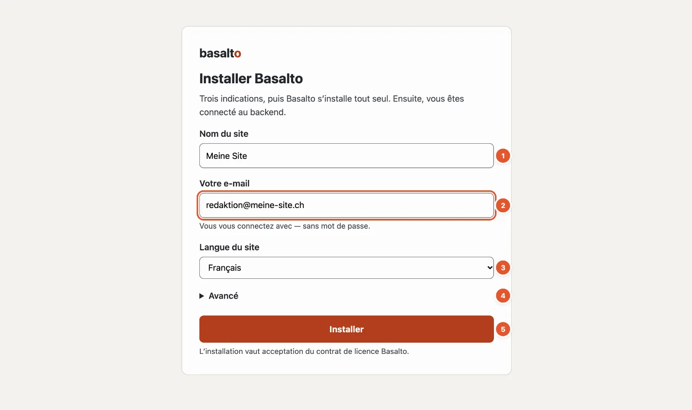
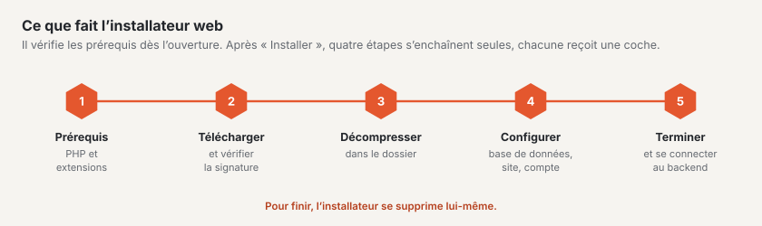

# Installer Basalto

Le plus simple est d’installer Basalto avec l’**installateur web** : un seul fichier, que vous déposez dans un dossier
vide et ouvrez dans le navigateur. Trois indications suffisent ; ensuite, vous êtes connecté au backend — sans
terminal, sans mot de passe et sans serveur de messagerie.

## Ce dont vous avez besoin

| Quoi | Valeur |
| --- | --- |
| Un hébergement web ou un serveur web local | avec PHP 8.4 ou plus récent et HTTPS |
| Extensions PHP | `mbstring`, `intl`, `gd`, `zip`, `sodium` et `pdo_sqlite` (ou `pdo_mysql` ou `pdo_pgsql`) |
| Un dossier vide | le dossier de votre domaine chez l’hébergeur ; en local, un dossier que le serveur web diffuse |
| Une adresse e-mail | pour votre premier compte |

Vous n’avez pas besoin de créer une base de données : par défaut, Basalto utilise SQLite, un fichier dans le dossier
de l’installation. Pour les grands sites, choisissez MariaDB, MySQL ou PostgreSQL sous « Avancé ».

S’il manque un prérequis, l’installateur l’indique sous « Prérequis manquants » avant de faire quoi que ce soit.

## Pas à pas

1. Téléchargez l’installateur sur basaltocms.com, sous **Téléchargement** — un fichier `index.php`.
2. Déposez-le dans le dossier **vide** : chez l’hébergeur, par FTP dans le dossier du domaine ; en local, par exemple
   dans `~/Sites/meine-site`.
3. Ouvrez l’adresse dans le navigateur, par exemple `https://meine-site.ch` ou `http://meine-site.test`.
4. Remplissez le formulaire (numéros comme sur l’image ci-dessus) :
   1. **Nom du site** — proposé à partir du nom du dossier ; vous pourrez le modifier plus tard.
   2. **Votre e-mail** — c’est avec elle que vous vous connecterez désormais, avec un code par e-mail ou une passkey.
   3. **Langue du site** — la langue par défaut. Vous ajouterez d’autres langues ensuite.
   4. **Avancé** — uniquement si vous voulez utiliser une autre base de données ou saisir tout de suite une clé de
      licence.
   5. **« Installer »**.
5. Attendez que les quatre étapes — télécharger et vérifier la signature, décompresser, configurer, terminer — soient
   cochées. L’installateur vous redirige ensuite vers le backend.

L’installateur vérifie la signature du paquet téléchargé avant de le décompresser : un paquet modifié est refusé.
Il configure ensuite la base de données, crée votre site avec le thème Starter et quelques pages de départ, puis vous
connecte. Pour finir, il se supprime lui-même.

## Après l’installation

- **Configurer une passkey.** L’aperçu général du backend vous le propose. Avec une passkey, vous vous connectez avec
  l’empreinte digitale, le visage ou le verrouillage de l’appareil — même si un e-mail n’arrive pas.
- **Regarder les pages de départ.** Votre site a déjà une page d’accueil, « À propos », « Contact », « Recherche », un
  blog, « Mentions légales » et « Protection des données ». Vous remplacez leurs textes par les vôtres.
- **Saisir une licence** dès que le site travaille pour une entreprise ou une association — plus d’informations sous
  [Licence](../verwaltung/lizenz.md). Sans clé, Basalto fonctionne au niveau gratuit Free.

## En cas de problème

| Vous voyez | Cause | Solution |
| --- | --- | --- |
| « Le dossier n’est pas vide » avec une liste de fichiers | Le dossier contient déjà des fichiers. | Retirer les fichiers indiqués ou utiliser un nouveau dossier. Les fichiers que les hébergeurs créent eux-mêmes (`.htaccess`, `.user.ini`, `.well-known`, `cgi-bin`, `error_log`) peuvent rester. |
| « L’installation est déjà en cours dans un autre navigateur » | Un autre navigateur a commencé l’installation. | Continuer là-bas — ou supprimer le fichier `.basalto-install.json` du dossier et recommencer. |
| « Prérequis manquants » avec une liste | PHP est trop ancien ou une extension manque. | Dans l’administration de votre hébergeur, augmenter la version de PHP ou activer l’extension. |
| Après l’installation, le navigateur affiche une liste de fichiers ou « Forbidden » | Le serveur web commence dans le dossier principal au lieu du dossier `public/`. | Avec Apache, l’installateur crée un `.htaccess` qui règle cela ; avec nginx, faire pointer la racine du domaine sur `public/`. |

## Autres voies

Si vous travaillez sur votre propre serveur avec une console, vous installez Basalto avec Composer et la commande
`php artisan basalto:install`. C’est décrit dans l’[Installation du manuel d’exploitation](../betrieb/installation.md),
avec l’hébergement, la sauvegarde et les mises à jour.

## Pour continuer

- [Visite du backend](rundgang.md)
- [La première page](erste-seite.md)
