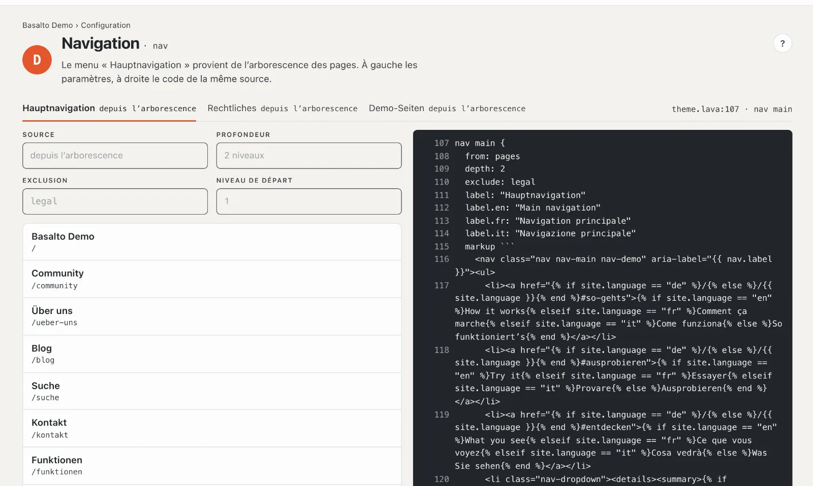
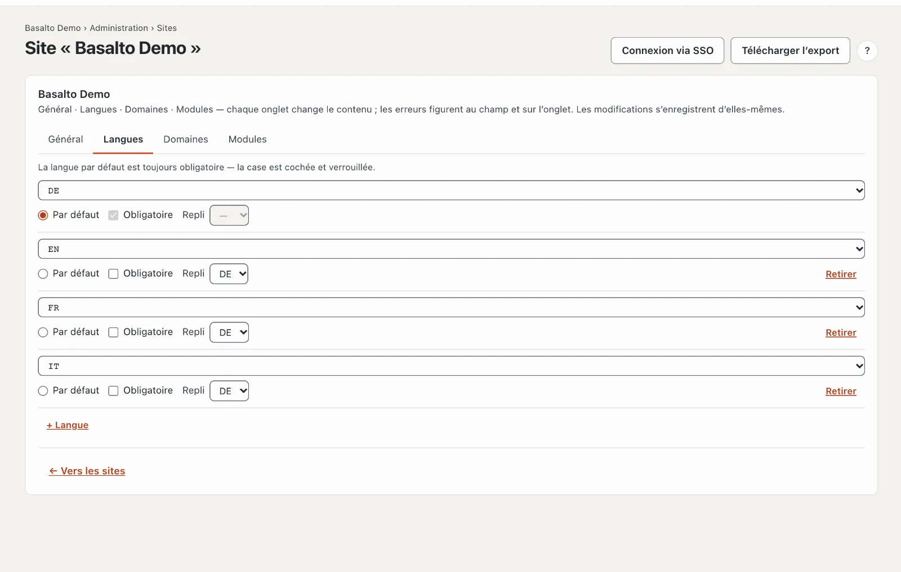
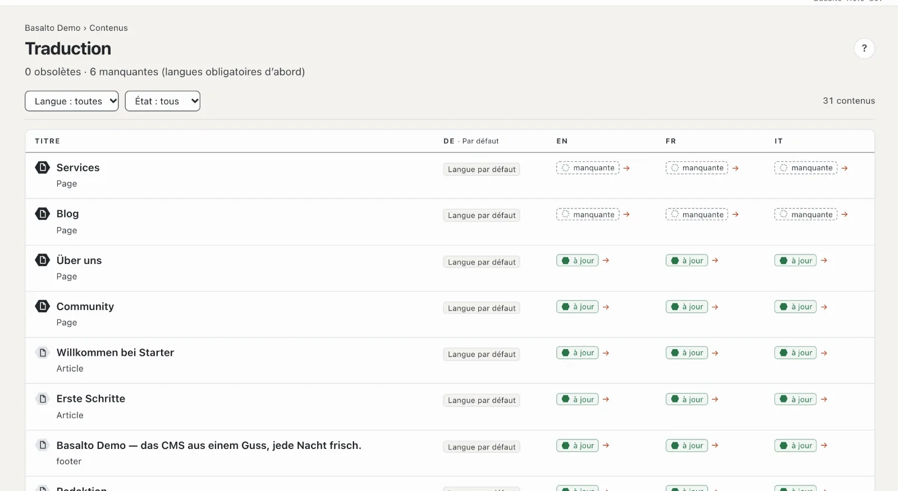

# Menu et langues

Une fois publiée, la nouvelle page figure d’elle-même dans le menu. Vous voyez ici d’où le menu tire ses entrées,
comment modifier l’ordre et comment votre site reçoit une deuxième langue.

## Le menu

Dans le thème Starter, le **menu principal suit l’arborescence** : chaque page publiée du niveau supérieur y
apparaît, ses sous-pages en dessous. Vous n’avez donc pas à gérer le menu.

- **Consulter :** mode « Configuration » › « Comment s’y retrouver ? » › **« Modifier les menus »**. Un onglet par
  menu — menu principal, Juridique et autres — avec la source et les entrées telles que les visiteurs les voient.
- **Modifier l’ordre :** mode « Contenus » › **Pages** › sur la page, **« Déplacer »** (flèche vers le haut et vers
  le bas) et choisir la nouvelle place. Le menu suit immédiatement.
- **Retirer une page du menu :** dans les paramètres de la page, onglet « Experts », cocher
  **« Masquer dans le menu (reste accessible) »**. La page reste accessible à son adresse.

Le menu ne contient que des pages publiées. S’il manque une page, c’est le plus souvent qu’elle est encore un
brouillon.

Certains thèmes ont en plus des **menus gérés librement**, dont vous composez vous-même les entrées dans la
configuration. Plus d’informations sous [Menus](../einrichtung/menues.md).

## Une deuxième langue

1. Mode « Administration » › **Sites** › votre site › onglet **« Langues »**.
2. **« + Langue »** et choisir la langue, par exemple l’anglais.
3. Pour chaque langue, vous réglez :
   - **Par défaut** — la langue principale, dont naissent toutes les traductions. Il y en a exactement une.
   - **Obligatoire** — sans cette langue, Basalto ne valide aucun contenu. Laissez la case décochée au début, pour
     pouvoir publier des pages avant leur traduction.
   - **Repli** — s’il manque une traduction, les visiteurs voient la version dans cette langue, par exemple
     l’allemand au lieu d’une page vide.

Les modifications s’enregistrent d’elles-mêmes. Sur le site web, un sélecteur de langue apparaît dès qu’il existe une
deuxième langue.

## Traduire la page

1. Mode « Contenus » › **Traduction** — la liste de tous les contenus avec leur état par langue.
2. Dans la ligne « Services », cliquer sur **« manquante »** dans la colonne de la langue.
3. **« Créer la traduction depuis l’allemand »**. À gauche figure le texte allemand à lire, à droite vous écrivez la
   traduction — champ par champ, bloc par bloc. Basalto enregistre automatiquement.
4. La traduction passe en ligne comme toute version : **Soumettre pour validation**, **Valider**, **Publier** — voir
   [La première page](erste-seite.md#4-vérifier-et-publier).

Si vous modifiez plus tard le texte allemand, la traduction passe à **« obsolète »** jusqu’à ce que quelqu’un la
mette à jour. Les images et les nombres valent pour toutes les langues et ne sont gérés que dans la langue par
défaut.

## En cas de problème

| Vous voyez | Cause | Solution |
| --- | --- | --- |
| La nouvelle page manque dans le menu | Elle n’est pas encore publiée, ou « Masquer dans le menu » est coché. | Publier la page ou décocher la case dans l’onglet « Experts ». |
| L’onglet « Langues » manque | Votre rôle ne gère pas de sites. | Demander à une personne ayant le rôle Administrateur ou Exploitant. |
| « Créer la traduction depuis l’allemand » est bloqué | Votre rôle ne peut pas modifier cette langue, ou il n’existe pas encore de version allemande. | Faire vérifier le rôle ou écrire d’abord la version allemande. |

## Pour continuer

- [Inviter l’équipe](team.md)
- [Traduire](../redaktion/uebersetzen.md)
- [Pages et arborescence](../redaktion/seiten.md)
