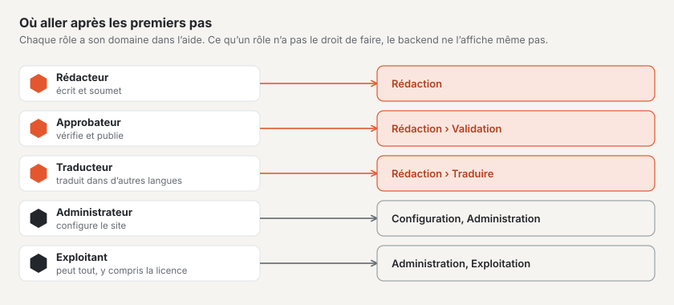

# Pour aller plus loin

Votre site fonctionne, la première page est en ligne, l’équipe est invitée. À partir d’ici, chaque rôle approfondit
sa propre partie de l’aide — cette page montre où.

## Pour la rédaction

- [Pages et arborescence](../redaktion/seiten.md) — sous-pages, redirections, corbeille.
- [Modifier le contenu avec des blocs](../redaktion/bloecke.md) — tous les blocs, le texte courant, coller depuis
  Word, restaurer d’anciennes versions.
- [Médias](../redaktion/medien.md) — dossiers, textes alternatifs, point focal, remplacement.
- [Formulaires](../redaktion/formulare.md) — adapter le formulaire de contact, lire les envois.

## Pour la validation et la traduction

- [Validation et publication](../redaktion/freigabe.md) — vérifier, refuser, planifier, mettre hors ligne.
- [Traduire](../redaktion/uebersetzen.md) — traduire côte à côte, mettre à jour les traductions obsolètes.

## Pour la configuration

- [Configuration](../einrichtung/README.md) — le parcours en neuf stations.
- [Apparence](../einrichtung/aussehen.md) — couleurs, polices, logo et changement de thème.
- [Mise en ligne](../einrichtung/live-gehen.md) — domaine propre, rapport de vérification, publication.

## Pour l’administration

- [Administration](../verwaltung/README.md) — sites, utilisateurs, rôles, paramètres.
- [Mises à jour](../verwaltung/updates.md) — tenir à jour le noyau, les modules et les thèmes.
- [Licence](../verwaltung/lizenz.md) — niveaux et clés.

## Pour la technique et l’exploitation

- [Manuel d’exploitation](../betrieb/README.md) — hébergement, sauvegarde, surveillance et commandes.
- [Documentation pour les développeurs](../entwickler/README.md) — thèmes en Lava, modules et l’API.
- [Marketplace](../marktplatz/README.md) — trouver ou proposer des thèmes et des plugins.

## Pour continuer

- [Bien démarrer avec Basalto](README.md)
- [Aide pour la rédaction](../redaktion/index.md)
