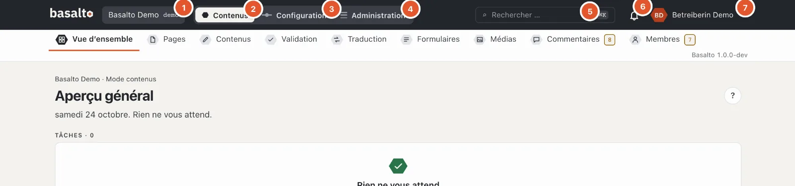
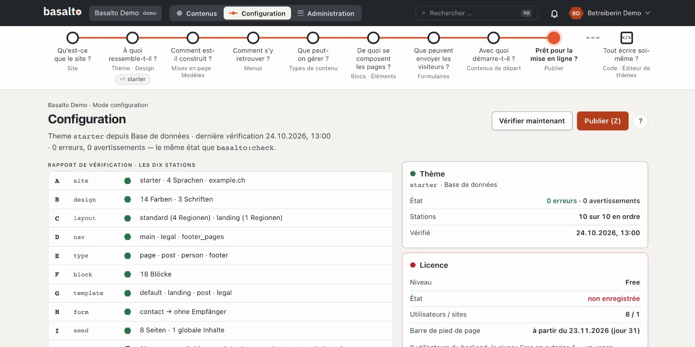
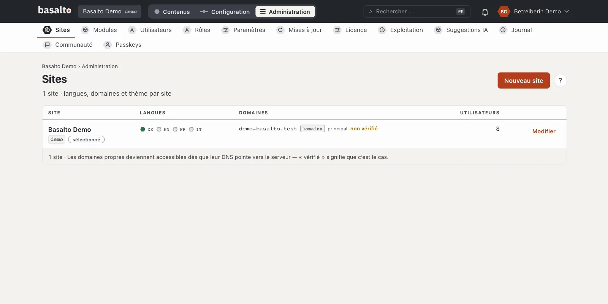
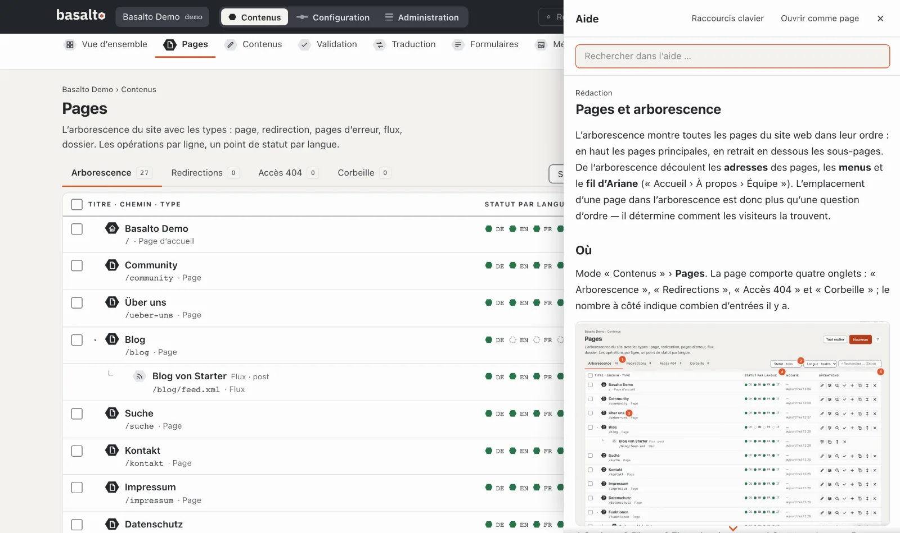

# Visite du backend

Le backend a trois **modes** : « Contenus » pour le travail rédactionnel quotidien, « Configuration » pour la forme et
la structure du site et « Administration » pour les sites, les utilisateurs et l’exploitation. Cette visite montre où
se trouve quoi et comment vous orienter.

## L’en-tête

L’en-tête est le même dans tous les modes :

1. **Le site** — si vous travaillez dans plusieurs sites, vous changez de site ici.
2. **Contenus** — pages, blocs, médias, traduction et validation.
3. **Configuration** — apparence, structure, menus et types de contenu du site.
4. **Administration** — sites, utilisateurs, rôles, paramètres, mises à jour et licence.
5. **Rechercher** — trouve des pages, des contenus, des médias et des utilisateurs ; plus rapide avec **⌘K** ou
   **Ctrl+K**.
6. **La cloche** — vos notifications, par exemple lorsqu’une version attend votre vérification.
7. **Votre nom** — le menu avec le profil, les paramètres, le mode sombre, l’aide et « Se déconnecter ».

Vous ne voyez que les modes dont votre rôle a besoin : qui ne fait qu’écrire voit « Contenus », mais ni
« Configuration » ni « Administration ».

## Mode « Contenus »

Sous l’en-tête figurent les **stations** du mode :

| Station | À quoi elle sert |
| --- | --- |
| **Aperçu général** | Ce qui vous attend : versions à vérifier, éléments refusés, traductions manquantes, avis. |
| **Pages** | L’arborescence du site web — créer, ordonner et modifier des pages. |
| **Contenus** | Les entrées sans place fixe dans l’arborescence, par exemple les articles de blog. |
| **Validation** | Tout ce qui doit être vérifié ou publié. |
| **Traduction** | Ce qui manque ou est obsolète dans d’autres langues. |
| **Formulaires** | Les formulaires et leurs envois. |
| **Médias** | Images et fichiers. |
| **Commentaires**, **Membres** | Uniquement si le module est activé pour le site. |

Un nombre couleur ambre à côté d’une station signifie : quelque chose vous y attend. Un nombre gris sert uniquement
d’information.

## Mode « Configuration »

La configuration vous guide à travers le site avec un **parcours** — neuf stations, chacune avec une question :
« Qu’est-ce que le site ? », « À quoi ressemble-t-il ? », « Comment est-il construit ? » jusqu’à « Prêt pour la mise
en ligne ? ». Un anneau foncé signifie « en ordre », un ✗ rouge « il manque quelque chose ici ». En dessous figure le
**rapport de vérification** avec dix vérifications. Pour l’instant, vous n’avez pas besoin de la configuration : le
thème Starter est entièrement configuré. Plus d’informations sous
[Configuration](../einrichtung/README.md).

## Mode « Administration »

Ici, vous gérez l’installation : **Sites** avec leurs langues et domaines, **Modules**, **Utilisateurs** et **Rôles**,
**Paramètres**, **Mises à jour**, **Licence**, **Exploitation** et le **Journal** de toutes les modifications. Plus
d’informations sous [Administration](../verwaltung/README.md).

## L’aide

- Le **« ? »** rond en haut à droite ouvre l’aide qui correspond à la page actuelle — sous forme de barre sur le bord
  droit. La page derrière reste utilisable.
- C’est plus rapide avec la touche **?** ou **F1**.
- En haut de la barre, vous cherchez dans toute l’aide ; **« Ouvrir comme page »** affiche l’aide en grand,
  **« Raccourcis clavier »** liste tous les raccourcis.

## En cas de problème

| Vous voyez | Cause | Solution |
| --- | --- | --- |
| « Configuration » ou « Administration » manque | Votre rôle n’autorise pas ce mode. | Demander à la personne qui administre votre site. |
| Un bouton est gris, avec une raison à côté | Votre rôle ne peut pas faire cette étape, par exemple « Votre rôle ne valide pas ». | Laisser l’étape à la personne responsable ou faire modifier le rôle. |
| La connexion demande un code à chaque fois | Votre compte n’a pas encore de passkey. | Dans l’aperçu général, choisir « Configurer une passkey ». |

## Pour continuer

- [La première page](erste-seite.md)
- [Aide pour la rédaction](../redaktion/index.md)
