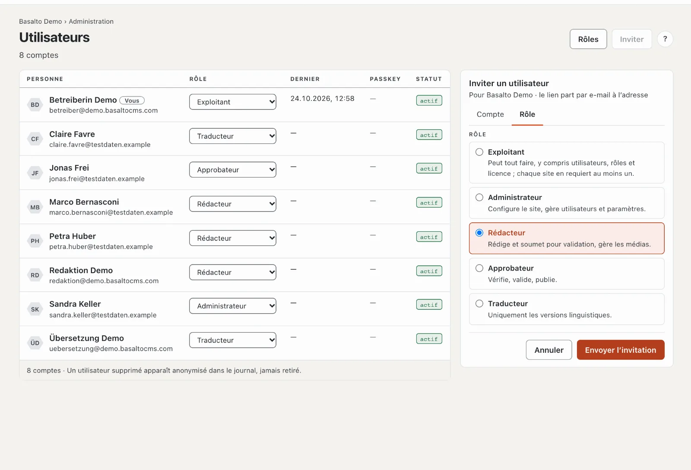

# Inviter l’équipe

Toute personne qui collabore reçoit son propre compte avec un **rôle** : il détermine ce que la personne peut faire
dans le site. Une invitation suffit — la personne se connecte avec le lien reçu par e-mail, sans aucun mot de passe.

## Inviter quelqu’un

1. Mode « Administration » › **Utilisateurs** › **« Inviter »**. À droite s’ouvre la fiche « Inviter un
   utilisateur ».
2. Onglet **« Compte »** : l’**adresse e-mail** de la personne.
3. Onglet **« Rôle »** : choisir le rôle — chacun avec une phrase sur ce qu’il permet.
4. **« Envoyer l’invitation »**.

Le lien de l’e-mail est valable 72 heures et ne peut être utilisé qu’une seule fois. Tant que la personne ne l’a pas
ouvert, elle figure dans la liste comme « invité » ; avec **« Renvoyer »**, vous envoyez un nouveau lien.

## Quel rôle ?

| Rôle | Peut | Convient à |
| --- | --- | --- |
| **Rédacteur** | écrire des pages et des contenus, gérer les médias, soumettre des versions | qui fournit les textes et les images |
| **Approbateur** | vérifier ce qui a été soumis, valider, publier, mettre hors ligne | qui répond du site web |
| **Traducteur** | traduire les contenus dans d’autres langues | traductrices et traducteurs |
| **Administrateur** | tout dans le site, y compris la configuration, les utilisateurs et les paramètres | qui gère le site |
| **Exploitant** | tout, y compris la licence ; chaque site en a au moins un | vous-même |

Vous n’attribuez que des rôles qui n’ont pas plus de droits que le vôtre. Vous modifiez le rôle plus tard dans la
liste, colonne **« Rôle »** — la modification s’applique immédiatement. Vous créez des rôles personnalisés aux droits
précisément ajustés sous **« Rôles »** ; plus d’informations sous [Rôles](../verwaltung/rollen.md).

## Bon à savoir

- **Quatre yeux :** si personne ne doit valider son propre travail, activez le principe des quatre yeux dans les
  paramètres. Chaque version a alors besoin d’une deuxième personne.
- **Une personne, plusieurs sites :** qui a déjà un compte dans un autre site reçoit avec l’invitation un rôle
  supplémentaire dans celui-ci — exactement un par site.
- **Quelqu’un quitte l’équipe :** **désactiver** le compte dans la fiche de la personne. Son travail et le journal
  sont conservés.

## En cas de problème

| Vous voyez | Cause | Solution |
| --- | --- | --- |
| L’invitation n’arrive pas | L’installation n’envoie pas d’e-mails, ou l’e-mail est dans les spams. | Vérifier le dossier des spams ; les paramètres de messagerie sont configurés par l’exploitation (voir l’[Installation du manuel d’exploitation](../betrieb/installation.md)). |
| « invité · expiré » | Les 72 heures sont écoulées. | **« Renvoyer »**. |
| Le rôle souhaité manque dans la liste | Il a plus de droits que votre propre rôle. | Faire envoyer l’invitation par une personne ayant un rôle plus élevé. |

## Pour continuer

- [Pour aller plus loin](naechste-schritte.md)
- [Utilisateurs](../verwaltung/benutzer.md)
