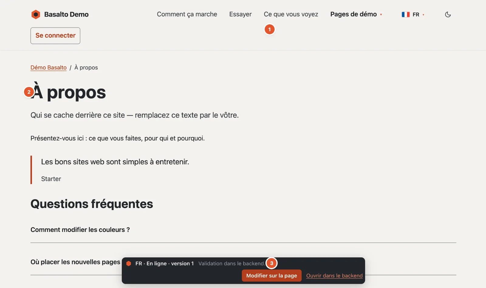
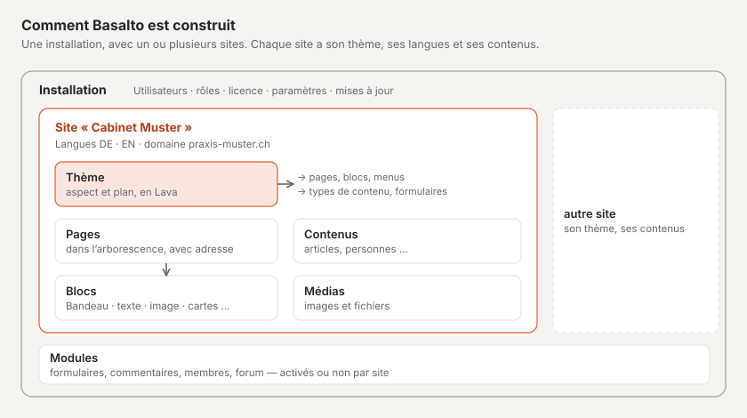

# Qu’est-ce que Basalto ?

Basalto est un système de gestion de contenu : vous gérez les contenus de votre site web dans le navigateur, et Basalto
les diffuse rapidement, de manière accessible et en plusieurs langues. La présentation et le plan de construction du
site web se trouvent dans un **Thème** ; la rédaction travaille uniquement avec les contenus et n’a besoin d’aucune
connaissance technique.

1. **Le menu** — il naît de l’arborescence : une nouvelle page y apparaît dès qu’elle est publiée.
2. **Le contenu** — composé de blocs, ici un titre, un texte, une citation et des questions avec leurs réponses.
3. **La barre** — visible uniquement pour les personnes connectées : langue, état et version de la page, ainsi que
   **« Modifier sur la page »** et **« Ouvrir dans le backend »**. Les visiteurs ne la voient jamais.

## Site web et backend

Chaque site Basalto a deux faces :

- **Le site web** — ce que voient vos visiteuses et visiteurs. Il n’affiche toujours que des contenus **publiés**.
- **Le backend** sous `/admin` — c’est là que vous créez des pages, écrivez, téléversez des images, traduisez et
  validez. Chaque modification naît d’abord comme brouillon et ne passe en ligne qu’après la validation.

## Comment Basalto est construit

- Une **installation**, c’est Basalto sur un serveur. Elle peut faire fonctionner un ou plusieurs **sites**, chacun
  avec sa propre adresse, ses propres langues et sa propre apparence.
- Le **thème** d’un site détermine l’apparence et le plan de construction : quels blocs existent, quels menus, quels
  types de contenu. Basalto fournit le thème **Starter** ; d’autres sont disponibles sur le Marketplace.
- Les **modules** complètent un site avec des formulaires, des commentaires, des membres ou un forum. Vous les activez
  ou les désactivez par site.

## Ce qui distingue Basalto

| Caractéristique | Ce que cela signifie pour vous |
| --- | --- |
| **Versions et validation** | Rien ne passe en ligne par erreur. Chaque modification est une version ; les anciennes peuvent être restaurées. |
| **Multilingue dès le départ** | Les traductions naissent de la langue par défaut ; Basalto montre ce qui manque ou est obsolète. |
| **Blocs avec aperçu** | Vous construisez les pages à partir de blocs prêts à l’emploi et voyez la page pendant que vous écrivez, dans l’aperçu en direct. |
| **Connexion sans mot de passe** | Avec un code par e-mail ou une passkey — aucun mot de passe que quelqu’un pourrait oublier ou deviner. |
| **Rapide et accessible** | Le site web se passe de JavaScript lourd ; le backend vérifie les contrastes de couleur et exige des textes alternatifs. |
| **Rôles** | Rédacteur, Approbateur, Traducteur, Administrateur et Exploitant — chacun ne voit que ce dont il a besoin. |

## Pour qui

- **Rédaction :** vous gérez les textes et les images sans vous soucier de la présentation ni de la technique.
- **Agences et webdesign :** vous configurez des sites, adaptez des thèmes et les remettez à la rédaction.
- **Développeuses et développeurs :** vous écrivez des thèmes dans le langage Lava et étendez Basalto avec des modules.
- **Exploitation :** vous installez, sauvegardez et mettez à jour Basalto sur votre propre serveur ou chez un
  hébergeur.

## Pour continuer

- [Les termes essentiels](begriffe.md)
- [Installer Basalto](installieren.md)
