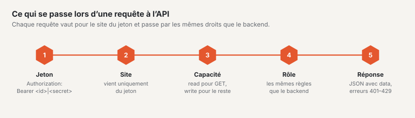

# API REST

Basalto dispose d’une API REST pour les contenus avec leur validation, les médias et les menus. Elle parle JSON, s’applique toujours à exactement un
site et vérifie les mêmes droits que le backend. Adresse de base : `https://<ihre-site>/api/v1`.



## Créer un jeton

1. Dans le backend, ouvrez votre profil (menu sous votre nom) › onglet **« Jetons API »**.
2. Choisissez **Nom**, **Site** et **Capacités** : `read` pour lire (`GET`), `write` pour écrire (`POST`, `PATCH`,
   `PUT`, `DELETE`). En option, une **Date d’expiration** — elle vaut jusqu’à la fin de la journée dans le fuseau horaire de votre profil.
3. Le jeton s’affiche **une seule fois**. Copiez-le et conservez-le en lieu sûr ; Basalto n’enregistre qu’une
   somme de contrôle.

## Comment l’API décide

- **Site :** chaque jeton appartient à exactement un site. Le site d’une requête provient uniquement du jeton — il n’existe aucun
  paramètre pour cela. Les contenus d’autres sites n’existent pas pour le jeton (404).
- **Droits :** d’abord la capacité du jeton (`read`, `write`), puis le **rôle** de la personne dans le site — les mêmes
  règles que dans le backend : la rédaction crée et soumet, la validation valide et publie, le
  principe des quatre yeux s’applique ici aussi.
- Un jeton est **invalide** s’il a été révoqué ou s’il a expiré (401), si la personne n’appartient plus au site
  ou si son compte est désactivé (403). Une session dans le backend ne remplace pas un jeton (401).
- **Limite :** 120 requêtes par minute et par jeton ; les en-têtes `X-RateLimit-*` indiquent l’état, au-delà la réponse est 429 avec
  `Retry-After`. La limite se trouve dans la configuration sous `basalto.api.per_minute`.

```bash
export TOKEN='<id>|<geheim>'          # depuis le profil
export B=https://ihre-site.ch/api/v1
H=(-s -H "Authorization: Bearer $TOKEN" -H 'Accept: application/json')
```

## Réponses et erreurs

- **Succès :** JSON avec `data` ; les listes en plus avec `links` (`first`, `last`, `prev`, `next`) et `meta`
  (`current_page`, `per_page`, `total`, `last_page`). Heures en ISO 8601 (UTC). La suppression répond `204` sans contenu.
- **Erreurs :** `401`, `403` et `404` avec `{"message": "…"}` ; `422` avec `{"message": "…", "errors": {"feld": ["…"]}}`.
  Les infractions à la validation (transition, principe des quatre yeux, langues obligatoires, slug, texte alternatif) figurent sous
  `errors.workflow`.

```bash
curl -s -o /dev/null -w "%{http_code}\n" -H 'Accept: application/json' $B/entries        # 401 sans jeton
```

## Contenus

| Méthode et chemin | Capacité · droit | Objet |
|---|---|---|
| `GET /entries` | read · appartient au site | Liste, les plus récents d’abord ; filtres `type`, `status`, `locale`, `q` (titre), `updated_since` (ISO 8601, `+` sous la forme `%2B` ou `Z`), `per_page` (1–100, par défaut 25), `page` |
| `GET /entries/{id}` | read · appartient au site | un contenu avec sa version la plus récente et sa version publiée par langue ; avec `?locale=xx`, en plus `data.locale` : la version que voient les visiteurs (`published`, selon le repli du site, avec `resolved`, `fallback`, `url`), et l’état le plus récent de cette langue (`latest`) |
| `POST /entries` | write · modifier les contenus | nouveau contenu d’un type du thème (`type`, `title`, en option `slug`, `intro`, `content`, `fields`) ; la première version est un brouillon dans la langue par défaut. Les pages sont créées dans l’arborescence du backend |
| `PATCH /entries/{id}` | write · modifier ou traduire | modifier dans `locale` (sinon la langue par défaut) ; ce qui manque provient de la version la plus récente. Si celle-ci est un brouillon, il est poursuivi — sinon un nouveau brouillon est créé, comme lors de l’enregistrement automatique dans l’éditeur |
| `POST /entries/{id}/workflow/{schritt}` | write · selon l’étape | `submit`, `withdraw` (modifier) ; `approve`, `reject` avec `comment` (valider) ; `schedule` avec `at`, `unschedule`, `publish`, `unpublish` (publier) ; chaque fois dans `locale` |
| `DELETE /entries/{id}` | write · modifier | dans la corbeille (restauration dans le backend) |

```bash
curl "${H[@]}" "$B/entries?per_page=2"
# {"data":[{"id":8,"type":"post",…},{"id":7,"type":"person",…}],
#  "links":{…,"next":"https://ihre-site.ch/api/v1/entries?per_page=2&page=2"},
#  "meta":{"current_page":1,"per_page":2,"total":6,"last_page":3,…}}

curl "${H[@]}" "$B/entries/2?locale=en"
# data.locale: requested "en", resolved "de", fallback true, published.title "Über uns"

curl "${H[@]}" -X POST -H 'Content-Type: application/json' \
  -d '{"type":"post","title":"Aus der API","fields":{"category":"Neuigkeiten"}}' $B/entries      # 201

curl "${H[@]}" -X POST -H 'Content-Type: application/json' -d '{"locale":"de"}' $B/entries/309/workflow/submit

curl "${H[@]}" -X DELETE $B/entries/309                                                      # 204
```

## Médias

| Méthode et chemin | Capacité · droit | Objet |
|---|---|---|
| `GET /media` | read · appartient au site | Liste ; `q` (nom, titre, auteur), `type` (`image`, `document`), `folder_id`, `per_page` |
| `GET /media/{id}` | read · appartient au site | fichier, titre, auteur, texte alternatif par langue, dimensions, point focal, état des variantes d’images, `file_url` |
| `GET /media/{id}/file` | read · appartient au site | le fichier original |
| `POST /media` | write · modifier les contenus ou gérer les médias | téléverser (multipart `file`, en option `folder_id`) — les mêmes contrôles que dans le backend : type et taille, espace de stockage, SVG sans script ; les variantes d’images sont ensuite générées en arrière-plan |
| `PATCH /media/{id}` | write · comme pour téléverser | ne modifier que ce qui est indiqué : `title`, `credit`, `alt` par langue du site |
| `DELETE /media/{id}` | write · gérer les médias | dans la corbeille |

```bash
curl "${H[@]}" -F "file=@team.jpg;type=image/jpeg" $B/media
# 201 {"data":{"id":4,"name":"team.jpg","width":1600,"height":1000,"variants_state":"pending","alt":{"de":null,"en":null},…}}

curl "${H[@]}" -X PATCH -H 'Content-Type: application/json' -d '{"alt":{"de":"Das Team vor dem Büro"}}' $B/media/4
```

## Menus

| Méthode et chemin | Capacité · droit | Objet |
|---|---|---|
| `GET /navigation` | read · appartient au site | les menus du thème : `handle`, `label`, `source` (`pages`, `type`, `db`, `theme`), `editable`, `depth` |
| `GET /navigation/{menü}` | read · appartient au site | dans `locale` : `items` comme sur le site web (`label`, `href`, `new_window`, `entry_id`, `children`), `raw` les entrées libres enregistrées |
| `POST /navigation/{menü}/items` | write · modifier les contenus | entrée libre dans un menu tenu librement : `kind` (`entry` avec `entry_id` ou `url` avec `url`), `label` par langue, `parent_id`, `visible`, `new_window` |
| `PUT /navigation/items/{id}` | write · modifier les contenus | modifier, avec tous les champs comme lors de la création |
| `DELETE /navigation/items/{id}` | write · modifier les contenus | supprimer ; les sous-entrées remontent |

```bash
curl "${H[@]}" -X POST -H 'Content-Type: application/json' \
  -d '{"kind":"url","url":"https://example.com","label":{"de":"Partner"},"new_window":true}' $B/navigation/footer/items   # 201
```

## Formulaires sans changement de page

Les pages comportant un formulaire (``) reçoivent un petit script intégré. Il envoie le formulaire avec
`fetch` et `Accept: application/json` :

- **Succès :** `200 {"message": "<Danke-Text>", "redirect": null}` — le texte de remerciement remplace le formulaire dans une zone
  avec `role="status"`. Si le formulaire a une redirection (`redirect: -> /danke`), le navigateur s’y rend.
- **Erreur :** `422` avec `errors` — une liste en haut du formulaire (`role="alert"`), le message au champ avec
  `aria-invalid` et `aria-describedby`, le focus sur le premier champ erroné.
- Le **spam** (champ piège, contrôle du temps, cinq envois par minute et par adresse) reçoit la même réponse qu’un humain et
  est seulement compté.
- **Sans script**, le formulaire est envoyé comme d’habitude avec redirection.
- **Désactiver** dans le thème : `data-basalto-ajax="false"` sur un élément qui englobe le formulaire.

## Ce que l’API ne sait pas faire

- Créer ou déplacer des pages dans l’arborescence, les dossiers de la médiathèque et la restauration depuis la corbeille n’existent
  que dans le backend.
- Les adresses des variantes d’images mènent au backend et exigent une connexion ; pour l’API, il y a `file_url`, le
  fichier original.
- Les modules ne peuvent pas encore déclarer leurs propres points de terminaison sous `api/v1`.

`php artisan route:list --path=api` affiche toutes les routes de l’installation.

## Pour continuer

- [Modules et plugins](erweiterungen.md)
- [Rôles](../verwaltung/rollen.md)
- [Validation et publication](../redaktion/freigabe.md)
