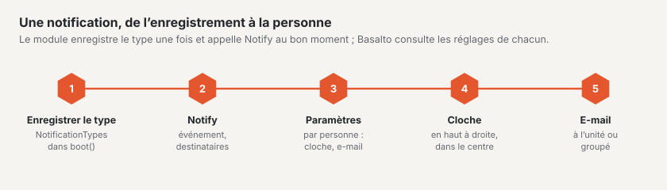

# Notifications

Basalto dispose d’une **cloche** en haut à droite du backend, d’un **centre** regroupant toutes les
notifications et, dans le profil, d’un onglet **« Notifications »** dans lequel chaque personne active et désactive, par sorte, la cloche et l’e-mail. Le noyau et les modules envoient par la même interface — un plugin n’a besoin pour cela que de deux étapes :
déclarer la sorte et appeler `Notify` au bon moment.



## 1. Déclarer la sorte

Dans le `boot()` du fournisseur de services, via le registre `Basalto\Core\Notifications\NotificationTypes` :

```php
use Basalto\Core\Access\Level;
use Basalto\Core\Notifications\NotificationTypes;

app(NotificationTypes::class)->type(
    'shop.order',                       // clé : minuscules avec point, préfixe = module
    'Neue Bestellung im Shop',          // libellé dans le profil (texte allemand = clé de la traduction)
    'Shop',                             // groupe dans le profil
    'Auf Rechnung oder mit Karte.',     // description sous le libellé (facultative)
    area: 'shop',                       // qui peut la recevoir et la régler (domaine, voir Rôles et droits)
    level: Level::Edit,                 // … à partir de ce niveau (par défaut : voir)
    mail: true,                         // valeur par défaut de l’e-mail (cloche par défaut : activée)
    icon: 'license',                    // symbole dans l’hexagone (noms comme dans le menu)
);
```

| Paramètre | Signification |
| --- | --- |
| `area` | Domaine issu de `Areas` — la sorte n’apparaît que chez les personnes qui le voient sur l’un de leurs sites. Sans domaine, elle est **personnelle** (concerne son propre compte ou ses propres contenus) et visible pour tous. |
| `scope` | `NotificationType::BACKEND` (par défaut) ou `NotificationType::EXTRANET` — le domaine s’applique alors dans l’équipe de l’éditeur, et la notification apparaît dans la cloche de l’extranet. |
| `bell`, `mail` | Valeurs par défaut, tant que la personne ne règle rien. |
| `mailRequired` | L’e-mail arrive toujours (facture, résiliation) ; seule la cloche peut être désactivée. |
| `mailAvailable: false` | L’e-mail se règle ailleurs (destinataires d’un formulaire) — dans le profil, un tiret remplace l’interrupteur. |
| `when` | `Closure(): bool` — visible uniquement tant que la condition est remplie (p. ex. uniquement en exploitation SaaS). |

Les textes (libellé, groupe, description) appartiennent, comme tous les textes d’un module, à `lang/{en,it,fr}.json`.

## 2. Notifier

```php
use Basalto\Core\Notifications\Notify;

Notify::make('shop.order')
    ->title('Neue Bestellung :number', ['number' => $order->number])
    ->body('Von :name über :amount.', ['name' => $order->name, 'amount' => $amount])
    ->url(route('basalto.shop.orders.show', $order), 'Bestellung öffnen')
    ->toArea($site)              // toutes les personnes du site ayant le domaine de la sorte
    ->except($request->user())   // qui l’a déclenchée n’a pas besoin de message
    ->send();                    // nombre de destinataires
```

| Méthode | Effet |
| --- | --- |
| `make($key)` | Sorte issue du registre — une clé inconnue lève une exception (les fautes de frappe se remarquent dans les tests). |
| `title($text, $params)`, `body($text, $params)` | Texte allemand avec des espaces réservés ; la traduction dans la langue de la personne a lieu à l’affichage ou à l’envoi. |
| `url($url, $action)` | Cible d’un clic et libellé du bouton dans l’e-mail. Relative (`/admin/…`) si la requête s’exécute sur un autre hôte. |
| `site($site)` | Le site auquel elle appartient — à l’ouverture, le backend bascule vers ce site. `toArea()` le définit lui-même. |
| `to($users)`, `toArea($site, $area, $level)`, `toExtranet($area, $level)` | Destinataires : des personnes individuelles, toutes celles ayant un domaine sur un site ou l’équipe de l’éditeur. Jamais les personnes désactivées. |
| `except($user)` | Exclure une personne. |
| `collapse($key)`, `titleMany($text)` | Regrouper les non lues ayant la même clé : dix commandes deviennent une ligne « :count neue Bestellungen ». |

Les canaux qui s’appliquent sont décidés par `NotificationSettings` selon les réglages de la personne : interrupteur principal, interrupteurs
pour la cloche et l’e-mail, choix par sorte. La cloche écrit immédiatement, l’e-mail passe par la file d’attente. Le message ne contient
que des données finales (pas de modèles) — la file d’attente ne connaît pas de mandant.

## E-mail propre, e-mails existants

- Un e-mail propre (pièce jointe, structure propre) : hériter de `Basalto\Core\Notifications\BasaltoNotification` et surcharger
  `toMail()`.
- Afficher en plus dans la cloche un e-mail obligatoire existant : intégrer le trait `AlsoInBell` et fournir `bellKind()` ainsi que
  `bell()` (titre, texte, adresse) — c’est ainsi que procèdent les factures, la période d’essai, la résiliation, le domaine et l’export du SaaS.

## Ce que le noyau signale lui-même

| Clé | Quand | À qui |
| --- | --- | --- |
| `content.submitted` | version soumise | validation du site |
| `content.rejected`, `content.approved`, `content.published` | refusée (avec commentaire), validée, publiée | qui l’a soumise |
| `forms.submitted` | nouvel envoi (regroupé par formulaire) | domaine « Formulaires » |
| `security.access` | passkey ajoutée ou supprimée, jeton API créé | la personne elle-même |
| `support.access` | le support de l’éditeur ouvre le site | domaine « Paramètres » |
| `operations.backup_failed` | sauvegarde échouée (pas en exploitation SaaS) | domaine « Exploitation » |
| `account.*` | facture, période d’essai, résiliation, domaine en ligne, export (e-mails obligatoires, SaaS uniquement) | propriété et facturation |
| `extranet.domains`, `extranet.cancellations` | domaine supplémentaire demandé, résiliation d’un compte | équipe dans l’extranet |

Les modules fournis déclarent `comments.posted`, `members.pending`, `licensing.orders`, `marketplace.review` et
`marketplace.reported`.

## Stockage et protection des données

La cloche écrit dans la table `notifications` de Laravel, complétée par `kind`, `scope` et `site_id`. Le
droit d’accès dans le profil liste les notifications d’une personne, la suppression d’une personne les supprime. Lors de l’export d’un
site, elles ne sont pas incluses — elles appartiennent aux personnes, pas au site.

## Pour continuer

- [Modules et plugins](erweiterungen.md)
- [Aide pour la rédaction](../redaktion/index.md#notifications)
