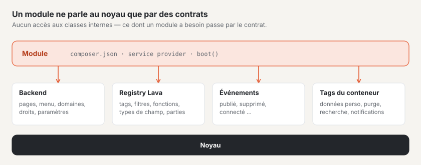

# Modules et plugins

Basalto dispose d’**une seule** interface d’extension pour les deux : les modules sont fournis avec Basalto (`modules/*`,
`basalto/module-*`), les plugins proviennent de tiers — techniquement, ils sont construits de la même manière. Une
extension ne s’adresse au noyau que par des contrats publics : l’interface du backend, le registre Lava,
les événements de domaine et les tags du conteneur. Ce dont un module a besoin, le contrat le reçoit — aucun accès aux classes internes.



Deux exemples sous `modules/` :

- `modules/example` — le plus petit module : une page du backend, une entrée de menu, une
  migration et des extensions Lava.
- `modules/comments` — un vrai module : balise Lava, route du frontend, modération avec compteur dans le
  menu, protection des données et purge.

## Structure d’un paquet

```text
modules/example/
├── composer.json                 paquet, fournisseur de services, manifeste
├── src/ExampleServiceProvider.php
├── src/Http/Controllers/…
├── database/migrations/…
├── lang/de/backend.php, lang/en/backend.php, lang/en.json …
└── resources/js/pages/Hello.vue  page Inertia « example::Hello »
```

### `composer.json` avec manifeste

```json
{
    "name": "basalto/module-example",
    "type": "library",
    "require": { "php": "^8.4", "basalto/core": "*" },
    "autoload": { "psr-4": { "Basalto\\Modules\\Example\\": "src/" } },
    "extra": {
        "laravel": {
            "providers": ["Basalto\\Modules\\Example\\ExampleServiceProvider"]
        },
        "basalto": {
            "module": "example",
            "name": "Beispiel",
            "api": 1,
            "lava": "example",
            "switchable": true
        }
    }
}
```

| Clé dans `extra.basalto` | Signification |
| --- | --- |
| `module` | Handle du module — minuscules, chiffres, `-` et `_` ; en même temps préfixe dans Lava et espace de noms des pages Inertia |
| `name` | Nom affiché |
| `api` | Version de l’interface d’extension, aujourd’hui `1` |
| `lava` | Espace de noms dans Lava (identique au handle) |
| `switchable` | si le module peut être activé et désactivé par site |
| `requires` | Handles d’autres modules dont il a besoin (p. ex. le Marketplace `["licensing"]`) — indication pour les humains et pour le Marketplace ; le noyau ne l’impose pas aujourd’hui |

Laravel trouve le fournisseur de services par Package Discovery (`extra.laravel.providers`). Le `composer.json` du
dossier principal de l’installation intègre tous les dossiers sous `modules/*` comme paquets locaux (`path`).

`Backend::module()` lit le manifeste et l’enregistre (`Backend::modules()`). Le fait qu’un module puisse être activé ou désactivé est déterminé par
le paramètre `switchable` lors de l’appel — l’entrée dans le manifeste n’est aujourd’hui qu’une indication (pour le Marketplace).

## Fournisseur de services

Tout se passe dans `boot()`. Le module d’exemple au complet :

```php
final class ExampleServiceProvider extends ServiceProvider
{
    public function boot(): void
    {
        $root = dirname(__DIR__);
        $this->loadTranslationsFrom($root.'/lang', 'example');
        $this->loadJsonTranslationsFrom($root.'/lang');
        $this->loadMigrationsFrom($root.'/database/migrations');

        $backend = $this->app->make(Backend::class);
        $backend->pages('example', $root.'/resources/js/pages');
        $backend->module('example', 'example::backend.title', composerJson: $root.'/composer.json');
        $backend->menu('example::backend.title', 'basalto.example', 50, Backend::MODE_CONTENT, module: 'example', icon: 'module');
        $backend->routes(static function (): void {
            Route::get('example', HelloController::class)->name('example');
        });

        $this->app->extend(Registry::class, static function (Registry $registry): Registry {
            $registry->module('example')
                ->function('example.greeting', static fn (mixed $name): string => 'Grüezi '.(string) $name)
                ->tag('example.cart', static function (array $args, array $named): string { /* … */ })
                ->fieldType('example.price', ['input' => 'number', 'step' => 0.05, 'currency' => 'CHF']);

            return $registry;
        });
    }
}
```

## Interface du backend : `Basalto\Core\Backend\Backend`

Un singleton dans le conteneur (`$this->app->make(Backend::class)`).

| Méthode | Signature | Objet |
| --- | --- | --- |
| `module` | `module(string $handle, string $label, bool $switchable = true, ?string $composerJson = null, bool $enabledByDefault = true): self` | Déclarer le module ; `$label` est une clé de traduction ; `$composerJson` fournit le manifeste ; `$enabledByDefault` à faux signifie désactivé d’usine |
| `menu` | `menu(string $label, string $route, int $order = 100, string $mode = self::MODE_CONTENT, ?string $module = null, ?string $icon = null): self` | Entrée de menu ; `$route` est un nom de route, `$mode` l’un de `MODE_CONTENT` (Contenus), `MODE_SETUP` (Configuration), `MODE_ADMIN` (Administration). Avec `$module`, l’entrée disparaît lorsque le module est désactivé pour le site |
| `count` | `count(string $route, Closure $count): self` | Compteur sur l’entrée de menu de cette route, par site : `fn (Site $site): int` |
| `pages` | `pages(string $namespace, string $directory): self` | Répertoire de pages Vue sous un espace de noms |
| `routes` | `routes(Closure $routes): void` | Routes sous le chemin du backend (`basalto.backend.path`, par défaut `admin`) avec le middleware du backend (`web`, `auth`, compte actif, choix du site, Inertia) et le préfixe de nom `basalto.` |
| `moduleEnabled` | `moduleEnabled(string $handle, Site $site): bool` | le module est-il activé pour ce site ? |
| `modules`, `menuItems`, `menuByMode`, `counts`, `pageNamespaces`, `path`, `middleware`, `vite` | — | Lecture pour le noyau |

Un exemple de `count()` tiré du module de commentaires — le nombre de commentaires en attente dans le menu :

```php
$backend->count('basalto.comments.index', static fn (Site $site): int => Comment::query()->withoutGlobalScopes()
    ->where('site_id', $site->id)->where('status', CommentStatus::Pending->value)->count());
```

### Routes

`routes()` ajoute le chemin du backend et le préfixe de nom : `Route::get('example', …)->name('example')` devient
`/admin/example` avec le nom `basalto.example` — en accord avec l’entrée de menu ci-dessus. Les routes hors du backend (par exemple
l’envoi de commentaires depuis le frontend), le module les crée lui-même :

```php
Route::post('comments/{entry}', CommentSubmissionController::class)->whereNumber('entry')
    ->middleware(['web', 'basalto.site'])->withoutMiddleware(ValidateCsrfToken::class)->name('basalto.comments.submit');
```

### Domaines et droits

Chaque route du backend appartient à un **domaine** avec un groupe (Contenus, Configuration, Administration). Le module déclare ses
domaines dans `boot()` et attribue les routes par préfixe ; certaines routes peuvent exiger un niveau plus élevé :

```php
app(Areas::class)->register('members', 'Mitglieder', Areas::CONTENT, 'members')
    ->map('basalto.members.', 'members')
    ->route('basalto.members.settings', 'members', Level::All);
```

Sans indication propre, GET exige « voir », DELETE « supprimer » et tout le reste « modifier ». Le middleware
`GuardAreaAccess` vérifie chaque requête, le menu masque les entrées sans droit. Les routes sans attribution exigent
« Paramètres · tout », et le test `AreaCoverageTest` les signale. Dans le code, on interroge
`Gate::allows('area', [$site, 'members', Level::Delete])` ou `Access::allows()` ; les langues sont vérifiées par
`Access::authorizeLocale()`. « Emprunter » le droit d’une autre capacité (par exemple `update` du site) n’est plus
nécessaire. Comment les exploitants règlent les rôles : [Rôles et droits](../betrieb/rollen.md).

### Pages Inertia avec espace de noms

Un contrôleur rend `Inertia::render('example::Hello', [...])` ; la partie avant `::` est l’espace de noms issu de
`pages()`, la partie après est le chemin de la page sans `.vue`. Le noyau utilise `core::…`.

```php
final class HelloController
{
    public function __invoke(Request $request): Response
    {
        $greeting = (new Renderer(app(Registry::class)))->render('{{ example.greeting(name) }}', ['name' => $request->user()->name ?? 'Gast']);

        return Inertia::render('example::Hello', ['greeting' => $greeting]);
    }
}
```

Le noyau intègre les pages de tous les modules fournis dans son bundle : `packages/core/resources/js/backend.ts` cherche
`modules/<namensraum>/resources/js/pages/<Seite>.vue`. L’espace de noms doit donc correspondre au nom du dossier sous `modules/`.
Les plugins de tiers n’apportent donc pas de pages Vue propres : ils décrivent leur administration en PHP et le noyau
la dessine — voir [Pages du backend par description](#pages-du-backend-par-description).

### Activable par site

Activer et désactiver les modules activables : Administration › Sites › Modifier le site › onglet « Modules ». L’enregistrement a lieu dans
`sites.settings.modules.<handle>` ; sans entrée, la valeur par défaut du module s’applique — généralement activé, avec `module(…, enabledByDefault: false)` désactivé d’usine (ainsi la vente de licences et le Marketplace, qui ne tournent que sur basaltocms.com). Les entrées de menu avec `module:`
disparaissent d’elles-mêmes. **Tout le reste, le module le vérifie lui-même** avec `moduleEnabled()` — c’est ce que fait le
module de commentaires dans le rendu de la balise, dans l’envoi et dans la modération :

```php
abort_if($site === null || ! $this->backend->moduleEnabled('comments', $site), 404);
```

Une fois le module désactivé, les données restent enregistrées.

## Pages du backend par description

Un plugin construit son administration sans apporter de JavaScript : le contrôleur renvoie une description de la page
(`Basalto\Core\Backend\Schema\AdminPage`), et le noyau la dessine avec ses propres composants — chiffres clés,
avis, texte, listes, formulaires, boutons. Chaque page ressemble ainsi au reste du backend, fonctionne au clavier et
avec un lecteur d’écran et reste valable lors d’une mise à jour du noyau. Validation et enregistrement restent du code
Laravel ordinaire.

```php
use Basalto\Core\Backend\Schema\{Action, AdminPage, Column, Form, FormField, Row, Stat, Table};

public function index(Request $request): AdminPage
{
    $q = trim((string) $request->query('q', ''));
    $notes = Note::query()->when($q !== '', fn ($query) => $query->whereLike('text', '%'.$q.'%'))
        ->orderByDesc('id')->paginate(20)->withQueryString();

    return AdminPage::make(__('Notizen'))
        ->crumb(__('Beispiel › Notizen'))
        ->stats([Stat::make(__('Notizen'), Note::query()->count())])
        ->form(Form::make(route('basalto.example.notes.store'))->title(__('Neue Notiz'))->submit(__('Anlegen'))
            ->fields([FormField::textarea('text', __('Text'))->required()->rows(3)]))
        ->table(Table::make('notizen')
            ->columns([Column::text('text', __('Text')), Column::date('created', __('Angelegt'))])
            ->rows($notes->items(), fn (Note $note): Row => Row::make($note->id)
                ->cell('text', $note->text)
                ->cell('created', $this->dates->dateTime($note->created_at))
                ->url(route('basalto.example.notes.edit', ['note' => $note->id]))
                ->action(Action::delete(__('Löschen'), route('basalto.example.notes.destroy', ['note' => $note->id]))
                    ->confirm(__('Diese Notiz löschen?'))->variant('danger')))
            ->search($q, __('Notizen durchsuchen'))
            ->paginate($notes)
            ->bulk(Action::bulk('delete', __('Löschen'), route('basalto.example.notes.bulk'))->confirm(__('Die gewählten Notizen löschen?')))
            ->empty(__('Noch keine Notizen'), __('Legen Sie oben die erste an.')));
}
```

L’exemple complet avec modification, suppression et action groupée se trouve dans le module d’exemple
(`modules/example/src/Http/Controllers/NotesController.php`, page `/admin/example/notizen`).

| Composant | Appel | Rôle |
| --- | --- | --- |
| `AdminPage` | `make($titre)`, `crumb()`, `lead()`, `action()`, `stats()`, `notice($texte, $ton, $titre)`, `text($texte, $titre)`, `table()`, `form()` | La page ; les sections apparaissent dans l’ordre des appels |
| `Stat` | `make($libellé, $valeur)`, `hint()`, `tone()` | Chiffre clé en haut de la page ; ton `neutral`, `success`, `warning`, `danger` |
| `Table` | `make($clé)`, `title()`, `columns()`, `rows($éléments, fn)`, `search($valeur, $indication, $paramètre)`, `filter()`, `paginate($paginator)`, `bulk(...)`, `empty($titre, $texte)` | Liste avec recherche, filtres, pages et actions groupées |
| `Column` | `text`, `mono`, `number`, `money`, `date`, `badge`, `link` | Colonne ; `number` et `money` sont alignés à droite |
| `Row` | `make($id)`, `cell()`, `badge($clé, $texte, $ton)`, `link($clé, $texte, $url)`, `url()`, `action()` | Ligne ; avec `url()`, la première colonne devient un lien vers l’enregistrement |
| `Filter` | `make($paramètre, $libellé, $valeur)`, `option($valeur, $libellé, $nombre)` | Choix au-dessus de la liste, comme paramètre de requête dans l’adresse |
| `Form` | `make($url, $méthode)`, `title()`, `fields()`, `values()`, `autosave()`, `submit()` | Formulaire ; avec `autosave()`, il s’enregistre seul après chaque pause, sinon avec le bouton |
| `FormField` | `text`, `email`, `url`, `number`, `password`, `textarea`, `select($nom, $libellé, $choix)`, `checkbox`, `date`, `time`, `datetime`, `color`, `richtext`, `file($nom, $libellé, $accept)` ; en plus `help()`, `placeholder()`, `required()`, `min()`, `max()`, `step()`, `rows()`, `mono()`, `onLeave()`, `half()` | Champ ; avec l’enregistrement automatique, `password` n’est enregistré qu’en quittant le champ |
| `Action` | `link`, `post`, `put`, `delete`, `bulk($clé, $libellé, $url)` ; en plus `confirm($question)`, `variant()`, `with($données)` | Bouton ; avec `confirm()`, le noyau demande d’abord |

Ce qui compte :

- **Transmettre des textes traduits.** La description contient des textes finis ; `__()` avec les clés du dossier
  `lang/` du plugin (DE, EN, FR, IT).
- **Erreurs au champ :** le contrôleur valide comme d’habitude (`$request->validate()`) ; le noyau affiche les messages
  au champ concerné. Les confirmations reviennent par `back()->with('status', …)`.
- **Les actions groupées** envoient `action` (la clé de `Action::bulk`) et `ids` à l’adresse indiquée — le contrôleur
  vérifie les deux et indique combien d’entrées sont concernées.
- **L’enregistrement automatique** (`Form::autosave()`) est prévu pour les enregistrements existants : après une pause,
  le noyau envoie les champs avec la méthode du formulaire (le plus souvent `put`) et indique au champ que c’est
  enregistré. Pour créer, utilisez un formulaire avec bouton.
- **Les droits** s’appliquent comme pour toute route ([Domaines et droits](#domaines-et-droits)) ; le contrôleur omet
  les boutons qu’un utilisateur n’a pas le droit d’utiliser.

## Pages montées : une page appartient au module

Un module peut reprendre une page de l’arborescence avec toutes les adresses en dessous — c’est ainsi que fonctionnent
le forum et le plugin « Événements ». La rédaction crée la page et choisit le module sous « Monter un module » dans
l’onglet « Experts » ; titre, fil d’Ariane, métadonnées et mise en page viennent toujours de la page et du thème.

```php
use Basalto\Core\Community\{MountHandler, MountRequest, MountResult, Mounts};

// boot() — handle, label in the choice, handler, module
app(Mounts::class)->register('events', 'Veranstaltungen', EventsMount::class, 'events');

final class EventsMount implements MountHandler
{
    public function handle(MountRequest $request): MountResult
    {
        return match ($request->segments) {
            [] => MountResult::page('<section>…</section>', head: '<link rel="alternate" …>'),
            ['kalender.ics'] => MountResult::raw($ics, 'text/calendar; charset=utf-8'),
            default => MountResult::notFound(),
        };
    }
}
```

`MountRequest` indique le site, la langue, la page, son adresse (`base`) et les éléments du chemin en dessous
(`segments`) ; `url('archiv')` construit une adresse sous la page. `MountResult::page()` place le balisage à
l’emplacement de l’introduction (avec titre, fil d’Ariane supplémentaire, description, `head` pour les données
structurées), `raw()` répond sans mise en page (flux, calendriers), et il y a `redirect()` et `notFound()`. Si le module
est désactivé pour le site, la page est une page ordinaire et les adresses en dessous répondent 404. La sortie se centre
elle-même (`width: min(100% - 2rem, …)`, `margin: auto`), car les thèmes n’encadrent pas la zone de l’introduction.

Avec `community: true` (seulement le forum), les profils et les conversations vivent aussi sous la page — un module sans
communauté l’omet. Les réponses pour les invités viennent du cache de pages : après une modification des données du
module, appelez `app(PageCache::class)->invalidate($site->id)`.

## Moteurs de recherche et statistiques

Basalto compose lui-même l’en-tête de chaque page une fois la page terminée — titre, description, image d’aperçu,
adresse canonique, versions linguistiques et données structurées. Un module apporte ce que lui seul sait :

```php
use Basalto\Core\Seo\PageSeo;

// dans un tag ou une partie Lava, pendant le rendu
app(PageSeo::class)->title($package->title)
    ->description($package->summary)
    ->image('/marketplace/media/'.$package->id.'/screen-1', 1280, 800, 'Capture d’écran')
    ->query(['paket' => $package->handle()])           // fait partie de l’adresse canonique
    ->data(['@type' => 'SoftwareApplication', 'name' => $package->title]);
```

`query()` nomme les paramètres sans lesquels la vue serait une autre — ils vont dans l’adresse canonique et les versions
linguistiques. `noindex()` exclut une vue de l’index (une fiche inconnue), `dates()` indique publication et
modification. Les pages montées donnent titre, description et image via `MountResult::page()`.

**Plan du site :** les adresses d’un module entrent dans le plan du site par une closure avec le tag `Sitemap::TAG` —
elle reçoit site, langue et adresse de base et renvoie une liste de `loc`, `lastmod`, `alternates` (langue → adresse) et,
au besoin, `images`. **IndexNow :** `app(IndexNow::class)->queue($site, [$url])` signale une adresse nouvelle ou
modifiée.

**Statistiques :** une section sous Administration › Statistiques s’enregistre avec `Backend::statistics()` — avec
domaine (droit), ordre, le module (seulement s’il est activé pour le site) et une closure qui construit une
`MetricSection`. Les chiffres clés avec `headline` figurent aussi dans la vue d’ensemble.

```php
use Basalto\Core\Analytics\Period;
use Basalto\Core\Extranet\Statistics\MetricSection;

$backend->statistics('reservierungen', 'Reservierungen', 'reservations', 100,
    static fn (Period $period, Site $site): MetricSection => (new MetricSection('reservierungen', 'Reservierungen'))
        ->kpi('Neue Reservierungen', $neu($period), $neu($period->previous()), headline: true)
        ->series('Neue Reservierungen je Tag', $period->daily($abfrage))
        ->list('Reservierungen je Angebot', $zeilen),
    module: 'reservations');
```

## Étendre Lava : le registre

Lava n’appelle que ce qui est enregistré (`Basalto\Lava\Runtime\Registry`, une instance par application). Un module
étend l’instance dans le conteneur et n’enregistre **que sous son préfixe** — via `module('handle')`, qui fournit un
`Basalto\Lava\Runtime\ModuleRegistry`. Un nom sans préfixe, avec un préfixe étranger ou déjà
pris lève une `LogicException`. Les thèmes n’enregistrent jamais rien.

```php
$this->app->extend(Registry::class, static function (Registry $registry): Registry {
    $registry->module('comments')
        ->tag('comments.list', static fn (array $args, array $named, Context $ctx): string => app(CommentsRenderer::class)->render($named, $ctx));

    return $registry;
});
```

| Méthode du `ModuleRegistry` | Signature | Dans Lava |
| --- | --- | --- |
| `function` | `function(string $name, Closure $fn): self` — paramètres quelconques, pour un filtre le premier est la valeur | `{{ example.greeting(name) }}`, `{{ preis \| example.money }}` |
| `tag` | `tag(string $name, Closure $fn): self` — `fn (array $args, array $named, Context $ctx): string` | `` |
| `fieldType` | `fieldType(string $name, array $options = []): self` | `field preis: example.price` |
| `property` | `property(string $keyword, string $name): self` | propriété supplémentaire, p. ex. `property('type', 'example.sku')` → `example.sku:` dans un `type` |
| `part` | `part(string $name, string $label, array $settings, Closure $render): self` — `fn (array $settings, array $vars, string $lang): string` | partie Lava `part warenkorb: shop.cart { … }` — réglages en liste ou avec leur libellé dans l’éditeur de mises en page : `['per' => 'Anzahl', 'heading' => 'Überschrift']` |

Remarques :

- **Les balises renvoient du HTML** et échappent elles-mêmes (`htmlspecialchars`). `$args` sont les arguments positionnels, `$named` les
  arguments nommés ; `$ctx->get('page')` et `$ctx->get('site')` fournissent les variables de la page.
- **Les erreurs dans une fonction ou une balise** (mauvais type, argument manquant) deviennent une erreur Lava avec numéro de ligne ;
  le thème ne voit aucune pile PHP. Les limites du moteur de rendu s’appliquent (temps, boucles, profondeur).
- Les **types de champs** des modules sont connus du vérificateur (`basalto:check`), qui les propose (« `price` — vouliez-vous dire
  `example.price` ? »). Les options (`['input' => 'number', …]`) sont stockées par le registre (`fieldTypeOptions()`) ;
  le formulaire du backend ne les exploite pas encore.
- **Serveur de langage :** les noms enregistrés apparaissent dans la complétion et le survol ; le serveur de langage lit la signature
  dans la closure.

## Événements de domaine

Le noyau déclenche des événements Laravel avec une charge utile stable (espace de noms `Basalto\Core\Events`). Un module les écoute avec
`Event::listen(…)`.

| Événement | Charge utile | Quand |
| --- | --- | --- |
| `EntrySaved` | `Entry $entry, EntryVersion $version` | une version linguistique a été enregistrée (brouillon) |
| `VersionTransitioned` | `EntryVersion $version, EntryStatus $from, EntryStatus $to, ?string $comment` | une version a changé d’état dans le workflow |
| `VersionPublished` | `EntryVersion $version` | une version est en ligne |
| `MediaUploaded` | `Media $media` | un média a été téléversé |
| `MediaTrashed` | `Media $media, int $usages` | un média a été mis à la corbeille (avec le nombre de contenus qui l’intègrent encore) |
| `MediaRestored` | `Media $media` | un média a été restauré depuis la corbeille |
| `SiteCreated` | `Site $site` | un site a été créé |
| `SiteUpdated` | `Site $site, array $before, array $after` | données de base d’un site modifiées |
| `UserLoggedIn` | `Authenticatable $user, string $method` | connexion au backend (code, lien ou passkey) |

Toutes les propriétés sont `public readonly`.

Qui veut notifier des personnes lors d’un événement — dans la cloche et par e-mail, selon leurs réglages — déclare
une sorte et appelle `Notify` : voir [Notifications](benachrichtigungen.md).

## Protection des données : tags du conteneur

Les données personnelles dans les tables des modules se rattachent au droit d’accès, à la suppression et à la purge du noyau par deux tags du conteneur.
Les deux attendent une **closure** dans le conteneur.

| Tag | Appelé par | Signature de la closure | Retour |
| --- | --- | --- | --- |
| `basalto.person-data` | `Basalto\Core\Privacy\PersonData` (`basalto:privacy`, profil et gestion des utilisateurs dans le backend) | `fn (string $email, bool $delete): array` | pour le droit d’accès, une liste par sorte (ajoutée au rapport), pour la suppression, un nombre par sorte |
| `basalto.cleanup` | `basalto:cleanup` (chaque jour à 03:00) | `fn (Settings $settings): array` | par sorte, le nombre d’enregistrements supprimés ; apparaît dans la sortie et dans le journal |

Voici comment le module de commentaires rattache les deux :

```php
$this->app->instance('basalto.person-data.comments', (new CommentPersonData)(...));
$this->app->tag(['basalto.person-data.comments'], 'basalto.person-data');
$this->app->instance('basalto.cleanup.comments', CommentPersonData::cleanup(...));
$this->app->tag(['basalto.cleanup.comments'], 'basalto.cleanup');
```

`CommentPersonData::__invoke(string $email, bool $delete): array` fournit `['kommentare' => [...]]` ou
`['kommentare' => $anzahl]` ; `CommentPersonData::cleanup(Settings $settings): array` supprime, par site, le spam et
les éléments supprimés après le délai `comments.retention_days` (par défaut 365) et fournit `['Kommentare' => $anzahl]`. L’adresse
e-mail arrive en minuscules et sans espaces ; la recherche porte sur tous les sites.

## Compte frontend et pages protégées

Le **compte frontend** appartient au noyau (`Basalto\Core\FrontendAccounts`). La vente de licences, le Marketplace et les membres le partagent sans dépendre les uns des autres. Les anciens noms issus de la vente de licences
(`Basalto\Modules\Licensing\Accounts\Customer`, `CustomerAuth`, `CustomerLogin`, `CustomerLoginCode`,
`Frontend\LoginForm`, `Http\CustomerLoginController`, `Http\Middleware\…`, `Notifications\CustomerLoginCodeNotification`)
subsistent sous forme de `class_alias` et sont considérés comme obsolètes ; le nouveau code utilise les noms du noyau. Un alias est la même classe
(`instanceof` vaut pour les deux noms) — seules les comparaisons sur le nom de classe en tant que chaîne (par exemple
`Notification::assertSentTo(…, AlterName::class)`) voient le nom du noyau.

| Interface | Objet |
| --- | --- |
| `CustomerAuth::useFor('modul', ?Policy::class)` | Le module utilise le compte (dans `boot()`). Les routes `POST /account/login`, `/account/code`, `/account/logout` et la page de connexion `GET /account/login` ne répondent sur un site que si l’un des modules utilisateurs est activé. |
| `RegistrationPolicy::opensRegistration(Site)` | La connexion peut-elle créer de nouveaux comptes sur le site ? Sans règle, oui. Si aucun des modules activés ne l’autorise, les codes ne sont envoyés qu’aux adresses disposant d’un compte (la réponse au navigateur reste la même). |
| `CustomerAuth::current()` · `::available(Site)` · `::MIDDLEWARE` (`basalto.customer`) | Qui est connecté (uniquement les comptes du site de la requête), si le compte existe sur le site, middleware pour les routes réservées aux comptes |
| `LoginForm::render($request, $lang, $pfad, $intro, $zweck)` | Le formulaire de connexion pour des balises propres ; `$zweck` (p. ex. `members`) revient après le code sous la forme `CustomerSignedIn::$purpose` |
| Événement `Events\CustomerSignedIn` (`customer`, `site`, `purpose`) | Après le bon code — les membres créent ainsi l’adhésion la première fois |

**Sections du compte client :** la balise `` (partie Lava « Compte client », réglages `buy`, `entry`, `catalog`, `start`) affiche tout le compte : un en-tête compact avec salutation, à gauche les sections en navigation (nombre, point d’attention), à droite toujours une seule — d’abord la vue d’ensemble avec « À faire ensuite », une tuile par section et « Récemment ». Chaque section a l’ancre `#konto-<key>` ; une ancre n’importe où dans une section (`#lizenz-12`) ouvre cette section. Un module apporte une section en enregistrant dans `boot()` une classe — `app(AccountAreas::class)->add(MaSection::class)` — qui implémente `Basalto\Core\FrontendAccounts\Hub\AccountArea` :

| Méthode | Rôle |
| --- | --- |
| `key()` · `position()` | Ancre `#konto-<key>` et ordre (sites 10, licences 20, installations 30, Marketplace 40, compte auteur 45, communauté 50, factures 60, profil 90) |
| `pitch($page)` | Pour les visiteurs : symbole, titre et une phrase (`AreaPitch`) — ou `null` |
| `summary($page)` | Connecté : `AreaSummary` avec libellé, symbole, nombre, ton (`lava`, `warn`), tâches (`AreaTodo`), événements (`AreaEvent`), boutons (`AreaAction`) et messages — `null` masque la section |
| `render($page, $summary)` | Le contenu de la section ; le compte pose le cadre, le titre et l’ancre |

La section est recréée à chaque affichage et peut garder des données entre `summary()` et `render()`. `AccountPage` fournit site, langue, chemin, requête, compte connecté et `t()` pour les textes, `Icons::svg()` les symboles du compte. Éléments du balisage : `konto-zeilen` avec `konto-zeile`, `konto-sechseck`, `konto-chip`, `konto-knopf`, `konto-leer`, `konto-klappe`.

**Pages protégées :** le noyau connaît la protection (onglet « Accès », `access.protected`, héritée via
`access.children` ; `Pages::isProtected()`), n’admet les pages protégées dans la navigation et les listes que pour les personnes autorisées et ne les admet jamais dans
le plan du site, l’index de recherche et les flux, et répond aux visiteurs par 401 (aux personnes connectées sans droit par 403). Qui peut les voir,
un module le décide via `PageAccess::useGate(Gate::class)` avec le contrat `Basalto\Core\Content\ProtectedPageGate`
(`enabled`, `adminUrl`, `allows`, `denied`, `login`) ; sans module, seule la rédaction du site dans le backend les voit. Les
listes propres d’un module interrogent `app(PageAccess::class)->mayView($entry)`.

**Protection des données :** `PersonData` appelle d’abord les modules (`basalto.person-data`) et **ensuite** les comptes frontend du
noyau — un module retrouve donc encore ses données lors de la suppression via l’e-mail du compte ; il n’a pas besoin d’anonymiser le compte.

## Installé sans Composer

Les installations issues du programme d’installation web n’ont pas Composer : Basalto y installe lui-même les plugins
depuis le Marketplace ([Installer un plugin](../marktplatz/installieren.md#installer-un-plugin)). Pour cela, un plugin
doit respecter ceci :

- **`composer.json`** à la racine avec `type: basalto-plugin`, `extra.basalto.module` (identifiant) et
  `extra.laravel.providers`. Les classes uniquement via `autoload.psr-4` (plus `autoload.files` si nécessaire) — le
  chargeur ne connaît pas `classmap`.
- **Pas de bibliothèques propres.** Ce que nomme `require` doit déjà se trouver dans l’installation, dans une version
  compatible — par exemple `laravel/framework`, `dompdf/dompdf`, `sprain/swiss-qr-bill`, `league/flysystem-aws-s3-v3`,
  les modules fournis. Basalto vérifie `require.basalto/core` (p. ex. `^1.3`) par rapport à la version en service ; si
  quelque chose ne convient pas, il n’installe pas et indique la raison. Le Marketplace vérifie les mêmes règles dès la
  soumission.
- **Migrations sous `database/migrations`**, déclarées avec `loadMigrationsFrom()` : en retirant avec « Supprimer aussi
  les données », Basalto réinitialise exactement ce dossier. Les migrations ont donc besoin d’un `down()`.
- **Pas de pages Vue propres :** le bundle du noyau ne connaît que les modules fournis. L’administration d’un plugin
  naît des [Pages du backend par description](#pages-du-backend-par-description).
- **Rien de risqué au démarrage :** Basalto déclare le plugin dans la requête en cours, migre puis vérifie si le site
  démarre encore dans un processus frais (`/up/live`). Si un fournisseur lève une exception au démarrage, le plugin
  reste désactivé ; s’il en lève une plus tard dans une requête, seul le plugin manque et l’administration indique la
  raison.

- **PHPStan sans Larastan :** la vérification du Marketplace analyse le code avec PHPStan niveau 5, mais sans
  l’extension pour Laravel. Écrivez les requêtes Eloquent sous forme d’instructions (`$query->where(…);` puis
  `$query->get()`) plutôt qu’en longues chaînes, et appelez une méthode propre au lieu de scopes (`scopeVisible()`) —
  sinon la vérification signale les méthodes transmises comme inconnues.

Basalto dépose le plugin sous `storage/app/plugins/<editeur>/<paquet>` et tient lui-même la liste
`storage/app/plugins/plugins.php` ; à partir de celle-ci, le noyau déclare au démarrage les chemins PSR-4 auprès de
l’autoloader et enregistre les fournisseurs.

**Pendant le développement**, placez le plugin dans une copie de travail Git de Basalto sous `plugins/<nom>/` : Basalto
l’y charge au démarrage avec les mêmes règles qu’un plugin installé — en développement et dans les tests (désactivable
avec `BASALTO_PLUGINS_WORKSHOP=false`). Une version publiée ne contient jamais le dossier `plugins/`.

**Essayer vous-même** — dans une installation issue de l’installateur web, avec le ZIP que vous voulez soumettre :

```sh
php artisan basalto:plugin install --archiv=chemin/vers/plugin.zip
php artisan basalto:plugin check editeur/paquet
php artisan basalto:plugin remove editeur/paquet --daten-loeschen
```

`--archiv` installe sans catalogue et sans signature du Marketplace, sinon comme dans le backend (forme, compatibilité,
sauvegarde, migrations, test de démarrage). `check` appelle chaque page GET du plugin sans paramètre obligatoire —
connecté en tant que propriétaire du site par défaut, avec `--benutzer=<e-mail>` en tant qu’une autre personne — et
échoue dès qu’une page répond par une erreur serveur (`--json` pour une sortie lisible par machine). Après le retrait
avec `--daten-loeschen`, aucune table du plugin ne doit rester. Le Marketplace effectue exactement ces étapes lors du
**passage au banc d’essai** dans sa sandbox, avant de valider un plugin.

## Obligations d’une extension

Ce que chaque extension doit respecter :

1. **Portée du site** sur chaque table contenant des contenus d’un site : colonne `site_id` et, dans le modèle, le trait
   `Basalto\Core\Sites\BelongsToSite` (portée globale sur le site courant, `site_id` à la création) — avec un test
   montrant qu’un deuxième site ne voit rien.
2. **Traductions** de l’interface (DE, EN, IT, FR) sous `lang/` ; les libellés de menu sont des clés de traduction.
   Les traductions JSON de tous les modules s’appliquent ensemble : n’ajoutez que vos propres clés — une clé que le
   noyau traduit déjà (comme « Ort » ou « Stand ») serait écrasée pour tout le backend.
3. **Migrations** dans le paquet (`loadMigrationsFrom`), jamais dans le noyau.
4. **Données personnelles** : les rattacher à `basalto.person-data` et, s’il y a des délais, à `basalto.cleanup`.
5. **Export :** chaque table avec `site_id` fait partie de l’export du site ou reste en arrière avec justification —
   sinon, un test du noyau échoue. Dans le `boot()` du fournisseur : `app(ModuleTables::class)->export('events')` pour
   une table simple (ses lignes ne renvoient à d’autres données que par `site_id` ; l’import les crée pour le nouveau
   site si le module y est installé) ou `app(ModuleTables::class)->exclude('table', 'raison')`
   (`Basalto\Core\Transfer\ModuleTables`).

## Pour continuer

- [Lava — le langage des thèmes](lava.md)
- [Notifications](benachrichtigungen.md)
- [API REST](api.md)
