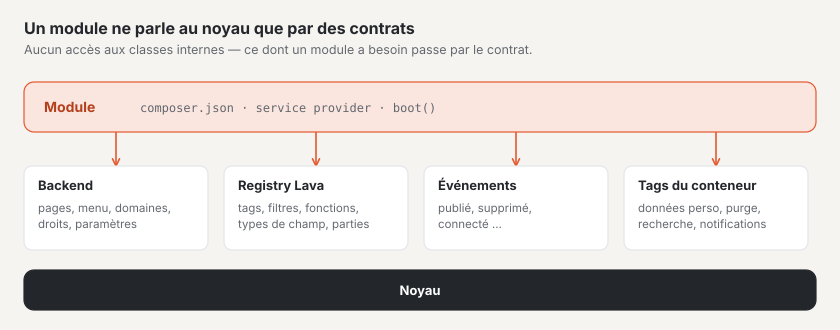

# Modules et plugins

Basalto dispose d’**une seule** interface d’extension pour les deux : les modules sont fournis avec Basalto (`modules/*`,
`basalto/module-*`), les plugins proviennent de tiers — techniquement, ils sont construits de la même manière. Une
extension ne s’adresse au noyau que par des contrats publics : l’interface du backend, le registre Lava,
les événements de domaine et les tags du conteneur. Ce dont un module a besoin, le contrat le reçoit — aucun accès aux classes internes.



Deux exemples sous `modules/` :

- `modules/example` — le plus petit module : une page du backend, une entrée de menu, une
  migration et des extensions Lava.
- `modules/comments` — un vrai module : balise Lava, route du frontend, modération avec compteur dans le
  menu, protection des données et purge.

## Structure d’un paquet

```text
modules/example/
├── composer.json                 paquet, fournisseur de services, manifeste
├── src/ExampleServiceProvider.php
├── src/Http/Controllers/…
├── database/migrations/…
├── lang/de/backend.php, lang/en/backend.php, lang/en.json …
└── resources/js/pages/Hello.vue  page Inertia « example::Hello »
```

### `composer.json` avec manifeste

```json
{
    "name": "basalto/module-example",
    "type": "library",
    "require": { "php": "^8.4", "basalto/core": "*" },
    "autoload": { "psr-4": { "Basalto\\Modules\\Example\\": "src/" } },
    "extra": {
        "laravel": {
            "providers": ["Basalto\\Modules\\Example\\ExampleServiceProvider"]
        },
        "basalto": {
            "module": "example",
            "name": "Beispiel",
            "api": 1,
            "lava": "example",
            "switchable": true
        }
    }
}
```

| Clé dans `extra.basalto` | Signification |
| --- | --- |
| `module` | Handle du module — minuscules, chiffres, `-` et `_` ; en même temps préfixe dans Lava et espace de noms des pages Inertia |
| `name` | Nom affiché |
| `api` | Version de l’interface d’extension, aujourd’hui `1` |
| `lava` | Espace de noms dans Lava (identique au handle) |
| `switchable` | si le module peut être activé et désactivé par site |
| `requires` | Handles d’autres modules dont il a besoin (p. ex. le Marketplace `["licensing"]`) — indication pour les humains et pour le Marketplace ; le noyau ne l’impose pas aujourd’hui |

Laravel trouve le fournisseur de services par Package Discovery (`extra.laravel.providers`). Le `composer.json` du
dossier principal de l’installation intègre tous les dossiers sous `modules/*` comme paquets locaux (`path`).

`Backend::module()` lit le manifeste et l’enregistre (`Backend::modules()`). Le fait qu’un module puisse être activé ou désactivé est déterminé par
le paramètre `switchable` lors de l’appel — l’entrée dans le manifeste n’est aujourd’hui qu’une indication (pour le Marketplace).

## Fournisseur de services

Tout se passe dans `boot()`. Le module d’exemple au complet :

```php
final class ExampleServiceProvider extends ServiceProvider
{
    public function boot(): void
    {
        $root = dirname(__DIR__);
        $this->loadTranslationsFrom($root.'/lang', 'example');
        $this->loadJsonTranslationsFrom($root.'/lang');
        $this->loadMigrationsFrom($root.'/database/migrations');

        $backend = $this->app->make(Backend::class);
        $backend->pages('example', $root.'/resources/js/pages');
        $backend->module('example', 'example::backend.title', composerJson: $root.'/composer.json');
        $backend->menu('example::backend.title', 'basalto.example', 50, Backend::MODE_CONTENT, module: 'example', icon: 'module');
        $backend->routes(static function (): void {
            Route::get('example', HelloController::class)->name('example');
        });

        $this->app->extend(Registry::class, static function (Registry $registry): Registry {
            $registry->module('example')
                ->function('example.greeting', static fn (mixed $name): string => 'Grüezi '.(string) $name)
                ->tag('example.cart', static function (array $args, array $named): string { /* … */ })
                ->fieldType('example.price', ['input' => 'number', 'step' => 0.05, 'currency' => 'CHF']);

            return $registry;
        });
    }
}
```

## Interface du backend : `Basalto\Core\Backend\Backend`

Un singleton dans le conteneur (`$this->app->make(Backend::class)`).

| Méthode | Signature | Objet |
| --- | --- | --- |
| `module` | `module(string $handle, string $label, bool $switchable = true, ?string $composerJson = null, bool $enabledByDefault = true): self` | Déclarer le module ; `$label` est une clé de traduction ; `$composerJson` fournit le manifeste ; `$enabledByDefault` à faux signifie désactivé d’usine |
| `menu` | `menu(string $label, string $route, int $order = 100, string $mode = self::MODE_CONTENT, ?string $module = null, ?string $icon = null): self` | Entrée de menu ; `$route` est un nom de route, `$mode` l’un de `MODE_CONTENT` (Contenus), `MODE_SETUP` (Configuration), `MODE_ADMIN` (Administration). Avec `$module`, l’entrée disparaît lorsque le module est désactivé pour le site |
| `count` | `count(string $route, Closure $count): self` | Compteur sur l’entrée de menu de cette route, par site : `fn (Site $site): int` |
| `pages` | `pages(string $namespace, string $directory): self` | Répertoire de pages Vue sous un espace de noms |
| `routes` | `routes(Closure $routes): void` | Routes sous le chemin du backend (`basalto.backend.path`, par défaut `admin`) avec le middleware du backend (`web`, `auth`, compte actif, choix du site, Inertia) et le préfixe de nom `basalto.` |
| `moduleEnabled` | `moduleEnabled(string $handle, Site $site): bool` | le module est-il activé pour ce site ? |
| `modules`, `menuItems`, `menuByMode`, `counts`, `pageNamespaces`, `path`, `middleware`, `vite` | — | Lecture pour le noyau |

Un exemple de `count()` tiré du module de commentaires — le nombre de commentaires en attente dans le menu :

```php
$backend->count('basalto.comments.index', static fn (Site $site): int => Comment::query()->withoutGlobalScopes()
    ->where('site_id', $site->id)->where('status', CommentStatus::Pending->value)->count());
```

### Routes

`routes()` ajoute le chemin du backend et le préfixe de nom : `Route::get('example', …)->name('example')` devient
`/admin/example` avec le nom `basalto.example` — en accord avec l’entrée de menu ci-dessus. Les routes hors du backend (par exemple
l’envoi de commentaires depuis le frontend), le module les crée lui-même :

```php
Route::post('comments/{entry}', CommentSubmissionController::class)->whereNumber('entry')
    ->middleware(['web', 'basalto.site'])->withoutMiddleware(ValidateCsrfToken::class)->name('basalto.comments.submit');
```

### Domaines et droits

Chaque route du backend appartient à un **domaine** avec un groupe (Contenus, Configuration, Administration). Le module déclare ses
domaines dans `boot()` et attribue les routes par préfixe ; certaines routes peuvent exiger un niveau plus élevé :

```php
app(Areas::class)->register('members', 'Mitglieder', Areas::CONTENT, 'members')
    ->map('basalto.members.', 'members')
    ->route('basalto.members.settings', 'members', Level::All);
```

Sans indication propre, GET exige « voir », DELETE « supprimer » et tout le reste « modifier ». Le middleware
`GuardAreaAccess` vérifie chaque requête, le menu masque les entrées sans droit. Les routes sans attribution exigent
« Paramètres · tout », et le test `AreaCoverageTest` les signale. Dans le code, on interroge
`Gate::allows('area', [$site, 'members', Level::Delete])` ou `Access::allows()` ; les langues sont vérifiées par
`Access::authorizeLocale()`. « Emprunter » le droit d’une autre capacité (par exemple `update` du site) n’est plus
nécessaire. Comment les exploitants règlent les rôles : [Rôles et droits](../betrieb/rollen.md).

### Pages Inertia avec espace de noms

Un contrôleur rend `Inertia::render('example::Hello', [...])` ; la partie avant `::` est l’espace de noms issu de
`pages()`, la partie après est le chemin de la page sans `.vue`. Le noyau utilise `core::…`.

```php
final class HelloController
{
    public function __invoke(Request $request): Response
    {
        $greeting = (new Renderer(app(Registry::class)))->render('{{ example.greeting(name) }}', ['name' => $request->user()->name ?? 'Gast']);

        return Inertia::render('example::Hello', ['greeting' => $greeting]);
    }
}
```

Le noyau intègre les pages de tous les modules fournis dans son bundle : `packages/core/resources/js/backend.ts` cherche
`modules/<namensraum>/resources/js/pages/<Seite>.vue`. L’espace de noms doit donc correspondre au nom du dossier sous `modules/`.
Un build propre pour les plugins de tiers (`resources/dist` avec manifeste via `vite()`) est encore
en suspens.

### Activable par site

Activer et désactiver les modules activables : Administration › Sites › Modifier le site › onglet « Modules ». L’enregistrement a lieu dans
`sites.settings.modules.<handle>` ; sans entrée, la valeur par défaut du module s’applique — généralement activé, avec `module(…, enabledByDefault: false)` désactivé d’usine (ainsi la vente de licences et le Marketplace, qui ne tournent que sur basaltocms.com). Les entrées de menu avec `module:`
disparaissent d’elles-mêmes. **Tout le reste, le module le vérifie lui-même** avec `moduleEnabled()` — c’est ce que fait le
module de commentaires dans le rendu de la balise, dans l’envoi et dans la modération :

```php
abort_if($site === null || ! $this->backend->moduleEnabled('comments', $site), 404);
```

Une fois le module désactivé, les données restent enregistrées.

## Étendre Lava : le registre

Lava n’appelle que ce qui est enregistré (`Basalto\Lava\Runtime\Registry`, une instance par application). Un module
étend l’instance dans le conteneur et n’enregistre **que sous son préfixe** — via `module('handle')`, qui fournit un
`Basalto\Lava\Runtime\ModuleRegistry`. Un nom sans préfixe, avec un préfixe étranger ou déjà
pris lève une `LogicException`. Les thèmes n’enregistrent jamais rien.

```php
$this->app->extend(Registry::class, static function (Registry $registry): Registry {
    $registry->module('comments')
        ->tag('comments.list', static fn (array $args, array $named, Context $ctx): string => app(CommentsRenderer::class)->render($named, $ctx));

    return $registry;
});
```

| Méthode du `ModuleRegistry` | Signature | Dans Lava |
| --- | --- | --- |
| `function` | `function(string $name, Closure $fn): self` — paramètres quelconques, pour un filtre le premier est la valeur | `{{ example.greeting(name) }}`, `{{ preis \| example.money }}` |
| `tag` | `tag(string $name, Closure $fn): self` — `fn (array $args, array $named, Context $ctx): string` | `` |
| `fieldType` | `fieldType(string $name, array $options = []): self` | `field preis: example.price` |
| `property` | `property(string $keyword, string $name): self` | propriété supplémentaire, p. ex. `property('type', 'example.sku')` → `example.sku:` dans un `type` |
| `part` | `part(string $name, string $label, array $settings, Closure $render): self` — `fn (array $settings, array $vars, string $lang): string` | partie Lava `part warenkorb: shop.cart { … }` |

Remarques :

- **Les balises renvoient du HTML** et échappent elles-mêmes (`htmlspecialchars`). `$args` sont les arguments positionnels, `$named` les
  arguments nommés ; `$ctx->get('page')` et `$ctx->get('site')` fournissent les variables de la page.
- **Les erreurs dans une fonction ou une balise** (mauvais type, argument manquant) deviennent une erreur Lava avec numéro de ligne ;
  le thème ne voit aucune pile PHP. Les limites du moteur de rendu s’appliquent (temps, boucles, profondeur).
- Les **types de champs** des modules sont connus du vérificateur (`basalto:check`), qui les propose (« `price` — vouliez-vous dire
  `example.price` ? »). Les options (`['input' => 'number', …]`) sont stockées par le registre (`fieldTypeOptions()`) ;
  le formulaire du backend ne les exploite pas encore.
- **Serveur de langage :** les noms enregistrés apparaissent dans la complétion et le survol ; le serveur de langage lit la signature
  dans la closure.

## Événements de domaine

Le noyau déclenche des événements Laravel avec une charge utile stable (espace de noms `Basalto\Core\Events`). Un module les écoute avec
`Event::listen(…)`.

| Événement | Charge utile | Quand |
| --- | --- | --- |
| `EntrySaved` | `Entry $entry, EntryVersion $version` | une version linguistique a été enregistrée (brouillon) |
| `VersionTransitioned` | `EntryVersion $version, EntryStatus $from, EntryStatus $to, ?string $comment` | une version a changé d’état dans le workflow |
| `VersionPublished` | `EntryVersion $version` | une version est en ligne |
| `MediaUploaded` | `Media $media` | un média a été téléversé |
| `MediaTrashed` | `Media $media, int $usages` | un média a été mis à la corbeille (avec le nombre de contenus qui l’intègrent encore) |
| `MediaRestored` | `Media $media` | un média a été restauré depuis la corbeille |
| `SiteCreated` | `Site $site` | un site a été créé |
| `SiteUpdated` | `Site $site, array $before, array $after` | données de base d’un site modifiées |
| `UserLoggedIn` | `Authenticatable $user, string $method` | connexion au backend (code, lien ou passkey) |

Toutes les propriétés sont `public readonly`.

Qui veut notifier des personnes lors d’un événement — dans la cloche et par e-mail, selon leurs réglages — déclare
une sorte et appelle `Notify` : voir [Notifications](benachrichtigungen.md).

## Protection des données : tags du conteneur

Les données personnelles dans les tables des modules se rattachent au droit d’accès, à la suppression et à la purge du noyau par deux tags du conteneur.
Les deux attendent une **closure** dans le conteneur.

| Tag | Appelé par | Signature de la closure | Retour |
| --- | --- | --- | --- |
| `basalto.person-data` | `Basalto\Core\Privacy\PersonData` (`basalto:privacy`, profil et gestion des utilisateurs dans le backend) | `fn (string $email, bool $delete): array` | pour le droit d’accès, une liste par sorte (ajoutée au rapport), pour la suppression, un nombre par sorte |
| `basalto.cleanup` | `basalto:cleanup` (chaque jour à 03:00) | `fn (Settings $settings): array` | par sorte, le nombre d’enregistrements supprimés ; apparaît dans la sortie et dans le journal |

Voici comment le module de commentaires rattache les deux :

```php
$this->app->instance('basalto.person-data.comments', (new CommentPersonData)(...));
$this->app->tag(['basalto.person-data.comments'], 'basalto.person-data');
$this->app->instance('basalto.cleanup.comments', CommentPersonData::cleanup(...));
$this->app->tag(['basalto.cleanup.comments'], 'basalto.cleanup');
```

`CommentPersonData::__invoke(string $email, bool $delete): array` fournit `['kommentare' => [...]]` ou
`['kommentare' => $anzahl]` ; `CommentPersonData::cleanup(Settings $settings): array` supprime, par site, le spam et
les éléments supprimés après le délai `comments.retention_days` (par défaut 365) et fournit `['Kommentare' => $anzahl]`. L’adresse
e-mail arrive en minuscules et sans espaces ; la recherche porte sur tous les sites.

## Compte frontend et pages protégées

Le **compte frontend** appartient au noyau (`Basalto\Core\FrontendAccounts`). La vente de licences, le Marketplace et les membres le partagent sans dépendre les uns des autres. Les anciens noms issus de la vente de licences
(`Basalto\Modules\Licensing\Accounts\Customer`, `CustomerAuth`, `CustomerLogin`, `CustomerLoginCode`,
`Frontend\LoginForm`, `Http\CustomerLoginController`, `Http\Middleware\…`, `Notifications\CustomerLoginCodeNotification`)
subsistent sous forme de `class_alias` et sont considérés comme obsolètes ; le nouveau code utilise les noms du noyau. Un alias est la même classe
(`instanceof` vaut pour les deux noms) — seules les comparaisons sur le nom de classe en tant que chaîne (par exemple
`Notification::assertSentTo(…, AlterName::class)`) voient le nom du noyau.

| Interface | Objet |
| --- | --- |
| `CustomerAuth::useFor('modul', ?Policy::class)` | Le module utilise le compte (dans `boot()`). Les routes `POST /account/login`, `/account/code`, `/account/logout` et la page de connexion `GET /account/login` ne répondent sur un site que si l’un des modules utilisateurs est activé. |
| `RegistrationPolicy::opensRegistration(Site)` | La connexion peut-elle créer de nouveaux comptes sur le site ? Sans règle, oui. Si aucun des modules activés ne l’autorise, les codes ne sont envoyés qu’aux adresses disposant d’un compte (la réponse au navigateur reste la même). |
| `CustomerAuth::current()` · `::available(Site)` · `::MIDDLEWARE` (`basalto.customer`) | Qui est connecté (uniquement les comptes du site de la requête), si le compte existe sur le site, middleware pour les routes réservées aux comptes |
| `LoginForm::render($request, $lang, $pfad, $intro, $zweck)` | Le formulaire de connexion pour des balises propres ; `$zweck` (p. ex. `members`) revient après le code sous la forme `CustomerSignedIn::$purpose` |
| Événement `Events\CustomerSignedIn` (`customer`, `site`, `purpose`) | Après le bon code — les membres créent ainsi l’adhésion la première fois |

**Sections du compte client :** la balise `` (partie Lava « Compte client », réglages `buy`, `entry`, `catalog`, `start`) affiche tout le compte : un en-tête compact avec salutation, à gauche les sections en navigation (nombre, point d’attention), à droite toujours une seule — d’abord la vue d’ensemble avec « À faire ensuite », une tuile par section et « Récemment ». Chaque section a l’ancre `#konto-<key>` ; une ancre n’importe où dans une section (`#lizenz-12`) ouvre cette section. Un module apporte une section en enregistrant dans `boot()` une classe — `app(AccountAreas::class)->add(MaSection::class)` — qui implémente `Basalto\Core\FrontendAccounts\Hub\AccountArea` :

| Méthode | Rôle |
| --- | --- |
| `key()` · `position()` | Ancre `#konto-<key>` et ordre (sites 10, licences 20, installations 30, Marketplace 40, compte auteur 45, communauté 50, factures 60, profil 90) |
| `pitch($page)` | Pour les visiteurs : symbole, titre et une phrase (`AreaPitch`) — ou `null` |
| `summary($page)` | Connecté : `AreaSummary` avec libellé, symbole, nombre, ton (`lava`, `warn`), tâches (`AreaTodo`), événements (`AreaEvent`), boutons (`AreaAction`) et messages — `null` masque la section |
| `render($page, $summary)` | Le contenu de la section ; le compte pose le cadre, le titre et l’ancre |

La section est recréée à chaque affichage et peut garder des données entre `summary()` et `render()`. `AccountPage` fournit site, langue, chemin, requête, compte connecté et `t()` pour les textes, `Icons::svg()` les symboles du compte. Éléments du balisage : `konto-zeilen` avec `konto-zeile`, `konto-sechseck`, `konto-chip`, `konto-knopf`, `konto-leer`, `konto-klappe`.

**Pages protégées :** le noyau connaît la protection (onglet « Accès », `access.protected`, héritée via
`access.children` ; `Pages::isProtected()`), n’admet les pages protégées dans la navigation et les listes que pour les personnes autorisées et ne les admet jamais dans
le plan du site, l’index de recherche et les flux, et répond aux visiteurs par 401 (aux personnes connectées sans droit par 403). Qui peut les voir,
un module le décide via `PageAccess::useGate(Gate::class)` avec le contrat `Basalto\Core\Content\ProtectedPageGate`
(`enabled`, `adminUrl`, `allows`, `denied`, `login`) ; sans module, seule la rédaction du site dans le backend les voit. Les
listes propres d’un module interrogent `app(PageAccess::class)->mayView($entry)`.

**Protection des données :** `PersonData` appelle d’abord les modules (`basalto.person-data`) et **ensuite** les comptes frontend du
noyau — un module retrouve donc encore ses données lors de la suppression via l’e-mail du compte ; il n’a pas besoin d’anonymiser le compte.

## Obligations d’une extension

Ce que chaque extension doit respecter :

1. **Portée du site** sur chaque table contenant des contenus d’un site : colonne `site_id` et, dans le modèle, le trait
   `Basalto\Core\Sites\BelongsToSite` (portée globale sur le site courant, `site_id` à la création) — avec un test
   montrant qu’un deuxième site ne voit rien.
2. **Traductions** de l’interface (DE, EN, IT, FR) sous `lang/` ; les libellés de menu sont des clés de traduction.
3. **Migrations** dans le paquet (`loadMigrationsFrom`), jamais dans le noyau.
4. **Données personnelles** : les rattacher à `basalto.person-data` et, s’il y a des délais, à `basalto.cleanup`.
5. **Export :** chaque table avec `site_id` doit être incluse dans l’export du site ou exclue avec justification — sinon, un test du
   noyau échoue. Une interface permettant aux modules d’exporter eux-mêmes leurs tables est encore en suspens ; d’ici
   là, la justification figure dans `Basalto\Core\Transfer\SiteExporter::EXCLUDED` (comme pour le module de commentaires).

## Pour continuer

- [Lava — le langage des thèmes](lava.md)
- [Notifications](benachrichtigungen.md)
- [API REST](api.md)
