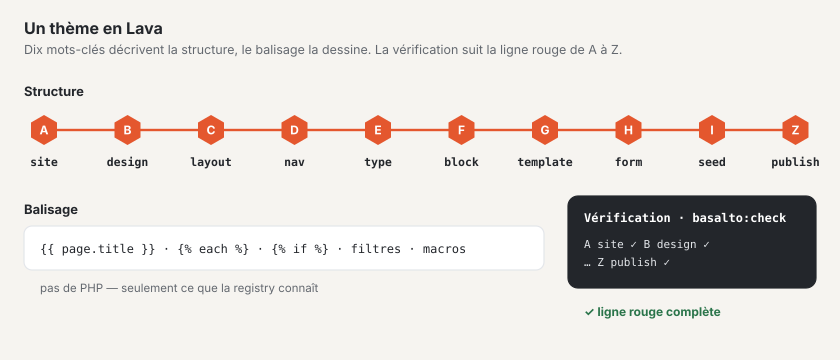

# Lava — le langage des thèmes

Lava décrit un thème entier dans un seul langage : la structure (site, design, mises en page, menus, types de contenu, blocs,
modèles, formulaires, contenus de départ, publication) et le balisage. Le balisage connaît les sorties, les boucles, les conditions,
les macros, les filtres et les fonctions — mais pas de PHP. Un thème ne peut donc exécuter aucun code ni rien enregistrer ;
Lava ne s’étend que par le registre du noyau et des modules ([Modules et plugins](erweiterungen.md)).

La référence pour la syntaxe est la grammaire dans `packages/lava/grammar/lava-1.ebnf` (voir [Grammaire](#grammaire)).



## Structure d’un thème

Un thème est un dossier sous `themes/` (ou sous `BASALTO_THEMES_PATH`). Le modèle de départ est
`themes/starter`, voir [Thèmes](themes.md).

| Fichier ou dossier | Obligatoire | Objet |
| --- | --- | --- |
| `theme.lava` | oui | Point d’entrée. Commence par la ligne de version `lava 1` (si elle manque, le vérificateur émet un avertissement). Peut intégrer d’autres fichiers `.lava` avec `include "datei.lava"` — uniquement au niveau supérieur, uniquement à l’intérieur du dossier, sans cycle. |
| `<ordner>/<name>.lava.html` | non | Balisage d’un élément dans un fichier propre plutôt que dans la clôture : `layouts/`, `blocks/`, `templates/`, `navs/`, `parts/`. Le fichier l’emporte sur la clôture de la définition. |
| `assets/` | non | Feuilles de style, scripts, polices, images — livrés sans build. Extensions autorisées : `css`, `js`, `svg`, `woff2`, `woff`, `png`, `jpg`, `jpeg`, `webp`, `avif`, `ico`. L’adresse contient une somme de contrôle (`/_theme/{site}/{hash}/{pfad}`), chaque modification en reçoit une nouvelle. |
| `assets/preview.(webp\|png\|jpg\|svg)` | non | Image d’aperçu dans Configuration › Thèmes (recherchée dans cet ordre). |
| `theme.json` | non | Indications pour la gestion des thèmes et le paquet : `label`, `author`, `version`, `license`, `description`. Sans `label`, c’est le nom issu de `site` qui s’applique ; sans `version`, `basalto:theme-pack` emballe en `0.0.0`. |

```json
{
    "label": "Starter",
    "author": "Basalto",
    "version": "1.0.0",
    "license": "MIT",
    "description": "Das Beispiel-Theme von Basalto …"
}
```

## La partie structure en bref

```lava
lava 1

# commentaire jusqu’à la fin de la ligne (sauf si « # » commence une couleur comme #b53f1d)
site starter {
  name: "Starter"
  languages: de, en            # liste, virgules facultatives
  default: de
  domain: example.ch
}

type page {
  label: "Seite"  label.en: "Page"        # suffixe de langue de deux minuscules
  field title: text required translatable # élément avec type et drapeaux après « : »
  field content: blocks { allow: hero, text }
  route: /{slug}                           # chemin avec espace réservé
  template: default                        # référence à une définition
}

layout landing extends standard {          # modificateur après le nom
  region hero before main
}
```

- Les **éléments** ont la forme `wort name: typ flags { … }` ; les **propriétés** la forme `schluessel: werte`.
- **Valeurs :** chaînes entre `"…"` ou `'…'`, nombres, `true`/`false`, couleurs `#rgb` à `#rrggbbaa`, chemins `/…`,
  références (mots nus) et flèches `->` (cible d’une entrée de menu ou d’un lien dans le seed).
- **Les retours à la ligne comptent :** ils terminent une propriété. Un élément par ligne, lorsque seules des valeurs suivent.
- Le **balisage** se trouve dans une clôture après le mot `markup` (trois accents graves avant et après, comme en Markdown) ou dans
  un fichier `.lava.html` (voir ci-dessus). La clôture est reprise telle quelle ; l’indentation commune est supprimée.
- **Variantes de langue :** `label.en`, `label.it`, `label.fr` … valent dans la langue concernée ; la valeur sans suffixe
  est en allemand. S’il manque une langue, Basalto prend l’anglais, puis seulement la valeur sans suffixe — une interface
  en français affiche donc « Hero » plutôt que « Bühne » tant que `label.fr` manque.
- **La logique appartient au balisage :** une valeur contenant `{{` ou `{%` dans une partie structure déclenche un avertissement.

## Les dix mots-clés et la ligne rouge A–Z

Un thème répond à dix questions, une station par question. `php artisan basalto:check` et la configuration dans le backend
affichent la même ligne (source : `Basalto\Lava\Diagnostics\Step`, `Basalto\Lava\Theme\Line`).

| Station | Mot-clé | Question | Propriétés · sous-éléments |
| --- | --- | --- | --- |
| A | `site` | Qui suis-je ? | `name languages default domain redirects timezone` |
| B | `design` | À quoi est-ce que je ressemble ? | `space radius images css logo` · `color font images palette` |
| C | `layout` | Où se trouve quoi ? | `region`, balisage ; plus les parties Lava `part` |
| D | `nav` | Comment s’oriente-t-on ? | `from items depth start exclude only label` · `item`, balisage |
| E | `type` | Quels contenus existe-t-il ? | `label route template` · `field` ; plus `global` (`label` · `field`) |
| F | `block` | De quoi se composent les pages ? | `label group hint` · `field`, balisage |
| G | `template` | Comment un contenu est-il affiché ? | `for layout noindex` · `region`, balisage |
| H | `form` | Comment me joindre ? | `label to subject thanks spam submit store redirect webhook retain consent` · `field` |
| I | `seed` | Par quoi est-ce que je commence ? | `page global` et chaque nom de type (`post …`, `person …`) |
| Z | `publish` | Peut-on mettre en ligne ? | `seo sitemap robots cookie legal redirects check` · `seo legal redirects` |

**Présentation sombre :** une couleur dans `design` peut porter une deuxième valeur pour le mode sombre, `color text: #23262b dark #ebe8e3`.
Elle s’applique lorsque les visiteurs choisissent « Sombre » avec `` ; sans choix, la page est claire,
même avec un système d’exploitation en mode sombre. Les couleurs sans valeur sombre valent dans les deux présentations. `basalto:check` calcule les
contrastes également pour la palette sombre.

**Variantes de couleurs :** un thème peut apporter des variantes de couleurs dans `design` (`palette`) ; le site en
choisit une sous Configuration › Design.

```lava
design {
  color accent: #3b1f2b dark #e3b98a
  palette salbei {
    label: "Salbei"  label.en: "Sage"  label.fr: "Sauge"  label.it: "Salvia"
    color accent: #23402f dark #a9cf9a
  }
}
```

Chaque ligne de la variante remplace entièrement la ligne du même nom dans `design`, valeur sombre comprise : si elle
n’en indique aucune, sa valeur claire vaut aussi en sombre. Les couleurs que la variante ne nomme pas restent comme dans
le thème ; une couleur que `design` ne connaît pas est un avertissement. Les couleurs propres du site se posent
par-dessus la variante. `basalto:check` calcule les contrastes de chaque variante, en clair et en sombre. Pour qu’une
variante agisse partout, la feuille de style n’utilise que des variables (`var(--color-…)`), aucune valeur de couleur
fixe — pas même pour les bandeaux sombres : des noms comme `dark-link` existent pour cela.

**Logo dans les e-mails :** l’en-tête de chaque e-mail montre le logo du site. Gmail et Outlook n’affichent pas le SVG —
placez donc à côté du logo le même fichier en PNG (`logo: assets/logo.svg` → `assets/logo.png`) en taille triple : l’e-mail
affiche un tiers des pixels (126 pixels de haut → 42 pixels). Un logo large (logotype) est seul, un symbole avec le nom du
site à côté ; sans PNG, le nom s’affiche. Un logo de la médiathèque apparaît s’il est en PNG, JPEG ou GIF. Si votre logo est
sombre, placez-le dans le PNG sur une surface claire et arrondie en `#f6f4f0`, la couleur du fond de l’e-mail : en mode
sombre, l’application Gmail et Outlook assombrissent elles-mêmes l’e-mail, mais pas les images — sans surface, un logo
sombre disparaît ; avec elle, il se détache sur un écusson clair.

**Blocs dans la palette :** `group` attribue un bloc à un groupe de la palette dans l’éditeur, `hint` est une
phrase en dessous — les deux avec des variantes linguistiques comme `label` :

```lava
block hero {
  label: "Bühne"  label.en: "Hero"
  group: "Einstieg"  group.en: "Intro"
  hint: "Grosser Titel mit Einleitung, Bild und Knöpfen — oben auf der Seite."
  field title: text required translatable
}
```

Sans `group`, l’éditeur classe d’après les champs (image et titre avec bouton → « Ouverture », répétitions →
« Listes et grilles », bouton sans image → « Actions », aucun champ de contenu → « À partir des données », sinon « Texte » ou « Images ») ;
sans `hint`, ce sont les noms des champs qui s’affichent. Le **schéma** de chaque carte est dessiné par l’éditeur lui-même à partir des champs : un
titre (`title`, `heading`) comme barre épaisse, le texte courant comme lignes, une image (`image` ou un champ texte `art`,
`cover`, `logo`) comme surface d’image, les liens comme boutons, les répéteurs comme cartes, nombres, étapes ou questions dépliables
(d’après leurs champs `question`, `value`). Les champs d’accompagnement comme `art_overlay` ou `cta_label` ne dessinent rien en propre.

**Champs dans le formulaire :** ce que la rédaction voit dans le formulaire du bloc provient du champ — le tout avec des
variantes linguistiques comme `label` :

```lava
block hero {
  field title: text required translatable { label: "Titel"  label.en: "Title"  placeholder: "z. B. Willkommen" }
  field cta: link { label: "Knopf" }
  field cta_label: text translatable { label: "Beschriftung des Knopfs"  help: "Leer = Titel der Zielseite"  from: "cta.label" }
  field art_credit: text advanced { label: "Bildnachweis" }
}
```

- `label` — le libellé. Sans lui, l’éditeur tire du nom un texte lisible (`cta_label` → « Bouton ·
  Libellé », `art_overlay` → « Image · Graphique superposé ») ; les noms de champs en majuscules n’apparaissent plus.
- `help` — une phrase sous le champ ; `placeholder` — un exemple dans le champ vide.
- `from` — le champ dont la valeur s’applique tant que celui-ci est vide ; le champ vide l’affiche sous la forme « vide = « … » ». Un
  champ `x_label` à côté d’un lien `x` se comporte ainsi même sans `from`. Le balisage continue de décider lui-même
  (`{{ cta_label | default(cta.label) }}`) — `from` ne fait que l’expliquer à la rédaction.
- `pick: image` sur un champ texte (une adresse d’image comme `art`) — le formulaire affiche la médiathèque sous forme de dialogue avec
  téléversement et glisser-déposer ; c’est `media:<id>` qui est enregistré, et le balisage reçoit l’adresse de l’image. Un fichier
  sous `assets/` du thème peut toujours être saisi ; `asset()` laisse les adresses complètes (`https://…`) inchangées.
- Drapeau `advanced` — le champ figure sous « Plus de possibilités ». Sans `advanced` dans le bloc, les champs obligatoires,
  les champs remplis et, pour chaque sorte, le premier champ figurent en haut (texte, texte courant, image, lien, blocs imbriqués, répéteur),
  complétés jusqu’à trois ; les blocs comptant jusqu’à quatre champs affichent tout.

Il existe en outre au niveau supérieur `global` (compte pour E), `part` (compte pour C) et `include` (aucune station). Les modules
peuvent enregistrer d’autres propriétés par mot-clé (toujours avec un préfixe, p. ex. `example.sku`).

### État par station

- `✓` — la station est présente et sans erreur ; suivie d’un résumé (p. ex. « 2 langues », « 11 blocs »).
- `✗` — une erreur de cette station (la première avec numéro de ligne et suggestion) ou le mot-clé manque (« `nav` manque »).
- `–` — uniquement pour Z : « attend les étapes précédentes », tant qu’une station antérieure a `✗` et que `publish` manque.

« Ligne rouge complète — prête pour publish » apparaît lorsque les dix stations ont `✓` et qu’il n’y a aucune erreur.
Les avertissements (`!`) n’arrêtent pas la ligne.

### Ce que vérifie chaque station

Pour toutes les stations : un mot-clé inconnu est une **erreur** avec suggestion (« `desing` — vouliez-vous dire
`design` ? »). Les propriétés et sous-éléments inconnus sont des **avertissements** avec suggestion — ils ne cassent pas le thème.

| Station | Erreurs (`✗`) | Avertissements (`!`) |
| --- | --- | --- |
| A `site` | — | propriété inconnue |
| B `design` | valeur de couleur autre que `#rgb`, `#rrggbb` ou `#rrggbbaa` (aussi dans les variantes de couleurs) ; variante de couleurs sans nom ; `css` autre que `.css`, `logo` autre que `.svg/.png/.webp/.jpg/.jpeg`, `src` de police autre que `.woff2/.woff` ; fichier absent du dossier du thème | contraste inférieur à WCAG 2.2 AA (4,5:1 pour le texte) pour les paires `text`, `muted`, `link` sur `background` ainsi que `X-text`, `X-muted`, `X-link` ou `on-X` sur `X` — aussi pour chaque variante de couleurs ; variante de couleurs avec une couleur, une propriété ou un sous-élément inconnus |
| C `layout`, `part` | `extends` vers une mise en page inconnue ; syntaxe du balisage ; région avec un `part`, `nav` ou `global` inexistant ; partie d’une sorte inconnue ; partie sans `source:` (pour `nav`, `global`, `form`, `sitemap`, `list`) ou avec une source inconnue | réglage que la sorte de la partie ne connaît pas ; balisage imbriqué sur plus de 6 niveaux `each`/`if` |
| D `nav` | entrée de menu sans cible `-> …` ; la cible n’est pas une page issue de `seed` ; `only:`/`exclude:` nomme un modèle inconnu ; `from:` n’est ni `pages` ni un type ; `items:` autre que `db` ; syntaxe du balisage | imbrication |
| E `type`, `global` | champ sans type ; type de champ inconnu (noyau et modules, avec suggestion) ; `blocks { allow: … }` avec un bloc inconnu ; `relation <typ>` avec un type inconnu (autorisés : `form`, `page`, `global` ou un type du thème) ; `template:` inconnu | — |
| F `block` | comme E pour les champs ; syntaxe du balisage | imbrication |
| G `template` | sans `for:` ou pour un type inconnu ; sans `layout:` ou mise en page inconnue ; région que la mise en page (y compris `extends`) ne possède pas ; `nav`, `global` ou `part` dans une région inexistante ; syntaxe du balisage | imbrication |
| H `form` | champ de formulaire sans type ou avec un type inconnu ; `select`/`radio` sans `options:` ; de même pour les champs dans `group` | — |
| I `seed` | page avec un `template:` inconnu ; bloc dans `content { … }` qui n’existe pas | `{{`/`{%` dans des valeurs (logique dans la structure) |
| Z `publish` | `legal { … }` exige une page qui manque dans `seed` | — |

Types de champs du noyau : `text textarea richtext blocks markdown number checkbox bool date datetime select tags image
gallery file link relation repeater slug email url color code seo json` — plus ceux des modules (`example.price`).

Types de champs de formulaire : `text email number tel url date textarea select radio checkbox file range hidden explanation group`.

Ce que `basalto:publish` vérifie en plus par rapport à la base de données (`check: links, images, alt-texts, translations, forms`
ainsi que, toujours, la ligne rouge, les pages juridiques et les redirections) figure dans `Basalto\Core\Publish\PublishChecks`.

## Balisage

Le balisage se trouve dans la clôture d’un `layout`, `nav`, `block`, `template` ou `part` (sorte `html`) ou dans le fichier
`.lava.html` correspondant.

### Sorties, commentaires, variables

```lava
{{ page.title }}                 {# toujours échappé en HTML #}
{{ raw body }}                   {# non échappé — uniquement pour le texte courant de l’éditeur (richtext), que le noyau nettoie #}
{{ title | upper }}              {# filtre #}
{{ count(items) }}               {# fonction #}
{# commentaire, n’apparaît pas dans la sortie #}

```

L’accès avec `.` et `[…]` ne fonctionne que sur les tableaux et les propriétés publiques, jamais sur les méthodes. Un nom inconnu
donne `null` ; une fonction sans parenthèses est une erreur.

| Variable | Où | Contenu |
| --- | --- | --- |
| `site.name`, `site.language`, `site.domain`, `site.logo` | partout | site issu de `site`, langue courante, adresse du logo |
| `site.cancellation` | partout | adresse de « Résilier des contrats ici » — vide là où rien ne se résilie |
| `page.*` | pages | `title`, `intro`, champs du type, `url`, `path`, `locale`, `is_home`, `canonical`, `image`, `alternates` (chacun avec `locale`, `url`), `breadcrumbs` |
| `content` | balisage du modèle | les blocs rendus de la page (à sortir avec `{{ raw content }}`) |
| `regions.<name>` | balisage de la mise en page | `true` si la région a du contenu (p. ex. ``) |
| noms des champs, `block.name`, `block.index` | balisage du bloc | valeurs des champs du bloc, nom et position du bloc |
| `nav.name`, `nav.label`, `nav.items` | balisage de la navigation | pour chaque entrée `href`, `label`, `current`, `active`, `new_window` |
| `loop.index`, `loop.index0`, `loop.first`, `loop.last`, `loop.length` | dans `each` | compteurs de la boucle |

### Boucles et conditions

```lava

  <li>{{ loop.index }}. {{ item.title }}</li>

  <li>Noch nichts da.</li>


{{ key }}={{ value }}

………
```

### Expressions

| Sorte | Notation |
| --- | --- |
| Logique | `and` `&&` · `or` `\|\|` · `not` `!` |
| Comparaison | `==` `!=` `<` `>` `<=` `>=` · `in`, `not in` (liste ou sous-chaîne) |
| Calcul | `+` `-` `*` `/` `%` (la division par zéro est une erreur) |
| Concaténation | `~` (`"Seite " ~ loop.index`) |
| Conditionnelle | `a if bedingung else b` |
| Littéraux | nombres, `"…"`/`'…'`, `true`, `false`, `null`, listes `[1, 2]`, maps `{ key: wert }` |

Mots réservés : `and or not in if else true false null as with`.

### Macros et inclusions

```lava
<a class="card" href="{{ href }}">{{ title }}</a>

   {# trois appels équivalents #}

{{ card("Kontakt", "/kontakt") }}

       {# lit parts/card.lava.html ; « with » transmet des variables #}
```

`include` lit `<pfad>.lava.html` dans le thème — jamais en dehors du dossier. Si la valeur après `with` est une map,
ses clés deviennent des variables ; sinon, elle s’appelle `item`.

### Balises

Une balise s’écrit `` ; les arguments sont séparés par des espaces ou des virgules.

| Balise | Effet |
| --- | --- |
| `` | jeu de caractères, viewport, variables de design du site et feuilles de style du thème — en premier dans `<head>` |
| `` | sélecteur clair/sombre pour les visiteurs (soleil/lune, choix enregistré dans le navigateur) — uniquement si `design` a des couleurs sombres |
| `` | titre, description, canonical, `robots` et indications Open Graph de la page (issus de `publish.seo` et des données de la page) |
| `` | contenu d’une région (dans le balisage de la mise en page) |
| `` · `` · `` | navigation, partie Lava ou formulaire à cet endroit |
| `` | image avec une variante issue de `design.images` (WebP avec `srcset`, source AVIF, largeur et hauteur, `loading`) |
| `` | lien issu d’un champ `link` |
| `` | sortir un texte échappé |
| `` · `` | fil d’Ariane et changement de langue avec le balisage standard (balisage propre via `page.breadcrumbs` et `page.alternates`) |
| `` · `` | partager : e-mail et réseaux sous forme de simples liens (rien ne part avant le clic), « Copier le lien » et le partage de l’appareil ; adresse et titre de la page s’ils ne sont pas indiqués |
| `` · `` · `` | pagination, catégories et archives pour `entries()` |
| `` | formulaire de recherche et résultats du site — par mots, sans distinction de casse ni d’accents |
| `` | blocs imbriqués d’un champ `blocks` (déjà rendus) |
| `` · `` | voir ci-dessus |
| `` | commentaires (module `comments`) ; les modules apportent leurs propres balises avec préfixe |
| `` · `` · `` | connexion/déconnexion, formulaire de connexion et adhésion (module `members`, voir ci-dessous) |

Une balise inconnue échoue au rendu, pas à la vérification.

### Balises des membres

Le module « Membres » (`members`) apporte trois balises — également sous forme de parties Lava du même nom, donc dans une
région (`region header: part konto`) ou comme bloc d’une page. Les trois ne sortent **rien** lorsque le module est désactivé pour
le site. Si le module est totalement absent de l’installation, une balise échoue au rendu (comme toute balise inconnue) —
c’est pourquoi, dans un thème qui doit aussi fonctionner sans le module, elle figure dans une condition :

```lava
<div class="header-account"></div>
```

`site.modules` nomme les modules activés pour le site (`site.modules.comments`, `site.modules.members` …).

| Balise | Visiteurs | Connecté | Réglages |
| --- | --- | --- | --- |
| `` | lien « Se connecter » (`a.members-link`) vers la page de connexion | bouton « Se déconnecter » (`form.members-link.is-signed-in`) | `login: "/pfad"` — cible de « Se connecter » ; sinon la page de connexion issue des paramètres des membres ou `/account/login` |
| `` | connexion par code envoyé par e-mail (`section.account-login#konto-anmeldung`) — qui se connecte ainsi adhère selon la règle du site | « Connecté en tant que … · Se déconnecter » (`form.account-signed-in`) | — |
| `` | comme `members.login` | état de l’adhésion (`section.members-panel#konto`) : active depuis …, en attente de validation, bloquée, pas d’invitation — ou « Devenir membre » (`form.members-join`) — plus « Se déconnecter » | — |

Les pages protégées affichent d’elles-mêmes la connexion aux visiteurs (la page d’erreur 401 du site ou une page « Connexion
requise » dans la mise en page du thème, à la place de `page.intro`, sinon au début de `<main>`) ; le
thème n’a pas besoin de balise pour cela. Pour les visiteurs, la sortie est la même pour tous et peut provenir du cache des pages (la première étape de la
connexion n’a pas de jeton CSRF) ; qui est connecté ne reçoit jamais de page issue du cache. Les classes
`account-login`, `account-form`, `account-intro`, `account-status`, `account-signed-in`, `members-panel`,
`members-state` (avec `is-active`, `is-pending`, `is-blocked`, `is-none`), `members-join`, `members-link` ainsi que les
classes de formulaire du noyau (`form`, `form-field`, `form-error`, `form-help`) peuvent être mises en forme. Le thème Starter montre un exemple.

### Limites

Lors du rendu s’appliquent au maximum 10 000 itérations de boucle, 2 secondes et une imbrication (inclusion, macro,
boucle, condition) jusqu’à la profondeur 8 (`Basalto\Lava\Runtime\Limits`) ; au-delà, le rendu s’interrompt par une erreur Lava
avec numéro de ligne. Le vérificateur avertit dès 7 niveaux `each`/`if`. Une erreur PHP dans une fonction enregistrée devient
une erreur Lava avec numéro de ligne — le thème ne voit jamais de pile PHP.

## Parties Lava

Une **partie** est un élément de construction prêt à l’emploi avec des réglages, défini une fois et placé dans des régions ou dans le balisage :

```lava
part main_nav: nav {
  source: main
  label: "Hauptnavigation"  label.en: "Main navigation"
}
part lang_switch: languages

layout standard {
  region header: part main_nav, part lang_switch    # remplissage par défaut de la région
  region main
  …
}
```

Dans le balisage, la même partie s’écrit ``. Les parties comptent pour la station C.

| Sorte | Libellé | Réglages | Sortie |
| --- | --- | --- | --- |
| `nav` | Navigation | `source depth start only exclude label` | la navigation `source` ; les réglages de l’instance remplacent ceux de la `nav` |
| `breadcrumbs` | Fil d’Ariane | — | fil d’Ariane de la page |
| `languages` | Changement de langue | — | liens vers les versions linguistiques |
| `global` | Contenu global | `source` | champs du contenu global |
| `form` | Formulaire | `source` | le formulaire |
| `sitemap` | Plan du site HTML | `source depth start only exclude label` | tous les niveaux de la navigation `source` |
| `search` | Recherche | — | comme `` |
| `list` | Liste | `source per label` | contenus les plus récents du type `source` |
| `html` | HTML | — | balisage propre dans la clôture de la partie |

Les modules enregistrent leurs propres sortes avec préfixe (`shop.cart`), voir [Modules et plugins](erweiterungen.md).

Ce qu’une région peut encore contenir (dans la mise en page par défaut, dans le modèle par type) : `content`, `content.first`,
`content.rest` (les blocs de la page, en entier ou partagés), `nav <name>`, `global <name>`, `part <name>`,
`breadcrumbs`, `languages`.

À ne pas confondre avec deux autres formes de réutilisation :

- `include "datei.lava"` au niveau supérieur insère une **structure** supplémentaire dans `theme.lava`. Une définition nommée
  qui existe déjà avec la même sorte et le même nom (par exemple `nav main`) remplace la précédente. C’est ainsi que le Lava d’un site — intégré à la
  fin — remplace un menu ou un bloc du thème ; la démo s’en sert pour son propre menu principal.
- `` dans le balisage intègre un **fichier de balisage** `parts/karte.lava.html`.

## Filtres et fonctions

Les filtres et les fonctions forment une seule et même liste : `{{ wert | name(a, b) }}` appelle `name(wert, a, b)`. Ils sont enregistrés
dans `Basalto\Lava\Runtime\Registry::standard()` ; `entries` est défini par l’application lors du rendu d’une page.

| Nom | Appel | Résultat |
| --- | --- | --- |
| `count` | `count(liste)` | nombre d’éléments, sinon `0` |
| `length` | `text \| length` | caractères d’un texte (Unicode) ou nombre d’éléments |
| `upper`, `lower` | `text \| upper` | majuscules ou minuscules (Unicode) |
| `truncate` | `text \| truncate(100, "…")` | raccourci à n caractères, fin ajoutée (par défaut 100 et `…`) |
| `date` | `datum \| date("d.m.Y")` | date au format PHP, par défaut `d.m.Y` ; accepte un horodatage ou un texte de date |
| `join` | `liste \| join(", ")` | éléments joints, par défaut `, ` |
| `first`, `last` | `liste \| first` | premier ou dernier élément |
| `keys` | `map \| keys` | clés d’une map |
| `default` | `wert \| default("–")` | remplacement lorsque la valeur est `null`, vide ou une liste vide |
| `json` | `wert \| json` | JSON (Unicode et `/` non échappés) |
| `range` | `range(1, 5)` | liste de a à b, 10 000 éléments au maximum |
| `url` | `"blog/a" \| url` | adresse avec `/` initial ; `http…` reste inchangé |
| `t` | `text \| t` | le texte inchangé — espace réservé, aucune traduction n’a encore lieu |
| `nl2br` | `{{ raw text \| nl2br }}` | échappe et insère `<br />` — à sortir donc avec `raw` |
| `replace` | `text \| replace("a", "b")` | remplace chaque occurrence |
| `slug` | `text \| slug` | minuscules, tout ce qui n’est pas `a–z` ou `0–9` devient `-` (les trémas disparaissent : « Zürich » → `z-rich`) |
| `entries` | `entries("post", 10)` · `entries("event", 6, "kommend")` | contenus publiés d’un type avec pagination (pour chaque entrée, entre autres `url`, `title`, `date`, `intro`, `category`, `category_url`, `author`). La troisième valeur choisit l’ordre : `neu` (par défaut : champ `date`, sinon publication, le plus récent d’abord), `alt`, `kommend` (seulement les contenus avec leur propre `date` à partir d’aujourd’hui, le plus proche d’abord — événements) ou `reihenfolge` (champ `position`, sinon la place dans l’arborescence — carte, chambres). Les versions plus anciennes de Basalto l’ignorent et trient du plus récent au plus ancien |
| `asset` | `asset("demo/editor.svg")` | adresse d’un fichier sous `assets/` du thème (images, graphiques), avec somme de contrôle — vide si le fichier manque |

Les fonctions des modules portent le préfixe du module, p. ex. `{{ example.greeting(name) }}` ou
`{{ preis | example.money }}`. Les noms connus d’une installation apparaissent dans la complétion du serveur de langage.

## Vérifier : `php artisan basalto:check`

```text
basalto:check [--theme=THEME] [--site=SITE] [--json]
```

| Option | Signification |
| --- | --- |
| `--theme=` | Répertoire du thème relatif à l’installation, par exemple `themes/starter` — à indiquer toujours |
| `--site=` | Handle d’un site : vérifie le thème que le site utilise réellement — depuis la base de données (`lava_sources`) s’il en a un, sinon le dossier |
| `--json` | ligne et constats au format JSON (`line`, `diagnostics`) |

La commande se termine avec le code 0 sans erreur, sinon 1. Les avertissements ne modifient pas le code.

Sur le thème Starter :

```text
$ php artisan basalto:check --theme=themes/starter
Theme «starter» (Dateien)
A site       ✓ starter · 2 Sprachen · example.ch
B design     ✓ 14 Farben · 3 Schriften
C layout     ✓ standard (4 Regionen) · landing (1 Regionen)
D nav        ✓ main · legal
E type       ✓ page · post · person · footer
F block      ✓ 11 Blöcke
G template   ✓ default · landing · post · legal
H form       ✓ contact → ohne Empfänger
I seed       ✓ 8 Seiten · 1 globale Inhalte
Z publish    ✓ Sitemap true · Prüfungen: links, images, alt-texts, translations, forms
Rote Linie vollständig — bereit für publish.
```

Avec une erreur (un modèle renvoie à une mise en page mal orthographiée, extrait) :

```text
G template   ✗ Template «default» verweist auf unbekanntes Layout «standart» — meinten Sie «standard»? (Zeile 78)
  ✗ [G] Template «default» verweist auf unbekanntes Layout «standart» (theme.lava:78:1) — meinten Sie «standard»?
```

Chaque constat indique la station, le message, le fichier, la ligne et la colonne et — s’il y en a une — une suggestion. Les erreurs de
lecture (fichier `include` manquant ou circulaire) ne portent pas de station ; la ligne affiche alors toutes les stations comme
manquantes.

## Grammaire

La syntaxe complète figure en EBNF dans
`packages/lava/grammar/lava-1.ebnf` : partie structure, lexique, balisage,
expressions et — en commentaire — les propriétés par mot-clé. Les modifications au sein de `lava 1` sont uniquement
additives ; les formes existantes restent valides, une rupture serait `lava 2`.

## Pour continuer

- [Thèmes](themes.md)
- [Serveur de langage pour Lava](sprachdienst.md)
- [Modules et plugins](erweiterungen.md)
